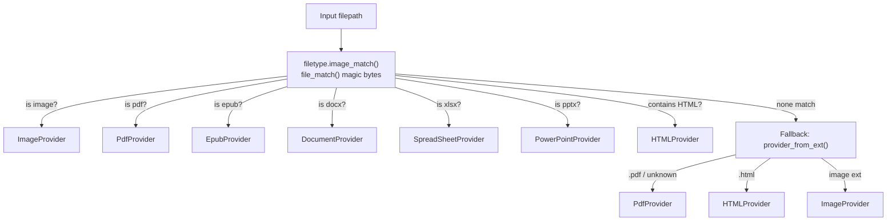
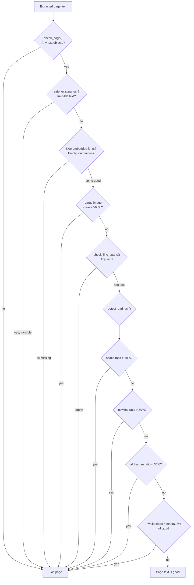

# Marker Providers — Input Format Detection and Normalization

**Marker's provider layer reads 8 input formats and normalizes them into a common `ProviderOutput` format (lines + spans + character data).** Each provider is responsible for extracting text with polygon positions from its specific file type. The `provider_from_filepath()` registry in `marker/providers/registry.py` auto-detects the file type using magic bytes and file extensions, routing to the correct provider class.

Source: `marker/providers/` — 8 files

## Provider Registry



The two-level detection in `registry.py:59-83`:

```python
# marker/providers/registry.py:59-83
def provider_from_filepath(filepath: str):
    if filetype.image_match(filepath) is not None:
        return ImageProvider
    if file_match(filepath, load_matchers("pdf")) is not None:
        return PdfProvider
    if file_match(filepath, load_matchers("epub")) is not None:
        return EpubProvider
    if file_match(filepath, load_matchers("doc")) is not None:
        return DocumentProvider
    if file_match(filepath, load_matchers("xls")) is not None:
        return SpreadSheetProvider
    if file_match(filepath, load_matchers("ppt")) is not None:
        return PowerPointProvider

    # Try parsing as HTML
    try:
        with open(filepath, "r", encoding="utf-8") as f:
            soup = BeautifulSoup(f.read(), "html.parser")
            if bool(soup.find()):
                return HTMLProvider
    except Exception:
        pass

    # Fallback to extension-based detection
    return provider_from_ext(filepath)
```

**Aha:** The registry tries magic bytes first (via `filetype` library), then HTML parsing, then extension-based fallback. The HTML detection is a heuristic: if BeautifulSoup finds ANY HTML tag, it routes to `HTMLProvider`. This means a plain text file containing `<div>` would be treated as HTML — but the fallback chain makes this acceptable since Marker is for document conversion, not text files.

## Provider Type Map

| DOCTYPE_MATCHERS Key | filetype Matchers | Extensions |
|---------------------|-------------------|------------|
| `"image"` | `IMAGE` (PNG, JPG, GIF, WebP, TIFF, BMP, …) | `.png`, `.jpg`, `.jpeg`, `.gif`, `.webp`, `.tiff`, `.bmp` |
| `"pdf"` | `archive.Pdf` | `.pdf` |
| `"epub"` | `archive.Epub` | `.epub` |
| `"doc"` | `document.Docx` | `.docx` |
| `"xls"` | `document.Xlsx` | `.xlsx` |
| `"ppt"` | `document.Pptx` | `.pptx` |

Source: `marker/providers/registry.py:14-25`

## BaseProvider Interface

Every provider extends `BaseProvider`:

```python
# marker/providers/__init__.py
class BaseProvider:
    def __init__(self, filepath: str, config=None): ...
    def __len__(self) -> int: ...           # Page count
    def get_images(self, idxs: List[int], dpi: int) -> List[Image.Image]: ...
    def get_page_bbox(self, idx: int) -> PolygonBox: ...
    def get_page_lines(self, idx: int) -> List[ProviderOutput]: ...
    def get_page_refs(self, idx: int) -> List[Reference]: ...
```

The core output type is `ProviderOutput`:

```python
# marker/providers/__init__.py
class ProviderOutput(BaseModel):
    line: Line        # The line block with polygon
    spans: List[Span] # Text spans with font info
    chars: List[List[Char]]  # Optional character-level data
```

## PdfProvider — The Most Complex Provider

`PdfProvider` (`marker/providers/pdf.py`, 452 lines) is the workhorse. It handles PDF text extraction via pdfium + pdftext, with extensive bad-OCR detection.

### Configuration Options

```python
# marker/providers/pdf.py:29-82
class PdfProvider(BaseProvider):
    page_range: List[int] = None          # Which pages to process
    pdftext_workers: int = 4              # Parallel workers for pdftext
    flatten_pdf: bool = True              # Flatten PDF forms before extraction
    force_ocr: bool = False               # Skip pdftext, use Surya OCR only
    ocr_invalid_chars: tuple = (chr(0xFFFD), "�")
    ocr_space_threshold: float = 0.7      # Max space ratio for good text
    ocr_newline_threshold: float = 0.6    # Max newline ratio for good text
    ocr_alphanum_threshold: float = 0.3   # Min alphanumeric ratio
    image_threshold: float = 0.65         # Max image coverage to keep page
    strip_existing_ocr: bool = False      # Remove invisible OCR text layers
    disable_links: bool = False
    keep_chars: bool = False              # Keep character-level data
```

### Text Extraction: pdftext_extraction()

```python
# marker/providers/pdf.py:202-304
def pdftext_extraction(self, doc: PdfDocument) -> ProviderPageLines:
    page_char_blocks = dictionary_output(
        self.filepath, page_range=self.page_range,
        keep_chars=self.keep_chars, workers=self.pdftext_workers,
        flatten_pdf=self.flatten_pdf, quote_loosebox=False,
        disable_links=self.disable_links,
    )
    # For each page, iterate blocks → lines → spans
    for page in page_char_blocks:
        for block in page["blocks"]:
            for line in block["lines"]:
                spans = []
                for span in line["spans"]:
                    # Extract font info, formats (bold, italic), superscript/subscript
                    font_formats = self.font_flags_to_format(span["font"]["flags"])
                        .union(self.font_names_to_format(span["font"]["name"]))
                    spans.append(SpanClass(
                        polygon=PolygonBox.from_bbox(span["bbox"]),
                        text=fix_text(span["text"]),
                        font=span["font"]["name"] or "Unknown",
                        font_weight=span["font"]["weight"] or 0,
                        font_size=span["font"]["size"] or 0,
                        formats=list(font_formats),
                        url=span.get("url"),
                        has_superscript=span.get("superscript", False),
                        has_subscript=span.get("subscript", False),
                    ))
```

### Font Flag Decoding

PDF font flags are bit-encoded integers. `font_flags_to_format()` decodes them:

```python
# marker/providers/pdf.py:127-176
def font_flags_to_format(self, flags: Optional[int]) -> Set[str]:
    flag_map = {
        1: "FixedPitch", 2: "Serif", 3: "Symbolic", 4: "Script",
        6: "Nonsymbolic", 7: "Italic", 17: "AllCap", 18: "SmallCap",
        19: "ForceBold", 20: "UseExternAttr",
    }
    # Decode bits, then apply heuristics:
    # "Symbolic + Italic" → "plain"
    # "ForceBold" → "bold"
    # "Italic" → "italic"
```

The funky logic is necessary because PDF fonts sometimes encode "Symbolic" alongside "Italic" for symbol fonts that happen to be italic — these should NOT be marked as italic in the output.

### Bad OCR Detection Pipeline

`PdfProvider` has multiple checks to determine if PDF text extraction produced usable text:



```python
# marker/providers/pdf.py:379-401
def detect_bad_ocr(self, text):
    if len(text) == 0:
        return True
    spaces = len(re.findall(r"\s+", text))
    alpha_chars = len(re.sub(r"\s+", "", text))
    if spaces / (alpha_chars + spaces) > self.ocr_space_threshold:
        return True
    newlines = len(re.findall(r"\n+", text))
    non_newlines = len(re.sub(r"\n+", "", text))
    if newlines / (newlines + non_newlines) > self.ocr_newline_threshold:
        return True
    if alphanum_ratio(text) < self.ocr_alphanum_threshold:
        return True
    invalid_chars = len([c for c in text if c in self.ocr_invalid_chars])
    if invalid_chars > max(6.0, len(text) * 0.03):
        return True
    return False
```

**Aha:** The OCR quality thresholds are tuned for the common failure modes of PDF text extraction. A space ratio above 70% means the extracted text is mostly whitespace (failed encoding). A newline ratio above 60% means every character is on its own line (positioning data but no word grouping). Invalid characters (>6 or >3% of text) means the encoding is corrupted. Each threshold was empirically determined from real-world PDF failures.

### Page-Level Checks

`check_page()` performs per-page validation:

```python
# marker/providers/pdf.py:321-377
def check_page(self, page_id: int, doc: PdfDocument) -> bool:
    page_objs = list(page.get_objects(filter=[
        pdfium_c.FPDF_PAGEOBJ_TEXT, pdfium_c.FPDF_PAGEOBJ_IMAGE
    ]))
    # Skip pages with no text objects
    if not any([obj.type == pdfium_c.FPDF_PAGEOBJ_TEXT for obj in page_objs]):
        return False

    if self.strip_existing_ocr:
        # Skip pages where text is invisible (hidden OCR layer)
        for text_obj in ...:
            if pdfium_c.FPDFTextObj_GetTextRenderMode(text_obj) in [
                pdfium_c.FPDF_TEXTRENDERMODE_INVISIBLE,
                pdfium_c.FPDF_TEXTRENDERMODE_UNKNOWN,
            ]:
                return False
        # Skip if ALL fonts are non-embedded (likely garbled)
        # Skip if large images cover >65% of page
```

## ImageProvider

For image files (PNG, JPG, etc.), `ImageProvider` has no text extraction — everything goes through Surya OCR:

```python
# marker/providers/image.py
class ImageProvider(BaseProvider):
    def __init__(self, filepath: str, config=None):
        # Opens the image, treats it as a single-page document
        # Page lines are empty — all OCR happens in OcrBuilder
```

## Office Document Providers

Document, SpreadSheet, and PowerPoint providers use their respective Python libraries (python-docx, openpyxl, python-pptx) to extract text with page-like segmentation.

## Cross-References

- [Architecture](01-architecture.md) — How providers feed into builders
- [Builders](03-builders.md) — How LayoutBuilder, LineBuilder, and OcrBuilder consume provider output

## Next

→ [Builders](03-builders.md) — How the four builders construct the Document object graph from provider output.
