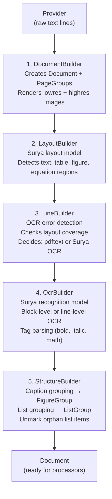

# Marker Builders — Constructing the Document Object Graph

**The four builders transform raw provider output into a typed Document object graph.** Each builder adds one layer of structure: `DocumentBuilder` creates the page containers, `LayoutBuilder` runs Surya layout detection to find block regions, `LineBuilder` assigns text lines into layout blocks and determines which pages need OCR, `OcrBuilder` runs Surya text recognition on blocks that need it, and `StructureBuilder` groups related blocks (captions with figures, consecutive list items).

Source: `marker/builders/` — 5 files

## Builder Pipeline



## 1. DocumentBuilder

`DocumentBuilder` (`marker/builders/document.py`, 53 lines) creates the Document shell and coordinates the three sub-builders.

```python
# marker/builders/document.py:31-37
def __call__(self, provider, layout_builder, line_builder, ocr_builder):
    document = self.build_document(provider)
    layout_builder(document, provider)
    line_builder(document, provider)
    if not self.disable_ocr:
        ocr_builder(document, provider)
    return document
```

**Aha:** The `disable_ocr` flag is a fast path for documents where PDF text extraction is known good. When set, `OcrBuilder` is skipped entirely, saving the cost of running the Surya recognition model on hundreds of text lines.

The Document shell is created by rendering each page at two resolutions:

```python
# marker/builders/document.py:39-53
def build_document(self, provider):
    lowres_images = provider.get_images(provider.page_range, self.lowres_image_dpi)   # 96 DPI
    highres_images = provider.get_images(provider.page_range, self.highres_image_dpi) # 192 DPI
    initial_pages = [
        PageGroupClass(
            page_id=p,
            lowres_image=lowres_images[i],
            highres_image=highres_images[i],
            polygon=provider.get_page_bbox(p),
            refs=provider.get_page_refs(p)
        ) for i, p in enumerate(provider.page_range)
    ]
    return DocumentClass(filepath=provider.filepath, pages=initial_pages)
```

**Why two resolutions?** Low-res (96 DPI) is for layout detection — it's fast and sufficient for finding block regions. High-res (192 DPI) is for OCR — text recognition needs more pixel detail for accurate character recognition.

## 2. LayoutBuilder

`LayoutBuilder` (`marker/builders/layout.py`, 162 lines) runs the Surya `LayoutPredictor` model to identify block regions on each page.

```python
# marker/builders/layout.py:51-58
def __call__(self, document, provider):
    if self.force_layout_block is not None:
        layout_results = self.forced_layout(document.pages)
    else:
        layout_results = self.surya_layout(document.pages)
    self.add_blocks_to_pages(document.pages, layout_results)
    self.expand_layout_blocks(document)
```

### Surya Layout Model

```python
# marker/builders/layout.py:86-92
def surya_layout(self, pages):
    self.layout_model.disable_tqdm = self.disable_tqdm
    layout_results = self.layout_model(
        [p.get_image(highres=False) for p in pages],
        batch_size=int(self.get_batch_size()),
    )
    return layout_results
```

Batch sizes scale by device: CUDA → 12, MPS/CPU → 6.

### Block Type Assignment

Each layout detection box has a label (e.g., "Text", "Figure", "Table") and a position. `add_blocks_to_pages()` instantiates the correct block class:

```python
# marker/builders/layout.py:131-153
def add_blocks_to_pages(self, pages, layout_results):
    for page, layout_result in zip(pages, layout_results):
        for bbox in sorted(layout_result.bboxes, key=lambda x: x.position):
            block_cls = get_block_class(BlockTypes[bbox.label])
            layout_block = page.add_block(block_cls, PolygonBox(polygon=bbox.polygon))
            layout_block.polygon = layout_block.polygon.rescale(
                layout_page_size, provider_page_size
            ).fit_to_bounds((0, 0, *provider_page_size))
            layout_block.top_k = {
                BlockTypes[label]: prob
                for (label, prob) in bbox.top_k.items()
                if label in BlockTypes.__members__
            }
            page.add_structure(layout_block)
```

**Aha:** The `top_k` field preserves the model's full probability distribution over block types. A block might be 80% Text, 15% Code, 5% other — this is stored and later used by processors like `BlockRelabelProcessor` to fix misclassifications. Without `top_k`, a near-tie between Text and Code would be lost.

### Layout Block Expansion

After layout detection, `expand_layout_blocks()` grows Picture, Figure, and ComplexRegion blocks to fill gaps:

```python
# marker/builders/layout.py:94-129
def expand_layout_blocks(self, document):
    for page in document.pages:
        for block_id in page.structure:
            block = document.get_block(block_id)
            if block.block_type in self.expand_block_types:
                other_blocks = [b for b in page_blocks if b != block]
                if not other_blocks:
                    block.polygon = block.polygon.expand(
                        self.max_expand_frac, self.max_expand_frac
                    ).fit_to_bounds((0, 0, *page_size))
                    continue
                min_gap = min(
                    block.polygon.minimum_gap(other.polygon)
                    for other in other_blocks
                )
                if min_gap <= 0:
                    continue
                x_expand_frac = min_gap / block.polygon.width if block.polygon.width > 0 else 0
                y_expand_frac = min_gap / block.polygon.height if block.polygon.height > 0 else 0
                block.polygon = block.polygon.expand(
                    min(self.max_expand_frac, x_expand_frac),
                    min(self.max_expand_frac, y_expand_frac),
                ).fit_to_bounds((0, 0, *page_size))
```

This is a clever heuristic: expand visual blocks into empty space, but only up to 5% of their size and only if no other block occupies that space. This captures parts of images or figures that the layout model missed due to irregular shapes.

## 3. LineBuilder

`LineBuilder` (`marker/builders/line.py`, 370 lines) is the decision engine: pdftext or OCR?

### Decision Algorithm

```python
# marker/builders/line.py:138-168
def get_all_lines(self, document, provider):
    ocr_error_detection_results = self.ocr_error_detection(document.pages, provider.page_lines)

    for document_page, ocr_error_label in zip(document.pages, ocr_error_detection_results.labels):
        document_page.ocr_errors_detected = ocr_error_label == "bad"
        provider_lines = provider.page_lines.get(document_page.page_id, [])
        provider_lines_good = all([
            bool(provider_lines),
            not document_page.ocr_errors_detected,
            self.check_layout_coverage(document_page, provider_lines),
            self.check_line_overlaps(document_page, provider_lines),
        ])
```

A page's text is considered "good" (use pdftext) only if ALL four conditions pass:
1. There are provider lines (not empty)
2. OCRErrorPredictor says "good" (not garbled)
3. Layout blocks are covered by text lines (≥25% coverage ratio)
4. Lines don't overflow page bounds or overlap each other

### Layout Coverage Check

```python
# marker/builders/line.py:281-327
def check_layout_coverage(self, document_page, provider_lines):
    # Count how many layout blocks have at least 1 intersecting text line
    for idx, layout_block in enumerate(layout_blocks):
        intersecting_lines = np.count_nonzero(intersection_matrix[idx] > 0)
        if intersecting_lines >= self.layout_coverage_min_lines:  # default: 1
            covered_blocks += 1

    coverage_ratio = covered_blocks / total_blocks if total_blocks > 0 else 1
    # Special case: single large text block → always OK (model often does this on blank pages)
    if not text_okay and (total_blocks == 1 and large_text_blocks == 1):
        text_okay = True
    return text_okay  # threshold: 0.25
```

**Aha:** The single-block exception handles a common Surya layout failure mode: on blank or near-blank pages, the layout model outputs one large "Text" block covering the whole page. The coverage check would fail (no text lines), but the page is actually blank — marking it for OCR would waste compute. The exception short-circuits correctly.

### Detection Model (Line-Level)

When pdftext is bad, `LineBuilder` runs the Surya `DetectionPredictor` to find individual text line bounding boxes:

```python
# marker/builders/line.py:102-103
provider_lines, ocr_lines = self.get_all_lines(document, provider)
self.merge_blocks(document, provider_lines, ocr_lines)
```

OCR lines are created as dummy `Line` blocks with no spans — the actual text gets filled in by `OcrBuilder`.

### OCR Error Detection

The `OCRErrorPredictor` model classifies page text as "good" or "bad":

```python
# marker/builders/line.py:234-249
def ocr_error_detection(self, pages, provider_page_lines):
    page_texts = []
    for document_page in pages:
        provider_lines = provider_page_lines.get(document_page.page_id, [])
        page_text = "\n".join(
            " ".join(s.text for s in line.spans) for line in provider_lines
        )
        page_texts.append(page_text)

    ocr_error_detection_results = self.ocr_error_model(
        page_texts, batch_size=int(self.get_ocr_error_batch_size())
    )
    return ocr_error_detection_results
```

The model classifies at the page-text level: if the extracted text looks garbled, the page gets OCR'd.

## 4. OcrBuilder

`OcrBuilder` (`marker/builders/ocr.py`, 410 lines) runs Surya text recognition on blocks that need it.

### Block Mode vs Line Mode

The critical decision in `select_ocr_blocks_by_mode()`:

```python
# marker/builders/ocr.py:108-118
def select_ocr_blocks_by_mode(self, page, block, block_lines, page_max_intersection_pct):
    if any([
        page_max_intersection_pct > self.block_mode_intersection_thresh,  # 0.5
        block.block_type not in self.full_ocr_block_types,
        len(block_lines) > self.block_mode_max_lines,                      # 15
        block.polygon.height >= self.block_mode_max_height_frac * page.polygon.height  # 0.5
    ]):
        return block_lines  # Line mode
    return [block]          # Block mode
```

**Aha:** Block mode (OCR the entire block as one image) produces better results for short text like headers, list items, and footnotes because the model sees more context. But it degrades for long text blocks where the line structure matters. The fallback rules ensure block mode only activates for blocks that are ≤15 lines, ≤50% of page height, and don't overlap other blocks. This dual-mode approach is what gives Marker its accuracy — it uses the right OCR strategy per block type.

### Skip OCR Blocks

```python
# marker/builders/ocr.py:40-52
skip_ocr_blocks = [
    BlockTypes.Equation,      # Handled by EquationProcessor
    BlockTypes.Figure,        # No text to OCR
    BlockTypes.Picture,       # No text to OCR
    BlockTypes.Table,         # Handled by TableProcessor
    BlockTypes.Form,          # Handled by LLMFormProcessor
    BlockTypes.TableOfContents,
]
```

These blocks get their text from other processors — the `OcrBuilder` skips them to avoid redundant work.

### Surya Recognition and Tag Parsing

The recognition model outputs text with XML-like formatting tags. `spans_from_html_chars()` parses these:

```python
# marker/builders/ocr.py:306-409
def spans_from_html_chars(self, chars, page, image):
    for char in chars:
        if char.text == "<br>":
            # End current span, flush line
            ...
        is_opening_tag, format = get_opening_tag_type(char.text)
        if is_opening_tag and format not in formats:
            formats.add(format)
            # Start new span with current formats (bold, italic, math, etc.)
            ...
        is_closing_tag, format = get_closing_tag_type(char.text)
        if is_closing_tag:
            formats.remove(format)
            # End current span
            ...
```

Tags like `<b>`, `<i>`, `<math>` are parsed character-by-character. The `formats` set tracks active formatting — spans are split whenever formatting changes.

## 5. StructureBuilder

`StructureBuilder` (`marker/builders/structure.py`, 127 lines) groups related blocks:

### Caption Grouping

```python
# marker/builders/structure.py:34-77
def group_caption_blocks(self, page):
    for block_id in static_page_structure:
        block = page.get_block(block_id)
        if block.block_type not in [BlockTypes.Table, BlockTypes.Figure, BlockTypes.Picture]:
            continue
        # Check previous block: is it a Caption/Footnote within gap_threshold?
        # Check next block: is it a Caption/Footnote?
        # If either match → create FigureGroup/TableGroup/PictureGroup
```

The group block is dynamically looked up: `BlockTypes[block.block_type.name + "Group"]`. This convention means `Figure` → `FigureGroup`, `Table` → `TableGroup`, etc.

### List Grouping

```python
# marker/builders/structure.py:79-114
def group_lists(self, page):
    for block_id in static_page_structure:
        block = page.get_block(block_id)
        if block.block_type != BlockTypes.ListItem:
            continue
        # Walk forward, collecting consecutive ListItems within gap_threshold
        if len(block_structure) > 1:
            group_block = page.add_block(ListGroup, new_polygon)
            group_block.structure = block_structure
```

### Unmark Orphan Lists

```python
# marker/builders/structure.py:116-127
def unmark_lists(self, page):
    # If a ListItem wasn't grouped, it's probably not actually a list item
    for block_id in page.structure:
        block = page.get_block(block_id)
        if block.block_type == BlockTypes.ListItem:
            generated_block = Text(polygon=block.polygon, ...)
            page.replace_block(block, generated_block)
```

This corrects Surya layout false positives where a single line of text was misclassified as a `ListItem`.

## Cross-References

- [Providers](02-providers.md) — How provider output feeds the builders
- [Processors](04-processors.md) — What happens after the document is built
- [Architecture](01-architecture.md) — The resolve_dependencies system that wires builders

## Next

→ [Processors](04-processors.md) — The 28 post-processors that clean, enhance, and transform the document.
