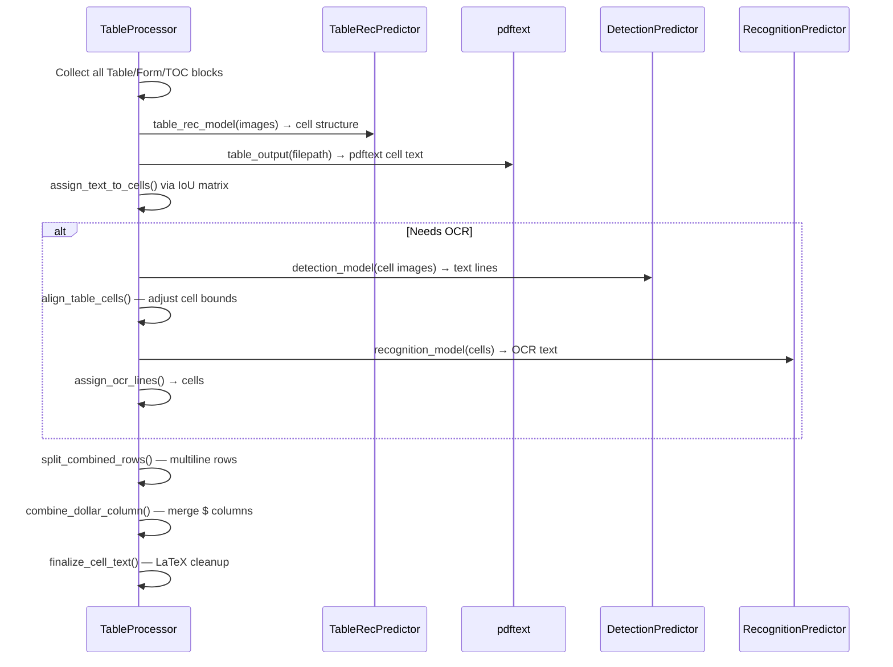

# Marker Processors — The 27-Stage Post-Processing Pipeline

**The processor pipeline is the heart of Marker's intelligence.** After builders construct the raw Document graph, 27 processors run in a specific order to clean, enhance, classify, and format every block. Each processor targets specific `block_types` and mutates the Document in place.

Source: `marker/processors/` — 23 files (17 heuristic + 11 LLM processors in `llm/`)

## Processor Architecture

Every processor implements the `BaseProcessor` interface:

```python
# marker/processors/__init__.py:10-17
class BaseProcessor:
    block_types: Tuple[BlockTypes] | None = None

    def __init__(self, config=None):
        assign_config(self, config)

    def __call__(self, document: Document, *args, **kwargs):
        raise NotImplementedError
```

`block_types` acts as a filter: processors that target specific block types only iterate over those. Processors with `block_types = None` process the entire document.

## Default Processor Pipeline (In Order)

```python
# marker/converters/pdf.py:74-103
default_processors = (
    OrderProcessor,            #  1. Assign reading order
    BlockRelabelProcessor,     #  2. Fix block type labels
    LineMergeProcessor,        #  3. Merge continuation lines
    BlockquoteProcessor,       #  4. Detect blockquotes
    CodeProcessor,             #  5. Detect code blocks
    DocumentTOCProcessor,      #  6. Build table of contents
    EquationProcessor,         #  7. Detect equations from LaTeX
    FootnoteProcessor,         #  8. Link footnotes to references
    IgnoreTextProcessor,       #  9. Mark boilerplate text for removal
    LineNumbersProcessor,      # 10. Strip line numbers
    ListProcessor,             # 11. Detect list structure
    PageHeaderProcessor,       # 12. Detect page headers/footers
    SectionHeaderProcessor,    # 13. Detect section headings
    TableProcessor,            # 14. Full table recognition pipeline
    LLMTableProcessor,         # 15. [LLM] Fix table structure
    LLMTableMergeProcessor,    # 16. [LLM] Merge split tables
    LLMFormProcessor,          # 17. [LLM] Detect form fields
    TextProcessor,             # 18. Merge text across pages/columns
    LLMComplexRegionProcessor, # 19. [LLM] Handle mixed-content regions
    LLMImageDescriptionProcessor, # 20. [LLM] Generate alt text
    LLMEquationProcessor,      # 21. [LLM] Fix equation formatting
    LLMHandwritingProcessor,   # 22. [LLM] Recognize handwriting
    LLMMathBlockProcessor,     # 23. [LLM] Detect display math blocks
    LLMSectionHeaderProcessor, # 24. [LLM] Improve heading classification
    LLMPageCorrectionProcessor, # 25. [LLM] Page-level OCR correction
    ReferenceProcessor,        # 26. Process internal references
    BlankPageProcessor,        # 27. Remove blank pages
    DebugProcessor,            # 28. Save debug data
)
```

## Processor Flow

```mermaid
flowchart TD
    subgraph Structural["Structural Processors"]
        Order["1. OrderProcessor<br/>Assigns reading order by Y→X position"]
        Relabel["2. BlockRelabelProcessor<br/>Fixes block type misclassifications<br/>Uses top_k probabilities"]
        LineMerge["3. LineMergeProcessor<br/>Merges continuation lines<br/>across pages"]
    end

    subgraph Detection["Detection Processors"]
        Blockquote["4. BlockquoteProcessor<br/>Detects quote blocks"]
        Code["5. CodeProcessor<br/>Detects code blocks<br/>Monospaced font + indentation"]
        DocTOC["6. DocumentTOCProcessor<br/>Builds TOC from headers"]
        Equation["7. EquationProcessor<br/>Detects LaTeX math"]
        Footnote["8. FootnoteProcessor<br/>Links footnote→reference"]
        IgnoreText["9. IgnoreTextProcessor<br/>Marks page boilerplate"]
        LineNums["10. LineNumbersProcessor<br/>Strips code line numbers"]
        List["11. ListProcessor<br/>Detects ordered/unordered lists"]
    end

    subgraph PageLevel["Page-Level Processors"]
        PageHeader["12. PageHeaderProcessor<br/>Identifies running headers"]
        SectionHeader["13. SectionHeaderProcessor<br/>Finds headings + assigns levels"]
    end

    subgraph Heavy["Heavy Processors"]
        Table["14. TableProcessor<br/>Full table rec pipeline<br/>703 lines, most complex processor"]
    end

    subgraph LLM["LLM Processors (use_llm=True only)"]
        LLMTable["15-17. LLM table/form"]
        LLMComplex["19-25. LLM region, equation,<br/>handwriting, math block,<br/>section header, page correction"]
    end

    subgraph Final["Final Processors"]
        TextMerge["18. TextProcessor<br/>Merges text across columns/pages"]
        Reference["26. ReferenceProcessor<br/>Processes internal links"]
        BlankPage["27. BlankPageProcessor<br/>Removes empty pages"]
        Debug["28. DebugProcessor<br/>Saves debug images/JSON"]
    end

    Order --> Relabel --> LineMerge --> Blockquote --> Code --> DocTOC
    DocTOC --> Equation --> Footnote --> IgnoreText --> LineNums --> List
    List --> PageHeader --> SectionHeader --> Table
    Table --> LLMTable --> TextMerge --> LLMComplex
    LLMComplex --> Reference --> BlankPage --> Debug
```



## Key Processors in Detail

### 14. TableProcessor — The Most Complex Processor

`TableProcessor` (`marker/processors/table.py`, 720 lines) is the most substantial processor. Its pipeline:



**Cell Text Cleanup** is particularly thorough:

```python
# marker/processors/table.py:187-219
def finalize_cell_text(self, cell):
    text = re.sub(r"\s?[.\-_…]{2,}", "", text)     # Remove "...", "- - -"
    text = re.sub(r"\\mathbf\{([0-9.,$€£]+)\}", r"<b>\1</b>", text)  # Unwrap mathbf
    text = re.sub(r"\\[a-zA-Z]+\{\s*\}", "", text)  # Drop empty tags
    text = re.sub(r"\\phantom\{.*?\}", "", text)    # Drop phantom
    text = re.sub(r"\\quad", "", text)               # Drop quad
    text = re.sub(r"\\mathsf\{([^}]*)\}", r"\1", text)  # Unwrap mathsf
    text = unwrap_math(text)  # Unwrap if no more LaTeX
    text = fix_text(text)
```

**Aha: Dollar column combination.** Many numeric tables have a standalone column of "$" signs that would look terrible in markdown. `combine_dollar_column()` detects columns where every cell is "" or "$" and merges the "$" into the start of the next column's text. The check is defensive: it only applies when the dollar column has the same number of rows as the next column, no cells span into it, and all colspans are 1.

**Aha: Row splitting.** When all cells in a row have the same number of text lines (>1), the row is split into multiple actual rows. This handles tables where the table recognition model merged adjacent rows because their visual gap was too small. The split threshold is configurable: at least 50% of rows in the table must qualify before any splitting happens, preventing single-row anomalies from splitting valid merged cells.

### 18. TextProcessor — Cross-Page and Cross-Column Merging

```python
# marker/processors/text.py:27-101
def __call__(self, document):
    for page in document.pages:
        for block in page.contained_blocks(document, self.block_types):
            next_block = document.get_next_block(block, self.ignored_block_types)
            # Check: is next block on same page but in different column?
            column_break = (next_block at similar Y but X is past block + column_gap)
            # Or: is next block on next page, in first quadrant?
            page_break = (next_block.page_id != block.page_id)

            if last_line_is_full_width or last_line_is_hyphentated:
                if not next_block_starts_indented:
                    block.has_continuation = True
```

**Aha:** The `has_continuation` flag set by `TextProcessor` controls how the markdown renderer handles paragraph breaks. When a text block has continuation, the markdown renderer's `convert_p()` emits no paragraph break — it just adds a space. This is how Marker preserves paragraph flow across page boundaries in PDFs. Without this, every page break would insert a spurious paragraph break in the markdown output.

### 13. SectionHeaderProcessor

Detects headings by analyzing font size and weight relative to the page:

```python
# marker/processors/sectionheader.py
class SectionHeaderProcessor(BaseProcessor):
    block_types = (BlockTypes.SectionHeader,)
    # Uses heuristics: larger font than body text, bold, short text
    # Assigns heading_level (1-6) based on font size hierarchy
```

### 7. EquationProcessor

Detects LaTeX math expressions in text blocks:

```python
# marker/processors/equation.py
class EquationProcessor(BaseProcessor):
    block_types = (BlockTypes.Equation,)
    # Recognizes LaTeX patterns: \frac, \sum, \int, \alpha, etc.
    # Converts inline math to TextInlineMath blocks
    # Preserves display math as Equation blocks
```

## LLM Processor Organization

The LLM processors are split into two categories:

### Complex Block Processors (BaseLLMComplexBlockProcessor)

These operate on `BlockTypes.ComplexRegion` and run independently with their own LLM calls:

- `LLMComplexRegionProcessor` — Mixed-content regions
- `LLMImageDescriptionProcessor` — Alt text generation
- `LLMEquationProcessor` — Equation formatting
- `LLMHandwritingProcessor` — Handwriting recognition
- `LLMTableProcessor` — Table structure fixes
- `LLMTableMergeProcessor` — Merge split tables
- `LLMFormProcessor` — Form field detection
- `LLMFormProcessor` — Form field detection
- `LLMSectionHeaderProcessor` — Heading classification
- `LLMPageCorrectionProcessor` — Page-level OCR fixes

Each extends `BaseLLMComplexBlockProcessor` and defines `block_types` to select which blocks it handles. The `rewrite_blocks()` method from the base class handles concurrent execution via `ThreadPoolExecutor`.

### Simple Block Processors (BaseLLMSimpleBlockProcessor)

These are coordinated by `LLMSimpleBlockMetaProcessor`, which batches their prompt construction and shares the LLM service:

- `LLMMathBlockProcessor` — Display math detection

The meta-processor collects all `BaseLLMSimpleBlockProcessor` instances, gathers their block lists, constructs prompts, and dispatches them through the LLM service. This avoids N separate LLM calls for N simple processors — the meta-processor handles batching.

## Processor Ordering Constraints

The order is critical — processors depend on earlier ones:

1. `OrderProcessor` MUST be first (everything depends on block order)
2. `BlockRelabelProcessor` MUST be second (subsequent processors check block type)
3. `TableProcessor` MUST run before `TextProcessor` (table cells shouldn't be merged across pages)
4. `TextProcessor` MUST run before `ReferenceProcessor` (refs may span merged paragraphs)
5. `DebugProcessor` MUST be last (captures final state)

## Cross-References

- [Builders](03-builders.md) — How the document is constructed before processors run
- [LLM Integration](06-llm-integration.md) — Deep dive into LLM processor architecture
- [Renderers](05-renderers.md) — How the processed document gets rendered to output

## Next

→ [Renderers](05-renderers.md) — How the processed Document gets rendered to markdown, HTML, JSON, and chunks.
