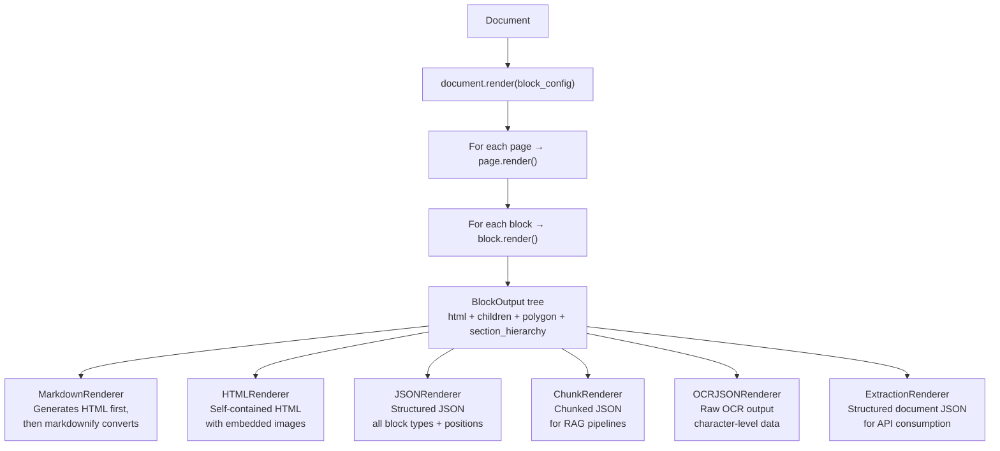
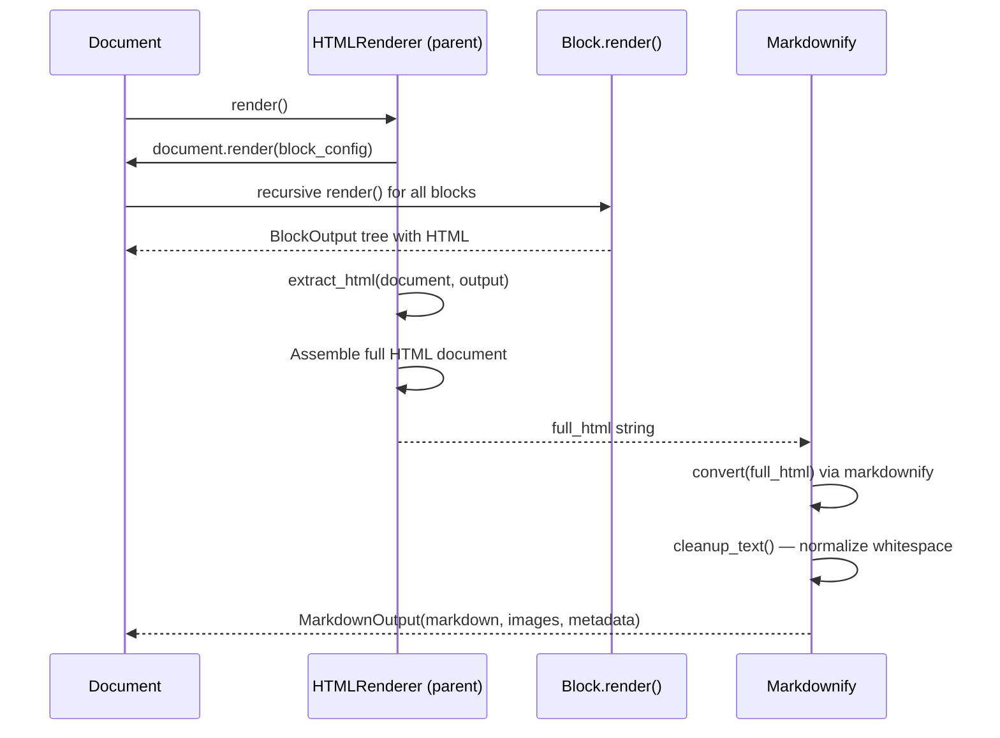

# Marker Renderers — From Document Graph to Output Formats

**The renderer layer serializes the processed Document object graph into one of six output formats.** Each renderer traverses the document tree via `document.render()`, which recursively calls `block.render()` on every block. The resulting `BlockOutput` tree is then converted to the target format: Markdown (via `markdownify`), HTML, JSON, chunked JSON, OCR debug JSON, or extraction JSON.

Source: `marker/renderers/` — 7 files

## Renderer Architecture



## MarkdownRenderer — The Primary Renderer

`MarkdownRenderer` (`marker/renderers/markdown.py`, 316 lines) is the most complex renderer. It uses a two-pass approach:



### Why HTML First?

**Aha:** Marker generates HTML as an intermediate format, then converts to markdown via `markdownify`. This is counter-intuitive — why not generate markdown directly? The answer: HTML preserves structure (tables, lists, inline formatting, links, images) that would be lost in a direct-to-markdown approach. `Markdownify` is a battle-tested HTML→Markdown converter that handles edge cases like nested lists, table colspan/rowspan, and inline code. Marker gets all that for free by generating well-structured HTML first.

### MarkdownRender Output

```python
# marker/renderers/markdown.py:260-315
class MarkdownOutput(BaseModel):
    markdown: str    # The final markdown text
    images: dict     # {filename: PIL.Image} extracted images
    metadata: dict   # Document metadata

class MarkdownRenderer(HTMLRenderer):
    page_separator: str = "-" * 48
    inline_math_delimiters: Tuple[str] = ("$", "$")
    block_math_delimiters: Tuple[str] = ("$$", "$$")
    html_tables_in_markdown: bool = False

    def __call__(self, document):
        document_output = document.render(self.block_config)
        full_html, images = self.extract_html(document, document_output)
        markdown = self.md_cls.convert(full_html)
        markdown = cleanup_text(markdown)
        return MarkdownOutput(markdown=markdown, images=images, metadata=...)
```

### Markdownify Configuration

```python
# marker/renderers/markdown.py:281-296
@property
def md_cls(self):
    return Markdownify(
        self.paginate_output,
        self.page_separator,
        heading_style="ATX",          # Uses # syntax, not underlines
        bullets="-",                  # Uses - for unordered lists
        escape_misc=False,
        escape_underscores=True,
        escape_asterisks=True,
        escape_dollars=True,          # Escape $ that aren't math
        sub_symbol="<sub>",
        sup_symbol="<sup>",
        ...
    )
```

### Custom Converters

`Markdownify` subclasses `markdownify.MarkdownConverter` and overrides key methods:

```python
# marker/renderers/markdown.py:86-99
def convert_p(self, el, text, parent_tags):
    has_continuation = el.has_attr("class") and "has-continuation" in el["class"]
    if has_continuation:
        # Handle hyphenation across pages
        if regex.compile(r".*[\p{Ll}|\d][-—¬]\s?$", regex.DOTALL).match(text):
            return regex.split(rf"[{hyphens}]\s?$", text)[0]
        return f"{text} "
    return f"{text}\n\n" if text else ""
```

**Aha:** The `has-continuation` CSS class is set by `TextProcessor` on blocks that continue across page/column boundaries. The markdown renderer reads this class — if present, it strips hyphenation and emits a space instead of a paragraph break. This is the bridge between the processor layer (which detected the continuation) and the renderer layer (which formats it correctly).

### Table Rendering

```python
# marker/renderers/markdown.py:120-218
def convert_table(self, el, text, parent_tags):
    # Build a 2D grid from HTML table
    # Handle colspan/rowspan → expand cells into grid
    # Calculate column widths for aligned markdown
    # Output GFM pipe tables
```

The table converter handles colspan/rowspan by expanding cells into a 2D grid, then rendering as GFM pipe tables:

```markdown
| Header 1     | Header 2     |
|-------------|-------------|
| Cell 1      | Cell 2      |
```

### Math Handling

```python
# marker/renderers/markdown.py:101-118
def convert_math(self, el, text, parent_tags):
    block = el.has_attr("display") and el["display"] == "block"
    if block:
        return "\n" + self.block_math_delimiters[0] + text.strip() + \
               self.block_math_delimiters[1] + "\n"  # $$\n...\n$$
    else:
        return " " + self.inline_math_delimiters[0] + text.strip() + \
               self.inline_math_delimiters[1] + " "  # $...$
```

## HTMLRenderer

```python
# marker/renderers/html.py
class HTMLRenderer:
    extract_images: bool = True
    image_format: str = "JPEG"
    paginate_output: bool = False

    def extract_html(self, document, document_output):
        # Traverses BlockOutput tree
        # Resolves <content-ref> tags to actual HTML
        # Collects embedded images
        # Returns (full_html, images_dict)
```

The HTML output is self-contained with embedded images as base64 data URIs.

## JSONRenderer

```python
# marker/renderers/json.py
class JSONRenderer(HTMLRenderer):
    def __call__(self, document):
        document_output = document.render(self.block_config)
        # Converts BlockOutput tree to JSONBlockOutput
        # Preserves: block type, polygon, text, children, section hierarchy
```

The JSON output preserves all structure — every block type, polygon position, parent/child relationship, and section hierarchy:

```json
{
  "children": [{
    "block_type": "Page",
    "page_id": 0,
    "children": [{
      "block_type": "Text",
      "html": "<p>Hello world</p>",
      "polygon": [[10, 20], [100, 20], [100, 40], [10, 40]]
    }]
  }]
}
```

## ChunkRenderer

```python
# marker/renderers/chunk.py
class ChunkRenderer:
    chunk_size: int = 512       # Target chunk size in tokens
    chunk_overlap: int = 50     # Overlap between chunks

    def __call__(self, document):
        # Splits document text into overlapping chunks
        # Preserves section hierarchy per chunk
        # Returns chunk list with metadata
```

## ExtractionRenderer

```python
# marker/renderers/extraction.py
class ExtractionRenderer:
    def __call__(self, document):
        # Produces structured JSON for API consumption
        # Includes: blocks, text, images, tables, metadata
```

## Output Saving

The `save_output()` function in `marker/output.py` handles all formats:

```python
# marker/output.py:56-101
def text_from_rendered(rendered):
    if isinstance(rendered, MarkdownOutput):
        return rendered.markdown, "md", rendered.images
    elif isinstance(rendered, HTMLOutput):
        return rendered.html, "html", rendered.images
    elif isinstance(rendered, JSONOutput):
        return rendered.model_dump_json(exclude=["metadata"], indent=2), "json", {}
    elif isinstance(rendered, ChunkOutput):
        return rendered.model_dump_json(exclude=["metadata"], indent=2), "json", {}
    ...

def save_output(rendered, output_dir, fname_base):
    text, ext, images = text_from_rendered(rendered)
    # Write text file (.md, .html, .json)
    # Write metadata as _meta.json
    # Save extracted images as JPEG
```

## Cross-References

- [Processors](04-processors.md) — How processors prepare the document for rendering
- [Architecture](01-architecture.md) — The BlockOutput tree that renderers consume
- [CLI & API](07-cli-api.md) — How to select renderers via CLI

## Next

→ [LLM Integration](06-llm-integration.md) — How 6 LLM services power the AI-enhanced processors.
