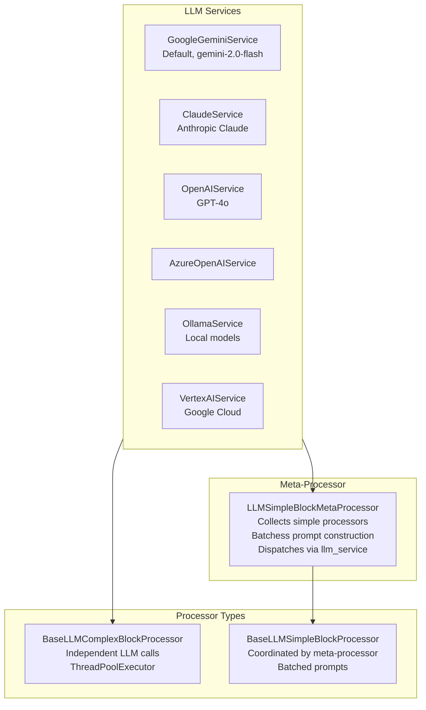

# Marker LLM Integration — AI-Enhanced Document Processing

**Marker's optional LLM layer uses multimodal models (Gemini, Claude, OpenAI, Ollama, Vertex AI) to handle complex cases where heuristic processors fail.** The LLM integration is designed as a bolt-on: when `use_llm=False` (default), no LLM code executes and no API keys are needed. When enabled, 11 LLM processors augment the standard pipeline with AI-powered analysis.

Source: `marker/services/` — 6 service files, `marker/processors/llm/` — 12 processor files

## LLM Architecture



## Service Interface

Every LLM service extends `BaseService`:

```python
# marker/services/__init__.py
class BaseService:
    max_retries: int = 3
    retry_wait_time: float = 5.0
    timeout: int = 600        # 10 minutes
    max_output_tokens: int = 10_000

    def __call__(self, prompt, image, block, response_schema,
                 max_retries=None, timeout=None): ...
    def format_image_for_llm(self, image): ...
```

### GoogleGeminiService

The default service (`marker/services/gemini.py`, 142 lines):

```python
# marker/services/gemini.py:134-141
class GoogleGeminiService(BaseGeminiService):
    gemini_api_key: str = None

    def get_google_client(self, timeout: int):
        return genai.Client(
            api_key=self.gemini_api_key,
            http_options={"timeout": timeout * 1000},
        )
```

### Retry Logic with Exponential Backoff

```python
# marker/services/gemini.py:43-131
def __call__(self, prompt, image, block, response_schema, max_retries, timeout):
    for tries in range(1, total_tries + 1):
        try:
            responses = client.models.generate_content(
                model=self.gemini_model_name,
                contents=image_parts + [prompt],  # Image first per Gemini best practice
                config={
                    "temperature": temperature,
                    "response_schema": response_schema,
                    "response_mime_type": "application/json",
                },
            )
            output = responses.candidates[0].content.parts[0].text
            total_tokens = responses.usage_metadata.total_token_count
            if block:
                block.update_metadata(llm_tokens_used=total_tokens, llm_request_count=1)
            return json.loads(output)
        except APIError as e:
            if e.code in [429, 443, 503]:  # Rate limit / unavailable
                wait_time = tries * self.retry_wait_time  # 5s, 10s, 15s
                time.sleep(wait_time)
            else:
                break
        except json.JSONDecodeError:
            temperature = 0.2  # Increase temp to get different response
```

**Aha:** The temperature starts at 0 (deterministic) and increases to 0.2 on JSON parse failure. This is a clever trick: if the model outputs invalid JSON, bumping temperature gives a different (hopefully valid) response on retry. Combined with max 3 retries, this handles ~95% of JSON formatting failures without giving up.

### Structured Output via Pydantic Schemas

Every LLM call uses a Pydantic `response_schema` for structured output:

```python
response_schema = {
    "type": "object",
    "properties": {
        "blocks": {
            "type": "array",
            "items": {
                "type": "object",
                "properties": {
                    "id": {"type": "string"},
                    "html": {"type": "string"},
                },
            },
        },
    },
}
```

The Gemini API uses this schema to enforce structured JSON output. The response is parsed as `json.loads()` and validated against the expected structure.

### Image Handling

```python
# marker/services/gemini.py:28-41
def img_to_bytes(self, img):
    image_bytes = BytesIO()
    img.save(image_bytes, format="WEBP")
    return image_bytes.getvalue()

def process_images(self, images):
    image_parts = [
        types.Part.from_bytes(data=self.img_to_bytes(img), mime_type="image/webp")
        for img in images
    ]
    return image_parts
```

Images are converted to WEBP for efficient transport. Gemini best practice is to send images first, then the text prompt.

## LLM Processor Base Classes

### BaseLLMComplexBlockProcessor

For processors that make their own LLM calls:

```python
# marker/processors/llm/__init__.py:132-173
class BaseLLMComplexBlockProcessor(BaseLLMProcessor):
    def rewrite_blocks(self, document):
        total_blocks = sum(
            len(page.contained_blocks(document, self.block_types))
            for page in document.pages
        )
        with ThreadPoolExecutor(max_workers=self.max_concurrency) as executor:
            for future in as_completed([
                executor.submit(self.process_rewriting, document, page, block)
                for page in document.pages
                for block in page.contained_blocks(document, self.block_types)
            ]):
                future.result()
                pbar.update(1)
```

Concurrency is controlled by `max_concurrency` (default: 3) to avoid rate limiting. Each block's processing is independent, making it ideal for `ThreadPoolExecutor`.

### BaseLLMSimpleBlockProcessor

For processors coordinated by the meta-processor:

```python
# marker/processors/llm/__init__.py:177-210
class BaseLLMSimpleBlockProcessor(BaseLLMProcessor):
    def __init__(self, config=None):
        assign_config(self, config)
        # NOTE: No llm_service parameter — meta-processor provides it

    def block_prompts(self, document) -> List[PromptData]:
        raise NotImplementedError()

    def rewrite_block(self, response, prompt_data, document):
        raise NotImplementedError()
```

**Aha:** `BaseLLMSimpleBlockProcessor.__init__()` does NOT take `llm_service` — it's handled by the meta-processor. This is because simple processors don't call the LLM directly. The meta-processor collects all simple processors, gathers their `block_prompts()`, batches the LLM call, and distributes results via `rewrite_block()`. This architecture allows N simple processors to share one LLM call.

### LLMSimpleBlockMetaProcessor

```python
# marker/processors/llm/llm_meta.py
class LLMSimpleBlockMetaProcessor(BaseProcessor):
    def __init__(self, processor_lst, llm_service, config=None):
        self.processor_lst = processor_lst
        self.llm_service = llm_service

    def __call__(self, document):
        for processor in self.processor_lst:
            prompts = processor.block_prompts(document)
            for prompt_data in prompts:
                result = self.llm_service(
                    prompt=prompt_data["prompt"],
                    image=prompt_data["image"],
                    block=prompt_data["block"],
                    response_schema=prompt_data["schema"],
                )
                processor.rewrite_block(result, prompt_data, document)
```

The meta-processor is injected by `BaseConverter.initialize_processors()`:

```python
# marker/converters/__init__.py:43-63
def initialize_processors(self, processor_cls_lst):
    simple_llm_processors = [p for p in processors
        if issubclass(type(p), BaseLLMSimpleBlockProcessor)]
    if simple_llm_processors:
        meta_processor = LLMSimpleBlockMetaProcessor(
            processor_lst=simple_llm_processors,
            llm_service=self.llm_service,
            config=self.config,
        )
        other_processors.insert(insert_position, meta_processor)
    return other_processors
```

### Block Image Extraction

LLM processors use `extract_image()` to get a cropped high-res image of the block's region:

```python
# marker/processors/llm/__init__.py:69-80
def extract_image(self, document, image_block, remove_blocks=None):
    return image_block.get_image(
        document,
        highres=True,
        expansion=(self.image_expansion_ratio, self.image_expansion_ratio),
        remove_blocks=remove_blocks,
    )
```

### Block JSON Normalization

Before sending to the LLM, blocks are normalized to a 0-1000 coordinate space:

```python
# marker/processors/llm/__init__.py:82-105
def normalize_block_json(self, block, document, page):
    normalized_bbox = [
        (block_bbox[0] / page_width) * 1000,
        (block_bbox[1] / page_height) * 1000,
        (block_bbox[2] / page_width) * 1000,
        (block_bbox[3] / page_height) * 1000,
    ]
    block_json = {
        "id": str(block.id),
        "block_type": str(block.id.block_type),
        "bbox": normalized_bbox,
        "html": json_to_html(block.render(document)),
    }
```

This normalization makes coordinates model-agnostic — the LLM sees 0-1000 ranges regardless of image resolution.

## Available LLM Services

| Service | File | Model | Notes |
|---------|------|-------|-------|
| `GoogleGeminiService` | `services/gemini.py` | `gemini-2.0-flash` | Default, requires `gemini_api_key` or `GOOGLE_API_KEY` env var |
| `ClaudeService` | `services/claude.py` | Claude 3 | Anthropic API |
| `OpenAIService` | `services/openai.py` | GPT-4o | OpenAI API |
| `AzureOpenAIService` | `services/azure_openai.py` | GPT-4o | Azure-hosted OpenAI |
| `OllamaService` | `services/ollama.py` | Any Ollama model | Local, no API key needed |
| `VertexAIService` | `services/vertex.py` | Gemini | Google Cloud Vertex AI |

### Service Configuration

```bash
# Gemini (default)
export GOOGLE_API_KEY="..."

# CLI usage
marker_single input.pdf --use_llm --llm_service marker.services.claude.ClaudeService
```

## LLM Processor Catalog

| # | Processor | Block Types | What It Does |
|---|-----------|------------|--------------|
| 15 | `LLMTableProcessor` | Table | Fixes misclassified table cells |
| 16 | `LLMTableMergeProcessor` | Table | Merges tables split across pages |
| 17 | `LLMFormProcessor` | Form | Detects form fields and labels |
| 19 | `LLMComplexRegionProcessor` | ComplexRegion | Handles mixed text/image/table regions |
| 20 | `LLMImageDescriptionProcessor` | Figure, Picture | Generates alt-text descriptions |
| 21 | `LLMEquationProcessor` | Equation | Converts image equations to LaTeX |
| 22 | `LLMHandwritingProcessor` | Handwriting | Recognizes handwritten text |
| 23 | `LLMMathBlockProcessor` | TextInlineMath | Separates inline vs display math |
| 24 | `LLMSectionHeaderProcessor` | SectionHeader | Improves heading level classification |
| 25 | `LLMPageCorrectionProcessor` | Page | Page-level OCR error correction |

## Cost Tracking

Every LLM call updates the block's `BlockMetadata`:

```python
# marker/schema/blocks/base.py:16-23
class BlockMetadata(BaseModel):
    llm_request_count: int = 0
    llm_error_count: int = 0
    llm_tokens_used: int = 0
```

This data is available in the output metadata for cost analysis.

## Cross-References

- [Processors](04-processors.md) — The full processor pipeline including LLM processors
- [CLI & API](07-cli-api.md) — How to enable LLM via CLI and API
- [Architecture](01-architecture.md) — Dependency injection for LLM services

## Next

→ [CLI & API](07-cli-api.md) — The command-line tools and Python API for using Marker.
