# Ponytail — Lazy Senior Dev AI Agent Skill

**Ponytail is an AI agent skill that reduces code output by 54% (up to 94%) without sacrificing safety.** It's not a code minifier or a "write shorter" prompt — it's a carefully engineered persona that teaches AI agents the judgment of a senior developer. It operates through a **Ladder of Sophistication**: 5 rungs from native HTML up to full frameworks, each with explicit proof-you-need-it criteria. Measured on 12 real feature tasks against a FastAPI + React codebase (Haiku 4.5, n=4), ponytail was the ONLY arm that cut every metric (LOC -54%, tokens -22%, cost -20%, time -27%) while maintaining 100% safety. The competitive arms either increased token usage (caveman terse-prose: +7% tokens) or sacrificed safety (YAGNI one-liner: 95% safe).

Source: `ponytail/` — `skills/ponytail/SKILL.md`, `benchmarks/`, MIT

## Architecture

```mermaid
flowchart TD
    Task["User: 'Add a date picker'"] --> Agent["AI Coding Agent<br/>Claude Code / Codex / Cursor..."]
    Agent --> Skill["ponytail SKILL.md loaded"]

    Skill --> Ladder["Ladder of Sophistication"]
    Ladder --> L1["Rung 1: Native HTML<br/><input type='date'><br/><details>/<summary><br/><dialog><br/><datalist>"]
    L1 -->|"insufficient"| L2["Rung 2: HTML + CSS"]
    L2 -->|"insufficient"| L3["Rung 3: + Vanilla JS<br/>IntersectionObserver<br/>Web Animations API"]
    L3 -->|"insufficient"| L4["Rung 4: Lightweight lib<br/>htmx, Alpine.js, Preact"]
    L4 -->|"insufficient"| L5["Rung 5: Full Framework<br/>React, Vue, Svelte<br/>Requires: complex state + team mandate + existing codebase"]

    Skill --> Safety["Safety Rules<br/>(non-negotiable)"]
    Safety --> S1["Never remove validation"]
    Safety --> S2["Never remove error handling"]
    Safety --> S3["Never skip security (XSS, CSRF, SQLi)"]
    Safety --> S4["Never skip accessibility"]
    Safety --> S5["Never remove type safety"]
    Safety --> S6["Keep existing tests passing"]
```



### What It Replaces

```html
<!-- WITHOUT ponytail (50-400+ lines): -->
<!-- Installs flatpickr, writes React wrapper component, -->
<!-- adds stylesheet, discusses timezone handling, labels, validation -->

<!-- WITH ponytail (1 line): -->
<!-- ponytail: browser has one -->
<input type="date">
```

## The 5-Rung Ladder of Sophistication

**Aha:** The ladder is a decision tree, not a rule. Every rung has "proof you need to skip" — the agent must articulate WHY the simpler solution doesn't work before leveling up. This forces deliberation that the LLM otherwise skips.

### Rung 1: Native HTML

Five elements cover 90% of common UI requests:
- `<input type="date">` — date picker (replaces flatpickr, react-datepicker)
- `<details>/<summary>` — accordion/collapsible (replaces custom collapse components)
- `<dialog>` — modal (replaces react-modal, custom dialog components)
- `<datalist>` — autocomplete/combobox (replaces react-select for simple cases)
- `<input type="color">` — color picker (replaces react-color)

Proof needed to skip: "None of these 5 elements fits the requirement."

### Rung 2: HTML + CSS

Use CSS for styling before reaching for JavaScript:
- `:has()` selector replaces conditional rendering logic
- CSS Grid + flexbox replaces layout libraries
- CSS custom properties replaces theme context providers
- `@container` queries replaces ResizeObserver components

### Rung 3: HTML + CSS + Vanilla JS

Browser APIs that replace common libraries:
- `IntersectionObserver` → scroll-based animations, lazy loading (replaces react-intersection-observer)
- `Web Animations API` → element.animate() (replaces framer-motion for simple cases)
- `Custom Elements` (web components) → reusable UI without framework
- `AbortController` → request cancellation (already built into fetch)

### Rung 4: Lightweight Libraries

If the platform truly can't do it:
- `htmx` — server-driven interactivity (replaces React for mostly-static pages)
- `Alpine.js` — sprinkle of reactivity (replaces React for simple interactive components)
- `Preact` (3KB) — React-compatible with signal-based updates

### Rung 5: Full Framework

Must pass ALL three gates:
1. Complex state graph shared across many components
2. Team mandate (organization standardizes on React/Vue/Svelte)
3. Existing codebase already in that framework

## The 8 Safety Rules

```
1. NEVER remove validation — every user input must be validated server-side
2. NEVER remove error handling — every async operation needs try/catch or .catch()
3. NEVER skip security — XSS (escape output), CSRF (tokens), SQL injection (parameterized queries)
4. NEVER skip accessibility — ARIA labels, keyboard navigation, color contrast ≥ 4.5:1
5. NEVER remove type safety — TypeScript types, PropTypes, or JSDoc annotations
6. NEVER remove tests — keep all existing tests passing, write tests for new behavior
7. ALWAYS preserve external behavior — the same inputs MUST produce the same outputs
8. WHEN unsure between two approaches, pick the simpler one — it's easier to add than remove
```

**Aha:** Safety rules make ponytail fundamentally different from "write shorter code" prompts. The YAGNI+one-liner competitive arm achieved nearly as good LOC reduction (67%) but dropped safety to 95% — it removed validation in edge cases. Ponytail's rules are explicit, numbered, and tested against adversarial audit.

## Benchmarks — Agentic Measurements

| Arm | LOC | Tokens | Cost | Time | Safety |
|-----|-----|--------|------|------|--------|
| **No skill baseline** | 100% | 100% | 100% | 100% | 100% |
| **ponytail** | **46%** | **78%** | **80%** | **73%** | **100%** |
| Caveman (terse prose control) | 80% | 107% | 103% | 102% | 100% |
| "YAGNI + one-liners" prompt | 67% | 86% | 79% | 70% | 95% |

### Methodology

```
- Headless Claude Code sessions
- Target: tiangolo/full-stack-fastapi-template (real FastAPI + React repo)
- 12 feature tickets (date picker, color picker, form validation, etc.)
- n=4 runs per task per arm (Haiku 4.5)
- Scored on git diff: lines added + changed
- Safety: adversarial audit of generated code
```

**Aha:** Caveman increases token usage despite reducing LOC. The model spends MORE thinking tokens deliberating "how do I write this tersely?" — trading one cost for another. Ponytail is the only arm that reduces ALL metrics because the ladder provides a structured decision process the model can follow mechanically rather than deliberating each time.

### Per-Task Variance

The 54% mean masks high variance:
- **Date picker:** 404 → 23 lines (94% reduction — `<input type="date">`)
- **Color picker:** 287 → 23 lines (92% reduction — `<input type="color">`)
- **Minimal existing code:** near-zero reduction (code was already minimal)

## Integration

```bash
# Claude Code
npx skills add DietrichGebert/ponytail

# Codex
codex skills add DietrichGebert/ponytail

# Manual (any agent)
cp skills/ponytail/SKILL.md .cursor/rules/ponytail.mdc
```

Works with 14 agents: Claude Code, Cursor, Codex, Windsurf, Gemini CLI, GitHub Copilot, OpenCode, Qwen Coder, Aider, PI Agent, Antigravity, Kilo, Kiro, OpenCode Zen.

## Cross-References

- [taste-skill](../src.DesignSkills/markdown/00-overview.md) — Anti-slop design skills (same skill-based architecture)
- [goose](../src.block/markdown/00-overview.md) — Block's AI agent (ponytail runs in goose sessions)

## Build HTML

```bash
cd /home/darkvoid/Boxxed/@dev/repo-expolorations/[src.AI]/src.PromptOptimizations
python3 build.py .
```
