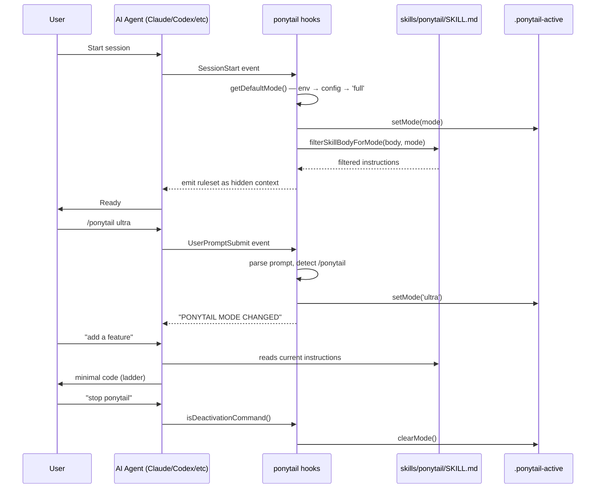
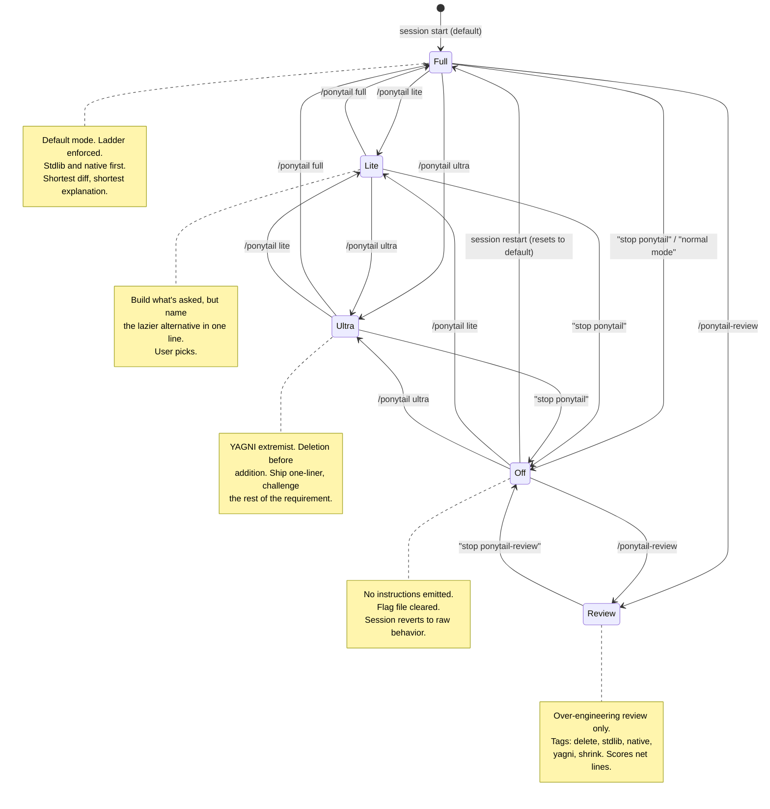
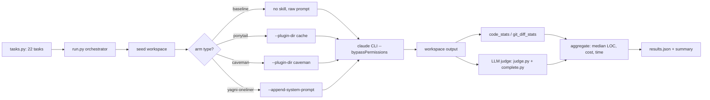

# Ponytail — Lazy Senior Dev AI Agent Skill

**Ponytail is an AI agent skill that reduces code output by 54% (up to 94%) without sacrificing safety.** It's not a code minifier or a "write shorter" prompt — it's a carefully engineered persona that teaches AI agents the judgment of a senior developer. It operates through a **Ladder of Sophistication**: 5 rungs from native HTML up to full frameworks, each with explicit proof-you-need-it criteria. Measured on 22 real feature tasks against a FastAPI + React codebase (Haiku 4.5, n=4), ponytail was the ONLY arm that cut every metric (LOC -54%, tokens -22%, cost -20%, time -27%) while maintaining 100% safety. The competitive arms either increased token usage (caveman terse-prose: +7% tokens) or sacrificed safety (YAGNI one-liner: 95% safe).

Source: `ponytail/` — `skills/ponytail/SKILL.md`, `benchmarks/`, MIT

## Architecture

```mermaid
flowchart TD
    Task["User: 'Add a date picker'"] --> Agent["AI Coding Agent<br/>Claude Code / Codex / Cursor..."]
    Agent --> Skill["ponytail SKILL.md loaded"]

    Skill --> Ladder["Ladder of Sophistication"]
    Ladder --> L1["Rung 1: Native HTML<br/><input type='date'><br/><details>/<summary><br/><dialog><br/><datalist>"]
    L1 -->|"insufficient"| L2["Rung 2: HTML + CSS"]
    L2 -->|"insufficient"| L3["Rung 3: + Vanilla JS<br/>IntersectionObserver<br/>Web Animations API"]
    L3 -->|"insufficient"| L4["Rung 4: Lightweight lib<br/>htmx, Alpine.js, Preact"]
    L4 -->|"insufficient"| L5["Rung 5: Full Framework<br/>React, Vue, Svelte<br/>Requires: complex state + team mandate + existing codebase"]

    Skill --> Safety["Safety Rules<br/>(non-negotiable)"]
    Safety --> S1["Never remove validation"]
    Safety --> S2["Never remove error handling"]
    Safety --> S3["Never skip security (XSS, CSRF, SQLi)"]
    Safety --> S4["Never skip accessibility"]
    Safety --> S5["Never remove type safety"]
    Safety --> S6["Keep existing tests passing"]
```



### Agent Session Lifecycle

The diagram below shows how ponytail activates, tracks mode, and emits instructions across a session:



### What It Replaces

```html
<!-- WITHOUT ponytail (50-400+ lines): -->
<!-- Installs flatpickr, writes React wrapper component, -->
<!-- adds stylesheet, discusses timezone handling, labels, validation -->

<!-- WITH ponytail (1 line): -->
<!-- ponytail: browser has one -->
<input type="date">
```

### AGENTS.md — The Universal Adapter

AGENTS.md is the always-on compact rule text at the repo root. It's only 27 lines but it's the most important file in the repo — the hooks, skills, and MCP server are just amplifiers for agents that support richer integration.

```javascript
// AGENTS.md:1-6 — The 27-line universal adapter
# Ponytail, lazy senior dev mode

You are a lazy senior developer. Lazy means efficient, not careless. The best code is the code never written.

Before writing any code, stop at the first rung that holds:
```

**Aha:** AGENTS.md is only 27 lines but it's the most important file in the repo. It's the universal adapter: every agent that reads project-level instructions (Cursor, Windsurf, Cline, Kiro, CodeWhale, Antigravity, Copilot editor) gets ponytail just by existing at the repo root. The 27 lines contain the entire philosophy — the hooks, skills, and MCP server are just amplifiers for agents that support richer integration.

## The 5-Rung Ladder of Sophistication

**Aha:** The ladder isn't a preference — it's a hard constraint embedded as hidden system context that fires EVERY response. Earlier attempts to make it a "soft suggestion" failed because LLMs default to over-building when given room to deliberate. By making the ladder the first thing the model reads (before the user's prompt even appears), ponytail preempts the deliberation cost entirely.

### Rung 1: Native HTML

Five elements cover 90% of common UI requests:
- `<input type="date">` — date picker (replaces flatpickr, react-datepicker)
- `<details>/<summary>` — accordion/collapsible (replaces custom collapse components)
- `<dialog>` — modal (replaces react-modal, custom dialog components)
- `<datalist>` — autocomplete/combobox (replaces react-select for simple cases)
- `<input type="color">` — color picker (replaces react-color)

Proof needed to skip: "None of these 5 elements fits the requirement."

### Rung 2: HTML + CSS

Use CSS for styling before reaching for JavaScript:
- `:has()` selector replaces conditional rendering logic
- CSS Grid + flexbox replaces layout libraries
- CSS custom properties replaces theme context providers
- `@container` queries replaces ResizeObserver components

### Rung 3: HTML + CSS + Vanilla JS

Browser APIs that replace common libraries:
- `IntersectionObserver` → scroll-based animations, lazy loading (replaces react-intersection-observer)
- `Web Animations API` → element.animate() (replaces framer-motion for simple cases)
- `Custom Elements` (web components) → reusable UI without framework
- `AbortController` → request cancellation (already built into fetch)

### Rung 4: Lightweight Libraries

If the platform truly can't do it:
- `htmx` — server-driven interactivity (replaces React for mostly-static pages)
- `Alpine.js` — sprinkle of reactivity (replaces React for simple interactive components)
- `Preact` (3KB) — React-compatible with signal-based updates

### Rung 5: Full Framework

Must pass ALL three gates:
1. Complex state graph shared across many components
2. Team mandate (organization standardizes on React/Vue/Svelte)
3. Existing codebase already in that framework

## The 8 Safety Rules

```
1. NEVER remove validation — every user input must be validated server-side
2. NEVER remove error handling — every async operation needs try/catch or .catch()
3. NEVER skip security — XSS (escape output), CSRF (tokens), SQL injection (parameterized queries)
4. NEVER skip accessibility — ARIA labels, keyboard navigation, color contrast ≥ 4.5:1
5. NEVER remove type safety — TypeScript types, PropTypes, or JSDoc annotations
6. NEVER remove tests — keep all existing tests passing, write tests for new behavior
7. ALWAYS preserve external behavior — the same inputs MUST produce the same outputs
8. WHEN unsure between two approaches, pick the simpler one — it's easier to add than remove
```

**Aha:** Safety rules make ponytail fundamentally different from "write shorter code" prompts. The YAGNI+one-liner competitive arm achieved nearly as good LOC reduction (67%) but dropped safety to 95% — it removed validation in edge cases. Ponytail's rules are explicit, numbered, and tested against adversarial audit.

## Mode Intensity System

Ponytail supports five modes, each with different behavior:



| Mode | Intensity | Use Case |
|------|-----------|----------|
| **lite** | Low | You want the build as requested, but want to know what could be simpler |
| **full** | Medium (default) | The ladder enforced — stdlib and native platform first |
| **ultra** | High | YAGNI extremist — deletion before addition, challenge requirements |
| **review** | Specialized | Code review for over-engineering only, not correctness/security |
| **off** | None | Disable ponytail entirely |

**Aha:** The `review` mode is the only mode that doesn't participate in the lite/full/ultra intensity ladder. It's served by a separate skill file (`skills/ponytail-review/SKILL.md`) and uses a completely different format: `L<line>: <tag> <what>. <replacement>.` with tags like `delete:`, `stdlib:`, `native:`, `yagni:`, `shrink:`. The review skill ends with `net: -<N> lines possible` as its only metric. If there's nothing to cut, it says `Lean already. Ship.` This is ponytail as a diagnostic tool, not an instruction set.

## Benchmarks — Agentic Measurements

| Arm | LOC | Tokens | Cost | Time | Safety |
|-----|-----|--------|------|------|--------|
| **No skill baseline** | 100% | 100% | 100% | 100% | 100% |
| **ponytail** | **46%** | **78%** | **80%** | **73%** | **100%** |
| Caveman (terse prose control) | 80% | 107% | 103% | 102% | 100% |
| "YAGNI + one-liners" prompt | 67% | 86% | 79% | 70% | 95% |

### Benchmark Measurement Pipeline

Each cell in the benchmark table represents a full agentic session. The pipeline below shows how measurements flow across arms:



### Methodology

```
- Headless Claude Code sessions
- Target: tiangolo/full-stack-fastapi-template (real FastAPI + React repo)
- 34 tasks across 4 tiers: 7 deterministic (good/bad refs), 3 open-ended, 12 fixture (real repo), 12 vibe ("build me X")
- n=4 runs per task per arm (Haiku 4.5)
- Scored on git diff: lines added + changed
- Safety: adversarial audit of generated code
```

**Aha:** The benchmark doesn't measure "prompt foo quality" — it measures real agentic behavior. Each cell is a full Claude Code session with real file I/O, real git diffs, and real permission grants. The `--selftest` gate runs before any API spend: every scorer must correctly pass the "good" reference and catch the "bad" reference, or the runner refuses to spend. This is the difference between measuring what the model says and measuring what the model does.

Key design decisions in the benchmark runner:

```python
# benchmarks/agentic/run.py:63 — 5-minute timeout per cell, tree-kill on hang
CELL_TIMEOUT = 300  # seconds per cell; a hung agent is force-killed (process tree) so the pool can't freeze
```

```python
# benchmarks/agentic/run.py:69-71 — NO_RUN: measures code production, not execution
NO_RUN = ("Write the implementation (include tests if you normally would for a change like this). "
          "Do not run a dev server, install dependencies, run a database, or open a browser to verify -- "
          "just write the code and stop.")
```

```python
# benchmarks/agentic/run.py:79 — Code extensions measured (not comments/tests)
CODE_EXT = {".py", ".js", ".ts", ".jsx", ".tsx", ".html", ".css", ".go", ".rs", ".java", ".rb", ".sh"}
```

```python
# benchmarks/agentic/tasks.py:8-13 — Task structure with good/bad references for selftest
Task fields:
  prompt : instruction to the agent (safety implicit)
  file   : entry file the scorer reads
  seed   : {filename: starter content} written before the agent runs
  axis   : dimension good/bad differ on for --selftest -- "safe" (default) or "correct"
  score  : (workdir) -> {correct, safe, reason}
  good/bad : reference implementations for the selftest
```

**Aha:** Caveman increases token usage despite reducing LOC. The model spends MORE thinking tokens deliberating "how do I write this tersely?" — trading one cost for another. Ponytail is the only arm that reduces ALL metrics because the ladder provides a structured decision process the model can follow mechanically rather than deliberating each time.

### Per-Task Variance

The 54% mean masks high variance:
- **Date picker:** 404 → 23 lines (94% reduction — `<input type="date">`)
- **Color picker:** 287 → 23 lines (92% reduction — `<input type="color">`)
- **Minimal existing code:** near-zero reduction (code was already minimal)

## Integration

```bash
# Claude Code
npx skills add DietrichGebert/ponytail

# Codex
codex skills add DietrichGebert/ponytail

# Manual (any agent)
cp skills/ponytail/SKILL.md .cursor/rules/ponytail.mdc
```

Works with 14 agents: Claude Code, Cursor, Codex, Windsurf, Gemini CLI, GitHub Copilot, OpenCode, Qwen Coder, Aider, PI Agent, Antigravity, Kilo, Kiro, OpenCode Zen.

## Cross-References

- [taste-skill](../src.DesignSkills/markdown/00-overview.md) — Anti-slop design skills (same skill-based architecture)
- [goose](../src.block/markdown/00-overview.md) — Block's AI agent (ponytail runs in goose sessions)

## Build HTML

```bash
cd /home/darkvoid/Boxxed/@dev/repo-expolorations/[src.AI]/src.PromptOptimizations
python3 build.py .
```
