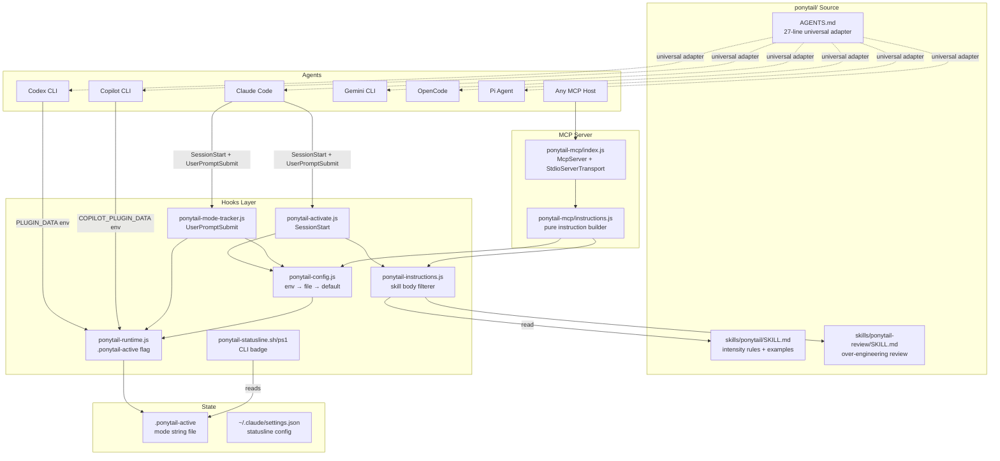

# Ponytail Architecture: Hooks, Config Resolution, Runtime State, MCP, and Skill Filtering

Ponytail runs as a set of Node.js hooks that inject instructions into AI agent sessions. Five hook files, one config resolver, one runtime state manager, an MCP server for agents supporting the Model Context Protocol, and a skill-filtering engine that selects intensity-level instructions. The entire system activates on SessionStart and tracks mode changes on every user prompt.

Source: `hooks/` — 5 files, `ponytail-mcp/` — 2 files, `skills/` — 2 SKILL.md files, `pi-extension/` — 1 file.

## System Architecture

The diagram below shows how ponytail's components connect to each other and to the agents that consume them:



## Hook Architecture

Ponytail uses two Claude Code hook events plus a statusline script:

| Hook | File | Event | Purpose |
|------|------|-------|---------|
| Activate | `hooks/ponytail-activate.js` | SessionStart | Resolve mode, write flag, emit instructions |
| Mode Tracker | `hooks/ponytail-mode-tracker.js` | UserPromptSubmit | Detect `/ponytail` commands, update mode |
| Statusline | `hooks/ponytail-statusline.sh` / `.ps1` | CLI prompt render | Show `[PONYTAIL]` or `[PONYTAIL:ULTRA]` badge |

### Hook Execution Flow

Each session start triggers a deterministic sequence:

```mermaid
sequenceDiagram
    autonumber
    participant User
    participant Agent as AI Agent
    participant Act as ponytail-activate.js
    participant Cfg as ponytail-config.js
    participant Instr as ponytail-instructions.js
    participant Rt as ponytail-runtime.js
    participant Flag as .ponytail-active
    participant SL as statusline.sh

    User->>Agent: Start session
    Agent->>Act: SessionStart event fires
    Act->>Cfg: getDefaultMode()
    Cfg->>Cfg: PONYTAIL_DEFAULT_MODE?
    Cfg->>Cfg: ~/.config/ponytail/config.json?
    Cfg-->>Act: mode (off|lite|full|ultra|review)

    alt mode == "off"
        Act->>Rt: clearMode()
        Rt->>Flag: rm .ponytail-active
        Act-->>Agent: exit(0) — no instructions emitted
    else mode != "off"
        Act->>Rt: setMode(mode)
        Rt->>Flag: write mode string
        Act->>Instr: getPonytailInstructions(mode)
        Instr->>Instr: read skills/ponytail/SKILL.md
        Instr->>Instr: filterSkillBodyForMode(body, mode)
        Instr-->>Act: filtered instructions
        Act->>Act: detect missing statusline config
        Act-->>Agent: emit instructions as hidden context
        Agent->>User: "Ready" with [PONYTAIL] badge
    end

    User->>Agent: /ponytail ultra
    Agent->>Act2 as ponytail-mode-tracker.js<br/>UserPromptSubmit
    Act2->>Act2: parse stdin JSON, detect /ponytail
    Act2->>Rt: setMode("ultra")
    Rt->>Flag: write "ultra"
    Act2-->>Agent: "PONYTAIL MODE CHANGED — level: ultra"
```

### SessionStart Hook

Source: `hooks/ponytail-activate.js` — 91 lines.

```javascript
// ponytail-activate.js:1-6 — SessionStart activation hook
//
// Runs on every session start:
//   1. Writes flag file at $CLAUDE_CONFIG_DIR/.ponytail-active (defaults to ~/.claude; statusline reads this)
//   2. Emits ponytail ruleset as hidden SessionStart context
//   3. Detects missing statusline config and emits setup nudge
```

The hook resolves the default mode, writes the flag file, builds the instruction set, and detects whether the statusline is configured:

```javascript
// ponytail-activate.js:27-32 — "off" mode skips activation entirely
if (mode === 'off') {
  clearMode();
  const hookOutput = (isCodex || isCopilot) ? '' : 'OK';
  writeHookOutput('SessionStart', 'off', hookOutput);
  process.exit(0);
}

// ponytail-activate.js:42-85 — emit instructions, detect missing statusline
let output = getPonytailInstructions(mode);

// 3. Detect missing statusline config — nudge Claude to help set it up
if (!isCodex && !isCopilot) try {
  // ... reads ~/.claude/settings.json, checks statusLine key
  // emits a setup nudge with exact JSON snippet to add
}
```

### UserPromptSubmit Hook

Source: `hooks/ponytail-mode-tracker.js` — 55 lines.

Reads stdin as JSON, detects `/ponytail lite|full|ultra|off` commands, writes the new mode to the flag file, and detects deactivation phrases:

```javascript
// ponytail-mode-tracker.js:17-44 — parse /ponytail commands from user input
if (/^[/@$]ponytail/.test(prompt)) {
  const parts = prompt.split(/\s+/);
  const cmd = parts[0].replace(/^[@$]/, '/');
  const arg = parts[1] || '';

  let mode = null;
  if (cmd === '/ponytail-review' || cmd === '/ponytail:ponytail-review') {
    mode = 'review';
  } else if (cmd === '/ponytail' || cmd === '/ponytail:ponytail') {
    if (arg === 'lite') mode = 'lite';
    else if (arg === 'full') mode = 'full';
    else if (arg === 'ultra') mode = 'ultra';
    else if (arg === 'off') mode = 'off';
    else mode = getDefaultMode();
  }
  // ... setMode(mode) or clearMode()
}

// ponytail-mode-tracker.js:48-51 — deactivation detection
if (isDeactivationCommand(prompt)) {
  clearMode();
  writeHookOutput('UserPromptSubmit', 'off', 'PONYTAIL MODE OFF');
}
```

**Aha:** The command parser accepts three prefix characters (`/`, `@`, `$`) — the regex `/^[/@$]ponytail/` catches `/ponytail`, `@ponytail`, and `$ponytail` equally. This covers Claude Code's slash-command syntax, Pi's `@` prefix, and any agent that uses `$` for commands. The prefix is then normalized to `/` internally so the rest of the logic is agent-agnostic.

## Config Resolution

Source: `hooks/ponytail-config.js` — 122 lines.

Resolution order (highest to lowest priority):

```mermaid
flowchart TD
    Start[getDefaultMode called] --> Env{PONYTAIL_DEFAULT_MODE set?}
    Env -->|yes, valid| ReturnEnv[return env value]
    Env -->|no or invalid| File{~/.config/ponytail/config.json exists?}
    File -->|yes, valid defaultMode| ReturnFile[return config value]
    File -->|no or missing| Default[return "full"]

    ReturnEnv --> End((mode))
    ReturnFile --> End
    Default --> End

    subgraph "Config File Locations (checked in order)"
        L1[$XDG_CONFIG_HOME/ponytail/config.json]
        L2[~/.config/ponytail/config.json — macOS/Linux fallback]
        L3[%APPDATA%/ponytail/config.json — Windows]
    end

    File -.-> L1
    File -.-> L2
    File -.-> L3

    subgraph "Valid Modes"
        M1[off]
        M2[lite]
        M3[full]
        M4[ultra]
        M5[review]
    end

    Env -.->|VALID_MODES| M1
    Env -.->|VALID_MODES| M2
    Env -.->|VALID_MODES| M3
    Env -.->|VALID_MODES| M4
    Env -.->|VALID_MODES| M5
```

```javascript
// ponytail-config.js:16-18 — mode definitions
const DEFAULT_MODE = 'full';
const VALID_MODES = ['off', 'lite', 'full', 'ultra', 'review'];
const RUNTIME_MODES = ['off', 'lite', 'full', 'ultra'];
```

**Aha:** There are two mode sets: `VALID_MODES` (5 modes, used for config files) and `RUNTIME_MODES` (4 modes, used for active sessions). The `review` mode is valid in config but not a runtime intensity — it's an independent skill served via `/ponytail-review` that doesn't participate in the lite/full/ultra ladder. This separation prevents a user from accidentally setting `defaultMode: "review"` in config and getting a no-op.

```javascript
// ponytail-config.js:76-96 — getDefaultMode
function getDefaultMode() {
  // 1. Environment variable (highest priority)
  const envMode = process.env.PONYTAIL_DEFAULT_MODE;
  if (envMode && VALID_MODES.includes(envMode.toLowerCase())) {
    return envMode.toLowerCase();
  }

  // 2. Config file
  try {
    const configPath = getConfigPath();
    const config = JSON.parse(fs.readFileSync(configPath, 'utf8'));
    if (config.defaultMode && VALID_MODES.includes(config.defaultMode.toLowerCase())) {
      return config.defaultMode.toLowerCase();
    }
  } catch (e) { /* Config file doesn't exist or is invalid — fall through */ }

  // 3. Default
  return DEFAULT_MODE; // 'full'
}
```

### Config Directory Resolution

Cross-platform config directory resolution:

```javascript
// ponytail-config.js:54-65 — getConfigDir
function getConfigDir() {
  if (process.env.XDG_CONFIG_HOME) {
    return path.join(process.env.XDG_CONFIG_HOME, 'ponytail');
  }
  if (process.platform === 'win32') {
    return path.join(
      process.env.APPDATA || path.join(os.homedir(), 'AppData', 'Roaming'),
      'ponytail'
    );
  }
  return path.join(os.homedir(), '.config', 'ponytail');
}
```

### Deactivation Detection

```javascript
// ponytail-config.js:40-43 — exact-match deactivation
function isDeactivationCommand(text) {
  const t = String(text || '').trim().toLowerCase().replace(/[.!?\s]+$/, '');
  return t === 'stop ponytail' || t === 'normal mode';
}
```

**Aha:** The deactivation check requires the **entire message** to be the command (ignoring case and trailing punctuation). Earlier versions matched the phrase anywhere in the message, which turned ponytail off mid-task for ordinary requests like "add a normal mode toggle". The regex `/[.!?\s]+$/` strips trailing punctuation so "stop ponytail." and "stop ponytail" both work, but "can you stop ponytail from simplifying this" does not match.

### Shell Safety Check

```javascript
// ponytail-config.js:50-52 — allowlist-based shell safety
function isShellSafe(p) {
  return typeof p === 'string' && /^[A-Za-z0-9 _.\-:/\\~]+$/.test(p);
}
```

**Aha:** Instead of escaping shell metacharacters (which is fragile across bash, zsh, and PowerShell), ponytail uses an allowlist: only alphanumeric characters plus space, underscore, dot, hyphen, colon, backslash, and tilde are permitted. If the plugin install path contains any other character (quotes, `&`, `$`, backtick, `;`), the statusline setup nudge falls back to manual configuration. An allowlist beats escaping every shell's metacharacters — a hostile clone path falls back to manual setup instead of being misinterpreted.

## Runtime State

Source: `hooks/ponytail-runtime.js` — 51 lines.

Mode is stored as a single string in `.ponytail-active` in the agent's config directory:

```javascript
// ponytail-runtime.js:5-13 — agent-specific state directory
const STATE_FILE = '.ponytail-active';
const isCopilot = Boolean(process.env.COPILOT_PLUGIN_DATA);
const isCodex = !isCopilot && Boolean(process.env.PLUGIN_DATA);

let stateDir = getClaudeDir();
if (isCodex) stateDir = process.env.PLUGIN_DATA;
if (isCopilot) stateDir = process.env.COPILOT_PLUGIN_DATA;

const statePath = path.join(stateDir, STATE_FILE);
```

| Agent | State Directory | Output Format |
|-------|----------------|---------------|
| Claude Code | `~/.claude/` (or `$CLAUDE_CONFIG_DIR`) | Raw text on stdout |
| Codex CLI | `$PLUGIN_DATA` | JSON: `{ systemMessage: "PONYTAIL:FULL", hookSpecificOutput: {...} }` |
| Copilot CLI | `$COPILOT_PLUGIN_DATA` | JSON: `{ additionalContext: "..." }` (SessionStart only) |

```javascript
// ponytail-runtime.js:24-43 — agent-specific output writer
function writeHookOutput(event, mode, context = '') {
  if (isCopilot) {
    // Copilot reads additionalContext on SessionStart; ignores output elsewhere.
    process.stdout.write(JSON.stringify(
      event === 'SessionStart' && context ? { additionalContext: context } : {}));
    return;
  }
  if (isCodex) {
    const output = { systemMessage: `PONYTAIL:${mode.toUpperCase()}` };
    if (context) {
      output.hookSpecificOutput = {
        hookEventName: event,
        additionalContext: context,
      };
    }
    process.stdout.write(JSON.stringify(output));
    return;
  }
  process.stdout.write(context); // Claude Code: raw text
}
```

**Aha:** Each agent has a completely different expected output format. Copilot wants `{ additionalContext: "..." }`, Codex wants `{ systemMessage: "PONYTAIL:FULL" }`, and Claude Code wants raw text. The `writeHookOutput` function is the single point of divergence — everything else (config resolution, instruction building, state management) is agent-agnostic. This is the adapter pattern: one core, three output formats.

## Instruction Building & Skill Filtering

Source: `hooks/ponytail-instructions.js` — 92 lines.

The instruction builder reads the SKILL.md file, strips frontmatter, and filters the body to keep only mode-specific rows and examples that match the active intensity:

```javascript
// ponytail-instructions.js:8 — independent modes bypass the skill filter
const INDEPENDENT_MODES = new Set(['review']);

// ponytail-instructions.js:71-86 — getPonytailInstructions
function getPonytailInstructions(mode) {
  const configuredMode = normalizePersistedMode(mode) || DEFAULT_MODE;

  if (INDEPENDENT_MODES.has(configuredMode)) {
    // 'review' mode uses a separate skill file
    return 'PONYTAIL MODE ACTIVE — level: ' + configuredMode + '. Behavior defined by /ponytail-' + configuredMode + ' skill.';
  }

  const effectiveMode = normalizeMode(configuredMode) || DEFAULT_MODE;

  try {
    return 'PONYTAIL MODE ACTIVE — level: ' + effectiveMode + '\n\n' +
      filterSkillBodyForMode(fs.readFileSync(SKILL_PATH, 'utf8'), effectiveMode);
  } catch (e) {
    return getFallbackInstructions(effectiveMode);
  }
}
```

### Skill File Filtering

```javascript
// ponytail-instructions.js:11-37 — filterSkillBodyForMode
function filterSkillBodyForMode(body, mode) {
  const effectiveMode = normalizeMode(mode) || DEFAULT_MODE;
  const withoutFrontmatter = String(body || '').replace(/^---[\s\S]*?---\s*/, '');

  // Only the intensity table rows and worked examples are mode-specific, and
  // both are keyed by a mode name (lite/full/ultra). A bullet whose label is
  // not a mode — e.g. "No unrequested abstractions: ..." — is a normal rule
  // and must be kept verbatim.
  return withoutFrontmatter
    .split(/\r?\n/)
    .filter((line) => {
      const tableLabel = line.match(/^\|\s*\*\*(.+?)\*\*\s*\|/);
      if (tableLabel) {
        const labelMode = normalizeMode(tableLabel[1].trim());
        if (labelMode) return labelMode === effectiveMode;
      }

      const exampleLabel = line.match(/^-\s*([^:]+):\s*/);
      if (exampleLabel) {
        const labelMode = normalizeMode(exampleLabel[1].trim());
        if (labelMode) return labelMode === effectiveMode;
      }

      return true; // All other lines (general rules) are kept
    })
    .join('\n');
}
```

**Aha:** The skill file (SKILL.md) contains mode-specific intensity tables and worked examples. The filter removes frontmatter, then keeps only the table row and example section matching the active mode. Non-mode-specific rules (like "No unrequested abstractions") are kept verbatim for all modes. The filter is a single pass over the file's lines — no AST parsing, no markdown parsing, just two regexes. It works because the skill file's structure is self-describing: table rows start with `| **lite** |` and example bullets start with `- lite:`, so the filter can identify mode-keyed content by pattern alone.

### Fallback Instructions

When the skill file is unavailable (deleted, moved, or unreadable), hardcoded fallback instructions are emitted:

```
// ponytail-instructions.js:39-69 — getFallbackInstructions
PONYTAIL MODE ACTIVE — level: full

You are a lazy senior developer. Lazy means efficient, not careless.
The best code is the code never written.

## Persistence
ACTIVE EVERY RESPONSE. No drift back to over-building...

## The ladder
1. Does this need to be built at all? (YAGNI)
2. Does the standard library do this? Use it.
3. Does a native platform feature cover it? Use it.
4. Does an already-installed dependency solve it? Use it.
5. Can this be one line? Make it one line.
6. Only then: write the minimum code that works.

## Rules
No abstractions that were not requested. No avoidable dependencies...
```

## MCP Server

Source: `ponytail-mcp/index.js` — 48 lines, `ponytail-mcp/instructions.js` — 26 lines.

The MCP server exposes ponytail as both a **prompt** (user-invoked) and a **tool** (for hosts that pull context via tools):

```javascript
// ponytail-mcp/index.js:12-29 — MCP prompt registration
const server = new McpServer({ name: "ponytail", version: "0.1.0" });

server.registerPrompt(
  "ponytail",
  {
    title: "Ponytail mode",
    description: "Lazy senior dev instructions: YAGNI, stdlib first, the smallest correct change.",
    argsSchema: { mode: modeArg },
  },
  ({ mode }) => ({
    messages: [{ role: "user", content: { type: "text", text: buildInstructions(mode) } }],
  }),
);

// ponytail-mcp/index.js:31-46 — MCP tool registration
server.registerTool(
  "ponytail_instructions",
  {
    title: "Ponytail instructions",
    description: "Return the Ponytail ruleset for the given intensity (lite, full, or ultra).",
    inputSchema: { mode: modeArg },
    outputSchema: { mode: z.string(), instructions: z.string() },
    annotations: { readOnlyHint: true, openWorldHint: false },
  },
  ({ mode }) => {
    const resolvedMode = resolveMode(mode);
    const instructions = buildInstructions(resolvedMode);
    return { content: [{ type: "text", text: instructions }], structuredContent: { mode: resolvedMode, instructions } };
  },
);
```

The MCP instruction builder (`ponytail-mcp/instructions.js`) is a thin wrapper that reuses the same hooks-based instruction builder, ensuring every host emits identical rules:

```javascript
// ponytail-mcp/instructions.js:1-26 — pure instruction selection, no MCP/SDK imports
const { getPonytailInstructions } = require("../hooks/ponytail-instructions.js");
const { getDefaultMode, normalizeMode } = require("../hooks/ponytail-config.js");

export const MODES = ["lite", "full", "ultra"]; // "off" and "review" aren't served

export function resolveMode(requested) {
  const asked = normalizeMode(requested);
  if (asked && asked !== "off") return asked;
  const fallback = normalizeMode(getDefaultMode());
  return fallback && fallback !== "off" ? fallback : "full";
}

export function buildInstructions(requested) {
  return getPonytailInstructions(resolveMode(requested));
}
```

**Aha:** The MCP instruction builder has zero MCP/SDK imports — it uses `createRequire` to import the CommonJS hooks files from an ESM context. This keeps the instruction selection logic unit-testable on its own. The comment in the source says it explicitly: "Pure instruction selection for the Ponytail MCP server. No MCP/SDK imports, so this stays unit-testable on its own."

## Statusline Integration

Source: `hooks/ponytail-statusline.sh` — 12 lines, `hooks/ponytail-statusline.ps1` — 12 lines.

The statusline script reads the `.ponytail-active` flag and emits a colored badge:

```bash
#!/usr/bin/env bash
# ponytail-statusline.sh:1-12
flag="${CLAUDE_CONFIG_DIR:-$HOME/.claude}/.ponytail-active"
[ -f "$flag" ] || exit 0

mode=$(head -n1 "$flag" | tr -d '[:space:]')

if [ -z "$mode" ] || [ "$mode" = "full" ]; then
    printf '\033[38;5;108m[PONYTAIL]\033[0m'
else
    printf '\033[38;5;108m[PONYTAIL:%s]\033[0m' "$(printf '%s' "$mode" | tr '[:lower:]' '[:upper:]')"
fi
```

The activation hook auto-detects when the statusline is not configured in `~/.claude/settings.json` and emits a nudge with the exact JSON snippet to add:

```json
"statusLine": { "type": "command", "command": "bash \"/path/to/hooks/ponytail-statusline.sh\"" }
```

## AGENTS.md — The Universal Adapter

Source: `AGENTS.md` — 27 lines.

The 27-line `AGENTS.md` is the most important file in the repo. It's the universal adapter: every agent that reads project-level instructions (Cursor, Windsurf, Cline, Kiro, CodeWhale, Antigravity, Copilot editor) gets ponytail just by this file existing at the repo root. The hooks, skills, and MCP server are amplifiers for agents that support richer integration.

```markdown
# AGENTS.md — 27 lines, universal adapter
# Ponytail, lazy senior dev mode

You are a lazy senior developer. Lazy means efficient, not careless.
The best code is the code never written.

Before writing any code, stop at the first rung that holds:
1. Does this need to be built at all? (YAGNI)
2. Does the standard library already do this? Use it.
3. Does a native platform feature cover it? Use it.
4. Does an already-installed dependency solve it? Use it.
5. Can this be one line? Make it one line.
6. Only then: write the minimum code that works.
```

## Cross-References

- [Overview](00-overview.md) — What ponytail is, philosophy, benchmark numbers
- [Benchmarks](02-benchmarks.md) — Agentic benchmarks, correctness, robustness, LLM judges
- [Integrations](03-integrations.md) — Agent plugins, hooks, skills, commands

[Next → Benchmarks](02-benchmarks.md)
