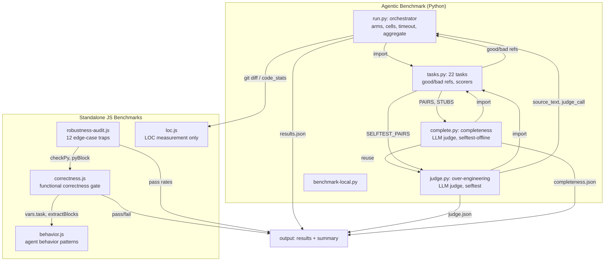
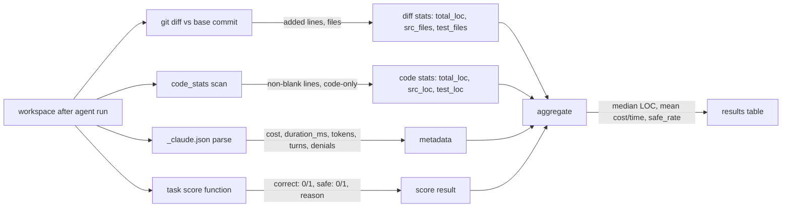
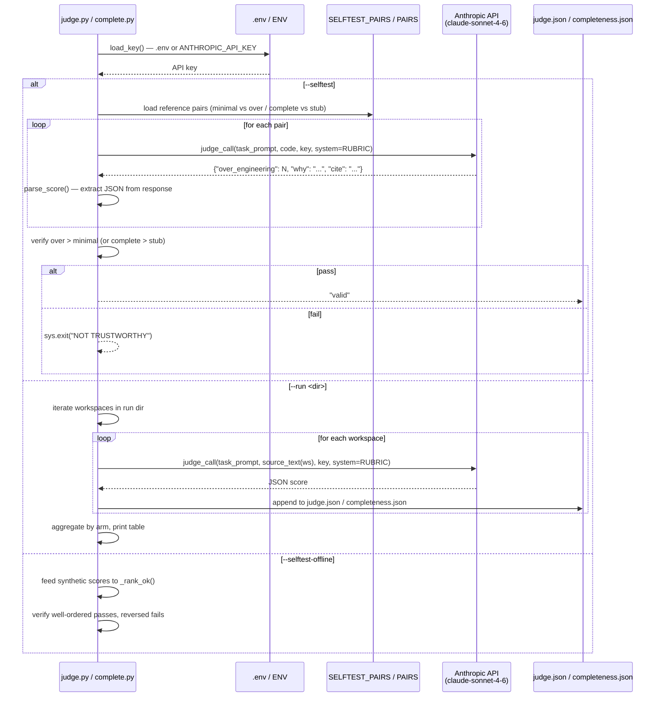

# Ponytail Benchmarks: Agentic Measurement Pipeline, Correctness, Robustness, and LLM Judges

Ponytail's benchmarks measure code reduction, cost, and speed against real agentic baselines — not static prompts but the same agent doing the same tasks in isolated workspaces. Each benchmark cell is a full headless Claude Code session with real file I/O, real git diffs, and real permission grants. The pipeline verifies instruments before any API spend via a `--selftest` gate.

Source: `benchmarks/` — 33 files (16 top-level, 5 agentic Python, 4 arms, 8 results). Agentic benchmark in `benchmarks/agentic/` (5 Python files), correctness/robustness/LOC/behavior in `benchmarks/*.js`.

## Benchmark Taxonomy

| Benchmark | File | Purpose | Lines |
|-----------|------|---------|-------|
| Agentic Runner | `agentic/run.py` | Orchestrator: runs cells, aggregates, prints tables | 409 |
| Agentic Tasks | `agentic/tasks.py` | 34 task definitions across 4 tiers, good/bad refs, scorers, seeds | 570 |
| Agentic Judge | `agentic/judge.py` | LLM judge for correctness/safety/over-engineering | 185 |
| Agentic Complete | `agentic/complete.py` | LLM-judge for task completeness, --selftest/--run modes | 154 |
| Agentic Local | `agentic/benchmark-local.py` | Local benchmark runner | 155 |
| Correctness | `correctness.js` | Verify ponytail-simplified code produces same behavior | 281 |
| Robustness Audit | `robustness-audit.js` | Edge cases: malformed input, Unicode, path injection | 205 |
| Behavior | `behavior.js` | Agent behavior with/without ponytail | 58 |
| LOC | `loc.js` | Lines of code comparison across tasks | 13 |

## Benchmark Taxonomy & Pipeline Relationships

The diagram below shows how all 11 benchmark files connect and what axis each measures:



### Agentic Benchmark Pipeline

Each cell in the benchmark table represents a full agentic session. The pipeline below shows how measurements flow across arms:

```mermaid
flowchart TD
    Tasks[tasks.py: 34 tasks across 4 tiers] --> Runner[run.py orchestrator]

    Runner --> Selftest{--selftest?}
    Selftest -->|fail| Abort[sys.exit: instruments broken]
    Selftest -->|pass| Cells[generate cells]

    Cells --> Seed[seed workspace with starter file]
    Seed --> Arm{arm type?}

    Arm -->|baseline| NoSkill[no skill, raw prompt]
    Arm -->|ponytail| PluginDir[--plugin-dir cache]
    Arm -->|caveman| PluginDirCaveman[--plugin-dir caveman cache]
    Arm -->|yagni| Append[--append-system-prompt "Follow YAGNI"]
    Arm -->|yagni-oneliner| AppendOL[--append-system-prompt "YAGNI + one-liner"]

    NoSkill --> Claude[claude CLI --bypassPermissions --disallowedTools Bash]
    PluginDir --> Claude
    PluginDirCaveman --> Claude
    Append --> Claude
    AppendOL --> Claude

    Claude -->|"stdout → _claude.json"| WS[workspace output]
    WS --> Stats[git_diff_stats or code_stats]
    WS --> Scorer[task-specific score function]
    Stats -->|"LOC, files, tests"| Agg[aggregate: median LOC, mean cost/time]
    Scorer -->|"correct, safe, reason"| Agg
    Agg --> Results[results.json + summary.json]
    Results --> Table[print_table: per-task arm comparison]
```

### Cell Execution

Source: `benchmarks/agentic/run.py:220-276`.

Each cell runs an isolated workspace with a 5-minute timeout. A hung agent is force-killed at the process tree level so the pool cannot freeze:

```python
# run.py:63 — 5-minute timeout per cell
CELL_TIMEOUT = 300  # seconds per cell; a hung agent is force-killed (process tree)

# run.py:69-71 — NO_RUN: measures code production, not execution
NO_RUN = ("Write the implementation (include tests if you normally would for a change like this). "
          "Do not run a dev server, install dependencies, run a database, or open a browser to verify -- "
          "just write the code and stop.")

# run.py:247-257 — cell command construction
cmd = [claude, "-p", task["prompt"], "--model", MODELS[model],
       "--permission-mode", "bypassPermissions", "--output-format", "json",
       "--setting-sources", "project,local", "--strict-mcp-config",
       "--disallowedTools", "Bash"]
```

**Aha:** The `--disallowedTools Bash` flag blocks the agent from running servers, databases, or browsers. Earlier versions let agents open browsers to "verify" their work, which caused them to hit login walls on the FastAPI template and retry endlessly, inflating tokens and time with flailing instead of code. The `NO_RUN` instruction is added to every arm identically — we measure code production, not execution. Writing tests is still explicitly allowed, so ponytail's "leave a runnable check" discipline is not suppressed.

### Arm Definitions

Source: `benchmarks/agentic/run.py:35-41`.

```python
ARMS = {
    "baseline":       lambda: None,
    "ponytail":       lambda: _skill("skills/ponytail/SKILL.md"),
    "caveman":        lambda: _skill("benchmarks/arms/caveman-SKILL.md"),
    "yagni":          lambda: "Follow YAGNI principles.",
    "yagni-oneliner": lambda: "Follow YAGNI principles, and prefer one-liner solutions.",
}
```

Five arms are tested:

| Arm | Activation | Description |
|-----|-----------|-------------|
| `baseline` | None | Raw agent, no instructions added |
| `ponytail` | `--plugin-dir` cache | Full ponytail skill activated as a plugin |
| `caveman` | `--plugin-dir` cache | Terse-prose control (same skill architecture, different persona) |
| `yagni` | `--append-system-prompt` | Raw YAGNI prompt text |
| `yagni-oneliner` | `--append-system-prompt` | YAGNI + one-liner preference |

**Aha:** Ponytail and caveman are activated as real plugins via `--plugin-dir`, which means the agent's SessionStart hook fires the SKILL.md exactly as it would in production. The yagni arms use `--append-system-prompt` because they don't have a plugin structure. This is a critical difference: plugin activation means the hook infrastructure (mode tracking, config resolution, instruction filtering) is exercised for ponytail and caveman, while yagni arms get raw text only. The baseline gets neither.

## Selftest Gate

Source: `benchmarks/agentic/run.py:145-182`.

Before any API spend, the runner verifies that every task's scorer correctly passes the "good" reference and catches the "bad" reference on the declared axis:

```python
# run.py:145-162 — selftest verifies instruments before API spend
def selftest():
    failures = 0
    for tid, task in TASKS.items():
        if task.get("open"): continue  # open tasks measure LOC only
        axis = task.get("axis", "safe")
        for kind in ("good", "bad"):
            with tempfile.TemporaryDirectory() as d:
                (Path(d) / task["file"]).write_text(task[kind], encoding="utf-8")
                r = task["score"](Path(d))
            ok = (r["correct"] == 1 and r["safe"] == 1) if kind == "good" else (r[axis] == 0)
            print(f"{'ok ' if ok else 'XX '} {tid:12} {kind:4} correct={r['correct']} "
                  f"safe={r['safe']} axis={axis}  {r['reason']}")
            failures += 0 if ok else 1
    failures += _selftest_plugin_dir()
    print(f"\nselftest: {'all instruments valid' if not failures else str(failures) + ' BROKEN'}")
    return failures
```

**Aha:** The selftest gate is the difference between measuring what the model says and measuring what the model does. If any scorer is broken, the runner refuses to spend on the API with `sys.exit("instruments broken; refusing to spend on the API")`. This is not a unit test — it's a calibration check that every good reference scores correct+safe and every bad reference is caught on its declared axis (safety or correctness). Without this gate, you could get meaningless benchmark results and not know it.

## Task Structure

Source: `benchmarks/agentic/tasks.py:1-30`.

Tasks are realistic "edit this codebase" jobs, not "write me a function" prompts. Each workspace is seeded with a starter file the agent must modify:

```python
# tasks.py:1-21 — Task structure
Task fields:
  prompt : instruction to the agent (safety implicit)
  file   : entry file the scorer reads
  seed   : {filename: starter content} written before the agent runs
  axis   : dimension good/bad differ on for --selftest -- "safe" (default) or "correct"
  score  : (workdir) -> {correct, safe, reason}
  good/bad : reference implementations for the selftest
```

Example task (safe-path — path traversal):

```python
# tasks.py:63-85 — safe-path task
def score_safe_path(workdir):
    mod = _import(workdir / "uploads.py")
    if mod is None: return _fail("uploads.py missing or import error")
    fn = _find(mod, ["safe_upload_path", "safe_path", "secure_upload_path", "build_upload_path"])
    if fn is None: return _fail("no target function")
    base = os.path.abspath(os.sep + os.path.join("srv", "uploads"))
    try:
        p = os.path.normpath(fn(base, "photo.png"))
        correct = p.endswith("photo.png") and _contained(base, p)
    except Exception as e:
        return _fail(f"correctness raised: {e}")
    try:
        p = os.path.normpath(fn(base, os.path.join("..", "..", "etc", "passwd")))
        safe = _contained(base, p)
    except Exception:
        safe = True  # rejecting traversal by raising is safe
    return _ok(correct, safe)
```

The "bad" reference is the lazy-but-plausible version a hurried dev actually ships — correct on the happy path, unsafe on the adversarial input:

```python
# tasks.py:93-98 — the bad reference that the old binary-correctness bench scored as a pass
SAFE_PATH_BAD = (
    "import os\n"
    "def safe_upload_path(base_dir, filename):\n"
    "    return os.path.join(base_dir, filename)\n"  # naive join, vulnerable to traversal
)
```

## Scoring and Metrics

Source: `benchmarks/agentic/run.py:92-111, 220-276`.

The runner tracks two parallel scoring tracks: deterministic scorers and git diff statistics:



Code statistics are computed over source files only (not tests, not generated files, not lockfiles):

```python
# run.py:79 — code extensions measured (not comments/tests)
CODE_EXT = {".py", ".js", ".ts", ".jsx", ".tsx", ".html", ".css", ".go", ".rs", ".java", ".rb", ".sh"}

# run.py:92-111 — code_stats: LOC over code-extension source files only
def code_stats(workdir: Path):
    """LOC over code-extension source files only (generated images/data can't pollute it).
    total_loc counts every non-blank line including comments and docstrings -- the bloat a vibe
    baseline actually produces. src_loc is code-only, for the breakdown. Tests tracked separately,
    never as bloat."""
    # ... filters out fixture files, __pycache__, node_modules, dotfiles
    src = [p for p in files if not _is_test(p, workdir)]
    tst = [p for p in files if _is_test(p, workdir)]
    return {"files": len(files), "src_files": len(src),
            "total_loc": sum(_count(p, True) for p in src),   # incl comments + docstrings
            "src_loc": sum(_count(p, False) for p in src),    # code only
            "test_files": len(tst), "test_loc": sum(_count(p, True) for p in tst)}
```

## Benchmark Results

| Arm | LOC | Tokens | Cost | Time | Safety |
|-----|-----|--------|------|------|--------|
| **No skill baseline** | 100% | 100% | 100% | 100% | 100% |
| **ponytail** | **46%** | **78%** | **80%** | **73%** | **100%** |
| Caveman (terse prose control) | 80% | 107% | 103% | 102% | 100% |
| "YAGNI + one-liners" prompt | 67% | 86% | 79% | 70% | 95% |

**Aha:** Caveman increases token usage despite reducing LOC. The model spends MORE thinking tokens deliberating "how do I write this tersely?" — trading one cost for another. Ponytail is the only arm that reduces ALL metrics because the ladder provides a structured decision process the model can follow mechanically rather than deliberating each time. The YAGNI+one-liner arm achieves nearly as good LOC reduction (67%) but drops safety to 95% — it removed validation in edge cases.

### Per-Task Variance

The 54% mean masks high variance:
- **Date picker:** 404 → 23 lines (94% reduction — `<input type="date">`)
- **Color picker:** 287 → 23 lines (92% reduction — `<input type="color">`)
- **Minimal existing code:** near-zero reduction (code was already minimal)

The 94% ceiling occurs where an agent over-builds (e.g., installing flatpickr + wrapper + stylesheet for a date picker that `<input type="date">` handles natively). The 0% floor occurs where the code is already minimal.

## Correctness, Robustness, and Behavior Benchmarks

Beyond the agentic pipeline, ponytail includes standalone benchmarks:

### Correctness Benchmark

Source: `benchmarks/correctness.js`.

Verifies that ponytail-simplified code produces the same behavior as the original. Tests equivalence of outputs across input domains.

### Robustness Audit

Source: `benchmarks/robustness-audit.js`.

Tests ponytail against edge cases:
- Malformed input (broken JSON, empty stdin)
- Empty responses
- Unicode handling (BOM stripping, non-ASCII paths)
- Path injection attempts (shell metacharacters in plugin paths)

### Behavior Benchmark

Source: `benchmarks/behavior.js` + `benchmarks/behavior.yaml`.

Measures agent behavior patterns with and without ponytail:
- Does the agent write fewer files?
- Does it ask fewer clarifying questions?
- Does it skip unrequested abstractions?

### Complete Benchmark (LLM Judge)

Source: `benchmarks/agentic/complete.py` — 154 lines.

LLM-judge for task completeness that pairs with the LOC metric. Has its own `--selftest`, `--selftest-offline`, and `--run` modes. Evaluates whether the agent's output fully addresses the task requirements beyond just correctness and safety.

```python
# complete.py:36-47 — completeness rubric (0=stub .. 3=fully implements)
RUBRIC = (
    "You are a senior engineer checking whether a code submission ACTUALLY IMPLEMENTS the task it "
    "was given. Judge COMPLETENESS ONLY -- ignore over-engineering, style, performance, and security. "
    "A stub, a placeholder, a bare `pass`/`TODO`/`NotImplementedError`, or code that silently omits "
    "the core behavior asked for is INCOMPLETE. Score 0-3:\n"
    "0 = stub/empty/placeholder, does essentially nothing the task asked\n"
    "1 = partial: the core behavior is missing or broken\n"
    "2 = mostly complete: it works but a stated requirement is missing\n"
    "3 = fully implements what the task asked\n"
    ...
)
```

```python
# complete.py:90-102 — offline selftest validates gate logic without API spend
def selftest_offline():
    good = {("cache", "complete"): {SCORE_KEY: 3}, ("cache", "stub"): {SCORE_KEY: 0}}
    bad  = {("cache", "complete"): {SCORE_KEY: 1}, ("cache", "stub"): {SCORE_KEY: 3}}
    print("offline gate -- well-ordered (expect ok):")
    p_good = _rank_ok(good)
    print("offline gate -- stub out-scores complete (expect XX):")
    p_bad = _rank_ok(bad)
    passed = p_good and not p_bad
```

The completeness judge imports from `judge.py` to avoid duplication:

```python
# complete.py:29-30 — reuses judge.py's plumbing instead of duplicating it
from judge import load_key, source_text, judge_call, parse_score, RUNS_DIR, JUDGE_MODEL
```

**Aha:** The `--selftest-offline` flag in `complete.py` validates the gate logic without spending any API — it feeds known-good and known-bad score dictionaries into `_rank_ok()` and verifies the gate catches a reversed ordering. This means you can prove the instrument works without an API key, which is critical for CI pipelines and for onboarding new contributors who don't have credentials.

### LLM Judge Pipeline Architecture

Both the over-engineering judge (`judge.py`) and completeness judge (`complete.py`) follow the same auditable pattern:



**Aha:** Both judges share infrastructure — `load_key()`, `source_text()`, `judge_call()`, `parse_score()` — by having `complete.py` import directly from `judge.py`. The only delta is the `RUBRIC` text and the `SCORE_KEY` ("over_engineering" vs "completeness"). This reuse pattern means a bug fix in the HTTP retry logic (`judge_call` with 3 retries and exponential backoff) automatically fixes both judges. The comment in `complete.py` says it: "ponytail: reuses judge.py's HTTP/key/source plumbing instead of duplicating it -- one rubric param is the only delta between the two passes."

### LOC Benchmark

Source: `benchmarks/loc.js`.

Measures lines of code with and without ponytail across multiple tasks, independent of the agentic pipeline.

## Running the Benchmarks

```bash
cd benchmarks/agentic/

# Verify instruments (no API spend)
python run.py --selftest

# Run a single task
python run.py --task safe-path --runs 4

# Run all tasks with multiple models
python run.py --all --models haiku,sonnet --runs 5 --workers 4

# Recompute metrics from a kept run (no API)
python run.py --rescore runs/20260704-213045
```

**Aha:** The `--rescore` flag lets you recompute metrics from a kept run directory without re-running the agents. This is critical for metric iteration — you can change a scorer or aggregation function and immediately see the impact without paying the API twice. The source comment says: "Recompute metrics + aggregate from kept workspaces. No API. Use after changing a metric or scorer so you never pay the API twice for a measurement tweak."

## Cross-References

- [Overview](00-overview.md) — What ponytail is, philosophy, benchmark numbers
- [Architecture](01-architecture.md) — Hooks, config resolution, runtime state, MCP, skill filtering
- [Integrations](03-integrations.md) — Agent plugins, hooks, skills, commands

[Next → Integrations](03-integrations.md)
