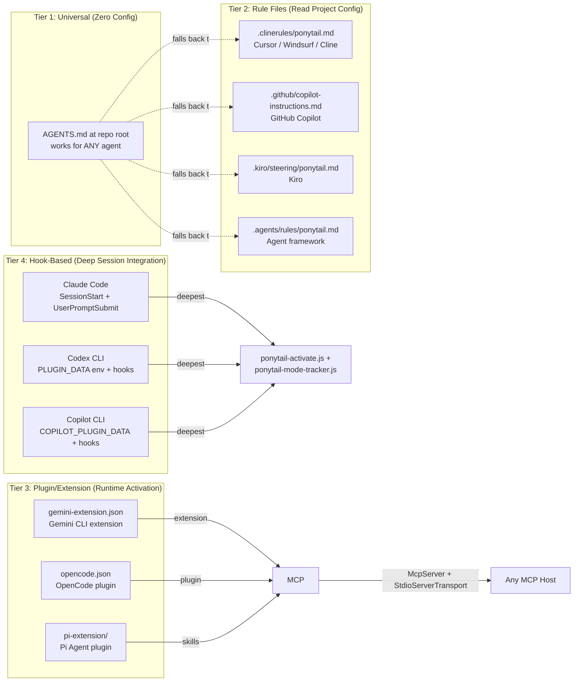
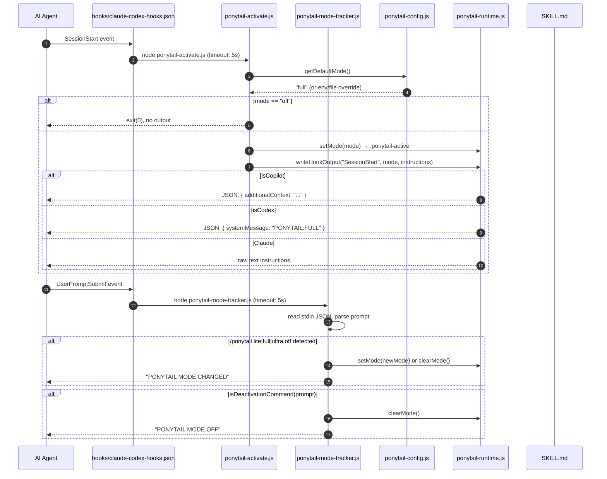
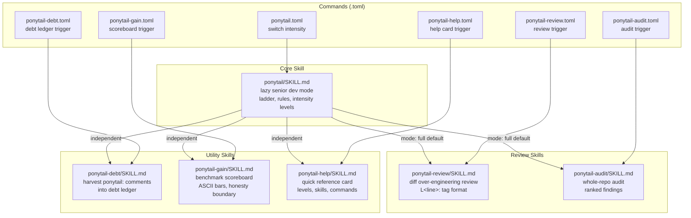

# Ponytail Integrations: 14 Agent Adapters, Hook Protocol, MCP, Skills, and Commands

Ponytail integrates with 14 AI agents through three mechanisms: Claude hooks (always-on), Gemini/OpenCode/Pi extensions (plugin-based), and an MCP server (protocol-based). The AGENTS.md file serves as a universal adapter that works for any agent that reads project-level instructions.

Source: `hooks/` (5 JS files, 2 JSON configs, 2 shell scripts), `skills/` (2 SKILL.md files), `ponytail-mcp/` (2 JS files), `pi-extension/` (1 JS file), `gemini-extension.json`, `opencode.json`, `commands/`, `scripts/`.

## Integration Architecture

The diagram below shows how ponytail connects to each supported agent through its preferred mechanism:

```mermaid
flowchart TD
    subgraph "Universal Adapter"
        AGENTS[AGENTS.md — 27 lines<br/>works with any agent reading project files]
    end

    subgraph "Claude Code / Codex / Copilot — Hook-Based"
        SJSON[~/.claude/settings.json<br/>or plugin marketplace.json]
        ACT[ponytail-activate.js<br/>SessionStart]
        MT[ponytail-mode-tracker.js<br/>UserPromptSubmit]
        RT[ponytail-runtime.js<br/>agent-specific output]
    end

    subgraph "MCP Hosts — Protocol-Based"
        MCP[ponytail-mcp/index.js<br/>McpServer + StdioServerTransport]
        MCP_TOOL[ponytail_instructions tool]
        MCP_PROMPT[ponytail prompt]
    end

    subgraph "Plugin/Extension Agents"
        GEMINI[gemini-extension.json<br/>contextFileName: AGENTS.md]
        OPENCODE[opencode.json<br/>plugin: .opencode/plugins/ponytail.mjs]
        PI[pi-extension/index.js<br/>Pi plugin + skills dir]
    end

    subgraph "Rule File Agents"
        CURSOR[.clinerules/ponytail.md<br/>Cursor/Cline]
        COPILOT[.github/copilot-instructions.md<br/>GitHub Copilot]
        KIRO[.kiro/steering/ponytail.md<br/>Kiro]
        AGENTS_RULES[.agents/rules/ponytail.md<br/>Agent framework]
    end

    AGENTS -->|"universal"| CC[Claude Code]
    AGENTS -->|"universal"| CX[Codex CLI]
    AGENTS -->|"universal"| CP[Copilot CLI]
    AGENTS -->|"universal"| GM[Gemini CLI]
    AGENTS -->|"universal"| OC[OpenCode]
    AGENTS -->|"universal"| PI_A[Pi Agent]
    AGENTS -->|"universal"| Aider[Aider]
    AGENTS -->|"universal"| Qwen[Qwen Coder]
    AGENTS -->|"universal"| AG[Antigravity]
    AGENTS -->|"universal"| Kiro[Kiro]
    AGENTS -->|"universal"| WS[Windsurf]
    AGENTS -->|"universal"| Cline[Cline]
    AGENTS -->|"universal"| Cursor[Cursor]
    AGENTS -->|"universal"| PI_PI[PI Agent]

    CC -->|"SessionStart hook"| ACT
    CC -->|"UserPromptSubmit hook"| MT
    CX -->|"PLUGIN_DATA env"| RT
    CP -->|"COPILOT_PLUGIN_DATA env"| RT

    MCP -->|"registerPrompt"| MCP_PROMPT
    MCP -->|"registerTool"| MCP_TOOL

    GEMINI --> GM
    OPENCODE --> OC
    PI --> PI_A

    CURSOR -->|"reads at project root"| WS
    COPILOT -->|"reads from .github/"| CC
    KIRO -->|"reads from .kiro/"| Kiro
    AGENTS_RULES -->|"reads from .agents/"| PI_A
```



## Integration Tiers: From Universal to Deep

Ponytail's 14 agents are organized into four integration tiers, each requiring different levels of agent support:



## Agent Adapter Matrix

Ponytail works with 14 agents, each with a different integration mechanism:

| # | Agent | Mechanism | Activation | Config File |
|---|-------|-----------|------------|-------------|
| 1 | Claude Code | Hooks (SessionStart + UserPromptSubmit) | Plugin marketplace or manual hooks JSON | `hooks/claude-codex-hooks.json` |
| 2 | Codex CLI | Hooks + `PLUGIN_DATA` env | Plugin system | `hooks/claude-codex-hooks.json` |
| 3 | Copilot CLI | Hooks + `COPILOT_PLUGIN_DATA` env | Plugin system | `hooks/copilot-hooks.json` |
| 4 | Gemini CLI | Extension | `gemini-extension.json` | `gemini-extension.json` |
| 5 | OpenCode | Plugin | `opencode.json` | `opencode.json` |
| 6 | Pi Agent | Plugin extension | `package.json` → `pi.extensions` | `pi-extension/index.js` |
| 7 | Cursor | Rule file | `.clinerules/ponytail.md` | `.clinerules/ponytail.md` |
| 8 | Windsurf | Rule file | Project rules | `.clinerules/ponytail.md` |
| 9 | Cline | Rule file | Project rules | `.clinerules/ponytail.md` |
| 10 | Aider | Rule file (AGENTS.md) | Project rules | Via AGENTS.md |
| 11 | Qwen Coder | Rule file (AGENTS.md) | Project rules | Via AGENTS.md |
| 12 | PI Agent | Rule file (AGENTS.md) | Project rules | Via AGENTS.md |
| 13 | Antigravity | Rule file (AGENTS.md) | Project rules | Via AGENTS.md |
| 14 | Kiro | Rule file | `.kiro/steering/ponytail.md` | `.kiro/steering/ponytail.md` |

## Hook Protocol: How Claude/Codex/Copilot Integration Works

The hook system is the deepest integration. Two hooks fire on every session:



### Hook Configuration Files

**Claude Code / Codex** — `hooks/claude-codex-hooks.json`:

```json
{
  "hooks": {
    "SessionStart": [{
      "matcher": "startup|resume|clear|compact",
      "hooks": [{
        "type": "command",
        "command": "command -v node >/dev/null 2>&1 && node \"${CLAUDE_PLUGIN_ROOT}/hooks/ponytail-activate.js\" || exit 0",
        "commandWindows": "if (Get-Command node -ErrorAction SilentlyContinue) { node \"$env:CLAUDE_PLUGIN_ROOT\\hooks\\ponytail-activate.js\" }",
        "timeout": 5,
        "statusMessage": "Loading ponytail mode..."
      }]
    }],
    "UserPromptSubmit": [{
      "hooks": [{
        "type": "command",
        "command": "command -v node >/dev/null 2>&1 && node \"${CLAUDE_PLUGIN_ROOT}/hooks/ponytail-mode-tracker.js\" || exit 0",
        "commandWindows": "if (Get-Command node -ErrorAction SilentlyContinue) { node \"$env:CLAUDE_PLUGIN_ROOT\\hooks\\ponytail-mode-tracker.js\" }",
        "timeout": 5,
        "statusMessage": "Tracking ponytail mode..."
      }]
    }]
  }
}
```

**Copilot CLI** — `hooks/copilot-hooks.json`:

```json
{
  "version": 1,
  "hooks": {
    "sessionStart": [{
      "type": "command",
      "bash": "node \"${PLUGIN_ROOT}/hooks/ponytail-activate.js\"",
      "powershell": "node \"${PLUGIN_ROOT}\\hooks\\ponytail-activate.js\"",
      "timeoutSec": 5
    }],
    "userPromptSubmitted": [{
      "type": "command",
      "bash": "node \"${PLUGIN_ROOT}/hooks/ponytail-mode-tracker.js\"",
      "powershell": "node \"${PLUGIN_ROOT}\\hooks\\ponytail-mode-tracker.js\"",
      "timeoutSec": 5
    }]
  }
}
```

**Aha:** The hook configs are nearly identical between Claude and Copilot but use different field names (`SessionStart` vs `sessionStart`, `timeout` vs `timeoutSec`, `command` vs `bash`/`powershell`). Each agent's hook JSON matches its own schema, but both point at the same JavaScript files. This is the adapter pattern again: same core logic, different wrapper schemas. The `${CLAUDE_PLUGIN_ROOT}` and `${PLUGIN_ROOT}` variables are resolved by the agent's plugin system at runtime.

## Gemini CLI Integration

Source: `gemini-extension.json` — 6 lines.

```json
{
  "name": "ponytail",
  "version": "4.7.0",
  "description": "Lazy senior dev mode. Forces the simplest, shortest solution that actually works: YAGNI, stdlib first, no unrequested abstractions.",
  "contextFileName": "AGENTS.md"
}
```

The extension points at `AGENTS.md` as its context file. Gemini reads the 27-line universal adapter and applies ponytail rules to every session.

## Codex CLI Integration

Via the `PLUGIN_DATA` environment variable. The runtime detects `process.env.PLUGIN_DATA` and writes output in Codex's expected JSON format:

```javascript
// ponytail-runtime.js:7, 31-40 — Codex detection and output
const isCodex = !isCopilot && Boolean(process.env.PLUGIN_DATA);

if (isCodex) {
  const output = { systemMessage: `PONYTAIL:${mode.toUpperCase()}` };
  if (context) {
    output.hookSpecificOutput = {
      hookEventName: event,
      additionalContext: context,
    };
  }
  process.stdout.write(JSON.stringify(output));
}
```

## Copilot CLI Integration

Via the `COPILOT_PLUGIN_DATA` environment variable. Copilot reads `additionalContext` on SessionStart only:

```javascript
// ponytail-runtime.js:6, 25-29 — Copilot detection and output
const isCopilot = Boolean(process.env.COPILOT_PLUGIN_DATA);

if (isCopilot) {
  process.stdout.write(JSON.stringify(
    event === 'SessionStart' && context ? { additionalContext: context } : {}));
}
```

**Aha:** Copilot only reads `additionalContext` on SessionStart — it ignores hook output on UserPromptSubmit. This means mode changes via `/ponytail` commands won't trigger a new instruction emit for Copilot; the flag file is updated but Copilot won't re-read it. Claude Code and Codex, by contrast, receive fresh output on every hook fire. This is a documented limitation of the Copilot integration.

## OpenCode Integration

Source: `opencode.json` — 4 lines.

```json
{
  "$schema": "https://opencode.ai/config.json",
  "plugin": ["./.opencode/plugins/ponytail.mjs"]
}
```

Registers ponytail as an OpenCode plugin. The plugin is built via `scripts/build-openclaw-skills.js`.

## Pi Extension

Source: `pi-extension/index.js`, `pi-extension/package.json`.

Registers ponytail as a Pi plugin with skills directory:

```json
// package.json
{
  "pi": {
    "extensions": ["./pi-extension/index.js"],
    "skills": ["./skills"]
  }
}
```

**Aha:** The Pi extension is the only integration that registers both an extension (`pi-extension/index.js`) AND a skills directory (`./skills`) in `package.json`. The extension handles the plugin lifecycle while the skills directory makes all 6 SKILL.md files available as slash commands. This dual registration is why Pi gets full ponytail functionality — the extension wires up the SessionStart hook, and the skills directory provides the command surface.

## MCP Server

Source: `ponytail-mcp/index.js` (48 lines), `ponytail-mcp/instructions.js` (26 lines), `ponytail-mcp/package.json`.

Exposes ponytail as an MCP (Model Context Protocol) server for any agent supporting the protocol. Two registration points:

1. **Prompt** (`ponytail`): User-invoked prompt that returns the ruleset for a given intensity
2. **Tool** (`ponytail_instructions`): Host-callable tool that returns structured instructions

```javascript
// ponytail-mcp/index.js:19-29 — registerPrompt
server.registerPrompt("ponytail", {
  title: "Ponytail mode",
  description: "Lazy senior dev instructions: YAGNI, stdlib first, the smallest correct change.",
  argsSchema: { mode: modeArg },
}, ({ mode }) => ({
  messages: [{ role: "user", content: { type: "text", text: buildInstructions(mode) } }],
}));

// ponytail-mcp/index.js:31-46 — registerTool
server.registerTool("ponytail_instructions", {
  title: "Ponytail instructions",
  description: "Return the Ponytail ruleset for the given intensity.",
  inputSchema: { mode: modeArg },
  outputSchema: { mode: z.string(), instructions: z.string() },
  annotations: { readOnlyHint: true, openWorldHint: false },
}, ({ mode }) => { ... });
```

## Skills

Source: `skills/ponytail/SKILL.md` (101 lines), `skills/ponytail-review/SKILL.md` (57 lines), `skills/ponytail-audit/SKILL.md`, `skills/ponytail-debt/SKILL.md`, `skills/ponytail-gain/SKILL.md`, `skills/ponytail-help/SKILL.md`.

The skills ecosystem provides six specialized capabilities:



The main skill file contains:
- Intensity mode definitions (lite, full, ultra)
- The 5-rung ladder of sophistication
- Rules (no unrequested abstractions, deletion over addition, etc.)
- Output format rules (code first, 3 lines max)
- Boundaries (what NOT to simplify)
- Worked examples for each mode

The review skill (`ponytail-review`) is for over-engineering code review:
- Format: `L<line>: <tag> <what>. <replacement>.`
- Tags: `delete:`, `stdlib:`, `native:`, `yagni:`, `shrink:`
- Scoring: `net: -<N> lines possible`
- Boundaries: over-engineering only, not correctness/security/performance

Four additional skills exist:

| Skill | File | Purpose | Trigger |
|-------|------|---------|---------|
| `ponytail-audit` | `skills/ponytail-audit/SKILL.md` | Whole-repo audit for over-engineering (repo-wide review) | `/ponytail-audit` |
| `ponytail-debt` | `skills/ponytail-debt/SKILL.md` | Harvest `ponytail:` comments into a debt ledger | `/ponytail-debt` |
| `ponytail-gain` | `skills/ponytail-gain/SKILL.md` | Display ponytail's measured impact scoreboard | `/ponytail-gain` |
| `ponytail-help` | `skills/ponytail-help/SKILL.md` | Quick-reference card for all modes, skills, commands | `/ponytail-help` |

## Commands

Source: `commands/` directory — 6 `.toml` files, one per skill.

Each command is a TOML file with a `description` and a `prompt` that instructs the agent:

| Command File | Description | Trigger |
|--------------|-------------|---------|
| `ponytail.toml` | Switch ponytail intensity level (lite/full/ultra/off) | `/ponytail` |
| `ponytail-review.toml` | Review changes for over-engineering, what can be deleted | `/ponytail-review` |
| `ponytail-audit.toml` | Audit the whole repo for over-engineering | `/ponytail-audit` |
| `ponytail-debt.toml` | Harvest `ponytail:` comments into a tracked debt ledger | `/ponytail-debt` |
| `ponytail-gain.toml` | Show measured impact scoreboard (less code, cost, time) | `/ponytail-gain` |
| `ponytail-help.toml` | Quick reference for ponytail levels, skills, and commands | `/ponytail-help` |

```toml
# commands/ponytail.toml — intensity switch
description = "Switch ponytail intensity level (lite/full/ultra/off)"
prompt = "Switch to ponytail {{args}} mode. If no level specified, use full. Lazy senior dev mode..."

# commands/ponytail-review.toml — over-engineering review
description = "Review changes for over-engineering, what can be deleted"
prompt = "Review the current code changes for over-engineering only, not correctness..."

# commands/ponytail-gain.toml — scoreboard display
description = "Show ponytail's measured impact scoreboard (less code, cost, time)"
prompt = "Show the ponytail gain scoreboard. One shot, change nothing..."
```

**Aha:** The `.toml` command files are the "wiring" layer that connects slash commands to skill behavior. Each `.toml` file has exactly two fields: `description` (what shows in the command palette) and `prompt` (what gets injected as system context when the command fires). The `{{args}}` template in `ponytail.toml` is the only command that accepts arguments (`/ponytail lite`, `/ponytail ultra`), while the others are one-shot invocations. This separation means the skill files (SKILL.md) define the behavior, and the command files define the trigger — you could add a new command without touching the skill, or reuse a skill under multiple commands.

## Scripts

| Script | Purpose | Lines |
|--------|---------|-------|
| `scripts/build-openclaw-skills.js` | Build skills for OpenClaw agent | ~40 |
| `scripts/check-rule-copies.js` | Verify rule files aren't duplicated across agent adapters | ~50 |

## Installation Methods

```bash
# Claude Code (plugin marketplace)
npx skills add DietrichGebert/ponytail

# Codex CLI
codex skills add DietrichGebert/ponytail

# Manual (any agent — copy rule file)
cp skills/ponytail/SKILL.md .cursor/rules/ponytail.mdc
```

**Aha:** The `npx skills add` command installs ponytail as a Claude Code plugin, which activates the hooks automatically. But the manual copy approach works for any agent that reads project-level rule files. The 27-line AGENTS.md is the true universal adapter — it works for Cursor, Windsurf, Cline, Kiro, CodeWhale, Antigravity, Copilot editor, and others, just by existing at the repo root. The plugin system and MCP server are amplifiers, not requirements.

## Cross-References

- [Overview](00-overview.md) — What ponytail is, philosophy, benchmark numbers
- [Architecture](01-architecture.md) — Hooks, config resolution, runtime state, MCP, skill filtering
- [Benchmarks](02-benchmarks.md) — Agentic benchmarks, correctness, robustness, LLM judges
