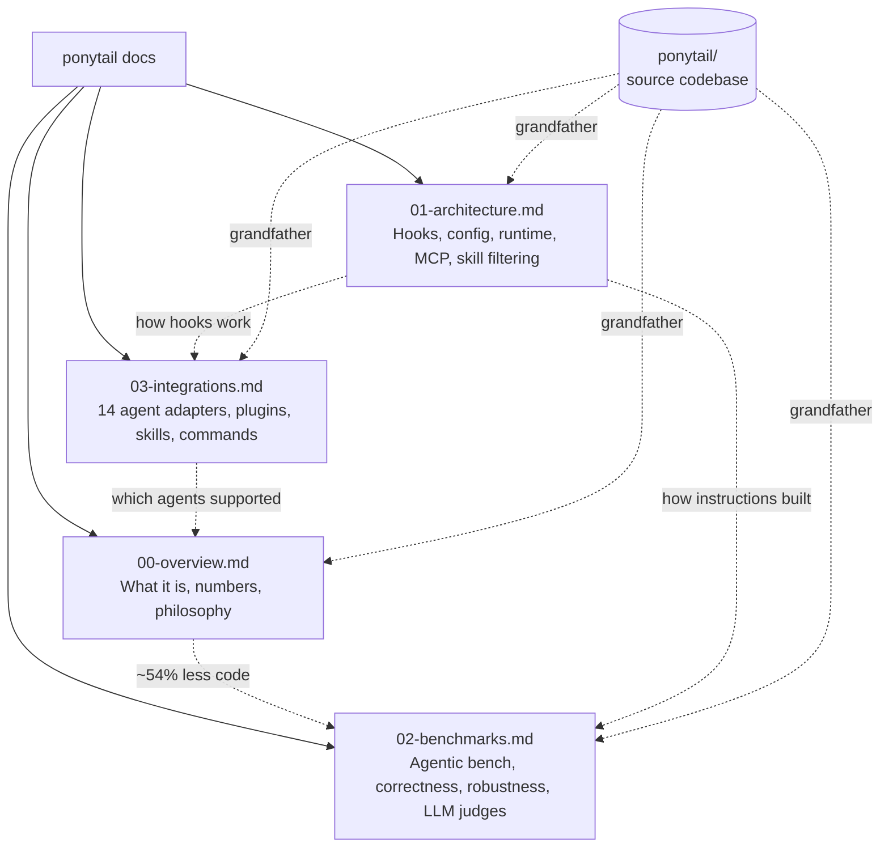
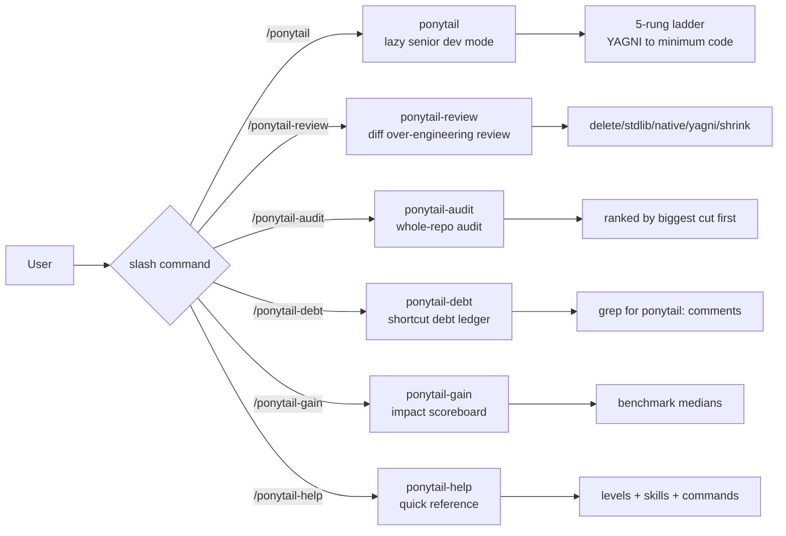

# Ponytail Documentation

Lazy senior dev mode for AI coding agents. ~54% less code, ~20% cheaper, ~27% faster.

| Attribute | Value |
|-----------|-------|
| Source files | ~35+ |
| Language | JavaScript (Node.js), Python |
| Agents supported | 14 |
| License | MIT |
| Modes | lite, full (default), ultra, off, review |



## Ponytail Skills Ecosystem

Ponytail ships with 6 specialized skills, each a self-contained SKILL.md file:



**Aha:** Ponytail's 27-line AGENTS.md is the most powerful integration point in the entire system. While the hooks, MCP server, and plugin extensions provide richer integration for agents that support them, the AGENTS.md file works universally — any agent that reads project-level instructions gets ponytail just by this file existing at the repo root. The hooks, skills, and MCP server are amplifiers, not requirements. This is why ponytail supports 14 agents with ~35 source files: the core is 27 lines, and everything else is adapter plumbing.

## Navigation

| # | Document | Purpose |
|---|----------|---------|
| 00 | [Overview](00-overview.md) | What ponytail is, philosophy, benchmark numbers |
| 01 | [Architecture](01-architecture.md) | Hooks, config resolution, runtime state, MCP, skill filtering |
| 02 | [Benchmarks](02-benchmarks.md) | Agentic benchmarks, correctness, robustness, LLM judges |
| 03 | [Integrations](03-integrations.md) | Agent plugins, hooks, skills, commands |

## Source Codebase

- **Location:** `/home/darkvoid/Boxxed/@formulas/src.rust/src.AI/src.PromptOptimizations/ponytail/`
- **Repository:** [DietrichGebert/ponytail](https://github.com/DietrichGebert/ponytail)
- **Key files:** `hooks/` (5 JS files, 2 JSON configs, 2 shell scripts), `skills/` (2 SKILL.md files), `benchmarks/agentic/` (4 Python files), `ponytail-mcp/` (2 JS files), `pi-extension/` (1 JS file)

## Build HTML

```bash
cd /home/darkvoid/Boxxed/@dev/repo-expolorations/[src.AI]
python3 build.py src.PromptOptimizations
```
