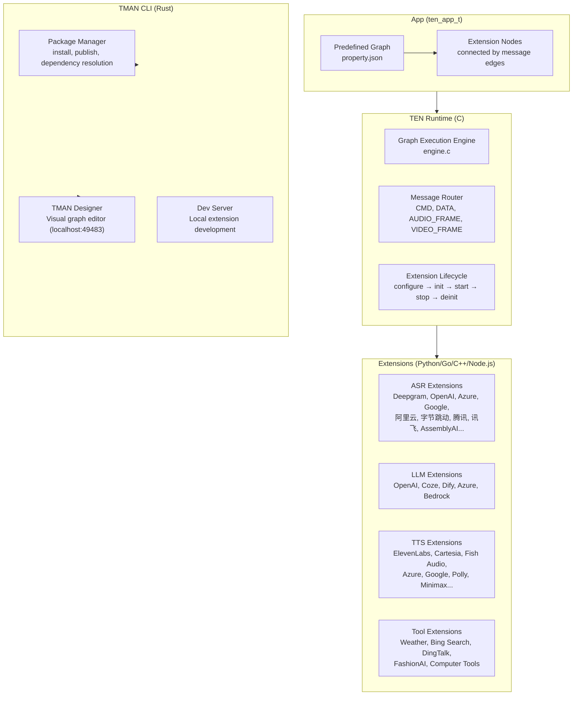
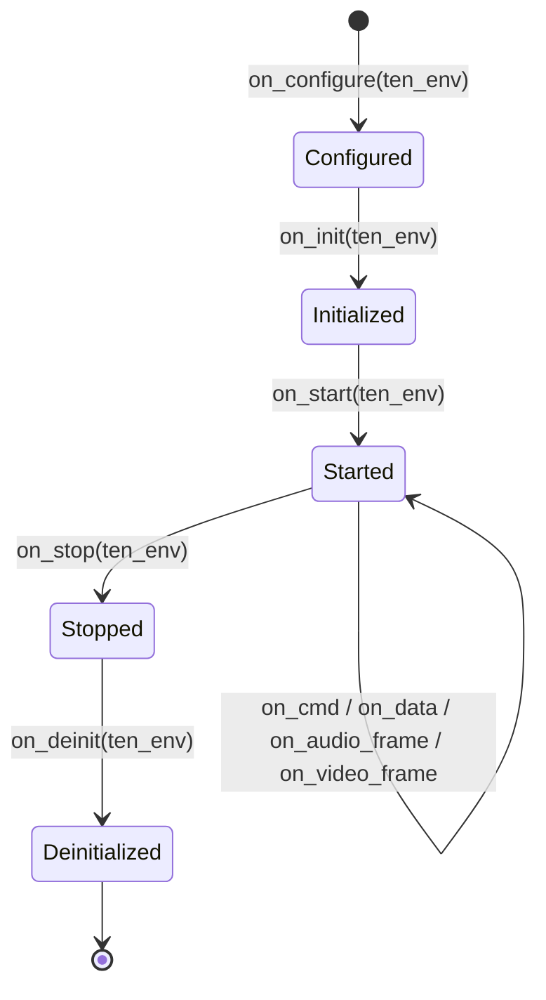

# TEN Framework — Real-Time Multi-Modal Conversational AI Agent Platform

**TEN (Transformational Extension Network) is an open-source framework for building real-time multi-modal conversational AI agents.** It uses a graph-based message-passing architecture: extensions (STT, LLM, TTS, tools) connect as nodes in a directed graph, and messages (commands, data, audio frames, video frames) flow along edges. The C core runtime handles sub-millisecond message routing. A Rust CLI (`tman`) manages packages with SAT-based dependency resolution and provides a visual graph editor. Extensions are written in Python, Go, C++, or Node.js. Ships with 95 pre-built extensions, 30 agent examples, a high-performance VAD library, and a Transformer-based turn-detection model.

Source: `ten-framework/` — ~4.7M lines, Apache 2.0

## Architecture



## The Graph Model

**Aha:** Every agent is a directed graph of extensions declared in `property.json`. Connections define which message types flow between nodes. This is visual, declarative, and version-controllable — unlike imperative agent code where message routing is scattered across callbacks.

```json
{
  "nodes": [
    { "type": "extension", "name": "stt", "addon": "deepgram_asr" },
    { "type": "extension", "name": "llm", "addon": "openai_chatgpt" },
    { "type": "extension", "name": "tts", "addon": "elevenlabs_tts" }
  ],
  "connections": [
    { "from": "stt", "to": "llm", "msg_type": "data" },
    { "from": "llm", "to": "tts", "msg_type": "data" }
  ]
}
```

## Message Types

| Type | Purpose | Example |
|------|---------|---------|
| `CMD` | Control commands | start, stop, pause |
| `CMD_RESULT` | Command responses | status, error codes |
| `DATA` | Structured data | JSON, text, embeddings |
| `AUDIO_FRAME` | Raw audio samples | PCM from microphone |
| `VIDEO_FRAME` | Raw video frames | Camera feed |

**Aha:** Audio and video are first-class message types, not opaque data blobs. The runtime can route audio frames with zero-copy buffer management, avoiding the serialization overhead that makes most agent frameworks unsuitable for real-time voice.

## Extension Lifecycle



Each extension is an independent process unit with its own lifecycle. The runtime manages threading — extensions can be single-threaded or multi-threaded, blocking or non-blocking.

## TEN Runtime Internals

The C runtime (~3.9M lines) handles:
- **Message dispatch:** lock-free queues for inter-extension communication
- **Thread pool:** configurable per-extension thread allocation
- **Buffer management:** reference-counted audio/video frame buffers with zero-copy sharing
- **Graph validation:** cycle detection, type checking on connections
- **Event loop:** libuv-based async I/O for extensions

## TMAN CLI (Rust)

```bash
tman install <package>       # Install extension from registry
tman publish                  # Publish extension to registry
tman designer                 # Launch visual graph editor
tman run                      # Run agent from property.json
```

**Aha:** TMAN uses a **SAT solver** (clingo) for dependency resolution. Extension dependencies form constraints; the SAT solver finds a valid installation plan or proves none exists. This is overkill for most package managers but essential here — extensions can have complex compatibility matrices across OS, CPU architecture, and runtime versions.

## 95 Pre-Built Extensions

| Category | Count | Examples |
|----------|-------|---------|
| ASR/STT | 20+ | Deepgram, OpenAI Whisper, Azure Speech, Google STT, AWS Transcribe, 阿里云, 字节跳动, 腾讯, 讯飞, AssemblyAI, Gladia, Soniox, Speechmatics |
| LLM | 5+ | OpenAI, Coze, Dify, Azure OpenAI, AWS Bedrock |
| TTS | 20+ | ElevenLabs, Azure TTS, Cartesia, Fish Audio, Hume AI, Minimax, Google TTS, Polly, RIME, Deepgram TTS, xAI, Oracle, 字节跳动, Murf |
| Tools | 10+ | Weather API, Bing Search, DingTalk Bot, FashionAI, Computer Tools, Conversation Logger |
| Memory | 3+ | memU, MemOS, PowerMem |

## 30 Agent Examples

| Example | Description |
|---------|-------------|
| voice-assistant | Core: ASR → LLM → TTS pipeline |
| voice-assistant-realtime | Real-time voice-to-voice with sub-second latency |
| voice-assistant-live2d | Lip-sync animated character |
| voice-assistant-sip-twilio | Phone calls via Twilio SIP |
| speaker-diarization | Real-time speaker identification |
| doodler | Canvas sketch generation from voice/text |
| transcription | Pure transcription pipeline |

## ten-vad — High-Performance VAD

- **Algorithm:** Acoustic event detection + pitch estimation + STFT
- **Size:** ~306KB (vs Silero VAD's ~2.2MB — **7x smaller**)
- **RTF:** 0.0086-0.0150 on x64 (extremely low CPU)
- **Languages:** C/C++ native, Python (ctypes/ONNX), Java (JNI/JNA), Go (CGo), JS (WASM)

## ten-turn-detection — Semantic Turn Detection

Fine-tuned Qwen2.5-7B model that classifies user input into three states:
- **finished** — Complete utterance, expect response (90.64% English, 98.90% Chinese accuracy)
- **unfinished** — User paused but intends to continue
- **wait** — User indicated no immediate response needed

## Cross-References

- [src.Hedr](../src.Hedr/markdown/00-overview.md) — Terminal workspace manager (hosts agent sessions)
- [Goose](../src.block/markdown/00-overview.md) — Block's AI agent
- [src.jeremychone](../src.jeremychone/markdown/00-overview.md) — AIP stack
