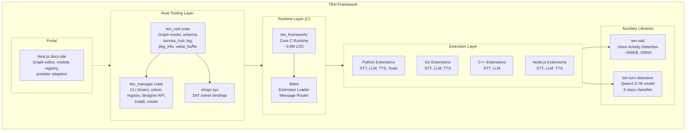
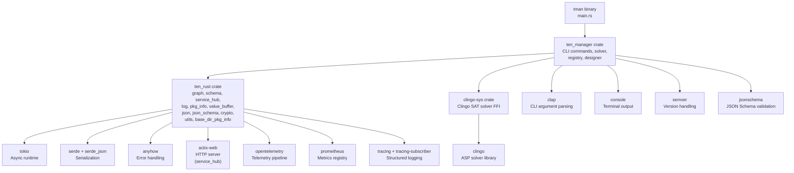

# TEN Framework Architecture — Layers, Modules, and Dependency Graph

TEN Framework is a multi-layered system with a C core runtime, Rust-based tooling (CLI, validation, designer backend), and multi-language extension SDKs (Python, Go, C++, Node.js). The architecture separates concerns across three major sub-projects and a portal documentation site.

## System Layer Diagram



## Crate Dependency Graph



## Source-to-Binary Mapping

| Binary | Source Crate | Entry Point | Purpose |
|--------|-------------|-------------|---------|
| `tman` | `ten_manager` | `core/src/ten_manager/src/main.rs:48` | CLI for package management, graph design, agent execution |
| `ten_rust` (staticlib) | `ten_rust` | `core/src/ten_rust/src/lib.rs:7` | Shared library for graph validation, schema, telemetry |
| `ten_rust` (rlib) | `ten_rust | N/A | Rust library for internal use by `ten_manager` |

Source: `core/src/ten_rust/Cargo.toml:21` — `crate-type = ["staticlib", "rlib"]`

## Package Type Hierarchy

TEN defines five package types that form a dependency hierarchy:

| Package Type | Directory | Purpose | Dependencies |
|-------------|-----------|---------|-------------|
| `app` | Root | Application entry point, `property.json` | extensions, protocols, addon_loaders, system |
| `extension` | `ten_packages/extension/` | Processing nodes (STT, LLM, TTS, tools) | protocols |
| `protocol` | `ten_packages/protocol/` | Transport adapters (HTTP, WebSocket, etc.) | — |
| `addon_loader` | `ten_packages/addon_loader/` | Language runtime loaders (Python, Go, Node.js) | — |
| `system` | `ten_packages/system/` | Built-in system packages | — |

Source: `core/src/ten_rust/src/pkg_info/mod.rs:194-228` — `PkgType` enum and `collect_pkg_info_from_path`

## Directory Structure

```
ten-framework/
├── core/
│   ├── src/
│   │   ├── ten_rust/          ← Rust library: graph, schema, service_hub, log, pkg_info
│   │   │   ├── src/
│   │   │   │   ├── graph/     ← Graph model (nodes, connections, subgraphs, selectors, checks)
│   │   │   │   ├── schema/    ← JSON schema definitions and runtime interface
│   │   │   │   ├── service_hub/ ← HTTP server + OpenTelemetry telemetry
│   │   │   │   ├── log/       ← Logging with encryption, OTLP, formatters
│   │   │   │   ├── pkg_info/  ← Package metadata, manifest, property
│   │   │   │   ├── value_buffer/ ← Binary value serialization (18 types)
│   │   │   │   ├── json/      ← JSON utilities
│   │   │   │   ├── json_schema/ ← JSON Schema validation
│   │   │   │   ├── crypto/    ← AES encryption for logs
│   │   │   │   ├── utils/     ← File system, path, URI utilities
│   │   │   │   ├── constants/ ← Error messages, constants
│   │   │   │   └── base_dir_pkg_info/ ← Per-app package cache
│   │   │   └── Cargo.toml
│   │   └── ten_manager/       ← Rust binary: CLI commands, SAT solver, designer
│   │       ├── src/
│   │       │   ├── cmd/       ← CLI subcommands (create, install, run, designer, etc.)
│   │       │   ├── solver/    ← SAT-based dependency resolution (clingo)
│   │       │   ├── registry/  ← Local + remote package registry
│   │       │   ├── designer/  ← HTTP API for visual graph editor
│   │       │   ├── install/   ← Package installation logic
│   │       │   ├── home/      ← User config, data, cache
│   │       │   ├── fs/        ← File system utilities, log watcher
│   │       │   ├── graph/     ← Graph validation and message conversion
│   │       │   ├── pkg_info/  ← Package info utilities
│   │       │   ├── schema/    ← Schema definitions
│   │       │   ├── create/    ← Package creation from templates
│   │       │   ├── check_env/ ← Environment checks (C++, Go, Node.js, Python, OS)
│   │       │   ├── output/    ← CLI output abstraction
│   │       │   ├── constants/ ← Constants and defaults
│   │       │   ├── cmd_line.rs ← Clap CLI parsing
│   │       │   ├── main.rs    ← Entry point
│   │       │   └── tracing_config.rs ← Tracing/profiling config
│   │       └── Cargo.toml
│   └── third_party/
│       └── clingo-sys/        ← Clingo SAT solver FFI bindings
├── packages/                  ← Pre-built extension packages
├── tools/                     ← Build and development tools
├── tests/                     ← Integration tests
└── docs/                      ← Documentation
```

## Cross-References

- [02-ten-rust-runtime.md](02-ten-rust-runtime.md) — Deep dive into the ten_rust crate
- [03-tman-cli.md](03-tman-cli.md) — TMAN CLI commands and SAT solver
- [04-graph-system.md](04-graph-system.md) — Graph model, nodes, connections
- [05-extension-system.md](05-extension-system.md) — Package types and manifest schema

## Next

Continue to [02-ten-rust-runtime.md](02-ten-rust-runtime.md) for a deep dive into the ten_rust crate's modules.
