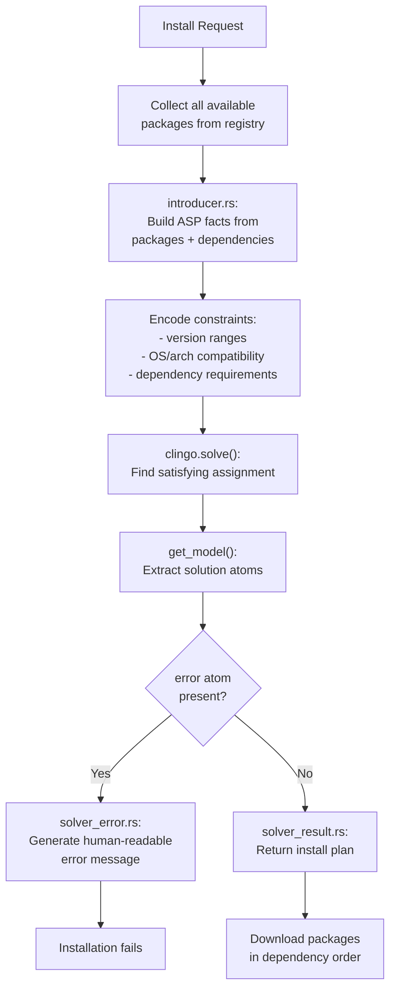
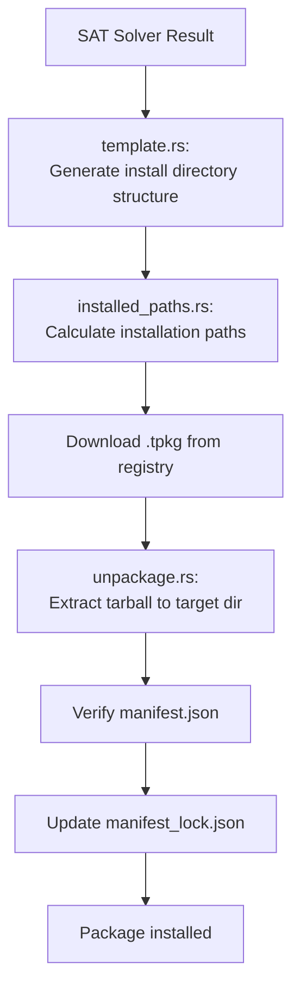

# TMAN CLI — TEN Package Manager and Graph Designer

The `tman` binary is TEN Framework's command-line tool, built with Rust using the `clap` crate for argument parsing. It handles package management (create, install, uninstall, fetch, publish, package), graph design (designer HTTP API), environment validation (check env), and agent execution (run).

## Entry Point and Initialization

Source: `core/src/ten_manager/src/main.rs:48-120`

```rust
fn main() {
    let out: Arc<Box<dyn TmanOutput>> = Arc::new(Box::new(TmanOutputCli));
    run(out);
}

fn run(out: Arc<Box<dyn TmanOutput>>) {
    let parsed_cmd = match cmd_line::parse_cmd() { ... };
    
    if parsed_cmd.show_version {
        out.normal_line(&format!("TEN Framework version: {VERSION}"));
        check_update_from_cmdline(out.clone())?;
        process::exit(0);
    }
    
    // Initialize tracing (console, chrome, flame, or all)
    let tracing_mode = TracingMode::from_config(tracing_mode_str);
    let _tracing_guard = init_tracing(tracing_mode, out.clone());
    
    let rt = Runtime::new()?;
    let result = rt.block_on(execute_cmd(
        parsed_cmd.tman_config,
        Arc::new(tokio::sync::RwLock::new(TmanStorageInMemory::default())),
        parsed_cmd.command_data.unwrap(),
        out.clone(),
    ));
    process::exit(result.is_err() as i32);
}
```

The CLI initializes in this order:
1. Parse command-line arguments via `clap`
2. Show version and check for updates (if `--version`)
3. Initialize tracing subsystem
4. Create tokio runtime
5. Execute the appropriate command
6. Exit with status code

## CLI Argument Parsing

Source: `core/src/ten_manager/src/cmd_line.rs:52-118`

```rust
Command::new("tman")
    .about("TEN manager")
    .disable_version_flag(true)
    .arg_required_else_help(true)
    .arg(Arg::new("VERSION").long("version")...)
    .arg(Arg::new("CONFIG_FILE").long("config-file").short('c')...)
    .arg(Arg::new("USER_TOKEN").long("user-token")...)
    .arg(Arg::new("VERBOSE").long("verbose")...)
    .arg(Arg::new("ASSUME_YES").long("yes").short('y')...)
    .arg(Arg::new("TRACING").long("tracing")
        .value_parser(["console", "chrome", "flame", "all"])...)
    // Hidden
    .arg(Arg::new("ADMIN_TOKEN").long("admin-token").hide(true)...)
    .subcommand(cmd_create)
    .subcommand(cmd_install)
    .subcommand(cmd_fetch)
    .subcommand(cmd_uninstall)
    .subcommand(cmd_package)
    .subcommand(cmd_publish)
    .subcommand(cmd_designer)
    .subcommand(cmd_check)
    .subcommand(cmd_modify)
    .subcommand(cmd_run)
    .subcommand(cmd_completion)
    // Hidden
    .subcommand(cmd_delete)
```

### Global Flags

| Flag | Short | Purpose |
|------|-------|---------|
| `--version` | — | Print version and check for updates |
| `--config-file` | `-c` | Custom config.json path |
| `--user-token` | — | Registry authentication token |
| `--verbose` | — | Enable verbose output |
| `--yes` | `-y` | Auto-confirm all prompts |
| `--tracing MODE` | — | Tracing mode: `console`, `chrome`, `flame`, `all` |
| `--admin-token` | — | (hidden) Administration token |

### Supported Values

Source: `core/src/ten_manager/src/cmd_line.rs:32-49`

| Category | Values |
|----------|--------|
| Package type | `system`, `protocol`, `addon_loader`, `extension`, `app` |
| OS | `linux`, `mac`, `win` |
| Architecture | `x86`, `x64`, `arm`, `arm64` |
| Build type | `debug`, `release` |
| Language | `cpp`, `go` |

## Command Dispatcher

Source: `core/src/ten_manager/src/cmd/mod.rs:27-92`

```rust
pub enum CommandData {
    Create(CreateCommand),
    Install(InstallCommand),
    Fetch(FetchCommand),
    Uninstall(UninstallCommand),
    Package(PackageCommand),
    Publish(PublishCommand),
    Delete(DeleteCommand),
    Designer(DesignerCommand),
    Check(CheckCommandData),
    Modify(ModifyCommandData),
    Run(RunCommand),
    Completion(CompletionCommand),
}
```

The `execute_cmd()` function dispatches to the appropriate subcommand handler.

## Subcommands Deep Dive

```mermaid
flowchart TD
    tman["tman"] --> create["create\nCreate app/extension from template"]
    tman --> install["install\nInstall packages with SAT solver"]
    tman --> fetch["fetch\nFetch packages from registry"]
    tman --> uninstall["uninstall\nRemove installed packages"]
    tman --> package["package\nPackage into .tpkg file"]
    tman --> publish["publish\nPublish to registry"]
    tman --> designer["designer\nLaunch HTTP graph editor"]
    tman --> check["check\nValidate manifest/property/env"]
    tman --> modify["modify\nProgrammatically edit graphs"]
    tman --> run["run\nExecute agent graph"]
    tman --> completion["completion\nShell completion scripts"]
    tman --> delete["delete (hidden)\nDelete packages"]
```



### `tman create`

Source: `core/src/ten_manager/src/cmd/cmd_create.rs:1-186`

Creates new apps or extensions from templates.

```bash
tman create --type app --name my-app --lang python
tman create --type extension --name my_extension --lang python
```

**Templates available:**

| Template | Language | Package Type |
|----------|----------|-------------|
| `default_app_cpp` | C++ | app |
| `default_app_go` | Go | app |
| `default_app_python` | Python | app |
| `default_app_nodejs` | Node.js | app |
| `default_extension_cpp` | C++ | extension |
| `default_extension_go` | Go | extension |
| `default_extension_python` | Python | extension |
| `default_extension_nodejs` | Node.js | extension |

Source: `core/src/ten_manager/src/constants/mod.rs:55-62`

### `tman install`

Source: `core/src/ten_manager/src/cmd/cmd_install.rs:1-1404` (largest command at 1404 lines)

The install command resolves dependencies using the SAT solver and installs packages from the registry.

```bash
tman install deepgram_asr
tman install --type extension --name openai_chatgpt --version 1.0.0
tman install --all    # Install all dependencies from manifest.json
```

**Key flow:**
1. Parse package specification (name, type, version)
2. Query registry for package metadata
3. Build dependency graph
4. Run SAT solver for resolution
5. Download and extract `.tpkg` files
6. Install to `ten_packages/` directory

### `tman designer`

Source: `core/src/ten_manager/src/cmd/cmd_designer.rs:1-158`

Launches the HTTP-based graph editor on `localhost:49483`.

```bash
tman designer                              # Use CWD as base dir
tman designer --base-dir /path/to/app      # Specify app directory
tman designer --ip 0.0.0.0 --port 8080     # Custom bind
```

**Aha:** The default port `49483` is computed from the ASCII sum of "rte" (runtime editor): `(114 + 116 + 101) % 16384 + 49152 = 49483`. This is a deterministic port assignment based on the mnemonic.

Source: `core/src/ten_manager/src/cmd/cmd_designer.rs:43-56`

### `tman check`

Source: `core/src/ten_manager/src/cmd/cmd_check/mod.rs:1-105`

Validates various aspects of the project.

```bash
tman check env                    # Check development environment
tman check manifest.json          # Validate manifest.json
tman check property.json          # Validate property.json
tman check interface.json         # Validate interface.json
```

**Environment checks:**

| Check | File | What It Validates |
|-------|------|-------------------|
| C++ | `check_cpp.rs` (451 lines) | Compiler, CMake, pkg-config, build tools |
| Go | `check_go.rs` (189 lines) | Go version, GOPATH, modules |
| Node.js | `check_nodejs.rs` (198 lines) | Node version, npm, npx |
| Python | `check_python.rs` (176 lines) | Python version, pip, venv |
| OS | `check_os.rs` (69 lines) | OS type, architecture |

### `tman run`

Source: `core/src/ten_manager/src/cmd/cmd_run.rs:1-242`

Executes an agent graph defined in `property.json`.

```bash
tman run                    # Run from CWD
tman run --base-dir /path   # Run specific app
```

The run command:
1. Loads `property.json` from the app directory
2. Validates the graph configuration
3. Starts the TEN runtime
4. Monitors execution and outputs logs

### `tman modify`

Source: `core/src/ten_manager/src/cmd/cmd_modify/mod.rs:1-61`

Programmatically modifies graph configurations.

```bash
tman modify graph --add-node ...
tman modify graph --add-connection ...
```

Uses `jq_util.rs` for JSON manipulation.

### `tman completion`

Source: `core/src/ten_manager/src/cmd/cmd_completion.rs:1-136`

Generates shell completion scripts for bash, zsh, fish, and PowerShell.

```bash
tman completion bash
tman completion zsh
```

## SAT Solver — Dependency Resolution

Source: `core/src/ten_manager/src/solver/solve.rs:1-926`

The SAT solver uses Clingo (Answer Set Programming) to resolve package dependencies.



### Solver Components

| File | Purpose | Lines |
|------|---------|-------|
| `mod.rs` | Module entry | 10 |
| `solve.rs` | Core SAT solving logic | 926 |
| `introducer.rs` | Build ASP facts | 148 |
| `solver_error.rs` | Error formatting | 196 |
| `solver_result.rs` | Result extraction | 204 |

### Clingo FFI Bindings

Source: `core/src/ten_rust/third_party/clingo-sys/`

| File | Purpose |
|------|---------|
| `bindings.rs` | Auto-generated Rust FFI bindings |
| `build.rs` | Build script for clingo C library |
| `lib.rs` | Module entry, re-exports |

## Registry System

Source: `core/src/ten_manager/src/registry/`

The registry system provides both local and remote package lookup.

| File | Purpose | Lines |
|------|---------|-------|
| `mod.rs` | Registry module entry, search interface | 305 |
| `local.rs` | Local package registry (installed packages) | 597 |
| `remote.rs` | Remote registry API client | 1000 |
| `pkg_cache.rs` | Downloaded package cache | 84 |
| `pkg_list_cache.rs` | Package list cache | 157 |
| `search.rs` | Search implementation | 71 |
| `found_result.rs` | Search result types | 189 |

### Remote Registry Configuration

Source: `core/src/ten_manager/src/constants/registry.rs:1-20`

| Constant | Value |
|----------|-------|
| `REMOTE_REGISTRY_MAX_RETRIES` | 30 |
| `REMOTE_REGISTRY_RETRY_DELAY_MS` | 500ms |
| `REMOTE_REGISTRY_REQUEST_TIMEOUT_SECS` | 120s |
| `DEFAULT_REGISTRY_PAGE_SIZE` | 100 |

## Install Pipeline

Source: `core/src/ten_manager/src/install/mod.rs:1-491`



## Constants and Defaults

Source: `core/src/ten_manager/src/constants/mod.rs:1-76`

| Constant | Value | Purpose |
|----------|-------|---------|
| `DOT_TEN_DIR` | `.ten` | Hidden config directory |
| `DESIGNER_BACKEND_DEFAULT_PORT` | `"49483"` | Default designer port |
| `TEN_PACKAGE_FILE_EXTENSION` | `.tpkg` | Package file extension |
| `DEFAULT_INIT_LATEST_VERSIONS_WHEN_INSTALL` | 3 | Initial versions to fetch |
| `DEFAULT_MAX_LATEST_VERSIONS_WHEN_INSTALL` | 9 | Maximum versions to consider |
| `PROCESS_STDOUT_MAX_LINE_CNT` | 1000 | Designer output limit |
| `DESIGNER_FRONTEND_DEFAULT_LOGVIEWER_LINE_SIZE` | 1000 | Log viewer default size |

## Cross-References

- [01-architecture.md](01-architecture.md) — Overall architecture
- [02-ten-rust-runtime.md](02-ten-rust-runtime.md) — ten_rust library used by tman
- [06-designer-api.md](06-designer-api.md) — Designer HTTP API launched by `tman designer`
- [05-extension-system.md](05-extension-system.md) — Package types managed by tman

## Next

Continue to [04-graph-system.md](04-graph-system.md) for the graph model deep dive.
