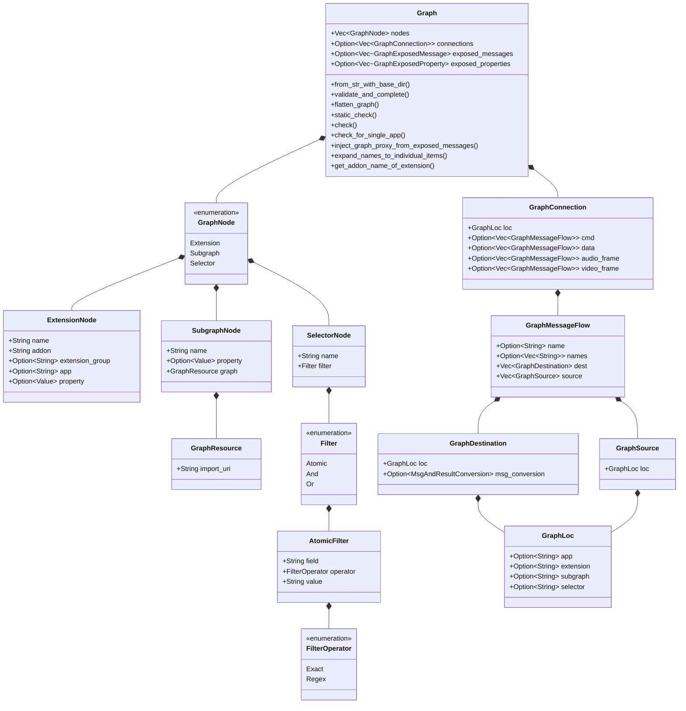
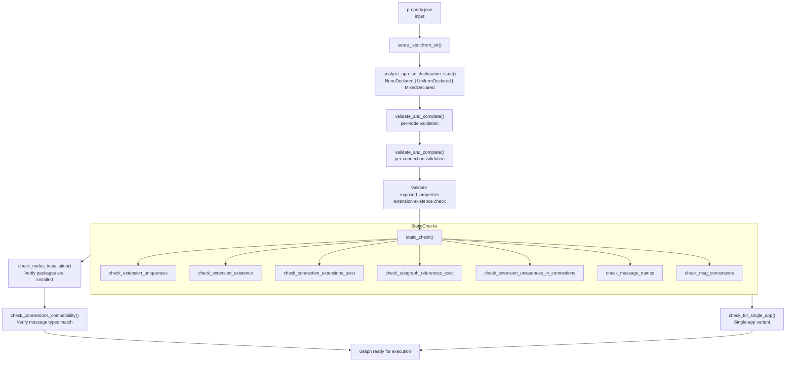
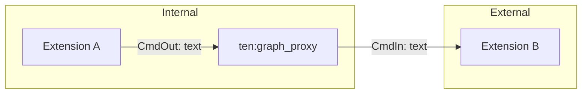

# TEN Graph System — Nodes, Connections, Subgraphs, and Selectors

TEN's core architecture is a declarative graph: extensions are nodes, message flows are edges, and the runtime executes by routing messages along these edges. The graph model supports three node types (extension, subgraph, selector), four message types (cmd, data, audio_frame, video_frame), and multi-app topologies. The entire graph model lives in the `ten_rust` crate's `graph/` module.

## Graph Data Model



Source: `core/src/ten_rust/src/graph/mod.rs:171-184`, `core/src/ten_rust/src/graph/node/mod.rs:122-137`, `core/src/ten_rust/src/graph/connection/mod.rs:195-208`

## Node Types

### Extension Nodes

Extension nodes represent processing units in the graph.

Source: `core/src/ten_rust/src/graph/node/mod.rs:28-44`

```rust
pub struct ExtensionNode {
    pub name: String,           // Unique identifier within the graph
    pub addon: String,          // The actual extension package name
    pub extension_group: Option<String>, // Threading group
    pub app: Option<String>,    // App URI (for multi-app graphs)
    pub property: Option<serde_json::Value>, // Per-node configuration
}
```

**Key facts:**
- `name` is the graph-local identifier (e.g., `"stt"`, `"llm"`)
- `addon` references the installed package (e.g., `"deepgram_asr"`, `"openai_chatgpt"`)
- `extension_group` controls threading: extensions in the same group share a thread pool
- `app` enables multi-app graphs (nodes can belong to different apps)
- `property` overrides the extension's default `property.json` values

### Subgraph Nodes

Subgraph nodes enable graph composition by importing external graphs.

Source: `core/src/ten_rust/src/graph/node/mod.rs:47-60`

```rust
pub struct SubgraphNode {
    pub name: String,
    pub property: Option<serde_json::Value>,
    pub graph: GraphResource,  // { "import_uri": "file://..." }
}

pub struct GraphResource {
    pub import_uri: String,
}
```

Subgraphs are loaded via `import_uri`, which can be a file path or URL. The `load_graph_from_uri()` function resolves the URI and parses the subgraph definition.

**Aha:** Subgraph resolution uses `exposed_messages` to map external message references to internal extension names. When a connection references a subgraph as source or destination, TEN recursively resolves through the subgraph's `exposed_messages` to find the actual extension that handles the message. This enables deeply nested subgraph composition without the parent graph needing to know the internal structure.

Source: `core/src/ten_rust/src/graph/subgraph/mod.rs:26-61`

```rust
fn resolve_subgraph_to_extension(
    subgraph_name: &str,
    msg_name: &str,
    msg_type: GraphExposedMessageType,
    subgraph: &Graph,
) -> Result<String> {
    if let Some(exposed_messages) = &subgraph.exposed_messages {
        let matching_exposed = exposed_messages
            .iter()
            .find(|exposed| exposed.msg_type == msg_type && exposed.name == msg_name);
        // ... returns the extension name from the matched exposed message
    }
}
```

The resolution is recursive — if the matched name points to another subgraph, the function recurses until it finds an actual extension node. Source: `core/src/ten_rust/src/graph/subgraph/mod.rs:111-231`

### Selector Nodes

Selector nodes provide dynamic routing based on message content.

Source: `core/src/ten_rust/src/graph/node/mod.rs:62-118`

```rust
pub enum FilterOperator { Exact, Regex }

pub struct AtomicFilter {
    pub field: String,
    pub operator: FilterOperator,
    pub value: String,
}

pub enum Filter {
    Atomic(AtomicFilter),
    And { and: Vec<Filter> },
    Or { or: Vec<Filter> },
}

pub struct SelectorNode {
    pub name: String,
    pub filter: Filter,
}
```

Selectors use a recursive filter DSL supporting `and`/`or` composition. The `flatten_selectors()` method resolves selectors to concrete extension nodes during graph flattening.

Source: `core/src/ten_rust/src/graph/selector.rs:1-354`

## Connection Model

Connections define how messages flow from a source to destinations.

### GraphLoc — Universal Location

Source: `core/src/ten_rust/src/graph/connection/mod.rs:21-34`

```rust
pub struct GraphLoc {
    pub app: Option<String>,
    pub extension: Option<String>,
    pub subgraph: Option<String>,
    pub selector: Option<String>,
}
```

A `GraphLoc` uses exactly one of `extension`, `subgraph`, or `selector` to identify a target node. The `validate_node_type()` method enforces this invariant by counting which fields are `Some` and requiring exactly one.

Source: `core/src/ten_rust/src/graph/connection/mod.rs:121-130`

```rust
pub fn validate_node_type(&self) -> Result<()> {
    let count = if self.extension.is_some() { 1 } else { 0 }
        + if self.subgraph.is_some() { 1 } else { 0 }
        + if self.selector.is_some() { 1 } else { 0 };
    if count == 1 {
        Ok(())
    } else {
        Err(anyhow::anyhow!(ERR_MSG_UNKNOWN_GRAPH_NODE_TYPE))
    }
}
```

### GraphConnection — Source Location + Message Flows

Source: `core/src/ten_rust/src/graph/connection/mod.rs:195-208`

```rust
pub struct GraphConnection {
    pub loc: GraphLoc,
    pub cmd: Option<Vec<GraphMessageFlow>>,
    pub data: Option<Vec<GraphMessageFlow>>,
    pub audio_frame: Option<Vec<GraphMessageFlow>>,
    pub video_frame: Option<Vec<GraphMessageFlow>>,
}
```

The `loc` field identifies the source node. Each message type has its own list of flows. This is the key representation: a connection is identified by its source location and carries separate flow lists for each message type.

### GraphMessageFlow — Named Messages

Source: `core/src/ten_rust/src/graph/connection/mod.rs:271-284`

```rust
pub struct GraphMessageFlow {
    pub name: Option<String>,       // Single message name
    pub names: Option<Vec<String>>, // Bulk: multiple message names
    pub dest: Vec<GraphDestination>,
    pub source: Vec<GraphSource>,
}
```

**Aha:** The `names` vs `name` duality is a compression optimization. A single connection can declare `names: ["text", "partial_text"]` instead of two separate flows, reducing JSON verbosity. The `expand_names_to_individual_items()` method expands these during graph flattening.

Source: `core/src/ten_rust/src/graph/mod.rs:427-527`

### GraphDestination — Target with Message Conversion

Source: `core/src/ten_rust/src/graph/connection/mod.rs:352-358`

```rust
pub struct GraphDestination {
    pub loc: GraphLoc,
    pub msg_conversion: Option<MsgAndResultConversion>,
}
```

Destinations can specify message conversion rules to transform messages between source and target schemas.

### GraphSource — Message Origin

Source: `core/src/ten_rust/src/graph/connection/mod.rs:400-404`

```rust
pub struct GraphSource {
    pub loc: GraphLoc,
}
```

Sources identify where messages originate, enabling bidirectional connection definitions.

## Graph Validation Pipeline



Source: `core/src/ten_rust/src/graph/mod.rs:298-380`

### App URI Declaration States

Source: `core/src/ten_rust/src/graph/mod.rs:94-102`

```rust
pub enum AppUriDeclarationState {
    NoneDeclared,       // No nodes have 'app' — single-app (default)
    UniformDeclared,    // All nodes have same 'app' — single-app
    MixedDeclared,      // Nodes have different 'app' — multi-app
}
```

The `is_single_app_graph()` method returns `true` for `NoneDeclared` or `UniformDeclared`.

**Aha:** TEN uses a clever invariant: either ALL nodes have an `app` field or NONE do. Mixed declarations are explicitly forbidden because the runtime cannot determine which app a node without an `app` field belongs to. This simplifies routing logic at the cost of requiring explicit declarations in multi-app setups. The `localhost` value is also forbidden as an explicit `app` field — it is used internally as the default when no app is specified.

Source: `core/src/ten_rust/src/graph/mod.rs:255-294`

### Static Check Functions

The seven static checks live in `core/src/ten_rust/src/graph/check/`:

| File | Lines | What It Checks |
|------|-------|----------------|
| `extension_uniqueness.rs` | 62 | No duplicate extension names in nodes |
| `extension_existence.rs` | 28 | All referenced extensions exist in nodes |
| `connection_extensions_exist.rs` | 176 | All connection source/dest nodes exist |
| `subgraph_references.rs` | 203 | All subgraph imports are valid |
| `extension_uniqueness_in_connections.rs` | 81 | No duplicate destinations in connections |
| `message_names.rs` | 173 | Valid message name patterns, no duplicates |
| `msg_conversions.rs` | 62 | Valid msg_conversion configurations |

Additionally:
- `nodes_installation.rs` (111 lines) — Verifies packages are actually installed
- `connections_compatibility.rs` (316 lines) — Verifies message types match between source and destination

## Graph Flattening

The `flatten_graph()` method transforms a declarative graph into a runtime-ready flat graph.

Source: `core/src/ten_rust/src/graph/mod.rs:534-563`

```
Step 1: expand_names_to_individual_items()
         Expand "names" arrays into individual "name" flows

Step 2: flatten_selectors()
         Resolve selector nodes to concrete extension nodes

Step 3: convert_reversed_connections_to_forward_connections()
         Convert reverse-direction connections to forward

Step 4: flatten_subgraphs()
         Recursively inline subgraph references
```

### Subgraph Flattening

Source: `core/src/ten_rust/src/graph/subgraph/flatten.rs:1-831`

The largest single file in the graph module (831 lines). Subgraph flattening:
1. Loads subgraph definitions from `import_uri`
2. Recursively flattens nested subgraphs
3. Remaps node names to avoid collisions
4. Rewires connections across subgraph boundaries
5. Handles property overrides from parent to child

## Graph Proxy Injection

Source: `core/src/ten_rust/src/graph/mod.rs:582-832`

The `inject_graph_proxy_from_exposed_messages()` method creates a `ten:graph_proxy` node that bridges internal and external message flows.



**Connection rules:**
- `*_in` messages: `graph_proxy → target extension`
- `*_out` messages: `source extension → graph_proxy`

**Aha:** The graph_proxy injection is TEN's solution to the "external interface" problem. Instead of extensions hardcoding external message routes, the graph declares `exposed_messages` and TEN automatically creates a proxy node that bridges internal and external message flows. This keeps the graph declarative while supporting runtime composition. The proxy node name is `ten:graph_proxy` and the addon is also `ten:graph_proxy` — using the `ten:` namespace prefix to identify it as a framework-managed component.

Source: `core/src/ten_rust/src/graph/mod.rs:595-596`

```rust
const GRAPH_PROXY_NAME: &str = "ten:graph_proxy";
const GRAPH_PROXY_ADDON: &str = "ten:graph_proxy";
```

## Graph Reversal

Source: `core/src/ten_rust/src/graph/reverse.rs:1-348`

The reverse module converts forward-direction connections to reverse-direction (and vice versa). This is needed when message flow direction is inverted (e.g., result messages flowing back to the origin).

## Exposed Messages and Properties

### GraphExposedMessageType

Source: `core/src/ten_rust/src/graph/mod.rs:115-126`

```rust
pub enum GraphExposedMessageType {
    CmdIn, CmdOut,
    DataIn, DataOut,
    AudioFrameIn, AudioFrameOut,
    VideoFrameIn, VideoFrameOut,
}
```

### GraphExposedMessage

Source: `core/src/ten_rust/src/graph/mod.rs:130-148`

```rust
pub struct GraphExposedMessage {
    pub msg_type: GraphExposedMessageType,
    pub name: String,
    pub extension: Option<String>,
    pub subgraph: Option<String>,
}
```

### GraphExposedProperty

Source: `core/src/ten_rust/src/graph/mod.rs:152-167`

```rust
pub struct GraphExposedProperty {
    pub extension: Option<String>,
    pub subgraph: Option<String>,
    pub name: String,
}
```

These enable development tools to provide intelligent prompts about which messages and properties are externally visible.

## Message Conversion

Source: `core/src/ten_rust/src/graph/msg_conversion/mod.rs:1-180`

Message conversions allow transforming messages between different schemas at connection boundaries. The `MsgAndResultConversion` type specifies how input messages map to output messages.

## Graph Info and Loading

Source: `core/src/ten_rust/src/graph/graph_info.rs:1-252`

The `GraphInfo` structure holds loaded graph data including the graph definition, base directory, and associated metadata. The `load_graph_from_uri()` function loads a graph from a file URI, parsing the JSON and resolving the base directory.

## Cross-References

- [01-architecture.md](01-architecture.md) — Overall architecture
- [02-ten-rust-runtime.md](02-ten-rust-runtime.md) — ten_rust graph module
- [05-extension-system.md](05-extension-system.md) — Extension nodes and packages
- [07-message-protocols.md](07-message-protocols.md) — Message types and conversions
- [11-data-flow.md](11-data-flow.md) — End-to-end data flow

## Next

Continue to [05-extension-system.md](05-extension-system.md) for the package system and manifest deep dive.
