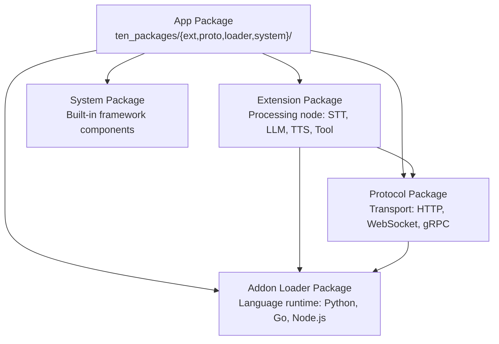
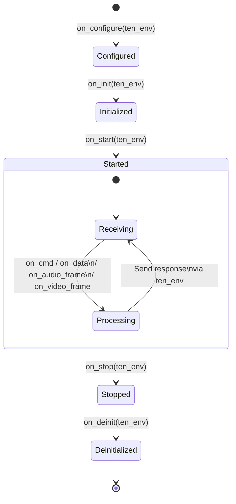

# TEN Extension System — Packages, Manifest, and Property

TEN packages are the deployable units of the framework. Each package has a `manifest.json` (metadata, dependencies, API) and optionally a `property.json` (runtime configuration). Five package types form a dependency hierarchy, each serving a specific role in the agent architecture.

## Package Type Hierarchy



Source: `core/src/ten_rust/src/pkg_info/mod.rs:194-228`

## Package Directory Structure

```
my_app/
├── manifest.json           # App package metadata
├── property.json           # App runtime configuration (graph, preload_addons)
└── ten_packages/
    ├── extension/
    │   ├── deepgram_asr/
    │   │   ├── manifest.json
    │   │   ├── property.json
    │   │   └── src/
    │   └── openai_chatgpt/
    │       ├── manifest.json
    │       └── src/
    ├── protocol/
    │   └── http_server/
    │       └── manifest.json
    ├── addon_loader/
    │   └── python/
    │       └── manifest.json
    └── system/
        └── graph_engine/
            └── manifest.json
```

## manifest.json — Package Metadata

Source: `core/src/ten_rust/src/pkg_info/manifest/mod.rs:185-205`

```rust
pub struct Manifest {
    pub type_and_name: PkgTypeAndName,
    pub version: Version,
    pub description: Option<LocalizedField>,
    pub display_name: Option<LocalizedField>,
    pub readme: Option<LocalizedField>,
    pub dependencies: Option<Vec<ManifestDependency>>,
    pub dev_dependencies: Option<Vec<ManifestDependency>>,
    pub tags: Option<Vec<String>>,
    pub supports: Option<Vec<ManifestSupport>>,
    pub api: Option<ManifestApi>,
    pub package: Option<PackageConfig>,
    pub scripts: Option<HashMap<String, String>>,
    pub flattened_api: Arc<tokio::sync::RwLock<Option<ManifestApi>>>,
}
```

### Required Fields

| Field | Type | Description |
|-------|------|-------------|
| `type` | enum | `app`, `extension`, `protocol`, `addon_loader`, `system` |
| `name` | string | Unique package identifier |
| `version` | semver | Package version |

### Optional Fields

| Field | Type | Description |
|-------|------|-------------|
| `description` | LocalizedField | Package description (i18n) |
| `display_name` | LocalizedField | Human-readable name (i18n) |
| `readme` | LocalizedField | README content (i18n) |
| `dependencies` | array | Runtime dependencies |
| `dev_dependencies` | array | Development-only dependencies |
| `tags` | array | Categorization tags |
| `supports` | array | OS/arch/build compatibility |
| `api` | ManifestApi | Message interface definitions |
| `package` | PackageConfig | Packaging configuration |
| `scripts` | map | Build/run scripts |

### Dependencies

Source: `core/src/ten_rust/src/pkg_info/manifest/dependency.rs:1-178`

```rust
pub enum ManifestDependency {
    RegistryDependency {
        pkg_type: String,
        name: String,
        version: Option<String>,
        tag: Option<String>,
    },
    LocalDependency {
        path: String,
    },
}
```

Registry dependencies specify a package type, name, optional version constraint, and optional tag. Local dependencies reference a relative filesystem path.

### Supports — Platform Compatibility

Source: `core/src/ten_rust/src/pkg_info/manifest/support.rs:1-141`

```rust
pub struct ManifestSupport {
    pub os: Option<Vec<String>>,
    pub arch: Option<Vec<String>>,
    pub build_type: Option<Vec<String>>,
    pub language: Option<Vec<String>>,
}
```

The SAT solver uses `supports` to filter packages during dependency resolution. A package with `"os": ["mac", "linux"]` will not be considered for Windows installations.

### API — Message Interface

Source: `core/src/ten_rust/src/pkg_info/manifest/api.rs:18-45`

```rust
pub struct ManifestApi {
    pub property: Option<ManifestApiProperty>,
    pub interface: Option<Vec<ManifestApiInterface>>,
    pub cmd_in: Option<Vec<ManifestApiMsg>>,
    pub cmd_out: Option<Vec<ManifestApiMsg>>,
    pub data_in: Option<Vec<ManifestApiMsg>>,
    pub data_out: Option<Vec<ManifestApiMsg>>,
    pub audio_frame_in: Option<Vec<ManifestApiMsg>>,
    pub audio_frame_out: Option<Vec<ManifestApiMsg>>,
    pub video_frame_in: Option<Vec<ManifestApiMsg>>,
    pub video_frame_out: Option<Vec<ManifestApiMsg>>,
}
```

The API defines which messages the package sends and receives for each message type (cmd, data, audio_frame, video_frame), with separate `*_in` and `*_out` arrays. The `interface` field supports importing external API definitions via `import_uri`.

Message names are validated against the pattern `^[A-Za-z_][A-Za-z0-9_]*$` at deserialization time (source: `api.rs:166-180`).

### LocalizedField — i18n Support

Source: `core/src/ten_rust/src/pkg_info/manifest/mod.rs:45-116`

```rust
pub struct LocaleContent {
    pub content: Option<String>,       // Inline content
    pub import_uri: Option<String>,    // Or load from URI
    #[serde(skip)]
    pub base_dir: Option<String>,      // For resolving relative URIs
}

pub struct LocalizedField {
    pub locales: HashMap<String, LocaleContent>,
}
```

**Aha:** Localized fields support lazy loading via `import_uri`. A package can ship with small metadata and defer loading large descriptions/READMEs until needed. The `serialize_with_resolved_content()` async method resolves all URIs before serialization, enabling round-trip consistency.

### Tags

Source: `core/src/ten_rust/src/pkg_info/constants.rs:20`

```rust
pub const TEN_STR_TAGS: &str = "tags";
```

Tags are a free-form string array in the manifest, categorized for registry search and filtering. Common tag values include extension type indicators (e.g., `llm`, `stt`, `tts`, `tool`) but the system accepts any string value.

### PackageConfig — Build Settings

Source: `core/src/ten_rust/src/pkg_info/manifest/publish.rs:1-13`

```rust
pub struct PackageConfig {
    // Configuration for packaging and publishing
}
```

## property.json — Runtime Configuration

Source: `core/src/ten_rust/src/pkg_info/property/mod.rs:1-358`

The `property.json` file defines runtime configuration for packages.

### App-Level Property

```json
{
  "ten": {
    "uri": "",
    "auto_start": true
  },
  "property": {
    // Extension-specific properties
  },
  "graph": {
    "nodes": [...],
    "connections": [...]
  }
}
```

### Extension-Level Property

Extensions define their configurable properties:

```json
{
  "ten": {
    "property": {
      "api_key": {
        "type": "string",
        "required": true,
        "secret": true
      },
      "model": {
        "type": "string",
        "default": "gpt-4"
      }
    }
  }
}
```

### Property Validation

Source: `core/src/ten_rust/src/pkg_info/property/mod.rs`

Properties are validated against JSON Schema definitions generated from the manifest API. The `json_schema` module provides validation using the `jsonschema` crate.

## Package Types Deep Dive

### App Package

The top-level package. Contains:
- `manifest.json` with `type: "app"`
- `property.json` with graph definition
- `ten_packages/` directory with sub-packages

### Extension Package

Processing nodes in the agent graph. Each extension:
- Implements lifecycle hooks: `on_configure`, `on_init`, `on_start`, `on_cmd`, `on_data`, `on_audio_frame`, `on_video_frame`, `on_stop`, `on_deinit`
- Declares message interfaces in `manifest.json` `api` field
- Can be written in Python, Go, C++, or Node.js

### Protocol Package

Transport adapters that handle communication between extensions and external systems.

### Addon Loader Package

Language runtime loaders that enable extensions written in different languages to run. Each loader:
- Manages the language runtime (Python interpreter, Go runtime, Node.js process)
- Handles message serialization between the C core and the extension
- Provides the FFI bridge for extension lifecycle hooks

### System Package

Built-in framework components that are part of the TEN runtime itself.

## Package File Format (.tpkg)

Source: `core/src/ten_manager/src/constants/mod.rs:28`

```rust
pub const TEN_PACKAGE_FILE_EXTENSION: &str = ".tpkg";
```

Packages are distributed as `.tpkg` files (tarballs) containing:
- `manifest.json`
- Source code / binaries
- `property.json` (optional)
- Documentation

### Unpackaging

Source: `core/src/ten_manager/src/package_file/unpackage.rs:1-287`

The `unpackage.rs` module extracts `.tpkg` files to the target directory.

## Installed Package Tracking

Source: `core/src/ten_manager/src/manifest_lock/mod.rs:1-415`

The `manifest_lock.json` file tracks installed packages and their exact versions (similar to `Cargo.lock` or `package-lock.json`).

## Template Packages

Source: `core/src/ten_manager/src/designer/template_pkgs/mod.rs:1-139`

Templates for creating new packages:

| Template | Language | Type |
|----------|----------|------|
| `default_app_cpp` | C++ | app |
| `default_app_go` | Go | app |
| `default_app_python` | Python | app |
| `default_app_nodejs` | Node.js | app |
| `default_extension_cpp` | C++ | extension |
| `default_extension_go` | Go | extension |
| `default_extension_python` | Python | extension |
| `default_extension_nodejs` | Node.js | extension |

## Extension Lifecycle



Each lifecycle method receives a `ten_env` handle that provides:
- Message sending: `ten_env.send_cmd()`, `ten_env.send_data()`, etc.
- Property access: `ten_env.get_property()`
- Logging: `ten_env.log()`

## Cross-References

- [01-architecture.md](01-architecture.md) — Package types in architecture context
- [03-tman-cli.md](03-tman-cli.md) — Package management commands
- [04-graph-system.md](04-graph-system.md) — Extension nodes in graphs
- [07-message-protocols.md](07-message-protocols.md) — Message types extensions handle

## Next

Continue to [06-designer-api.md](06-designer-api.md) for the Designer HTTP API deep dive.
