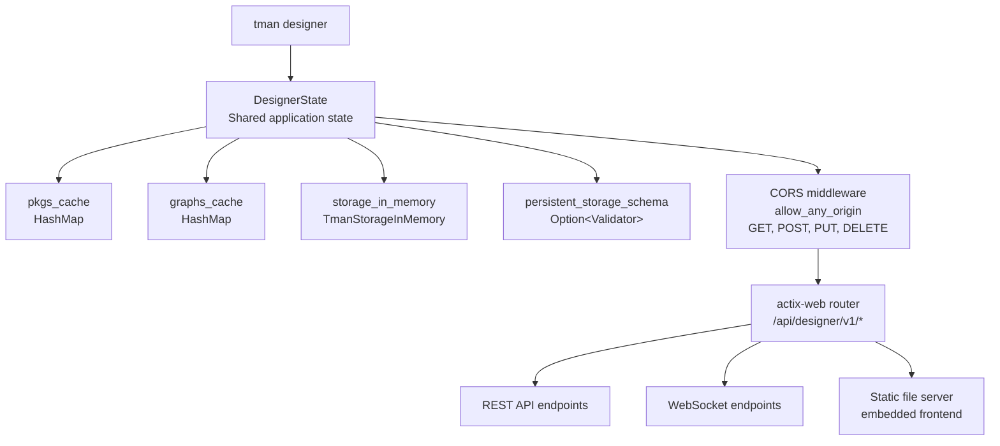

# TEN Designer API — HTTP Endpoints, WebSockets, and State Management

The Designer is an actix-web HTTP server launched by `tman designer` on port 49483. It provides a comprehensive REST API for graph editing, package management, and real-time communication via WebSockets. The frontend is embedded as static assets via `rust-embed`.

Source: `core/src/ten_manager/src/cmd/cmd_designer.rs:73-158`

## Server Architecture



Source: `core/src/ten_manager/src/designer/mod.rs:43-50`

## DesignerState

Source: `core/src/ten_manager/src/designer/mod.rs:43-50`

```rust
pub struct DesignerState {
    pub tman_config: Arc<tokio::sync::RwLock<TmanConfig>>,
    pub storage_in_memory: Arc<tokio::sync::RwLock<TmanStorageInMemory>>,
    pub out: Arc<Box<dyn TmanOutput>>,
    pub pkgs_cache: tokio::sync::RwLock<HashMap<String, PkgsInfoInApp>>,
    pub graphs_cache: tokio::sync::RwLock<HashMap<Uuid, GraphInfo>>,
    pub persistent_storage_schema: Arc<tokio::sync::RwLock<Option<Validator>>>,
}
```

The state uses `tokio::sync::RwLock` for concurrent access across async handlers.

## REST API Endpoints

Source: `core/src/ten_manager/src/designer/mod.rs:52-184`

### Version Endpoints

| Method | Path | Handler | Purpose |
|--------|------|---------|---------|
| GET | `/version` | `version::get_version_endpoint` | Get current version |
| GET | `/check-update` | `version::check_update_endpoint` | Check for updates |

### App Endpoints

| Method | Path | Handler | Purpose |
|--------|------|---------|---------|
| GET | `/apps` | `apps::get::get_apps_endpoint` | List available apps |
| POST | `/apps/load` | `apps::load::load_app_endpoint` | Load an app into memory |
| POST | `/apps/unload` | `apps::unload::unload_app_endpoint` | Unload an app |
| POST | `/apps/reload` | `apps::reload::reload_app_endpoint` | Reload an app |
| POST | `/apps/create` | `apps::create::create_app_endpoint` | Create a new app |
| POST | `/apps/addons` | `apps::addons::get_app_addons_endpoint` | Get app addons |
| POST | `/apps/scripts` | `apps::scripts::get_app_scripts_endpoint` | Get app scripts |
| POST | `/apps/schema` | `apps::schema::get_app_schema_endpoint` | Get app schema |

### Extension Endpoints

| Method | Path | Handler | Purpose |
|--------|------|---------|---------|
| POST | `/extensions/create` | `extensions::create::create_extension_endpoint` | Create extension |
| POST | `/extensions/schema` | `extensions::schema::get_extension_schema_endpoint` | Get extension schema |
| POST | `/extensions/property/get` | `extensions::property::get_extension_property_endpoint` | Get extension property |

### Validation Endpoints

| Method | Path | Handler | Purpose |
|--------|------|---------|---------|
| POST | `/manifest/validate` | `manifest::validate::validate_manifest_endpoint` | Validate manifest.json |
| POST | `/property/validate` | `property::validate::validate_property_endpoint` | Validate property.json |

### Template Endpoint

| Method | Path | Handler | Purpose |
|--------|------|---------|---------|
| POST | `/template-pkgs` | `template_pkgs::get_template_endpoint` | Get available templates |

### Graph Endpoints

| Method | Path | Handler | Purpose |
|--------|------|---------|---------|
| POST | `/graphs` | `graphs::get::get_graphs_endpoint` | Get all graphs |
| POST | `/graphs/update` | `graphs::update::update_graph_endpoint` | Update graph |
| POST | `/graphs/auto-start` | `graphs::auto_start::update_graph_auto_start_endpoint` | Set auto-start |
| POST | `/graphs/nodes/add` | `graphs::nodes::add::add_graph_node_endpoint` | Add graph node |
| POST | `/graphs/nodes/delete` | `graphs::nodes::delete::delete_graph_node_endpoint` | Delete graph node |
| POST | `/graphs/nodes/replace` | `graphs::nodes::replace::replace_graph_node_endpoint` | Replace graph node |
| POST | `/graphs/nodes/property/update` | `graphs::nodes::property::update::update_graph_node_property_endpoint` | Update node property |
| POST | `/graphs/connections/add` | `graphs::connections::add::add_graph_connection_endpoint` | Add connection |
| POST | `/graphs/connections/delete` | `graphs::connections::delete::delete_graph_connection_endpoint` | Delete connection |
| POST | `/graphs/connections/msg_conversion/update` | `graphs::connections::msg_conversion::update::update_graph_connection_msg_conversion_endpoint` | Update msg conversion |

### Message Compatibility

| Method | Path | Handler | Purpose |
|--------|------|---------|---------|
| POST | `/messages/compatible` | `messages::compatible::get_compatible_messages_endpoint` | Get compatible messages |

### Preferences

| Method | Path | Handler | Purpose |
|--------|------|---------|---------|
| GET | `/preferences/logviewer_line_size` | `preferences::logviewer_line_size::get_logviewer_line_size_endpoint` | Get line size |
| PUT | `/preferences/logviewer_line_size` | `preferences::logviewer_line_size::update_logviewer_line_size_endpoint` | Update line size |
| GET | `/preferences/locale` | `preferences::locale::get_locale_endpoint` | Get locale |
| PUT | `/preferences/locale` | `preferences::locale::update_locale_endpoint` | Update locale |

### Storage

| Method | Path | Handler | Purpose |
|--------|------|---------|---------|
| POST | `/storage/in-memory/set` | `storage::in_memory::set::set_in_memory_storage_endpoint` | Set in-memory value |
| POST | `/storage/in-memory/get` | `storage::in_memory::get::get_in_memory_storage_endpoint` | Get in-memory value |
| POST | `/storage/persistent/set` | `storage::persistent::set::set_persistent_storage_endpoint` | Set persistent value |
| POST | `/storage/persistent/get` | `storage::persistent::get::get_persistent_storage_endpoint` | Get persistent value |
| POST | `/storage/persistent/schema` | `storage::persistent::schema::set_persistent_storage_schema_endpoint` | Set persistent schema |

### File System

| Method | Path | Handler | Purpose |
|--------|------|---------|---------|
| POST | `/dir-list` | `dir_list::list_dir_endpoint` | List directory |
| POST | `/file-content` | `file_content::get_file_content_endpoint` | Get file content |
| PUT | `/file-content` | `file_content::save_file_content_endpoint` | Save file content |

### Registry

| Method | Path | Handler | Purpose |
|--------|------|---------|---------|
| GET | `/registry/packages` | `registry::packages::get_packages_endpoint` | List registry packages |
| POST | `/registry/packages/search` | `registry::search::search_packages_endpoint` | Search registry |

### Environment

| Method | Path | Handler | Purpose |
|--------|------|---------|---------|
| GET | `/env` | `env::get_env_endpoint` | Get environment info |
| POST | `/env-var` | `env_var::get_env_var_endpoint` | Get environment variable |

### Documentation

| Method | Path | Handler | Purpose |
|--------|------|---------|---------|
| POST | `/help-text` | `help_text::get_help_text_endpoint` | Get help text |
| POST | `/doc-link` | `doc_link::get_doc_link_endpoint` | Get documentation link |

## WebSocket Endpoints

Source: `core/src/ten_manager/src/designer/mod.rs:161-167`

| Path | Handler | Purpose |
|------|---------|---------|
| `/ws/builtin-function` | `builtin_function::builtin_function_endpoint` | Install packages via WebSocket |
| `/ws/exec` | `exec::exec_endpoint` | Execute commands |
| `/ws/terminal` | `terminal::ws_terminal_endpoint` | PTY terminal access |
| `/ws/log-watcher` | `log_watcher::log_watcher_endpoint` | Real-time log streaming |

### Builtin Function WebSocket

Source: `core/src/ten_manager/src/designer/builtin_function/mod.rs:40-214`

Uses the actix actor pattern for bidirectional communication:

```rust
pub enum BuiltinFunction {
    InstallAll { base_dir: String },
    Install { base_dir: String, pkg_type: String, pkg_name: String, pkg_version: Option<String> },
}

pub enum BuiltinFunctionOutput {
    NormalLine(String),
    NormalPartial(String),
    ErrorLine(String),
    ErrorPartial(String),
    Exit { exit_code: i32, error_message: Option<String> },
}
```

**Aha:** The WebSocket handler uses actix's actor model (`Actor` + `Handler` + `StreamHandler`) rather than simple HTTP upgrade. Each WebSocket connection becomes a separate `WsBuiltinFunction` actor with its own context, enabling concurrent operations without shared state contention. The `BuiltinFunctionOutput` handler maps internal output types to JSON WebSocket messages, providing real-time feedback during long-running operations like package installation.

### Terminal WebSocket

Source: `core/src/ten_manager/src/designer/terminal/`

| File | Purpose | Lines |
|------|---------|-------|
| `mod.rs` | Terminal endpoint, session management | 193 |
| `pty_manager.rs` | PTY (pseudo-terminal) management | 128 |

Uses `portable-pty` crate for cross-platform pseudo-terminal support.

### Log Watcher WebSocket

Source: `core/src/ten_manager/src/designer/log_watcher/mod.rs:1-354`

Streams log file contents in real-time via WebSocket. Uses file watcher to detect changes and push new lines to connected clients.

### Exec WebSocket

Source: `core/src/ten_manager/src/designer/exec/`

| File | Purpose | Lines |
|------|---------|-------|
| `mod.rs` | Exec endpoint | 286 |
| `cmd_run.rs` | Command execution | 371 |
| `msg.rs` | Message types | 41 |
| `run_script.rs` | Script execution | 45 |

Executes shell commands and streams stdout/stderr via WebSocket.

## Storage System

### In-Memory Storage

Source: `core/src/ten_manager/src/designer/storage/in_memory/`

| File | Purpose | Lines |
|------|---------|-------|
| `mod.rs` | Module entry | 18 |
| `key_parser.rs` | Key parsing and routing | 180 |
| `set.rs` | Set values | 92 |
| `get.rs` | Get values | 77 |

Keys are parsed to route to the correct storage location. The key format encodes the target (graph, node, etc.) and the field being accessed.

### Persistent Storage

Source: `core/src/ten_manager/src/designer/storage/persistent/`

| File | Purpose | Lines |
|------|---------|-------|
| `mod.rs` | Module entry | 52 |
| `schema.rs` | Schema validation | 199 |
| `set.rs` | Set with validation | 126 |
| `get.rs` | Get values | 89 |

Persistent storage uses JSON Schema validation. The schema is set via `/storage/persistent/schema` and all subsequent writes are validated against it.

## Response Types

Source: `core/src/ten_manager/src/designer/response.rs:1-114`

Standardized API response format:

```rust
pub struct TmanDesignerResponse {
    pub code: i32,
    pub message: String,
    pub data: Option<serde_json::Value>,
}
```

## Frontend Asset Serving

Source: `core/src/ten_manager/src/designer/frontend.rs:1-112`

Uses `rust-embed` to embed the frontend build output as static assets. The `get_frontend_asset()` handler serves these files for any route not matching an API endpoint.

## Cross-References

- [03-tman-cli.md](03-tman-cli.md) — `tman designer` command
- [01-architecture.md](01-architecture.md) — Designer in system architecture
- [04-graph-system.md](04-graph-system.md) — Graph editing via API

## Next

Continue to [07-message-protocols.md](07-message-protocols.md) for message type and conversion deep dive.
