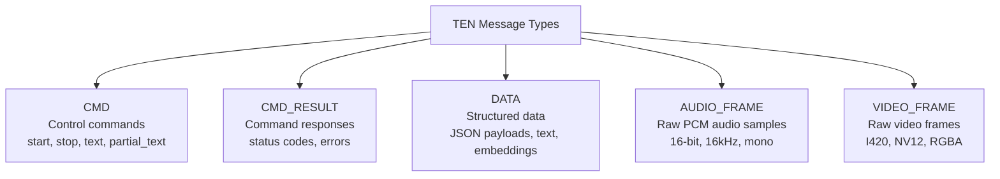
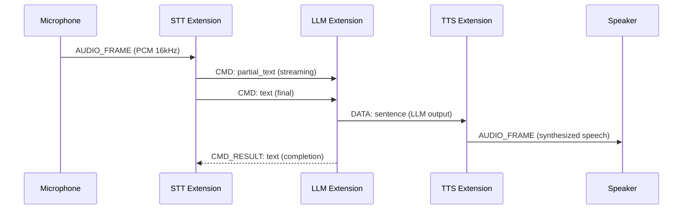

# TEN Message Protocols — cmd, data, audio_frame, video_frame

TEN's message-passing architecture uses four first-class message types that flow along graph edges. Unlike frameworks that treat all messages as opaque data, TEN distinguishes between control commands, structured data, and raw media frames — enabling zero-copy routing for audio/video and semantic routing for commands.

## Message Type Taxonomy



## Message Flow Model

Source: `core/src/ten_rust/src/graph/connection/mod.rs:271-284`

```rust
pub struct GraphMessageFlow {
    pub name: Option<String>,       // Message name (e.g., "text", "partial_text")
    pub names: Option<Vec<String>>, // Bulk declaration: ["text", "partial_text"]
    pub dest: Vec<GraphDestination>, // Where this message flows to
    pub source: Vec<GraphSource>,    // Where this message originates
}
```

### Name Validation

Source: `core/src/ten_rust/src/graph/connection/mod.rs:287-303`

```rust
pub fn validate_name_mutual_exclusivity(&self) -> Result<()> {
    match (&self.name, &self.names) {
        (Some(_), Some(_)) => Err(anyhow::anyhow!(
            "Both 'name' and 'names' fields are specified, but they are mutually exclusive"
        )),
        (None, None) => Err(anyhow::anyhow!(
            "Neither 'name' nor 'names' field is specified, but one must be provided"
        )),
        (None, Some(names)) if names.is_empty() => {
            Err(anyhow::anyhow!("'names' field is empty, must contain at least one name"))
        }
        _ => Ok(()),
    }
}
```

Exactly one of `name` or `names` must be specified, and `names` must be non-empty when used.

### GraphExposedMessageType

Source: `core/src/ten_rust/src/graph/mod.rs:115-126`

```rust
pub enum GraphExposedMessageType {
    CmdIn, CmdOut,
    DataIn, DataOut,
    AudioFrameIn, AudioFrameOut,
    VideoFrameIn, VideoFrameOut,
}
```

Each message type has an `In` (received) and `Out` (sent) variant, enabling the graph to declare its external interface.

## CMD — Control Commands

Commands are named messages that trigger behavior in extensions. Common commands include:

| Command | Direction | Purpose |
|---------|-----------|---------|
| `text` | STT → LLM | Full transcription result |
| `partial_text` | STT → LLM | Streaming transcription (interim) |
| `sentence` | LLM → TTS | Complete sentence for speech synthesis |
| `end` | Any | Signal end of message stream |

Commands flow through the graph's `cmd` field in connections:

```json
{
  "connections": [
    {
      "from": "stt", "to": "llm",
      "cmd": [{"name": "text"}, {"name": "partial_text"}]
    }
  ]
}
```

## CMD_RESULT — Command Responses

Command results flow in the reverse direction of commands:

```json
{
  "connections": [
    {
      "from": "llm",
      "to": "stt",
      "cmd_result": [{"name": "text"}]
    }
  ]
}
```

## DATA — Structured Data

Data messages carry JSON payloads between extensions:

```json
{
  "connections": [
    {
      "from": "llm",
      "to": "tts",
      "data": [{"name": "sentence"}]
    }
  ]
}
```

## AUDIO_FRAME — Raw Audio

Audio frames carry raw PCM audio data. The TEN runtime manages these with zero-copy buffer sharing:

- **Format**: 16-bit signed PCM
- **Sample rate**: Typically 16kHz
- **Channels**: Mono
- **Buffer management**: Reference-counted, shared between extensions

Source: `core/src/ten_rust/src/value_buffer/mod.rs:13-39`

The `value_buffer` module provides binary serialization for audio frame metadata:

```rust
const VALUE_BUFFER_MAGIC: u16 = 0x010E;
const VALUE_BUFFER_VERSION: u8 = 1;
const VALUE_BUFFER_HEADER_SIZE: usize = 8;
```

## VIDEO_FRAME — Raw Video

Video frames carry raw video data:

- **Formats**: I420, NV12, RGBA
- **Buffer management**: Reference-counted

## Message Conversion

Source: `core/src/ten_rust/src/graph/msg_conversion/mod.rs:1-180`

Message conversions transform messages between different schemas at connection boundaries. The `MsgAndResultConversion` type specifies input-to-output mappings.

### Conversion Rules

Source: `core/src/ten_manager/src/graph/msg_conversion.rs:1-664`

The designer supports message conversion configuration via:

- **FixedValue** — Set a property to a constant value
- **FromOriginal** — Copy a property from the source message

```rust
fn navigate_property_path_mut(value: &mut Value, path: &str) -> &mut Value;
fn navigate_property_path(value: &Value, path: &str) -> Option<&Value>;
```

Supports dot notation (`"user.name"`) and bracket notation (`"items[0]"`).

### Schema Resolution

Source: `core/src/ten_manager/src/graph/msg_conversion.rs`

```rust
fn msg_conversion_get_final_target_schema(
    src_schema: &Value,
    rules: &[ConversionRule],
) -> Result<Value>;

fn msg_conversion_get_dest_msg_name(rules: &[ConversionRule]) -> Result<String>;
```

The conversion pipeline:
1. Fetch the source message schema from the extension package
2. Apply conversion rules to transform the schema
3. Compute the final target schema
4. Extract the destination message name from the `ten.name` rule

## Message Compatibility Checking

Source: `core/src/ten_manager/src/graph/compatible.rs:1-102`

The `get_compatible_msg_extension()` function finds extensions that can handle a given message type by comparing message schemas:

```rust
pub struct CompatibleExtensionAndMsg {
    pub node: ExtensionGraphNode,
    pub message: String,
}
```

**Aha:** Message compatibility is determined by schema comparison, not just message name matching. The system checks whether a message's schema is compatible with the target extension's expected schema — this prevents runtime errors from schema mismatches that would only be caught during execution.

## Message Name Validation

Source: `core/src/ten_rust/src/graph/check/message_names.rs:1-173`

Message names must match the pattern `^[A-Za-z_][A-Za-z0-9_]*$`. This is validated at two levels:

1. **At deserialization time** — `ManifestApiMsg` validates message names during manifest parsing (source: `core/src/ten_rust/src/pkg_info/manifest/api.rs:166-180`)
2. **At graph validation time** — `check_message_names()` validates all message names in the graph

```rust
fn validate_msg_name<'de, D>(deserializer: D) -> Result<String, D::Error> {
    let msg_name: String = String::deserialize(deserializer)?;
    let re = Regex::new(r"^[A-Za-z_][A-Za-z0-9_]*$").unwrap();
    if re.is_match(&msg_name) {
        Ok(msg_name)
    } else {
        Err(serde::de::Error::custom(
            "Invalid message name format, it needs to conform to the pattern \
             ^[A-Za-z_][A-Za-z0-9_]*$",
        ))
    }
}
```

## Message Conversion Validation

Source: `core/src/ten_rust/src/graph/check/msg_conversions.rs:1-62`

Validates that message conversion rules reference valid source and target properties.

## Connections Compatibility Check

Source: `core/src/ten_rust/src/graph/check/connections_compatibility.rs:1-316`

The most complex validation check (316 lines). Verifies:
- Source extension can send the specified message type
- Destination extension can receive the specified message type
- Message schemas are compatible
- Property overrides don't break schema constraints

## End-to-End Message Flow Example



## Graph Proxy Message Routing

Source: `core/src/ten_rust/src/graph/mod.rs:582-832`

The `ten:graph_proxy` extension bridges internal and external message flows:

- `CmdIn`: External → graph_proxy → internal extension
- `CmdOut`: Internal extension → graph_proxy → external
- `DataIn/Out`, `AudioFrameIn/Out`, `VideoFrameIn/Out`: Same pattern

## MsgType and MsgDirection

Source: `core/src/ten_rust/src/pkg_info/message.rs:1-90`

```rust
pub enum MsgType { Cmd, Data, AudioFrame, VideoFrame }
pub enum MsgDirection { In, Out }
```

These enums are used throughout the codebase to categorize messages for schema lookup and compatibility checking.

## Cross-References

- [02-ten-rust-runtime.md](02-ten-rust-runtime.md) — value_buffer binary serialization
- [04-graph-system.md](04-graph-system.md) — GraphMessageFlow in connection model
- [07-message-protocols.md](07-message-protocols.md) — (this document)
- [11-data-flow.md](11-data-flow.md) — End-to-end conversation pipeline

## Next

Continue to [08-turn-detection.md](08-turn-detection.md) for turn detection deep dive.
