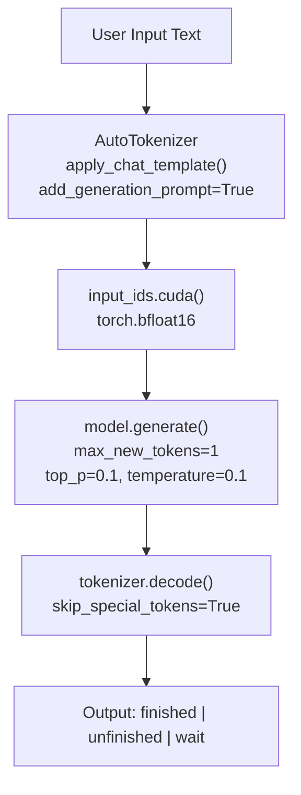
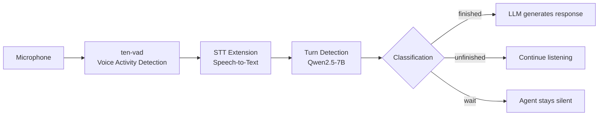

# TEN Turn Detection — Semantic Utterance Classification

TEN Turn Detection uses a fine-tuned Qwen2.5-7B model to classify user utterances into three states, enabling smarter conversation management than simple silence-based VAD.

Source: `ten-turn-detection/inference.py:1-109`

## Architecture



## Three Classification States

| State | Meaning | Example |
|-------|---------|---------|
| `finished` | Complete thought, expects a response | "Hey there I was wondering can you help me with my order" |
| `unfinished` | Paused but intends to continue | "Hello I have a question about" |
| `wait` | Explicit instruction to stop | "Shut up" |

Source: `ten-turn-detection/README.md`

## Inference Script

Source: `ten-turn-detection/inference.py:42-96`

```python
#!/usr/bin/env python
# -*- coding: utf-8 -*-

import argparse
import torch
from transformers import AutoTokenizer, AutoModelForCausalLM

def load_model(model_id):
    model = AutoModelForCausalLM.from_pretrained(
        model_id,
        trust_remote_code=True,
        torch_dtype=torch.bfloat16
    )
    tokenizer = AutoTokenizer.from_pretrained(model_id, trust_remote_code=True)
    model = model.cuda()
    model.eval()
    return model, tokenizer

def infer(model, tokenizer, system_prompt, user_input):
    inf_messages = [
        {"role": "system", "content": system_prompt}
    ] + [
        {"role": "user", "content": user_input}
    ]
    input_ids = tokenizer.apply_chat_template(
        inf_messages, add_generation_prompt=True, return_tensors="pt"
    ).cuda()

    with torch.no_grad():
        outputs = model.generate(
            input_ids,
            max_new_tokens=1,
            do_sample=True,
            top_p=0.1,
            temperature=0.1,
            pad_token_id=tokenizer.eos_token_id
        )

    response = outputs[0][input_ids.shape[-1]:]
    output = tokenizer.decode(response, skip_special_tokens=True)
    return output

if __name__ == "__main__":
    args = parse_args()
    model, tokenizer = load_model("TEN-framework/TEN_Turn_Detection")
    result = infer(model, tokenizer, args.system, args.input)
    print(result)
```

**Key parameters:**
- **Line 47**: `torch.bfloat16` for GPU memory efficiency
- **Line 52**: Hardcoded `.cuda()` — GPU required, no CPU fallback
- **Line 70**: Chat template with optional system prompt + single user message
- **Line 80**: `max_new_tokens=1` — single-token classification
- **Line 81-83**: `top_p=0.1`, `temperature=0.1` — near-deterministic output
- **Line 96**: Model ID: `TEN-framework/TEN_Turn_Detection` (HuggingFace)

**Aha:** Turn detection uses single-token generation as classification instead of a separate classifier head. The model generates exactly one token (`max_new_tokens=1`) which is the class label. This is elegant because it reuses the causal LM's existing architecture without adding classification layers — the fine-tuning simply teaches the model to output `finished`, `unfinished`, or `wait` as the next token.

## TEN-Turn-TestSet Dataset

Source: `ten-turn-detection/TEN-Turn-TestSet/`

| File | Lines | Examples |
|------|-------|----------|
| `finished.txt` | 508 | 500 labeled examples |
| `unfinished.txt` | 426 | 425 labeled examples |
| `wait.txt` | 200 | 199 labeled examples |

**Total: 1,124 labeled examples**

### Domain Coverage

The dataset is bilingual (Chinese + English) and covers:
- Customer service interactions
- Job interviews
- Education/tutoring
- Language practice
- Academic/technical statements

**Aha:** The "wait" class is unique to TEN's approach. Traditional turn detection systems only distinguish between "finished" and "unfinished." TEN adds "wait" for explicit stop requests ("Shh be quiet", "请停止"), enabling the agent to respect user commands to stop talking — a critical UX feature for voice agents.

## Reported Performance

### English

| Model | Finished | Unfinished | Wait |
|-------|----------|------------|------|
| Model A | 59.74% | 86.46% | N/A |
| Model B | 71.61% | 96.88% | N/A |
| **TEN** | **90.64%** | **98.44%** | **91%** |

### Chinese

| Model | Finished | Unfinished | Wait |
|-------|----------|------------|------|
| Model B | 74.63% | 88.89% | N/A |
| **TEN** | **98.90%** | **92.74%** | **92%** |

Model A does not support Chinese. Neither Model A nor Model B support the "wait" state.

Source: `ten-turn-detection/README.md`

## Integration with TEN Runtime

Turn detection works alongside VAD (Voice Activity Detection) in the conversation pipeline:



VAD detects when audio is present (someone is speaking). Turn detection classifies the semantic completeness of the transcribed text. Together, they provide both acoustic and semantic turn management.

## Model Details

| Property | Value |
|----------|-------|
| Base model | Qwen2.5-7B |
| Fine-tuned | Yes (instruction-tuning style) |
| HuggingFace | `TEN-framework/TEN_Turn_Detection` |
| Inference dtype | bfloat16 |
| Device | CUDA (GPU required) |
| Output | Single token classification |

## License

Apache 2.0 with additional restrictions (Agora): cannot host on end-user devices or compete with Agora's offerings.

Source: `ten-turn-detection/LICENSE`

## Cross-References

- [09-vad-library.md](09-vad-library.md) — VAD for acoustic turn detection
- [11-data-flow.md](11-data-flow.md) — Full conversation pipeline

## Next

Continue to [09-vad-library.md](09-vad-library.md) for the VAD library deep dive.
