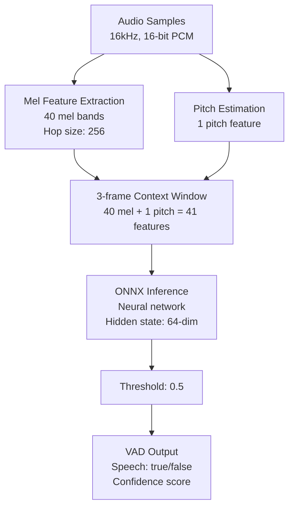
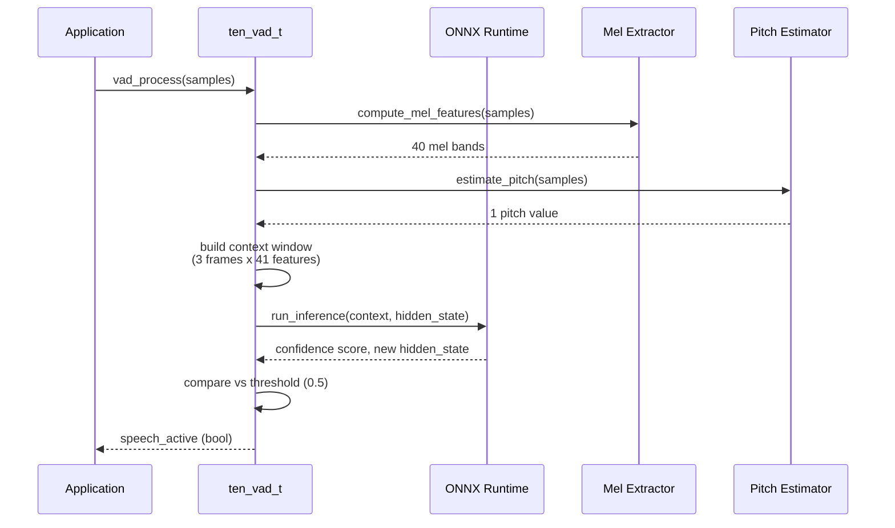
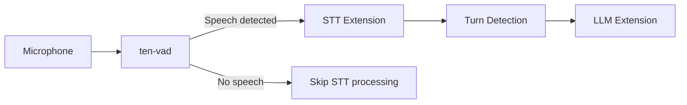

# TEN VAD Library — Voice Activity Detection with ONNX Inference

ten-vad is a high-performance Voice Activity Detection library written in C with ONNX neural network inference. At ~306KB, it is significantly smaller than alternatives (Silero VAD is ~2.2MB, ~7x larger) while maintaining extremely low CPU usage (RTF 0.0086-0.0150 on x64).

## Architecture



## Feature Computation

### Mel Features

- **Bands**: 40 mel frequency bands
- **Hop size**: 256 samples (16ms at 16kHz)
- **Window**: Computed from overlapping audio frames

### Pitch Features

- **Count**: 1 pitch feature per frame
- **Method**: Pitch estimation algorithm for voice detection

### Context Window

- **Size**: 3 frames
- **Input dimension**: 41 features per frame (40 mel + 1 pitch)
- **Total input**: 123 features (3 x 41)

### Hidden State

- **Dimension**: 64
- **Purpose**: Maintains temporal context across inference calls

## ONNX Inference Pipeline



## Configuration Constants

| Constant | Value | Purpose |
|----------|-------|---------|
| Hop size | 256 samples | Audio frame step size |
| Threshold | 0.5 | VAD confidence threshold |
| Mel bands | 40 | Number of mel frequency bands |
| Pitch features | 1 | Number of pitch features |
| Context window | 3 frames | Temporal context size |
| Hidden state | 64 dimensions | Recurrent state size |

## C API

The VAD library exposes a C API for cross-language integration:

```c
// Create VAD handle
ten_vad_t* ten_vad_create(const ten_vad_config_t* config);

// Process audio samples
bool ten_vad_process(ten_vad_t* vad, const float* samples, int num_samples);

// Destroy VAD handle
void ten_vad_destroy(ten_vad_t* vad);
```

## Language Bindings

| Language | Mechanism | File |
|----------|-----------|------|
| C/C++ | Native | `include/` headers |
| Python | ctypes/ONNX | `bindings/python/` |
| Java | JNI/JNA | `bindings/java/` |
| Go | CGo | `bindings/go/` |
| JavaScript | WASM | `bindings/js/` |

**Aha:** ten-vad achieves its small size by using a custom lightweight neural network rather than pre-trained Silero. The 40-mel + 1-pitch architecture with a 64-dim hidden state is purpose-built for voice detection, avoiding the overhead of general-purpose speech models. The 3-frame context window provides just enough temporal information for robust detection without excessive computation.

## Performance Metrics

| Metric | Value |
|--------|-------|
| Binary size | ~306KB |
| Silero VAD size | ~2.2MB (~7x larger) |
| RTF (x64) | 0.0086 - 0.0150 |
| Sample rate | 16kHz |
| Bit depth | 16-bit PCM |

RTF (Real-Time Factor) of 0.0086 means processing 1 second of audio takes 8.6 milliseconds — extremely low CPU usage suitable for real-time applications.

## Integration with TEN Framework

ten-vad integrates into the TEN conversation pipeline as the first stage:



This provides two key benefits:
1. **CPU savings**: STT is only invoked when speech is detected
2. **Latency reduction**: No unnecessary STT processing during silence

## Cross-References

- [08-turn-detection.md](08-turn-detection.md) — Semantic turn detection complement
- [11-data-flow.md](11-data-flow.md) — Full conversation pipeline

## Next

Continue to [10-portal-playground.md](10-portal-playground.md) for the Portal documentation site.
