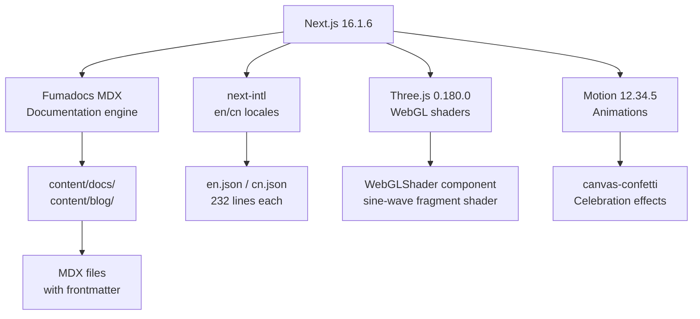

# TEN Portal — Documentation Site and Interactive Guide

The Portal is a Next.js documentation site built with Fumadocs, providing bilingual (English/Chinese) documentation for TEN Framework. It includes interactive guides, a version selector, blog posts, and AI integration features.

Source: `/home/darkvoid/Boxxed/@formulas/src.rust/src.AI/src.TenFramework/portal/`

## Architecture



## Technology Stack

| Package | Version | Purpose |
|---------|---------|---------|
| `next` | ^16.1.6 | Framework |
| `react` / `react-dom` | ^19.2.4 | UI runtime |
| `fumadocs-core/ui/mdx` | ^16.6.9 / ^13.0.8 | Docs engine |
| `next-intl` | ^4.8.3 | i18n (en/cn) |
| `motion` | ^12.34.5 | Animations |
| `three` | ^0.180.0 | WebGL shaders |
| `@orama/*` | ^3.1.18 | Search |
| `zod` | ^4.3.6 | Schema validation |
| `lucide-react` | ^0.486.0 | Icons |
| `geist` | ^1.7.0 | Font |

Source: `portal/package.json:1-68`

## Routing Structure

```
app/[lang]/
├── layout.tsx              — Root i18n layout (HTML shell, providers)
├── providers.tsx           — Fumadocs RootProvider wrapper
├── (home)/
│   ├── page.tsx            — Landing page: BackgroundVideo + Hero
│   └── _components.tsx     — Hero + ProjectsShowcase
├── docs/
│   ├── layout.tsx          — DocsLayout with sidebar (version selector)
│   └── [[...slug]]/page.tsx — Dynamic doc page: MDX rendering
├── guide/page.tsx          — Interactive contribution guide (cn locale)
├── workshop/page.tsx       — Workshop page with schedule, speakers
└── github-star-celebration/ — 8K star celebration: WebGL + confetti
```

Source: `portal/app/[lang]/` directory structure

## Documentation Content Pipeline

Source: `portal/source.config.ts:1-72`

```typescript
import { defineDocs, defineConfig } from 'fumadocs-mdx/config';

export const { docs, meta } = defineDocs({
  dir: 'content/docs',
});

export default defineConfig({
  mdxOptions: {
    remarkPlugins: [remarkSteps],
    lazyCodeHighlighting: true,
  },
});
```

Content is organized in `content/docs/` with `meta.json` files controlling navigation order. The `_version.json` file defines available documentation versions.

## Interactive Guide

Source: `portal/components/guide/InteractiveGuide.tsx:77-713`

A 13-step interactive walkthrough with:
- Action panels with code snippets
- Visual previews
- Drawer with cheat sheet / standards / manual tabs
- Confetti celebration on completion
- localStorage-tracked completion state

## Key UI Components

### Version Selector

Source: `portal/components/layout/version-select.tsx:20-104`

Reads versions from `content/docs/ten_framework/_version.json` and navigates between versioned doc paths.

### Liquid Button

Source: `portal/components/ui/liquid-glass-button.tsx:91-123`

Glassmorphism button with SVG `feTurbulence` filter for liquid distortion effect.

### Award Badge

Source: `portal/components/ui/award-badge.tsx:38-457`

Animated SVG badge with 3D perspective matrix on hover and confetti trigger.

### LLM Copy Button

Source: `portal/components/page-actions.tsx:24-73`

Fetches raw MDX content and copies it to clipboard — enabling users to paste documentation directly into LLM prompts.

### View Options

Source: `portal/components/page-actions.tsx:80-254`

Constructs URLs to open the current documentation page in:
- GitHub
- Scira AI
- ChatGPT
- Claude
- T3 Chat

**Aha:** The LLM Copy Button and View Options represent a new paradigm in documentation — making docs consumable by AI agents. Instead of just reading documentation, developers can send it directly to their AI coding assistant with context preserved. This reflects TEN's AI-first philosophy.

## Blog System

Source: `portal/content/blog/`

23 MDX blog posts with schemas:
- `author` — Post author
- `date` — Publication date
- `featured` — Featured flag
- `coverImage` — Cover image
- `category` — Enum: releases, tutorials, community, events

## Analytics

Source: `portal/components/analytics/`

| Component | Service | Tracking ID |
|-----------|---------|-------------|
| PostHogLoader | PostHog | `phc_pl9FJOL4Yl6EdZy3zwvQ6d8sM7N6npOa5NtJLBdYElJ` |
| AhrefsLoader | Ahrefs | `lOUyYaT4eHvdDZ0IWZN7YQ` |

Analytics loading is controlled by cookie consent (`CookieConsent` component).

## i18n System

Source: `portal/lib/i18n.ts:7-19`

```typescript
export const i18n = {
  locales: ['en', 'cn'],
  defaultLocale: 'en',
  hideLocale: 'default-locale',
};
```

Messages stored in `portal/messages/en.json` and `portal/messages/cn.json` (232 lines each).

## Deployment

Source: `portal/netlify.toml:1-54`

- **Platform**: Netlify with `@netlify/plugin-nextjs`
- **Build**: `npm run build`, publish `.next`
- **Memory**: `NODE_OPTIONS=--max_old_space_size=4096`
- **Edge functions**: Proxy for `/article/*`, `/blog/*`, `/assets/*`, `/category/*`
- **Redirect**: `doc.theten.ai` → `theten.ai/docs`

## State Management

The portal uses local React state only (`useState`, `useEffect`). No global store. Some components use `localStorage` for persistence:
- Cookie consent: `cookie-consent` key
- Guide steps: completion tracking
- Announcement dismissal: dismiss state

**Aha:** The Portal is purely a documentation/marketing site — it does NOT contain the graph editor or module registry components. Those live in the TEN Designer backend (tman designer) and are served as embedded static assets. The Portal's role is documentation, blog, community engagement, and interactive guides.

## Cross-References

- [06-designer-api.md](06-designer-api.md) — Designer backend that serves the actual graph editor
- [03-tman-cli.md](03-tman-cli.md) — CLI that launches the Designer

## Next

Continue to [11-data-flow.md](11-data-flow.md) for end-to-end data flow diagrams.
