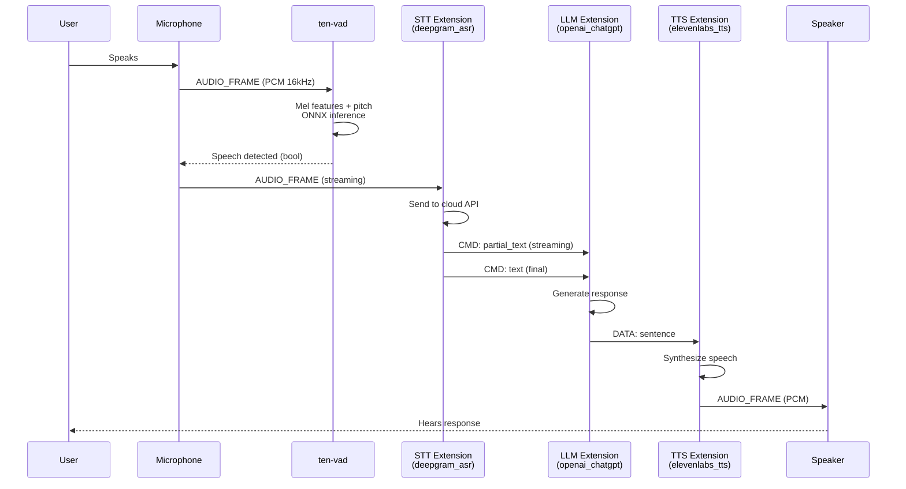
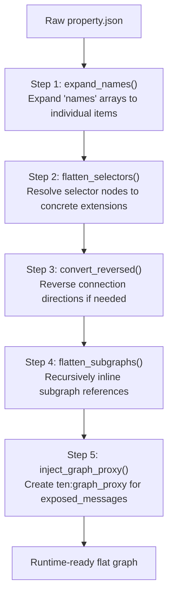
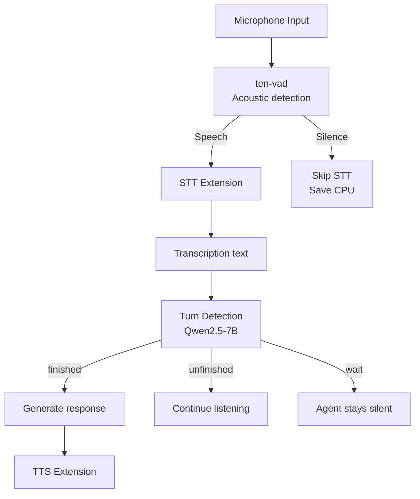
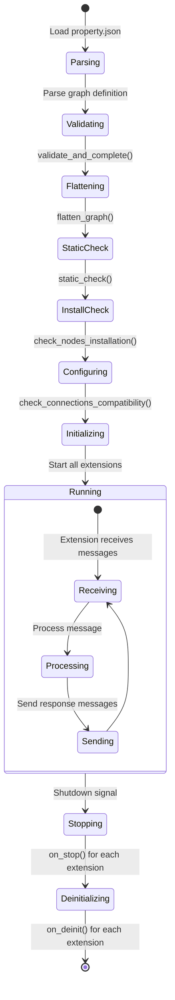
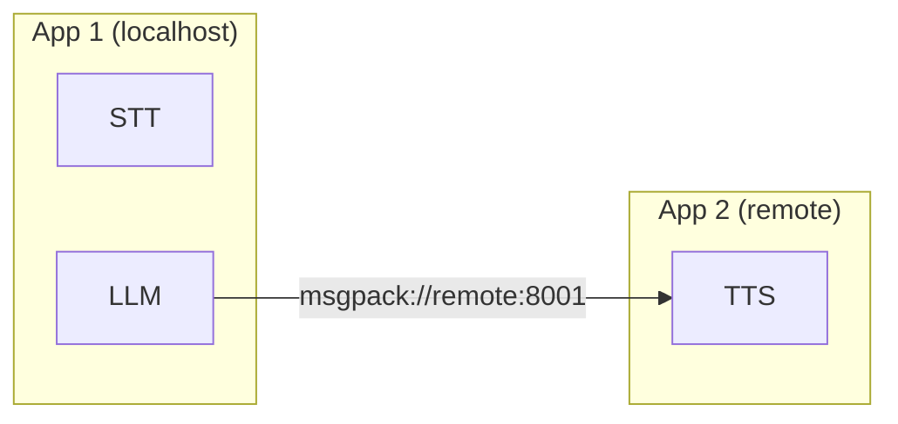

# TEN Data Flow — End-to-End Conversation Pipeline

This document traces data through a complete TEN agent conversation, from microphone input to speaker output, showing how messages flow through the graph at each stage.

## Voice Assistant Pipeline



## Graph Definition

The pipeline is defined in `property.json`:

```json
{
  "ten": {
    "auto_start": true
  },
  "graph": {
    "nodes": [
      { "type": "extension", "name": "stt", "addon": "deepgram_asr" },
      { "type": "extension", "name": "llm", "addon": "openai_chatgpt" },
      { "type": "extension", "name": "tts", "addon": "elevenlabs_tts" }
    ],
    "connections": [
      {
        "from": "stt", "to": "llm",
        "cmd": [{ "name": "text" }, { "name": "partial_text" }]
      },
      {
        "from": "llm", "to": "tts",
        "data": [{ "name": "sentence" }]
      }
    ]
  }
}
```

## Graph Flattening Pipeline

Source: `core/src/ten_rust/src/graph/mod.rs:534-563`

Before execution, the declarative graph goes through a flattening pipeline:



Each step is optional — if a step doesn't change the graph, the original reference is preserved. The final comparison uses pointer equality (`std::ptr::eq`) to detect if any changes occurred.

Source: `core/src/ten_rust/src/graph/mod.rs:557-562`

```rust
if std::ptr::eq(processing_graph, self) {
    return Ok(None);  // No changes — no flattening needed
}
Ok(Some(processing_graph.clone()))
```

## Message Types in the Pipeline

| Stage | Message Type | Name | Payload |
|-------|-------------|------|---------|
| Mic → STT | AUDIO_FRAME | — | PCM 16-bit, 16kHz, mono |
| STT → LLM | CMD | `partial_text` | Streaming transcription (interim) |
| STT → LLM | CMD | `text` | Final transcription |
| LLM → TTS | DATA | `sentence` | LLM-generated text |
| TTS → Speaker | AUDIO_FRAME | — | Synthesized PCM audio |

## VAD + Turn Detection Integration



VAD handles the acoustic question: "Is someone speaking?" Turn detection handles the semantic question: "Are they done speaking?" Together, they provide both layers of turn management.

## Agent Lifecycle



## Extension Message Handling

Each extension implements lifecycle callbacks:

```python
class MyExtension(Extension):
    def on_configure(self, ten):
        """Load configuration from property.json"""
        self.api_key = ten.get_property("api_key")

    def on_init(self, ten):
        """Initialize resources (API clients, models)"""
        self.client = create_client(self.api_key)

    def on_start(self, ten):
        """Start processing - ready to receive messages"""
        pass

    def on_cmd(self, ten, cmd):
        """Handle incoming command messages"""
        if cmd.get_name() == "text":
            text = cmd.get_property("text")
            result = self.process(text)
            ten.send_cmd("response", {"text": result})

    def on_data(self, ten, data):
        """Handle incoming data messages"""
        pass

    def on_audio_frame(self, ten, frame):
        """Handle incoming audio frames"""
        pcm_data = frame.get_buf()
        pass

    def on_video_frame(self, ten, frame):
        """Handle incoming video frames"""
        pass

    def on_stop(self, ten):
        """Cleanup resources"""
        pass

    def on_deinit(self, ten):
        """Final cleanup"""
        pass
```

## Zero-Copy Audio Routing

Source: `core/src/ten_rust/src/value_buffer/mod.rs:13-39`

Audio frames use reference-counted buffer management:

```rust
const VALUE_BUFFER_MAGIC: u16 = 0x010E;
const VALUE_BUFFER_VERSION: u8 = 1;
const VALUE_BUFFER_HEADER_SIZE: usize = 8;
```

Audio buffers are shared between extensions without copying:
1. Source extension creates buffer with reference count = 1
2. Router increments refcount for each destination
3. Destination extension decrements refcount after processing
4. Buffer is freed when refcount reaches 0

**Aha:** The zero-copy audio routing is what makes TEN suitable for real-time voice. Most frameworks serialize audio to JSON/base64 for message passing, adding 33% overhead plus CPU for encode/decode. TEN's reference-counted buffer management routes raw PCM data with zero serialization cost — the only overhead is a pointer dereference and refcount update.

## Multi-App Communication

When graphs span multiple apps (different `app` URIs), messages flow through network protocols:



Connections specify the target app URI:

```json
{
  "connections": [
    {
      "from": "llm",
      "to": "tts",
      "app": "msgpack://remote:8001",
      "data": [{"name": "sentence"}]
    }
  ]
}
```

The `AppUriDeclarationState` determines whether the graph is single-app or multi-app. In multi-app mode, `localhost` is forbidden as an explicit app URI because remote apps cannot resolve it.

## Extension Group Threading

Extensions in the same `extension_group` share a thread pool. This is important for:
- Reducing thread count for related extensions
- Ensuring message ordering within a group
- Coordinating resource access between extensions

The `extension_group` field is defined on `ExtensionNode`:

Source: `core/src/ten_rust/src/graph/node/mod.rs:36`

```rust
pub extension_group: Option<String>,
```

## Property Overrides

Per-node property overrides in the graph definition take precedence over the extension's default `property.json`:

```json
{
  "nodes": [
    {
      "type": "extension",
      "name": "stt",
      "addon": "deepgram_asr",
      "property": {
        "model": "nova-2",
        "language": "en"
      }
    }
  ]
}
```

## Cross-References

- [04-graph-system.md](04-graph-system.md) — Graph flattening pipeline
- [07-message-protocols.md](07-message-protocols.md) — Message types
- [09-vad-library.md](09-vad-library.md) — VAD integration

## Next

Continue to [12-cross-cutting.md](12-cross-cutting.md) for cross-cutting concerns.
