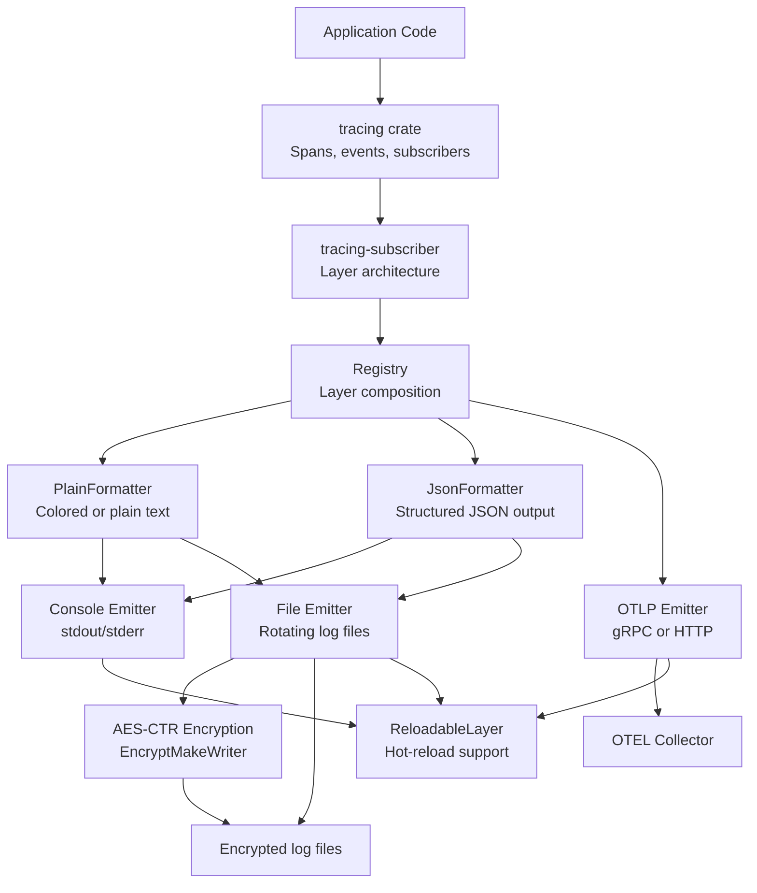
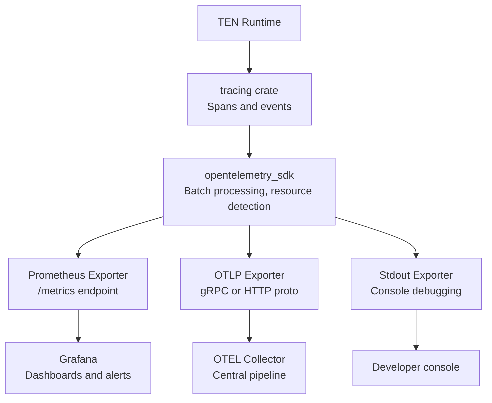

# TEN Cross-Cutting Concerns — Logging, Telemetry, Crypto, Configuration

TEN Framework addresses several cross-cutting concerns that span all modules: structured logging with encryption, OpenTelemetry-based telemetry, configuration management, environment detection, and memory management.

## Logging System

Source: `core/src/ten_rust/src/log/mod.rs:1-579`

The logging system is one of the most complex modules in ten_rust, providing structured logging with multiple emitters, encryption, OTLP export, and hot-reloadable configuration.

### Architecture



Source: `core/src/ten_rust/src/log/mod.rs:16-39`

### Log Levels

```rust
pub enum LogLevel {
    Invalid = 0,
    Debug = 1,
    Info = 2,
    Warn = 3,
    Error = 4,
}
```

Source: `core/src/ten_rust/src/log/mod.rs:43-63`

The `to_tracing_level()` method maps TEN log levels to `tracing::Level` values.

### Advanced Log Configuration

The logging system supports a declarative configuration model:

Source: `core/src/ten_rust/src/log/mod.rs:100-190`

```rust
pub enum AdvancedLogLevelFilter { OFF, Debug, Info, Warn, Error }

pub struct AdvancedLogMatcher {
    pub level: AdvancedLogLevelFilter,
    pub category: Option<String>,
}

pub enum FormatterType { Plain, Json }

pub struct AdvancedLogFormatter {
    pub formatter_type: FormatterType,
    pub colored: Option<bool>,
}

pub enum StreamType { Stdout, Stderr }

pub struct ConsoleEmitterConfig {
    pub stream: StreamType,
    pub encryption: Option<EncryptionConfig>,
}

pub struct FileEmitterConfig {
    pub path: String,
    pub encryption: Option<EncryptionConfig>,
}

pub enum OtlpProtocol { Grpc, Http }

pub struct OtlpEmitterConfig {
    pub endpoint: String,
    pub protocol: OtlpProtocol,       // default: Grpc
    pub headers: HashMap<String, String>,
    pub service_name: Option<String>,
}

pub enum AdvancedLogEmitter {
    Console(ConsoleEmitterConfig),
    File(FileEmitterConfig),
    Otlp(OtlpEmitterConfig),
}

pub struct AdvancedLogHandler {
    pub matchers: Vec<AdvancedLogMatcher>,
    pub formatter: AdvancedLogFormatter,
    pub emitter: AdvancedLogEmitter,
}

pub struct AdvancedLogConfig {
    pub handlers: Vec<AdvancedLogHandler>,
    #[serde(skip)]
    guards: Vec<Box<dyn std::any::Any + Send + Sync>>,
}
```

**Aha:** The log system uses a handler-based architecture where each handler has matchers (which messages to handle), a formatter (how to format them), and an emitter (where to send them). Multiple handlers can process the same message with different formatters and emitters — enabling simultaneous plain-text console output and JSON file output from the same log events.

### OTLP Export

Source: `core/src/ten_rust/src/log/otel.rs:1-408`

The OTLP emitter supports both gRPC and HTTP protocols:

- **gRPC** (default) — Uses tonic for efficient binary transport
- **HTTP** — Uses HTTP/JSON for environments where gRPC is blocked

Configuration via headers enables authentication with OTLP collectors:

```json
{
  "handlers": [{
    "matchers": [{"level": "info"}],
    "formatter": {"type": "json"},
    "emitter": {
      "type": "otlp",
      "config": {
        "endpoint": "https://otel.example.com:4317",
        "protocol": "grpc",
        "headers": {"Authorization": "Bearer token"},
        "service_name": "ten-agent"
      }
    }
  }]
}
```

### Log Encryption

Source: `core/src/ten_rust/src/log/encryption.rs:1-151`

Log files can be encrypted using AES-CTR mode:

```rust
pub struct EncryptionConfig {
    pub key: Vec<u8>,
    pub iv: Vec<u8>,
}
```

The `EncryptMakeWriter` wraps any `tracing_subscriber::fmt::MakeWriter` to encrypt output before writing. Uses the `aes` (0.8.4) and `ctr` (0.9.2) crates.

### Decryption Utility

Source: `core/src/ten_rust/src/log/decrypt.rs:1-54`

Command-line tool for decrypting encrypted log files. Reads the encrypted file, applies AES-CTR decryption, and outputs plain text.

### File Appender

Source: `core/src/ten_rust/src/log/file_appender.rs:1-134`

File-based log output with configurable rotation. Uses `tracing-appender` for non-blocking file writes.

### Dynamic Filter

Source: `core/src/ten_rust/src/log/dynamic_filter.rs:1-186`

Runtime-configurable log level filtering per category. Allows changing log levels without restarting the application. The `DynamicTargetFilterLayer` implements `tracing_subscriber::Layer` for integration with the tracing subscriber stack.

### Reloadable Configuration

Source: `core/src/ten_rust/src/log/reloadable.rs:1-199`

Hot-reloadable log configuration. The `ReloadableLayer` wraps the subscriber and can be reconfigured at runtime without dropping existing log messages. Uses `tracing-subscriber`'s `Reload` layer.

### Formatters

| File | Type | Lines | Purpose |
|------|------|-------|---------|
| `formatter/plain.rs` | Plain text | 307 | Colored or plain text output |
| `formatter/json.rs` | JSON structured | 346 | Structured JSON with configurable fields |

The JSON formatter supports configurable field names:

Source: `core/src/ten_rust/src/log/formatter/json.rs`

```rust
pub struct JsonFieldNames {
    pub timestamp: String,
    pub level: String,
    pub message: String,
    pub target: String,
    // ... more configurable field names
}
```

### C FFI Bindings

Source: `core/src/ten_rust/src/log/bindings.rs:1-377`

Exposes logging functions to the C runtime via cbindgen-generated bindings, enabling the C core to use Rust's tracing infrastructure.

## Telemetry System

Source: `core/src/ten_rust/src/service_hub/telemetry/`

### Architecture



Source: `core/src/ten_rust/Cargo.toml:37-52`

### OpenTelemetry Dependencies

| Crate | Version | Purpose |
|-------|---------|---------|
| `opentelemetry` | 0.31.0 | Core API |
| `opentelemetry_sdk` | 0.31.0 | Runtime (rt-tokio, logs) |
| `opentelemetry-prometheus` | 0.31.0 | Prometheus exporter |
| `opentelemetry-stdout` | 0.31.0 | Console exporter (metrics) |
| `opentelemetry-otlp` | 0.31.0 | OTLP exporter (metrics, logs, grpc-tonic, http-proto) |
| `opentelemetry-semantic-conventions` | 0.31.0 | Standard attribute names |
| `opentelemetry-appender-tracing` | 0.31.0 | Bridge tracing → OTel |
| `tracing-opentelemetry` | 0.32.0 | Bridge tracing spans → OTel |
| `prometheus` | 0.14 | Prometheus client |

### Metrics

Source: `core/src/ten_rust/src/service_hub/telemetry/metrics.rs:1-399`

Key metrics tracked include message throughput, extension latency, buffer allocation counts, and graph execution time.

### HTTP Metrics Endpoint

Source: `core/src/ten_rust/src/service_hub/telemetry/http_endpoint.rs:1-53`

Exposes the `/metrics` endpoint for Prometheus scraping.

### Exporter Configuration

Source: `core/src/ten_rust/src/service_hub/telemetry/exporter.rs:1-400`

Supports three exporters running simultaneously:
- **Prometheus** — Pull-based metrics scraping
- **OTLP** — Push-based metrics and logs to collectors
- **Stdout** — Console output for debugging

## Crypto Module

Source: `core/src/ten_rust/src/crypto/`

### AES-CTR Implementation

Source: `core/src/ten_rust/src/crypto/algorithm/aes.rs:1-73`

Uses the `aes` (0.8.4) and `ctr` (0.9.2) crates for CTR-mode encryption:

```rust
use aes::Aes256;
use ctr::Ctr128BE;
```

### C FFI Bindings

Source: `core/src/ten_rust/src/crypto/bindings.rs:1-85`

Exposes crypto functions to the C runtime via cbindgen-generated bindings.

## Configuration System

### TMAN Configuration

Source: `core/src/ten_manager/src/home/config.rs:1-114`

```rust
pub struct TmanConfig {
    pub config_file: Option<String>,
    pub admin_token: Option<String>,
    pub user_token: Option<String>,
    pub verbose: bool,
    pub assume_yes: bool,
    pub tracing_mode: Option<String>,
    pub registry: Registry,
    pub enable_package_cache: bool,
    pub designer: Designer,
}
```

### Default Values

| Setting | Default | Source Constant |
|---------|---------|----------------|
| Registry | `https://ten-store.theten.ai/api/...` | `constants/registry.rs` |
| CN Registry | `https://registry-ten.rtcdeveloper.cn/api/...` | `constants/registry.rs` |
| Designer port | `49483` | `constants/mod.rs:48` |
| Package cache | `true` | `home/package_cache.rs` |
| Max retries | `30` | `constants/mod.rs:31` |
| Retry delay | `500ms` | `constants/mod.rs:33` |
| Request timeout | `120s` | `constants/mod.rs:35` |
| Page size | `100` | `constants/mod.rs:39` |
| Max latest versions (init) | `3` | `constants/mod.rs:73` |
| Max latest versions (max) | `9` | `constants/mod.rs:74` |
| Stdout max lines | `1000` | `constants/mod.rs:42` |
| Log viewer line size | `1000` | `constants/mod.rs:46` |

### Config File Location

Source: `core/src/ten_manager/src/home/mod.rs:1-44`

| Platform | Path |
|----------|------|
| Windows | `%APPDATA%/tman/` |
| Unix | `~/.tman/` |
| Test | `$TEN_MANAGER_HOME_INTERNAL_USE_ONLY` |

CLI flag: `--config-file` or `-c`

### Home Directory Detection

Source: `core/src/ten_manager/src/home/mod.rs`

```rust
pub fn get_home_dir() -> Result<PathBuf> {
    // Test mode override
    if let Ok(home) = std::env::var("TEN_MANAGER_HOME_INTERNAL_USE_ONLY") {
        return Ok(PathBuf::from(home));
    }
    // Platform-specific paths
    #[cfg(target_os = "windows")]
    { /* %APPDATA%/tman/ */ }
    #[cfg(not(target_os = "windows"))]
    { /* ~/.tman/ */ }
}
```

## Environment Detection

Source: `core/src/ten_rust/src/env.rs:1-31`

```rust
pub struct EnvInfo {
    pub os: Os,
    pub arch: Arch,
}

pub fn get_env() -> EnvInfo {
    EnvInfo {
        os: Os::from(std::env::consts::OS),
        arch: Arch::from(std::env::consts::ARCH),
    }
}
```

### Supported OS/Arch Combinations

| OS | Architectures |
|----|--------------|
| linux | x86, x64, arm, arm64 |
| mac | x64, arm64 |
| win | x86, x64 |

Source: `core/src/ten_manager/src/cmd_line.rs:36-42`

### Environment Checks

Source: `core/src/ten_manager/src/check_env/`

| File | Lines | What It Checks |
|------|-------|----------------|
| `check_cpp.rs` | 451 | Compiler (gcc/clang/MSVC), CMake, pkg-config, build tools |
| `check_go.rs` | 189 | Go version, GOPATH, modules |
| `check_nodejs.rs` | 198 | Node version, npm, npx |
| `check_python.rs` | 176 | Python version, pip, venv |
| `check_os.rs` | 69 | OS type, architecture |
| `formatter.rs` | 240 | Output formatting for check results |
| `types.rs` | 143 | Types for environment check results |

## Memory Management

Source: `core/src/ten_manager/src/lib.rs`

Global allocator configuration:
- **Default**: `mimalloc` (fast, low fragmentation)
- **Optional**: `jemalloc` (via `jemalloc` feature flag)
- **Workaround**: actix-web memory leak false positive handling

## Tracing Configuration

Source: `core/src/ten_manager/src/tracing_config.rs:1-294`

```rust
pub enum TracingMode {
    Console,    // Console output
    Chrome,     // Chrome tracing format
    Flame,      // Flame graph output
    All,        // All modes combined
}
```

CLI flag: `--tracing MODE` where MODE is one of `console`, `chrome`, `flame`, `all`.

Uses:
- `tracing-subscriber` with env-filter for console
- `tracing-chrome` for Chrome DevTools tracing
- `tracing-flame` + `inferno` for flame graphs

## Backtrace Support

Source: `core/src/ten_rust/src/backtrace.rs:1-114`

Stack trace capture for error reporting. Uses the `backtrace` crate.

## File System Utilities

Source: `core/src/ten_manager/src/fs/`

| File | Purpose | Lines |
|------|---------|-------|
| `mod.rs` | Core FS utilities | 90 |
| `json.rs` | JSON file patching | 136 |
| `file_type.rs` | File type detection | 60 |
| `log_file_watcher.rs` | Log file monitoring | 322 |

Key functions:
- `copy_folder_recursively()` — Recursive directory copy via fs_extra
- `get_cwd()` — Current working directory
- `check_is_app_folder()` — Validate TEN app directory
- `find_nearest_app_dir()` — Walk upward to find app directory

## Path Utilities

Source: `core/src/ten_rust/src/utils/path.rs:1-262`

- Path normalization
- Relative path resolution
- Import URI handling with base directory

## URI Utilities

Source: `core/src/ten_rust/src/utils/uri.rs:1-87`

- URI parsing and validation
- Content loading from URIs (file://, http://, https://)
- Import URI resolution with base directory

## Output Abstraction

Source: `core/src/ten_manager/src/output/`

| File | Purpose | Lines |
|------|---------|-------|
| `mod.rs` | `TmanOutput` trait definition | 23 |
| `cli.rs` | CLI implementation | 28 |
| `channel.rs` | Channel-based output | 37 |

The `TmanOutput` trait abstracts output:

```rust
pub trait TmanOutput {
    fn normal_line(&self, msg: &str);
    fn normal_partial(&self, msg: &str);
    fn error_line(&self, msg: &str);
    fn error_partial(&self, msg: &str);
    fn is_interactive(&self) -> bool;
}
```

## Cross-References

- [02-ten-rust-runtime.md](02-ten-rust-runtime.md) — ten_rust log and service_hub modules
- [03-tman-cli.md](03-tman-cli.md) — TMAN configuration and tracing
- [06-designer-api.md](06-designer-api.md) — Designer log watcher WebSocket

## Next

All documents are complete. Return to [README.md](README.md) for the full document index.
