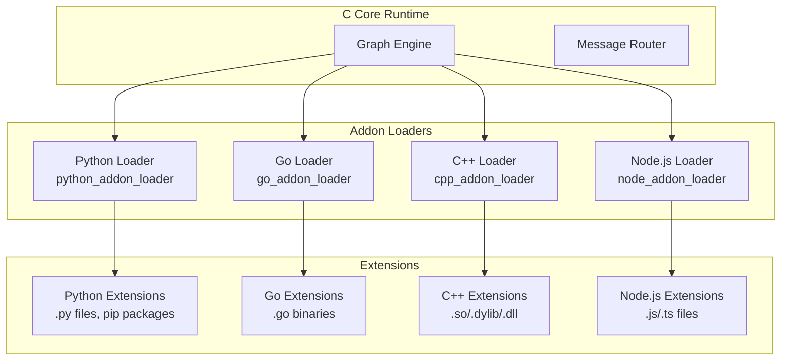

# TEN SDK Bindings — Python, Go, C++, Node.js Extension APIs

TEN Framework supports extensions in four languages: Python, Go, C++, and Node.js. Each language has a dedicated SDK that bridges the extension code to the C core runtime through a language-specific addon loader. This document covers the public API surface, extension lifecycle implementation, and message handling patterns for each SDK.

Source: `ten-framework/packages/` — core extensions and example extensions

## SDK Architecture



Each addon loader is a TEN system package that manages the language runtime and provides the FFI bridge for extension lifecycle hooks. The loaders handle message serialization between the C core and the extension, and provide the `ten_env` handle that extensions use to send messages and access properties.

## Python SDK

Source: `core/src/ten_runtime/binding/python/interface/ten_runtime/` — Python interface layer
Source: `core/src/ten_runtime/binding/python/native/` — C native bindings

### Public API Surface

The Python SDK exposes these core types from `ten_runtime`:

| Type | Purpose |
|------|---------|
| `Extension` | Base class for all extensions |
| `TenEnv` | Environment handle for sending messages, logging, property access |
| `Cmd` | Incoming command message |
| `CmdResult` | Command result/response |
| `Data` | Incoming data message |
| `AudioFrame` | Incoming audio frame |
| `VideoFrame` | Incoming video frame |
| `LogLevel` | Log level enum (DEBUG, INFO, WARN, ERROR) |
| `StatusCode` | Status code enum (OK, ERROR, etc.) |

Source: `packages/core_extensions/default_extension_python/extension.py:1-16`

```python
from ten_runtime import (
    AudioFrame,
    VideoFrame,
    Extension,
    TenEnv,
    Cmd,
    LogLevel,
    StatusCode,
    CmdResult,
    Data,
)
```

### Extension Lifecycle Implementation

Source: `packages/core_extensions/default_extension_python/extension.py:19-72`

```python
class DefaultExtension(Extension):
    def on_init(self, ten_env: TenEnv) -> None:
        ten_env.log(LogLevel.DEBUG, "on_init")
        ten_env.on_init_done()

    def on_start(self, ten_env: TenEnv) -> None:
        ten_env.log(LogLevel.DEBUG, "on_start")
        ten_env.on_start_done()

    def on_stop(self, ten_env: TenEnv) -> None:
        ten_env.log(LogLevel.DEBUG, "on_stop")
        ten_env.on_stop_done()

    def on_deinit(self, ten_env: TenEnv) -> None:
        ten_env.log(LogLevel.DEBUG, "on_deinit")
        ten_env.on_deinit_done()

    def on_cmd(self, ten_env: TenEnv, cmd: Cmd) -> None:
        cmd_name = cmd.get_name()
        ten_env.log(LogLevel.DEBUG, "on_cmd name {}".format(cmd_name))
        cmd_result = CmdResult.create(StatusCode.OK, cmd)
        ten_env.return_result(cmd_result)

    def on_data(self, ten_env: TenEnv, data: Data) -> None:
        data_name = data.get_name()
        ten_env.log(LogLevel.DEBUG, "on_data name {}".format(data_name))

    def on_audio_frame(self, ten_env: TenEnv, audio_frame: AudioFrame) -> None:
        audio_frame_name = audio_frame.get_name()
        ten_env.log(LogLevel.DEBUG, "on_audio_frame name {}".format(audio_frame_name))

    def on_video_frame(self, ten_env: TenEnv, video_frame: VideoFrame) -> None:
        video_frame_name = video_frame.get_name()
        ten_env.log(LogLevel.DEBUG, "on_video_frame name {}".format(video_frame_name))
```

**Key lifecycle methods:**

| Method | Purpose | Must Call |
|--------|---------|-----------|
| `on_init(ten_env)` | Initialize resources, read properties | `ten_env.on_init_done()` |
| `on_start(ten_env)` | Start processing, register handlers | `ten_env.on_start_done()` |
| `on_stop(ten_env)` | Stop processing, cleanup | `ten_env.on_stop_done()` |
| `on_deinit(ten_env)` | Final cleanup | `ten_env.on_deinit_done()` |
| `on_cmd(ten_env, cmd)` | Handle incoming commands | `ten_env.return_result(CmdResult)` |
| `on_data(ten_env, data)` | Handle incoming data | (no return required) |
| `on_audio_frame(ten_env, frame)` | Handle audio frames | (no return required) |
| `on_video_frame(ten_env, frame)` | Handle video frames | (no return required) |

### TenEnv API

The `TenEnv` handle provides these methods:

| Method | Purpose | Example |
|--------|---------|---------|
| `ten_env.log(level, msg)` | Log a message | `ten_env.log(LogLevel.DEBUG, "debug info")` |
| `ten_env.get_property(key)` | Read extension property | `ten_env.get_property("api_key")` |
| `ten_env.send_cmd(cmd)` | Send a command message | `ten_env.send_cmd(cmd_out)` |
| `ten_env.send_data(data)` | Send a data message | `ten_env.send_data(data_out)` |
| `ten_env.send_audio_frame(frame)` | Send an audio frame | `ten_env.send_audio_frame(frame)` |
| `ten_env.send_video_frame(frame)` | Send a video frame | `ten_env.send_video_frame(frame)` |
| `ten_env.return_result(result)` | Return a command result | `ten_env.return_result(cmd_result)` |
| `ten_env.on_init_done()` | Signal init complete | Required callback |
| `ten_env.on_start_done()` | Signal start complete | Required callback |
| `ten_env.on_stop_done()` | Signal stop complete | Required callback |
| `ten_env.on_deinit_done()` | Signal deinit complete | Required callback |

Aha: The `on_*_done()` pattern is TEN's solution to async lifecycle management. Instead of blocking the extension thread during initialization, the extension calls `on_init_done()` when ready. This allows extensions to perform async operations (like loading models or establishing connections) during the lifecycle phases without blocking the core runtime's startup sequence.

### Python GIL Management

Source: `core/src/ten_runtime/binding/python/native/extension.c:46-104`

The Python native binding handles the Global Interpreter Lock (GIL) with a clever optimization:

```c
static void proxy_on_configure(ten_extension_t *extension, ten_env_t *ten_env) {
    PyGILState_STATE prev_state = ten_py_gil_state_ensure_internal();  // Acquire GIL
    ten_py_extension_t *py_extension = (ten_py_extension_t *)ten_binding_handle_get_me_in_target_lang(...);
    ten_py_ten_env_t *py_ten_env = ten_py_ten_env_wrap(ten_env);
    py_extension->py_ten_env = (PyObject *)py_ten_env;

    PyObject *py_res = PyObject_CallMethod((PyObject *)py_extension, "_proxy_on_configure", "O", ...);
    py_ten_env->py_thread_state = ten_py_eval_save_thread();  // Save thread state for reuse
}
```

Aha: The GIL is acquired on the first callback (`on_configure`) and the Python thread state is saved. All subsequent lifecycle callbacks reuse this same thread state — the GIL is NOT released until `on_deinit_done`. This avoids repeated GIL acquire/release overhead across the 8+ lifecycle callbacks, a significant optimization for extensions that process many messages.

### AsyncExtension Pattern

Source: `core/src/ten_runtime/binding/python/interface/ten_runtime/async_extension.py:79-534`

The Python SDK provides an `AsyncExtension` base class with native `async/await` support:

```python
class AsyncExtension(_Extension):
    async def on_configure(self, _ten_env: AsyncTenEnv) -> None: pass
    async def on_cmd(self, _ten_env: AsyncTenEnv, _cmd: Cmd) -> None: pass
    async def on_data(self, _ten_env: AsyncTenEnv, _data: Data) -> None: pass
```

Thread mode is controlled by `TEN_PYTHON_THREAD_MODE` environment variable:
- **single_thread** (default): All async extensions share one global asyncio event loop via `GlobalThreadManager`
- **multi_thread**: Each extension gets its own daemon thread with its own event loop

### AsyncTenEnv Bridge

Source: `core/src/ten_runtime/binding/python/interface/ten_runtime/async_ten_env.py:30-411`

The `AsyncTenEnv` bridges synchronous C callbacks to async via `asyncio.Queue`:

```python
async def send_cmd(self, cmd: Cmd) -> CmdResultTuple:
    q = asyncio.Queue(maxsize=1)
    err = self._internal.send_cmd(cmd, lambda _, r, e: self._result_handler(r, e, q), False)
    [result, err] = await q.get()
    return result, err
```

### Addon Registration via Decorator

Source: `core/src/ten_runtime/binding/python/interface/ten_runtime/addon_manager.py:100-143`

```python
@register_addon_as_extension("my_addon")
class MyAddon(Addon):
    def on_create_instance(self, ten_env, name, context):
        ten_env.on_create_instance_done(MyExtension(name), context)
```

Aha: The Python SDK uses a decorator pattern (`@register_addon_as_extension`) rather than explicit addon classes. This is more Pythonic — the decorator handles registration automatically, reducing boilerplate. The C native side still creates the `ten_extension_t` handle and links it via `ten_binding_handle_set_me_in_target_lang()`.

### Python Extension Entry Point

Source: `packages/core_extensions/default_extension_python/addon.py:1-30`

```python
from ten import (
    Addon,
    Extension,
    ten_log,
    TEN_LOG_LEVEL,
    TEN_LOG_DEBUG,
)
from .extension import DefaultExtension

class DefaultAddon(Addon):
    def init(self, ten_env):
        ten_log(TEN_LOG_DEBUG, "DefaultAddon init")
        # Register the extension class
        ten_env.register_extension("default_extension", DefaultExtension)
```

The addon class registers the extension class with the TEN runtime, enabling the loader to instantiate and manage the extension lifecycle.

### Example: Ollama LLM Extension

Source: `packages/example_extensions/ollama_python/extension.py:1-120`

The Ollama extension demonstrates a real-world LLM integration:

```python
class OllamaExtension(Extension):
    def on_start(self, ten_env):
        # Read configuration
        self.model = ten_env.get_property("model")
        self.base_url = ten_env.get_property("base_url")
        self.client = ollama.Client(host=self.base_url)
        ten_env.on_start_done()

    def on_cmd(self, ten_env, cmd):
        if cmd.get_name() == "text":
            text = cmd.get_property("text")
            response = self.client.chat(model=self.model, messages=[
                {"role": "user", "content": text}
            ])
            # Send response as data
            data_out = Data.create("sentence")
            data_out.set_property("text", response["message"]["content"])
            ten_env.send_data(data_out)
```

## Go SDK

The Go SDK follows the same lifecycle pattern as Python but uses Go's native types and conventions.

### Extension Structure

A Go extension consists of:
- `main.go` — Entry point, addon registration
- `extension.go` — Extension struct with lifecycle methods
- `go.mod` — Module dependencies

### Lifecycle Interface

```go
type Extension interface {
    OnInit(tenEnv TenEnv)
    OnStart(tenEnv TenEnv)
    OnStop(tenEnv TenEnv)
    OnDeinit(tenEnv TenEnv)
    OnCmd(tenEnv TenEnv, cmd Cmd)
    OnData(tenEnv TenEnv, data Data)
    OnAudioFrame(tenEnv TenEnv, frame AudioFrame)
    OnVideoFrame(tenEnv TenEnv, frame VideoFrame)
}
```

### TenEnv Go API

| Method | Purpose |
|--------|---------|
| `tenEnv.Log(level, msg)` | Log a message |
| `tenEnv.GetProperty(key)` | Read extension property |
| `tenEnv.SendCmd(cmd)` | Send a command |
| `tenEnv.SendData(data)` | Send data |
| `tenEnv.SendAudioFrame(frame)` | Send audio frame |
| `tenEnv.SendVideoFrame(frame)` | Send video frame |
| `tenEnv.ReturnResult(result)` | Return command result |
| `tenEnv.OnInitDone()` | Signal init complete |
| `tenEnv.OnStartDone()` | Signal start complete |
| `tenEnv.OnStopDone()` | Signal stop complete |
| `tenEnv.OnDeinitDone()` | Signal deinit complete |

Aha: The Go SDK uses Go's interface system rather than class inheritance. Extensions implement the `Extension` interface, and the addon loader calls the appropriate method based on the message type. This is idiomatic Go — composition over inheritance — while maintaining the same lifecycle semantics as Python and C++.

### Go Handle Registry

Source: `core/src/ten_runtime/binding/go/interface/ten_runtime/handle.go:67-235`

The Go SDK uses a custom dual-handle system instead of `cgo.Handle`:

| Handle Type | Storage | Use Case |
|-------------|---------|----------|
| `goHandle` (mutable) | `concurrentMap` with `sync.RWMutex` | Callbacks, properties, temp objects (recycled via `sync.Pool`) |
| `immutableHandle` | `sync.Map` with atomic counter | Long-lived objects (extensions, ten_envs) |

Aha: The Go SDK deliberately avoids `cgo.Handle` for two documented reasons: (1) race conditions with the Go runtime when handles are deleted during GC, and (2) `sync.Map` has poor deletion performance. The custom `goHandle` uses `sync.Pool` for handle ID recycling, which is more efficient for short-lived objects like callbacks.

### CGO Concurrency Limiter

Source: `core/src/ten_runtime/binding/go/interface/ten_runtime/cgo_helper.go:164-179`

```go
var limiter iRateLimiter = newTokenBucketLimiter(runtime.GOMAXPROCS(0))

func withCGOLimiter(fn func() error) error {
    limiter.acquire()
    defer limiter.release()
    return fn()
}
```

Aha: When a goroutine enters a cgo syscall, the Go runtime's P unbinds from G, and a new M (OS thread) may be created for the next runnable G. Without a limiter, high-concurrency extensions could spawn unbounded OS threads. The token bucket limiter caps concurrent cgo calls at `GOMAXPROCS`, preventing thread explosion while maintaining throughput.

### Zero-Copy String Passing

Source: `core/src/ten_runtime/binding/go/interface/ten_runtime/cmd.go:42-87`

The Go SDK uses `unsafe.StringData()` to pass Go string bytes directly to C, avoiding `C.CString` allocation and `C.free` cleanup:

```go
// Instead of: cStr := C.CString(str); defer C.free(unsafe.Pointer(cStr))
// Direct pointer to Go string's underlying bytes:
ptr := unsafe.StringData(str)
C.ten_go_ten_cmd_set_property_string(..., (*C.char)(unsafe.Pointer(ptr)), C.size_t(len(str)))
```

## C++ SDK

The C++ SDK provides a class-based API that mirrors the Python SDK.

### Extension Base Class

```cpp
class Extension {
public:
    virtual void OnInit(TenEnv& ten_env) = 0;
    virtual void OnStart(TenEnv& ten_env) = 0;
    virtual void OnStop(TenEnv& ten_env) = 0;
    virtual void OnDeinit(TenEnv& ten_env) = 0;
    virtual void OnCmd(TenEnv& ten_env, Cmd& cmd) = 0;
    virtual void OnData(TenEnv& ten_env, Data& data) = 0;
    virtual void OnAudioFrame(TenEnv& ten_env, AudioFrame& frame) = 0;
    virtual void OnVideoFrame(TenEnv& ten_env, VideoFrame& frame) = 0;
};
```

### TenEnv C++ API

| Method | Purpose |
|--------|---------|
| `ten_env.Log(level, msg)` | Log a message |
| `ten_env.GetProperty(key)` | Read extension property |
| `ten_env.SendCmd(cmd)` | Send a command |
| `ten_env.SendData(data)` | Send data |
| `ten_env.SendAudioFrame(frame)` | Send audio frame |
| `ten_env.SendVideoFrame(frame)` | Send video frame |
| `ten_env.ReturnResult(result)` | Return command result |
| `ten_env.OnInitDone()` | Signal init complete |
| `ten_env.OnStartDone()` | Signal start complete |
| `ten_env.OnStopDone()` | Signal stop complete |
| `ten_env.OnDeinitDone()` | Signal deinit complete |

The C++ SDK compiles to shared libraries (`.so` on Linux, `.dylib` on macOS, `.dll` on Windows) that are loaded by the C++ addon loader at runtime.

### C++ Exception Safety Fence

Source: `core/include/ten_runtime/binding/cpp/detail/extension.h:276-301`

Every user-facing callback is wrapped in try/catch:

```cpp
void invoke_cpp_extension_on_configure(ten_env_t &ten_env) {
    try { on_configure(ten_env); }
    catch (std::exception &e) {
        TEN_ENV_LOG_WARN(ten_env, "C++ extension exception: %s", e.what());
        issue_stop_graph_cmd(ten_env);
        ten_env.on_configure_done();  // Still signal completion to prevent hang
    }
}
```

Aha: The C++ SDK's exception safety fence ensures that even if user code throws, the lifecycle still completes. Without this, a thrown exception would bypass the `on_configure_done()` call, causing the entire graph startup to hang indefinitely. The fence logs the exception, issues a stop-graph command for safety, and still signals completion.

### Passkey Idiom for Factory Methods

Source: `core/include/ten_runtime/binding/cpp/detail/data.h:26-137`

```cpp
class data_t : public msg_t {
  struct ctor_passkey_t { friend data_t; ctor_passkey_t() = default; };
  static std::unique_ptr<data_t> create(const char *data_name, error_t *err = nullptr);
  buf_t lock_buf(error_t *err = nullptr);
  bool unlock_buf(buf_t &buf, error_t *err = nullptr);
};
```

The passkey idiom restricts direct construction of `data_t`, enforcing factory method usage and preventing accidental misuse.

### send_cmd_ex for Multiple Results

Source: `core/include/ten_runtime/binding/cpp/detail/ten_env.h`

The C++ SDK provides `send_cmd_ex` with `ten_env_send_cmd_options_t {.enable_multiple_results = true}` for receiving multiple intermediate results from a single command. This is essential for streaming operations like LLM token-by-token generation.

## Node.js SDK

The Node.js SDK uses JavaScript/TypeScript for extension development.

### Extension Pattern

```typescript
import { Extension, TenEnv, Cmd, Data, CmdResult, StatusCode } from 'ten_runtime';

class MyExtension extends Extension {
    async onStart(tenEnv: TenEnv): Promise<void> {
        tenEnv.log('debug', 'on_start');
        tenEnv.onStartDone();
    }

    async onCmd(tenEnv: TenEnv, cmd: Cmd): Promise<void> {
        const name = cmd.getName();
        tenEnv.log('debug', `on_cmd: ${name}`);
        const result = CmdResult.create(StatusCode.OK);
        tenEnv.returnResult(result);
    }
}
```

Aha: The Node.js SDK uses async/await for all lifecycle methods, enabling extensions to perform async operations (HTTP requests, file I/O, database queries) naturally within the lifecycle callbacks. The addon loader manages the async event loop integration, so extensions don't need to manage their own event loops.

### AsyncGenerator for Streaming

Source: `core/src/ten_runtime/binding/nodejs/interface/ten_env.ts`

The Node.js SDK provides `sendCmdEx` as an `AsyncGenerator` for receiving multiple intermediate results:

```typescript
async *sendCmdEx(cmd: Cmd): AsyncGenerator<[CmdResult | undefined, TenError | undefined]> {
    while (true) {
        const [result, error] = await promise;
        yield [result, error];
        if (result?.isCompleted()) break;
    }
}
```

### Fire-and-Forget Optimization

Source: `core/src/ten_runtime/binding/nodejs/interface/msg/data.ts:95-119`

```typescript
if (!options || !options.waitForResult) {
    return ten_addon.ten_nodejs_ten_env_send_data(this, data, undefined);  // no callback
}
```

Aha: The Node.js SDK optimizes for fire-and-forget messages. If no callback is provided and `waitForResult` is false, the binding skips callback registration entirely. This avoids the overhead of creating and managing a Promise for messages where the sender doesn't care about acknowledgment — a common pattern for data messages in streaming pipelines.

### Native Addon Loading

Source: `core/src/ten_runtime/binding/nodejs/interface/ten_addon.ts:1-34`

```typescript
import { createRequire } from "node:module";
const require = createRequire(import.meta.url);
addon = require("libten_runtime_nodejs");  // or "ten_runtime_nodejs" on Windows MSVC
```

The addon loading uses `createRequire` to support both CommonJS and ESM module systems, loading the native binding dynamically at runtime.

## SDK Comparison

| Feature | Python | Go | C++ | Node.js |
|---------|--------|----|----|---------|
| Inheritance model | Class inheritance | Interface implementation | Virtual base class | Class inheritance |
| Async support | Callback-based (`on_*_done`) | Goroutine-friendly | Thread-based | Async/await |
| Package format | `.py` files / pip packages | Compiled binary | `.so`/`.dylib`/`.dll` | `.js`/`.ts` + npm |
| Property types | `str`, `int`, `float`, `bool` | Native Go types | Native C++ types | JS types |
| Logging | `ten_env.log(LogLevel, msg)` | `tenEnv.Log(level, msg)` | `ten_env.Log(level, msg)` | `tenEnv.log(level, msg)` |

## Message Types in SDKs

Each SDK provides constructors and accessors for the four message types:

### Cmd (Command)

| SDK | Create | Get Name | Get Property | Set Property |
|-----|--------|----------|--------------|--------------|
| Python | `Cmd.create("text")` | `cmd.get_name()` | `cmd.get_property("text")` | `cmd.set_property("text", value)` |
| Go | `NewCmd("text")` | `cmd.GetName()` | `cmd.GetProperty("text")` | `cmd.SetProperty("text", value)` |
| C++ | `Cmd::create("text")` | `cmd.get_name()` | `cmd.get_property("text")` | `cmd.set_property("text", value)` |
| Node.js | `Cmd.create("text")` | `cmd.getName()` | `cmd.getProperty("text")` | `cmd.setProperty("text", value)` |

### CmdResult

| SDK | Create | Set Status | Return |
|-----|--------|------------|--------|
| Python | `CmdResult.create(StatusCode.OK, cmd)` | — | `ten_env.return_result(result)` |
| Go | `NewCmdResult(StatusCodeOK, cmd)` | — | `tenEnv.ReturnResult(result)` |
| C++ | `CmdResult::create(StatusCode::OK)` | — | `ten_env.ReturnResult(result)` |
| Node.js | `CmdResult.create(StatusCode.OK)` | — | `tenEnv.returnResult(result)` |

### Data

| SDK | Create | Get Property | Set Property |
|-----|--------|--------------|--------------|
| Python | `Data.create("sentence")` | `data.get_property("text")` | `data.set_property("text", value)` |
| Go | `NewData("sentence")` | `data.GetProperty("text")` | `data.SetProperty("text", value)` |
| C++ | `Data::create("sentence")` | `data.get_property("text")` | `data.set_property("text", value)` |
| Node.js | `Data.create("sentence")` | `data.getProperty("text")` | `data.setProperty("text", value)` |

### AudioFrame / VideoFrame

| SDK | Get Buffer | Get Name | Create |
|-----|------------|----------|--------|
| Python | `frame.get_buf()` | `frame.get_name()` | `AudioFrame.create(name)` |
| Go | `frame.GetBuf()` | `frame.GetName()` | `NewAudioFrame(name)` |
| C++ | `frame.get_buf()` | `frame.get_name()` | `AudioFrame::create(name)` |
| Node.js | `frame.getBuf()` | `frame.getName()` | `AudioFrame.create(name)` |

## Extension Registration

Each language has a specific registration mechanism:

**Python:**
```python
# addon.py
class DefaultAddon(Addon):
    def init(self, ten_env):
        ten_env.register_extension("default_extension", DefaultExtension)
```

**Go:**
```go
// main.go
func main() {
    addon := NewAddon("default_extension")
    addon.RegisterExtension(&DefaultExtension{})
    addon.Run()
}
```

**C++:**
```cpp
// addon.cpp
extern "C" {
    TEN_ADDON_ENTRY(Addon) {
        addon->register_extension("default_extension", &DefaultExtension::create);
    }
}
```

**Node.js:**
```typescript
// index.ts
export class DefaultAddon extends Addon {
    async init(tenEnv: TenEnv): Promise<void> {
        tenEnv.registerExtension("default_extension", DefaultExtension);
    }
}
```

Aha: The addon entry point pattern (`init` method registering the extension class) decouples the extension implementation from the loader mechanism. The loader only needs to call `init()` on the addon, and the addon decides which extension classes to register. This means a single addon package can register multiple extension classes, enabling composite extensions that share state or resources.

## Cross-References

- [05-extension-system.md](05-extension-system.md) — Package types, manifest.json, lifecycle overview
- [07-message-protocols.md](07-message-protocols.md) — Message type specifications
- [14-core-extensions.md](14-core-extensions.md) — Default extension implementations
- [19-extension-examples.md](19-extension-examples.md) — Example extensions catalog

## Next

Continue to [14-core-extensions.md](14-core-extensions.md) for the core extension templates deep dive.
