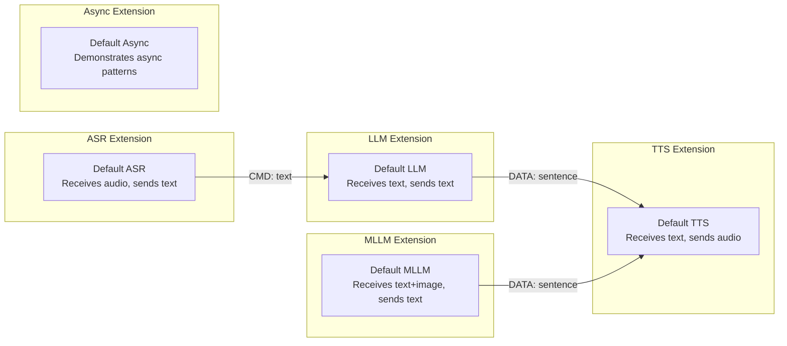

# TEN Core Extensions — Default Templates for ASR, LLM, TTS, and MLLM

TEN Framework ships with four core extension templates that serve as starting points for building speech-to-text, language model, text-to-speech, and multimodal LLM extensions. These templates demonstrate the extension lifecycle, message handling, and property management patterns.

Source: `ten-framework/packages/core_extensions/` — default extension templates

## Core Extension Overview



| Template | Directory | Purpose |
|----------|-----------|---------|
| `default_asr_extension_python` | Speech-to-text template | Receives audio frames, outputs text commands |
| `default_extension_python` | Generic extension template | Demonstrates basic lifecycle and message handling |
| `default_llm_extension_python` | Language model template | Receives text commands, outputs data messages |
| `default_mllm_extension_python` | Multimodal LLM template | Handles text + image input |
| `default_tts_extension_python` | Text-to-speech template | Receives data, outputs audio frames |
| `default_async_extension_python` | Async pattern template | Demonstrates async processing |

## Default ASR Extension (Speech-to-Text)

Source: `packages/core_extensions/default_asr_extension_python/extension.py:1-70`

The ASR extension receives audio frames and outputs text commands:

```python
class DefaultAsrExtension(Extension):
    def on_start(self, ten_env: TenEnv) -> None:
        ten_env.log(LogLevel.INFO, "DefaultAsrExtension on_start")
        ten_env.on_start_done()

    def on_audio_frame(self, ten_env: TenEnv, audio_frame: AudioFrame) -> None:
        # IMPLEMENT: process audio frame and convert to text
        # Create a cmd message with the transcription result
        cmd_out = Cmd.create("text")
        cmd_out.set_property_string("text", "transcription result")

        ten_env.log(LogLevel.INFO, "DefaultAsrExtension on_audio_frame {}".format(
            cmd_out.get_property_string("text")))

        # Send the command to downstream extensions
        ten_env.send_cmd(cmd_out)
```

**Message flow:**
1. **Input**: `AudioFrame` from microphone or audio source
2. **Output**: `Cmd("text")` with transcription result

**Key implementation pattern:** The ASR extension creates a `Cmd` message named `"text"` with the transcription stored in the `"text"` property. This follows TEN's convention where STT outputs are commands, enabling downstream extensions (like LLM) to receive them via `on_cmd`.

## Default Extension (Generic Template)

Source: `packages/core_extensions/default_extension_python/extension.py:1-72`

The generic template demonstrates all lifecycle hooks and message handlers:

```python
class DefaultExtension(Extension):
    def on_init(self, ten_env: TenEnv) -> None:
        ten_env.log(LogLevel.DEBUG, "on_init")
        ten_env.on_init_done()

    def on_start(self, ten_env: TenEnv) -> None:
        ten_env.log(LogLevel.DEBUG, "on_start")
        # IMPLEMENT: read properties, initialize resources
        ten_env.on_start_done()

    def on_stop(self, ten_env: TenEnv) -> None:
        ten_env.log(LogLevel.DEBUG, "on_stop")
        # IMPLEMENT: clean up resources
        ten_env.on_stop_done()

    def on_deinit(self, ten_env: TenEnv) -> None:
        ten_env.log(LogLevel.DEBUG, "on_deinit")
        ten_env.on_deinit_done()

    def on_cmd(self, ten_env: TenEnv, cmd: Cmd) -> None:
        cmd_name = cmd.get_name()
        ten_env.log(LogLevel.DEBUG, "on_cmd name {}".format(cmd_name))
        # IMPLEMENT: process cmd
        cmd_result = CmdResult.create(StatusCode.OK, cmd)
        ten_env.return_result(cmd_result)

    def on_data(self, ten_env: TenEnv, data: Data) -> None:
        data_name = data.get_name()
        ten_env.log(LogLevel.DEBUG, "on_data name {}".format(data_name))
        # IMPLEMENT: process data

    def on_audio_frame(self, ten_env: TenEnv, audio_frame: AudioFrame) -> None:
        audio_frame_name = audio_frame.get_name()
        ten_env.log(LogLevel.DEBUG, "on_audio_frame name {}".format(audio_frame_name))
        # IMPLEMENT: process audio frame

    def on_video_frame(self, ten_env: TenEnv, video_frame: VideoFrame) -> None:
        video_frame_name = video_frame.get_name()
        ten_env.log(LogLevel.DEBUG, "on_video_frame name {}".format(video_frame_name))
        # IMPLEMENT: process video frame
```

**Key patterns demonstrated:**
- All four lifecycle hooks: `on_init`, `on_start`, `on_stop`, `on_deinit`
- All four message handlers: `on_cmd`, `on_data`, `on_audio_frame`, `on_video_frame`
- Command result handling: creating `CmdResult` with `StatusCode.OK` and returning via `ten_env.return_result()`

Aha: The generic template follows the "explicit done" pattern where each lifecycle method must explicitly signal completion by calling `on_*_done()`. This is TEN's solution to async initialization — the extension can start async operations (like loading a model or establishing a connection) and call `done()` only when ready. The core runtime waits for all extensions to signal `done` before considering the graph started.

## Default LLM Extension

Source: `packages/core_extensions/default_llm_extension_python/extension.py:1-80`

The LLM template demonstrates text-to-text processing:

```python
class DefaultLlmExtension(Extension):
    def on_start(self, ten_env: TenEnv) -> None:
        ten_env.log(LogLevel.DEBUG, "DefaultLlmExtension on_start")
        ten_env.on_start_done()

    def on_cmd(self, ten_env: TenEnv, cmd: Cmd) -> None:
        cmd_name = cmd.get_name()
        ten_env.log(LogLevel.DEBUG, "on_cmd, cmd name: {}".format(cmd_name))

        if cmd_name == "text":
            # Get the text from the input command
            text = cmd.get_property_string("text")
            ten_env.log(LogLevel.DEBUG, "on_cmd, text: {}".format(text))

            # IMPLEMENT: generate response using LLM

            # Create a data message with the response
            data_out = Data.create("sentence")
            data_out.set_property_string("text", "response text")

            ten_env.send_data(data_out)

        cmd_result = CmdResult.create(StatusCode.OK, cmd)
        ten_env.return_result(cmd_result)
```

**Message flow:**
1. **Input**: `Cmd("text")` from ASR extension with user transcription
2. **Output**: `Data("sentence")` to TTS extension with generated response

**Key implementation pattern:** The LLM extension receives commands (input text) and outputs data (generated sentences). Using `Data` instead of `Cmd` for output is intentional — data messages represent streaming content rather than control commands, and they don't require a `CmdResult` acknowledgment.

## Default TTS Extension

Source: `packages/core_extensions/default_tts_extension_python/extension.py:1-80`

The TTS template demonstrates text-to-audio processing:

```python
class DefaultTtsExtension(Extension):
    def on_start(self, ten_env: TenEnv) -> None:
        ten_env.log(LogLevel.DEBUG, "DefaultTtsExtension on_start")
        ten_env.on_start_done()

    def on_data(self, ten_env: TenEnv, data: Data) -> None:
        data_name = data.get_name()
        ten_env.log(LogLevel.DEBUG, "on_data, data name: {}".format(data_name))

        if data_name == "sentence":
            text = data.get_property_string("text")
            ten_env.log(LogLevel.DEBUG, "on_data, text: {}".format(text))

            # IMPLEMENT: synthesize speech from text

            # Create an audio frame
            audio_frame = AudioFrame.create("pcm_frame")
            audio_frame.set_property_int("sample_rate", 16000)
            # IMPLEMENT: set the audio buffer

            ten_env.send_audio_frame(audio_frame)
```

**Message flow:**
1. **Input**: `Data("sentence")` from LLM extension with text to speak
2. **Output**: `AudioFrame("pcm_frame")` to speaker/audio output

**Key implementation pattern:** The TTS extension receives data messages and outputs audio frames. The audio frame has a `sample_rate` property (16000 Hz by default) and a raw PCM buffer. Extensions should set the buffer with synthesized audio data.

## Default MLLM Extension (Multimodal)

Source: `packages/core_extensions/default_mllm_extension_python/extension.py:1-90`

The MLLM template handles both text and image input:

```python
class DefaultMllmExtension(Extension):
    def on_start(self, ten_env: TenEnv) -> None:
        ten_env.log(LogLevel.DEBUG, "DefaultMllmExtension on_start")
        ten_env.on_start_done()

    def on_cmd(self, ten_env: TenEnv, cmd: Cmd) -> None:
        cmd_name = cmd.get_name()
        ten_env.log(LogLevel.DEBUG, "on_cmd, cmd name: {}".format(cmd_name))

        if cmd_name == "text":
            text = cmd.get_property_string("text")
            ten_env.log(LogLevel.DEBUG, "on_cmd, text: {}".format(text))

            # IMPLEMENT: process text input
            # IMPLEMENT: generate response using MLLM

            data_out = Data.create("sentence")
            data_out.set_property_string("text", "response text")
            ten_env.send_data(data_out)

        cmd_result = CmdResult.create(StatusCode.OK, cmd)
        ten_env.return_result(cmd_result)

    def on_video_frame(self, ten_env: TenEnv, video_frame: VideoFrame) -> None:
        video_frame_name = video_frame.get_name()
        ten_env.log(LogLevel.DEBUG, "on_video_frame, name: {}".format(video_frame_name))

        # IMPLEMENT: process video frame for visual understanding
```

**Message flow:**
1. **Input**: `Cmd("text")` from user + `VideoFrame` from camera
2. **Output**: `Data("sentence")` to TTS extension

Aha: The MLLM extension demonstrates TEN's multimodal capability by handling both text commands and video frames in a single extension. Unlike the basic LLM extension, it implements `on_video_frame` to receive camera input, enabling vision-language models that can "see" and "speak" simultaneously. This is the foundation for multimodal agents like the TEN Agent with Vision support.

## Default Async Extension

Source: `packages/core_extensions/default_async_extension_python/extension.py:1-100`

The async template demonstrates non-blocking processing:

```python
class DefaultAsyncExtension(Extension):
    def on_start(self, ten_env: TenEnv) -> None:
        ten_env.log(LogLevel.DEBUG, "DefaultAsyncExtension on_start")

        # Start async processing thread
        self.processing_thread = threading.Thread(target=self._process_loop)
        self.processing_thread.start()

        ten_env.on_start_done()

    def _process_loop(self):
        while self.running:
            # Process messages from queue
            msg = self.queue.get()
            if msg is None:
                break
            # Process the message
            self._process(msg)
```

**Key patterns:**
- Uses a background thread for async processing
- Maintains a message queue for thread-safe communication
- Properly shuts down the thread on `on_stop`

## Extension Testing

Source: `packages/core_extensions/default_extension_python/tests/`

Each core extension includes pytest-based tests:

| File | Purpose |
|------|---------|
| `conftest.py` | Pytest fixtures for extension testing |
| `test_basic.py` | Basic lifecycle and message handling tests |

The test fixtures provide mock `TenEnv` objects that allow testing extension behavior without running the full TEN runtime:

```python
@pytest.fixture
def mock_ten_env():
    # Create a mock TenEnv for testing
    ...
```

## Extension Addon Pattern

Each core extension has an `addon.py` that registers the extension class with the TEN runtime:

Source: `packages/core_extensions/default_extension_python/addon.py:1-30`

```python
from ten import Addon
from .extension import DefaultExtension

class DefaultAddon(Addon):
    def init(self, ten_env):
        ten_env.register_extension("default_extension", DefaultExtension)
```

The addon class is the entry point for the extension package. When the Python addon loader loads the package, it calls `init()` on the addon, which registers the extension class. The runtime then creates instances of the extension as needed based on the graph configuration.

## Property Configuration

Each extension defines its configurable properties in `property.json`:

```json
{
  "ten": {
    "property": {
      "api_key": {
        "type": "string",
        "required": true,
        "secret": true
      },
      "model": {
        "type": "string",
        "default": "default-model"
      }
    }
  }
}
```

Extensions read properties during `on_start`:

```python
def on_start(self, ten_env: TenEnv) -> None:
    api_key = ten_env.get_property("api_key")
    model = ten_env.get_property("model")
    self.client = create_client(api_key, model)
    ten_env.on_start_done()
```

## Cross-References

- [05-extension-system.md](05-extension-system.md) — Package types, manifest.json, lifecycle overview
- [13-sdk-bindings.md](13-sdk-bindings.md) — SDK APIs for all supported languages
- [19-extension-examples.md](19-extension-examples.md) — Example extensions catalog (Ollama, PCM reader, etc.)
- [11-data-flow.md](11-data-flow.md) — End-to-end conversation pipeline

## Next

Continue to [15-agent-server.md](15-agent-server.md) for the Go server and worker management deep dive.
