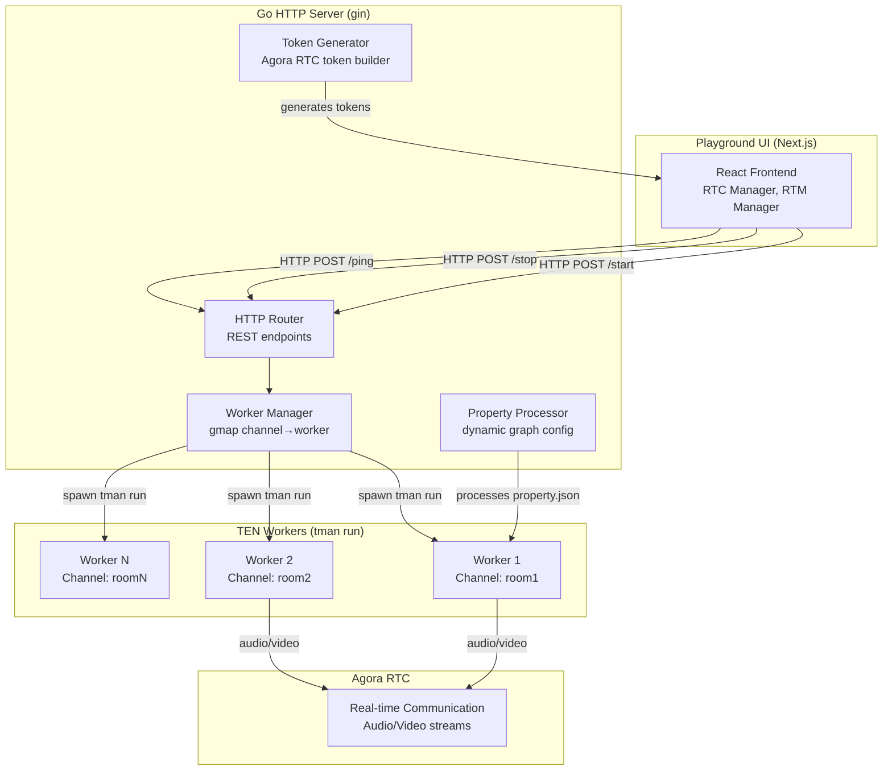

# TEN Agent Server — Go HTTP Server, Worker Management, and Agora RTC Integration

The TEN Agent server is a Go HTTP server that manages the lifecycle of TEN agent instances (workers). It provides REST APIs for starting, stopping, and monitoring agents, generates Agora RTC tokens for real-time communication, and manages RAG document pipelines. The server acts as the bridge between the playground UI and the TEN runtime.

Source: `ten-framework/ai_agents/server/` — Go server with gin framework

## Server Architecture



## Server Entry Point

Source: `ai_agents/server/main.go:1-104`

```go
func main() {
    var tenappDir string
    flag.StringVar(&tenappDir, "tenapp_dir", "", "The base folder path for tman run start command (required)")
    flag.Parse()

    // Validate required tenapp_dir parameter
    if tenappDir == "" {
        slog.Error("tenapp_dir parameter is required")
        os.Exit(1)
    }

    // Load .env
    err := godotenv.Load()
    if err != nil {
        slog.Warn("load .env file failed", "err", err)
    }

    // Validate environment
    agoraAppId := os.Getenv("AGORA_APP_ID")
    if len(agoraAppId) != 32 {
        slog.Error("environment AGORA_APP_ID invalid")
        os.Exit(1)
    }

    workersMax, _ := strconv.Atoi(os.Getenv("WORKERS_MAX"))
    workerQuitTimeoutSeconds, _ := strconv.Atoi(os.Getenv("WORKER_QUIT_TIMEOUT_SECONDS"))

    // Set up signal handler for Ctrl+C cleanup
    sigs := make(chan os.Signal, 1)
    signal.Notify(sigs, syscall.SIGINT, syscall.SIGTERM)
    go func() {
        <-sigs
        fmt.Println("Received interrupt signal, cleaning up workers...")
        internal.CleanWorkers()
        os.Exit(0)
    }()

    httpServer := internal.NewHttpServer(&internal.HttpServerConfig{
        AppId:                    agoraAppId,
        AppCertificate:           os.Getenv("AGORA_APP_CERTIFICATE"),
        LogPath:                  os.Getenv("LOG_PATH"),
        Port:                     os.Getenv("SERVER_PORT"),
        WorkersMax:               workersMax,
        WorkerQuitTimeoutSeconds: workerQuitTimeoutSeconds,
        Log2Stdout:               log2Stdout,
        TenappDir:                tenappDir,
    })
    httpServer.Start()
}
```

**Key initialization steps:**
1. Parse `--tenapp_dir` flag (required) — the base folder for TEN agents
2. Load `.env` file for configuration
3. Validate `AGORA_APP_ID` (must be 32 characters)
4. Parse `WORKERS_MAX` and `WORKER_QUIT_TIMEOUT_SECONDS`
5. Register signal handler for graceful shutdown
6. Start HTTP server with gin framework

## HTTP Server Configuration

Source: `ai_agents/server/internal/config.go:1-50`

```go
type HttpServerConfig struct {
    AppId                    string
    AppCertificate           string
    LogPath                  string
    Log2Stdout               bool
    PropertyJsonFile         string
    Port                     string
    WorkersMax               int
    WorkerQuitTimeoutSeconds int
    TenappDir                string
}
```

**Required environment variables:**

| Variable | Purpose | Validation |
|----------|---------|------------|
| `AGORA_APP_ID` | Agora application ID (32 chars) | Length must be 32 |
| `AGORA_APP_CERTIFICATE` | Agora app certificate for token generation | Optional |
| `WORKERS_MAX` | Maximum concurrent workers | Must be > 0 |
| `WORKER_QUIT_TIMEOUT_SECONDS` | Worker idle timeout | Must be > 0 |
| `LOG_PATH` | Log file directory | Created if missing |
| `LOG_STDOUT` | Also log to stdout | Boolean |
| `SERVER_PORT` | HTTP server port | Default from config |
| `VECTOR_DOCUMENT_PRESET_LIST` | JSON array of preset RAG documents | Optional |

## REST API Endpoints

Source: `ai_agents/server/internal/http_server.go:880-901`

```go
func (s *HttpServer) Start() {
    r := gin.Default()
    r.Use(corsMiddleware())

    r.GET("/", s.handlerHealth)
    r.GET("/health", s.handlerHealth)
    r.GET("/list", s.handlerList)
    r.POST("/start", s.handlerStart)
    r.POST("/stop", s.handlerStop)
    r.POST("/ping", s.handlerPing)
    r.GET("/graphs", s.handleGraphs)
    r.GET("/dev-tmp/addons/default-properties", s.handleAddonDefaultProperties)
    r.POST("/token/generate", s.handlerGenerateToken)
    r.GET("/vector/document/preset/list", s.handlerVectorDocumentPresetList)
    r.POST("/vector/document/update", s.handlerVectorDocumentUpdate)
    r.POST("/vector/document/upload", s.handlerVectorDocumentUpload)

    r.Run(fmt.Sprintf(":%s", s.config.Port))
}
```

| Method | Path | Purpose |
|--------|------|---------|
| GET | `/`, `/health` | Health check |
| GET | `/list` | List active workers |
| POST | `/start` | Start a new agent worker |
| POST | `/stop` | Stop an agent worker |
| POST | `/ping` | Keep-alive ping for worker |
| GET | `/graphs` | List available graphs from property.json |
| GET | `/dev-tmp/addons/default-properties` | List addon default properties |
| POST | `/token/generate` | Generate Agora RTC token |
| GET | `/vector/document/preset/list` | List preset RAG documents |
| POST | `/vector/document/update` | Update RAG document collection |
| POST | `/vector/document/upload` | Upload RAG document file |

Aha: The `/start` endpoint has a security guard: it always uses the launch `tenapp_dir` and ignores any `tenapp_dir` value in the request body. This prevents path traversal attacks where a malicious client could request the server to run a TEN agent from an arbitrary directory. Source: `http_server.go:288-293`

```go
// Security: Always use launch tenapp_dir, ignore request tenapp_dir to prevent path traversal attacks
tenappDir := s.config.TenappDir
if req.TenappDir != "" {
    slog.Warn("Ignoring request tenapp_dir for security", "requestId", req.RequestId, "requestedTenappDir", req.TenappDir, logTag)
}
```

## Worker Management

Source: `ai_agents/server/internal/worker_common.go:18-30`

```go
type Worker struct {
    ChannelName        string
    HttpServerPort     int32
    LogFile            string
    Log2Stdout         bool
    PropertyJsonFile   string
    GraphName          string
    TenappDir          string
    Pid                int
    QuitTimeoutSeconds int
    CreateTs           int64
    UpdateTs           int64
}
```

The worker manager uses a concurrent map (`gmap`) to track workers by channel name:

```go
var workers = gmap.New(true)
```

### Worker Start Flow

Source: `ai_agents/server/internal/http_server.go:236-321`

```go
func (s *HttpServer) handlerStart(c *gin.Context) {
    workersRunning := workers.Size()

    // Check worker limit
    if workersRunning >= s.config.WorkersMax {
        s.output(c, codeErrWorkersLimit, http.StatusTooManyRequests)
        return
    }

    // Check duplicate channel
    if workers.Contains(req.ChannelName) {
        s.output(c, codeErrChannelExisted, http.StatusBadRequest)
        return
    }

    // Gemini-specific worker limit (max 3)
    if strings.Contains(req.GraphName, "gemini") {
        graphNameCount := 0
        for _, channelName := range workers.Keys() {
            worker := workers.Get(channelName).(*Worker)
            if worker.GraphName == req.GraphName {
                graphNameCount++
            }
        }
        if graphNameCount >= MAX_GEMINI_WORKER_COUNT {
            s.output(c, codeErrWorkersLimit, http.StatusTooManyRequests)
            return
        }
    }

    // Allocate HTTP port for worker
    req.WorkerHttpServerPort = getHttpServerPort()

    // Process property.json (select graph, inject properties)
    propertyJsonFile, logFile, err := s.processProperty(&req, tenappDir)

    // Create and start worker
    worker := newWorker(req.ChannelName, logFile, s.config.Log2Stdout, propertyJsonFile, tenappDir)
    worker.HttpServerPort = req.WorkerHttpServerPort
    worker.GraphName = req.GraphName

    if req.QuitTimeoutSeconds > 0 {
        worker.QuitTimeoutSeconds = req.QuitTimeoutSeconds
    }

    if err := worker.start(&req); err != nil {
        s.output(c, codeErrStartWorkerFailed, http.StatusInternalServerError)
        return
    }
    workers.SetIfNotExist(req.ChannelName, worker)
}
```

**Start request schema:**

Source: `ai_agents/server/internal/http_server.go:50-61`

```go
type StartReq struct {
    RequestId            string                            `json:"request_id,omitempty"`
    ChannelName          string                            `json:"channel_name,omitempty"`
    GraphName            string                            `json:"graph_name,omitempty"`
    RemoteStreamId       uint32                            `json:"user_uid,omitempty"`
    BotStreamId          uint32                            `json:"bot_uid,omitempty"`
    Token                string                            `json:"token,omitempty"`
    WorkerHttpServerPort int32                             `json:"worker_http_server_port,omitempty"`
    Properties           map[string]map[string]interface{} `json:"properties,omitempty"`
    QuitTimeoutSeconds   int                               `json:"timeout,omitempty"`
    TenappDir            string                            `json:"tenapp_dir,omitempty"`
}
```

### Property Processing

The `processProperty` method dynamically modifies `property.json` for each agent session:

Source: `ai_agents/server/internal/http_server.go:566-878`

1. **Read** the base `property.json` from `tenapp_dir`
2. **Filter** `predefined_graphs` to only include the requested graph by name
3. **Set** `auto_start: true` for the selected graph
4. **Merge** request properties into extension node properties
5. **Inject** start parameters (channel name, token, etc.) into appropriate nodes
6. **Auto-inject** channel into any node with a `"channel"` property (line 706-725)
7. **Resolve** environment variable placeholders `${env:VAR|default}`
8. **Write** a temporary `property-{channel}-{timestamp}.json` file
9. **Return** the path for `tman run` to use

Aha: The property-based channel auto-injection (line 706-725) is a clever convention-over-configuration pattern. Instead of hardcoding which extensions need the channel name, the server scans all nodes and injects the channel into any node that has a `"channel"` property defined in its schema. This means new extensions that need the channel (like Heygen avatar or Anam avatar) automatically get it without server code changes — they just need to declare `"channel"` in their `property.json`.

### Worker Timeout Management

Source: `ai_agents/server/internal/worker_common.go:148-172`

```go
func timeoutWorkers() {
    for {
        for _, channelName := range workers.Keys() {
            worker := workers.Get(channelName).(*Worker)

            // Skip workers with infinite timeout
            if worker.QuitTimeoutSeconds == WORKER_TIMEOUT_INFINITY {
                continue
            }

            nowTs := time.Now().Unix()
            if worker.UpdateTs+int64(worker.QuitTimeoutSeconds) < nowTs {
                if err := worker.stop(uuid.New().String(), channelName.(string)); err != nil {
                    slog.Error("Timeout worker stop failed", "err", err, "channelName", channelName, logTag)
                    continue
                }
                slog.Info("Timeout worker stop success", "channelName", channelName, logTag)
            }
        }
        slog.Debug("Worker timeout check", "sleep", workerCleanSleepSeconds, logTag)
        time.Sleep(workerCleanSleepSeconds * time.Second)
    }
}
```

The timeout checker runs in a goroutine started by `Start()`. It iterates over all workers every 5 seconds (`workerCleanSleepSeconds`), comparing `UpdateTs + QuitTimeoutSeconds` against the current time. Workers that have been idle beyond their timeout are automatically stopped.

The `UpdateTs` is updated by:
- `/ping` endpoint — heartbeat from the playground
- Worker creation — initial timestamp
- Successful stop — cleanup timestamp

### HTTP Port Allocation

Source: `ai_agents/server/internal/worker_common.go:71-82`

```go
var (
    httpServerPort    = httpServerPortMin  // 10000
    httpServerPortMin = int32(10000)
    httpServerPortMax = int32(30000)
)

func getHttpServerPort() int32 {
    for {
        old := atomic.LoadInt32(&httpServerPort)
        new := old + 1
        if new > httpServerPortMax {
            new = httpServerPortMin
        }
        if atomic.CompareAndSwapInt32(&httpServerPort, old, new) {
            return new
        }
    }
}
```

Port allocation uses atomic compare-and-swap to ensure thread-safe allocation. Ports range from 10000 to 30000 (20,000 possible workers), cycling back to 10000 when exhausted.

## Agora RTC Token Generation

Source: `ai_agents/server/internal/http_server.go:357-388`

```go
func (s *HttpServer) handlerGenerateToken(c *gin.Context) {
    var req GenerateTokenReq
    c.ShouldBindBodyWith(&req, binding.JSON)

    if s.config.AppCertificate == "" {
        // No certificate — use AppId as token (development mode)
        s.output(c, codeSuccess, map[string]any{
            "appId": s.config.AppId,
            "token": s.config.AppId,
            "channel_name": req.ChannelName,
            "uid": req.Uid,
        })
        return
    }

    token, err := rtctokenbuilder.BuildTokenWithRtm(
        s.config.AppId, s.config.AppCertificate,
        req.ChannelName, fmt.Sprintf("%d", req.Uid),
        rtctokenbuilder.RolePublisher,
        tokenExpirationInSeconds, tokenExpirationInSeconds,
    )
    s.output(c, codeSuccess, map[string]any{
        "appId": s.config.AppId,
        "token": token,
        "channel_name": req.ChannelName,
        "uid": req.Uid,
    })
}
```

When no `AppCertificate` is configured, the server uses the `AppId` as the token (development mode). In production, it generates proper Agora RTC tokens using the `rtctokenbuilder2` library.

## Channel Name Sanitization

Source: `ai_agents/server/internal/http_server.go:904-953`

The server sanitizes channel names to prevent path injection attacks:

```go
func sanitizeChannelName(channelName string) (string, error) {
    if channelName == "" {
        return "", fmt.Errorf("channel name cannot be empty")
    }
    if len(channelName) > 100 {
        return "", fmt.Errorf("channel name too long")
    }
    // Check for path traversal characters
    if strings.Contains(channelName, "..") ||
       strings.Contains(channelName, "/") ||
       strings.Contains(channelName, "\\") ||
       strings.Contains(channelName, "\x00") {
        return "", fmt.Errorf("channel name contains invalid characters")
    }
    // ... sanitize and truncate
}
```

The sanitized name is used in filenames for property files and log files, preventing directory traversal.

## RAG Document Management

Source: `ai_agents/server/internal/http_server.go:445-503`

The server supports RAG (Retrieval-Augmented Generation) document management:

```go
func (s *HttpServer) handlerVectorDocumentUpload(c *gin.Context) {
    // Validate and sanitize channel name
    safeChannelName, err := sanitizeChannelName(req.ChannelName)

    // Save uploaded file with hashed name
    uploadFile := fmt.Sprintf("%s/file-%s-%d%s", s.config.LogPath,
        gmd5.MustEncryptString(safeChannelName), time.Now().UnixNano(), filepath.Ext(file.Filename))

    // Generate collection name
    collection := fmt.Sprintf("a%s_%d", gmd5.MustEncryptString(safeChannelName), time.Now().UnixNano())

    // Send update command to worker
    worker.update(&WorkerUpdateReq{
        Collection: collection,
        FileName: fileName,
        Path: uploadFile,
        Ten: &WorkerUpdateReqTen{
            Name: "file_chunk",
            Type: "cmd",
        },
    })
}
```

Uploaded files are saved with MD5-hashed channel names and timestamps, then a `file_chunk` command is sent to the worker to process the document into a vector collection.

## Cross-References

- [16-playground-ui.md](16-playground-ui.md) — Playground UI that communicates with this server
- [11-data-flow.md](11-data-flow.md) — Agent lifecycle and message flow
- [03-tman-cli.md](03-tman-cli.md) — `tman run` command that starts agents

## Next

Continue to [16-playground-ui.md](16-playground-ui.md) for the React playground UI deep dive.
