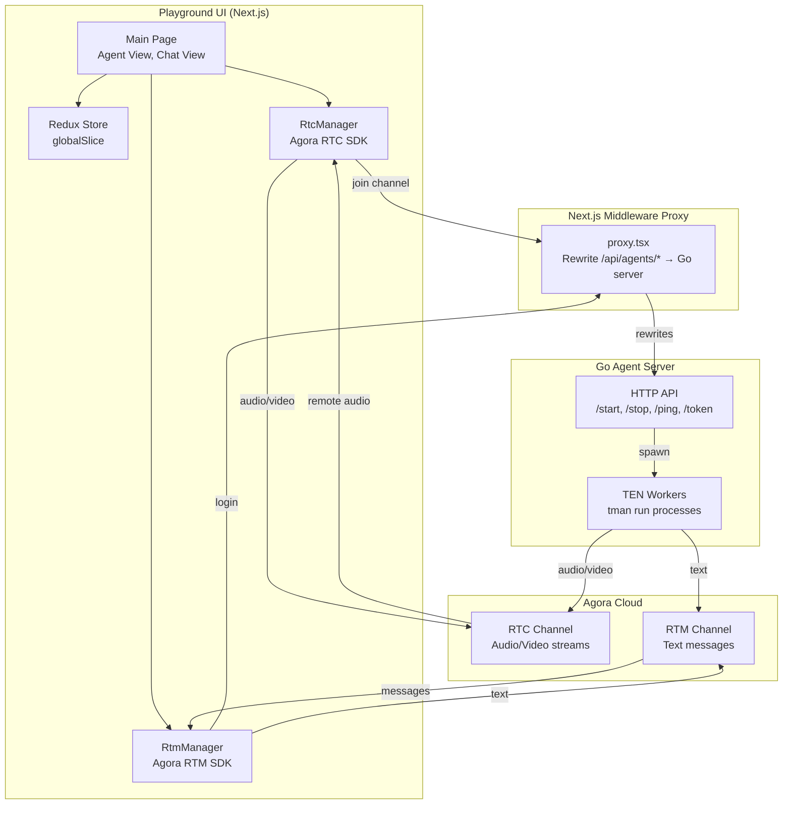

# TEN Playground UI — React Frontend, Redux State, and RTC/RTM Managers

The TEN Playground is a Next.js React application that provides a real-time interface for interacting with TEN agents. It uses Agora RTC for audio/video streaming, Agora RTM for text messaging, and Redux Toolkit for state management. The playground connects to the Go agent server via a Next.js middleware proxy.

Source: `ten-framework/ai_agents/playground/` — Next.js + React + Redux

## Architecture



## Technology Stack

| Package | Version | Purpose |
|---------|---------|---------|
| `next` | 16.0.7 | Framework with middleware proxy |
| `react` / `react-dom` | 19.2.0 | UI runtime |
| `@reduxjs/toolkit` | — | State management |
| `react-redux` | — | Redux bindings |
| `agora-rtc-sdk-ng` | — | Real-time audio/video |
| `agora-rtm` | — | Real-time messaging |
| `@trulience/react-sdk` | — | Avatar integration |
| `protobufjs` | — | STT message decoding |
| `@radix-ui/*` | — | UI component primitives |
| `tailwindcss` | 4 | Styling |

Source: `ai_agents/playground/package.json`

## Next.js Middleware Proxy

Source: `ai_agents/playground/src/proxy.tsx:1-62`

The proxy rewrites API requests to the Go server:

```typescript
export const config = {
    matcher: [
        "/api/agents/:path*",
        "/api/vector/:path*",
        "/api/token/:path*",
    ],
};

export function middleware(request: NextRequest) {
    const url = new URL(request.url);
    const serverUrl = process.env.AGENT_SERVER_URL;

    if (url.pathname.startsWith("/api/agents/")) {
        return NextResponse.rewrite(new URL(`${serverUrl}${url.pathname}`, serverUrl));
    }
    if (url.pathname.startsWith("/api/vector/")) {
        return NextResponse.rewrite(new URL(`${serverUrl}${url.pathname}`, serverUrl));
    }
    if (url.pathname.startsWith("/api/token/")) {
        return NextResponse.rewrite(new URL(`${serverUrl}${url.pathname}`, serverUrl));
    }
    return NextResponse.next();
}
```

**Key routing:**
- `/api/agents/start` → `AGENT_SERVER_URL/api/agents/start` → Go server `/start`
- `/api/agents/stop` → Go server `/stop`
- `/api/agents/ping` → Go server `/ping`
- `/api/token/generate` → Go server `/token/generate`
- `/api/vector/document/upload` → Go server `/vector/document/upload`

Aha: The middleware proxy decouples the playground from the Go server's actual URL. The playground makes all API calls to relative `/api/*` paths, and the middleware rewrites them to the configured `AGENT_SERVER_URL`. This means the same frontend code works in development (proxying to localhost), staging, and production without code changes — only the environment variable needs updating.

## Redux State Management

Source: `ai_agents/playground/src/store/reducers/global.ts:1-279`

### Initial State

```typescript
export interface InitialState {
    options: IOptions;           // channel, userName, userId, appId, token
    roomConnected: boolean;      // Agora RTC room connection status
    agentConnected: boolean;     // Agent session status
    rtmConnected: boolean;       // Agora RTM connection status
    themeColor: string;          // UI theme color
    language: Language;          // en-US, zh-CN, ko-KR, ja-JP
    voiceType: VoiceType;        // male, female
    chatItems: IChatItem[];      // Chat message history
    selectedGraphId: string;     // Currently selected graph
    graphList: Graph[];          // Available graphs from server
    graphMap: Record<string, Graph>;  // Graph lookup map
    addonModules: AddonDef.Module[];  // Available extension modules
    mobileActiveTab: EMobileActiveTab;  // Mobile tab: agent or chat
    trulienceSettings: ITrulienceSettings;  // Avatar settings
}
```

### Key Reducers

| Reducer | Purpose |
|---------|---------|
| `setOptions` | Update connection options (persisted to localStorage) |
| `setThemeColor` | Update UI theme color |
| `setRoomConnected` | Update RTC connection status |
| `setAgentConnected` | Update agent session status |
| `setRtmConnected` | Update RTM connection status |
| `addChatItem` | Add chat message with deduplication logic |
| `setLanguage` | Change language locale |
| `setSelectedGraphId` | Select a graph configuration |
| `setGraphList` | Update available graphs from server |
| `setVoiceType` | Change voice preset |
| `setGraph` | Update a specific graph |
| `setAddonModules` | Update available extension modules |
| `reset` | Reset all state to initial values |

### Chat Item Deduplication

Source: `ai_agents/playground/src/store/reducers/global.ts:97-153`

The `addChatItem` reducer implements smart deduplication for streaming text:

```typescript
addChatItem: (state, action: PayloadAction<IChatItem>) => {
    const { userId, text, isFinal, type, time } = action.payload;
    const LastFinalIndex = state.chatItems.findLastIndex((el) => el.userId === userId && el.isFinal);
    const LastNonFinalIndex = state.chatItems.findLastIndex((el) => el.userId === userId && !el.isFinal);
    const LastFinalItem = state.chatItems[LastFinalIndex];
    const LastNonFinalItem = state.chatItems[LastNonFinalIndex];

    if (LastFinalItem) {
        if (time <= LastFinalItem.time) {
            // discard — older than last final message
            return;
        } else {
            if (LastNonFinalItem) {
                // update existing non-final item
                state.chatItems[LastNonFinalIndex] = action.payload;
            } else {
                // add new item
                state.chatItems.push(action.payload);
            }
        }
    } else {
        // no final item yet
        if (LastNonFinalItem) {
            state.chatItems[LastNonFinalIndex] = action.payload;
        } else {
            state.chatItems.push(action.payload);
        }
    }
    state.chatItems.sort((a, b) => a.time - b.time);
}
```

Aha: The chat deduplication logic handles the streaming text pattern common in LLM outputs. When the agent sends partial text (`isFinal: false`), it updates the existing non-final item. When the final text arrives (`isFinal: true`), it replaces the non-final item. Messages with timestamps older than the last final message are discarded. This prevents duplicate or out-of-order messages from appearing in the chat UI, which is critical for real-time streaming where network latency can cause messages to arrive out of order.

## RTC Manager

Source: `ai_agents/playground/src/manager/rtc/rtc.ts:1-323`

The `RtcManager` class wraps the Agora RTC SDK:

```typescript
export class RtcManager extends AGEventEmitter<RtcEvents> {
    private _joined;
    client: IAgoraRTCClient;
    localTracks: IUserTracks;
    appId: string | null = null;
    token: string | null = null;
    userId: number | null = null;

    constructor() {
        super();
        this._joined = false;
        this.localTracks = {};
        this.client = AgoraRTC.createClient({ mode: "rtc", codec: "vp8" });
        this._listenRtcEvents();
    }

    async join({ channel, userId }: { channel: string; userId: number }) {
        if (!this._joined) {
            const res = await apiGenAgoraData({ channel, userId });
            const { appId, token } = data;
            this.appId = appId;
            this.token = token;
            this.userId = userId;
            await this.client?.join(appId, channel, token, userId);
            this._joined = true;
        }
    }
}
```

### RTC Event Listeners

Source: `ai_agents/playground/src/manager/rtc/rtc.ts:146-172`

```typescript
private _listenRtcEvents() {
    this.client.on("network-quality", (quality) => {
        this.emit("networkQuality", quality);
    });
    this.client.on("user-published", async (user, mediaType) => {
        await this.client.subscribe(user, mediaType);
        if (mediaType === "audio") {
            this._playAudio(user.audioTrack);
        }
        this.emit("remoteUserChanged", {
            userId: user.uid,
            audioTrack: user.audioTrack,
            videoTrack: user.videoTrack,
        });
    });
    this.client.on("user-unpublished", async (user, mediaType) => {
        await this.client.unsubscribe(user, mediaType);
        this.emit("remoteUserChanged", {
            userId: user.uid,
            audioTrack: user.audioTrack,
            videoTrack: user.videoTrack,
        });
    });
    this.client.on("stream-message", (_uid: UID, stream: any) => {
        this._parseData(stream);
    });
}
```

### Text Stream Parsing

Source: `ai_agents/playground/src/manager/rtc/rtc.ts:174-289`

The RTC data channel carries text messages encoded as chunked base64:

```typescript
handleChunk(formattedChunk: string) {
    const [message_id, partIndexStr, totalPartsStr, content] =
        formattedChunk.split("|");

    const part_index = parseInt(partIndexStr, 10);
    const total_parts = totalPartsStr === "???" ? -1 : parseInt(totalPartsStr, 10);

    // Cache chunks by message_id
    if (!this.messageCache[message_id]) {
        this.messageCache[message_id] = [];
        setTimeout(() => {
            if (this.messageCache[message_id]?.length !== total_parts) {
                delete this.messageCache[message_id]; // discard incomplete
            }
        }, TIMEOUT_MS); // 5000ms timeout
    }

    this.messageCache[message_id].push(chunkData);

    if (this.messageCache[message_id].length === total_parts) {
        const completeMessage = this.reconstructMessage(this.messageCache[message_id]);
        const { stream_id, is_final, text, text_ts, data_type, role } =
            JSON.parse(this.base64ToUtf8(completeMessage));

        // Emit chat item
        if (data_type === "raw") {
            const { data, type } = JSON.parse(text);
            if (type === "image_url") {
                textItem = { ...textItem, data_type: EMessageDataType.IMAGE, text: data.image_url };
            } else if (type === "action") {
                const { action, data: actionData } = data;
                if (action === "browse_website") {
                    window.open(actionData.url, "_blank");
                    return;
                }
            }
        }
        this.emit("textChanged", textItem);
    }
}
```

**Text stream protocol:**
1. Messages are split into chunks separated by `|`
2. Format: `message_id|part_index|total_parts|content`
3. Chunks are cached by `message_id`
4. Incomplete messages are discarded after 5 seconds (`TIMEOUT_MS`)
5. Complete messages are reconstructed, base64-decoded, and JSON-parsed
6. The `data_type` field determines rendering: `text`, `image`, `reason`, or `action`

Aha: The text stream protocol uses a pipe-delimited chunking scheme rather than relying on the underlying transport's message boundaries. This is necessary because RTC data channels can split large messages across multiple packets. The `message_id` + `part_index` + `total_parts` format enables the receiver to reassemble messages even when chunks arrive out of order. The 5-second timeout prevents memory leaks from abandoned partial messages.

## RTM Manager

Source: `ai_agents/playground/src/manager/rtm/index.ts:1-145`

The `RtmManager` handles text messaging via Agora RTM:

```typescript
class RtmManager extends AGEventEmitter<RtmEvents> {
    client: RTM;

    async login(token: string, userId: string) {
        await this.client.login({ token, userId });
    }

    async sendText(text: string, channelName: string) {
        const channel = await this.client.getOrCreateChannel(channelName);
        await channel.send({
            text: JSON.stringify({
                type: ERTMTextType.INPUT_TEXT,
                text: text,
                ts: Date.now(),
            }),
        });
    }

    async subscribe(channelName: string) {
        const channel = await this.client.getOrCreateChannel(channelName);
        channel.subscribe();
    }
}
```

**Text message format:**
```json
{
    "type": "INPUT_TEXT",
    "text": "user message here",
    "ts": 1234567890
}
```

## API Client

Source: `ai_agents/playground/src/common/request.ts:1-520`

The API client provides typed functions for server communication:

| Function | HTTP Method | Endpoint | Purpose |
|----------|-------------|----------|---------|
| `apiStartService` | POST | `/api/agents/start` | Start agent session |
| `apiStopService` | POST | `/api/agents/stop` | Stop agent session |
| `apiPing` | POST | `/api/agents/ping` | Keepalive ping |
| `apiGenAgoraData` | POST | `/api/token/generate` | Generate Agora token |
| `apiFetchGraphs` | GET | `/api/agents/graphs` | List available graphs |
| `apiFetchGraphDetails` | POST | `/api/agents/graph` | Get graph configuration |
| `apiUpdateGraph` | POST | `/api/agents/graph/update` | Update graph |
| `apiFetchInstalledAddons` | GET | `/api/agents/addons` | List installed extensions |
| `apiUploadVectorDocument` | POST | `/api/vector/document/upload` | Upload RAG document |
| `apiUpdateVectorDocument` | POST | `/api/vector/document/update` | Update RAG collection |

## Module Registry

Source: `ai_agents/playground/src/common/moduleConfig.ts:1-300`

The module registry maps extension package names to UI-friendly labels and metadata:

```typescript
export namespace ModuleRegistry {
    export enum ModuleType {
        STT = "stt",
        LLM = "llm",
        V2V = "v2v",
        TTS = "tts",
        TOOL = "tool",
    }

    export interface Module {
        name: string;
        type: ModuleType;
        label: string;
    }
}
```

| Registry | Extensions |
|----------|------------|
| STT | Deepgram, Transcribe, Speechmatics |
| LLM | OpenAI ChatGPT, Dify, Coze, Gemini, Bedrock |
| TTS | Azure, Cartesia, Cosy, ElevenLabs, Fish Audio, MiniMax, Polly, Neuphonic, OpenAI, Dubverse |
| V2V | OpenAI Realtime, Gemini Realtime, GLM Realtime, StepFun Realtime, Azure Realtime |
| Tool | Vision, WeatherAPI, BingSearch, OpenAI Image Gen, Computer Tool, MCP Client |

### Compatible Tools Mapping

```typescript
export const compatibleTools: Record<string, string[]> = {
    openai_chatgpt_python: ["vision_tool_python", "weatherapi_tool_python", "bingsearch_tool_python", "openai_image_generate_tool", "computer_tool_python", "mcp_client_python"],
    openai_v2v_python: ["weatherapi_tool_python", "bingsearch_tool_python", "openai_image_generate_tool", "computer_tool_python", "mcp_client_python"],
    // ...
};
```

## Graph Editor

Source: `ai_agents/playground/src/common/graph.ts:1-578`

The `GraphEditor` class provides manipulation methods for graph configurations:

| Method | Purpose |
|--------|---------|
| `addNode(graph, addon, name, group, properties)` | Add an extension node |
| `removeNode(graph, nodeName)` | Remove a node and its connections |
| `updateNodeProperty(graph, nodeName, properties)` | Update node properties |
| `addConnection(graph, source, dest, protocol, name)` | Add a message connection |
| `removeConnection(graph, source, dest?, protocol?, name?)` | Remove a connection |
| `linkTool(graph, llmNode, toolNode, tool)` | Link a tool to an LLM |
| `enableRTCVideoSubscribe(graph, enabled)` | Enable/disable RTC video subscription |

### Tool Linking

Source: `ai_agents/playground/src/common/graph.ts:502-552`

```typescript
static linkTool(graph: Graph, llmNode: Node, toolNode: Node, tool: ModuleRegistry.ToolModule): void {
    // LLM → Tool: tool_call command
    GraphEditor.addOrUpdateConnection(graph, `${llmNode.name}`, `${toolNode.name}`,
        GraphConnProtocol.CMD, "tool_call");

    // Tool → LLM: tool_register command
    GraphEditor.addOrUpdateConnection(graph, `${toolNode.name}`, `${llmNode.name}`,
        GraphConnProtocol.CMD, "tool_register");

    // Vision tools: RTC → Tool: video_frame
    const rtcModule = GraphEditor.findNodeByPredicate(graph, (node) => node.addon.includes("rtc"));
    if (toolNode.addon.includes("vision") && rtcModule) {
        GraphEditor.addOrUpdateConnection(graph, `${rtcModule.name}`, `${toolNode.name}`,
            GraphConnProtocol.VIDEO_FRAME, "video_frame");
    }

    // Text-output tools: Tool → message_collector: content_data
    const messageCollector = GraphEditor.findNodeByPredicate(graph, (node) => node.addon.includes("message_collector"));
    if (tool.options.outputContentText && messageCollector) {
        GraphEditor.addOrUpdateConnection(graph, `${toolNode.name}`, `${messageCollector.name}`,
            GraphConnProtocol.DATA, "content_data");
    }
}
```

Aha: The `linkTool` method automatically creates all necessary connections for a tool to work with an LLM. It creates bidirectional command connections (`tool_call` and `tool_register`), conditionally adds video frame routing for vision tools, and routes text output to the message collector. This means adding a tool to an agent is a single operation — the graph editor handles the four different connection types that a tool needs.

## Key UI Components

### Audio Visualizer

Source: `ai_agents/playground/src/components/Agent/AudioVisualizer.tsx`

Renders real-time audio level visualization using Web Audio API's `AnalyserNode`.

### Avatar Trulience

Source: `ai_agents/playground/src/components/Agent/AvatarTrulience.tsx`

Integrates the Trulience 3D avatar SDK for animated AI avatars.

### Stream Player

Source: `ai_agents/playground/src/components/Agent/StreamPlayer.tsx`

Plays remote audio tracks from the Agora RTC channel.

### Camera / Microphone Controls

Source: `ai_agents/playground/src/components/Agent/Camera.tsx`, `Microphone.tsx`

Provide UI controls for enabling/disabling camera and microphone input.

### Network Indicator

Source: `ai_agents/playground/src/components/Dynamic/NetworkIndicator.tsx`

Displays connection quality using Agora's network quality API.

## Cross-References

- [15-agent-server.md](15-agent-server.md) — Go server that the playground communicates with
- [11-data-flow.md](11-data-flow.md) — End-to-end conversation pipeline
- [07-message-protocols.md](07-message-protocols.md) — Message type specifications

## Next

Continue to [17-build-system.md](17-build-system.md) for the GN build system and CI/CD pipeline deep dive.
