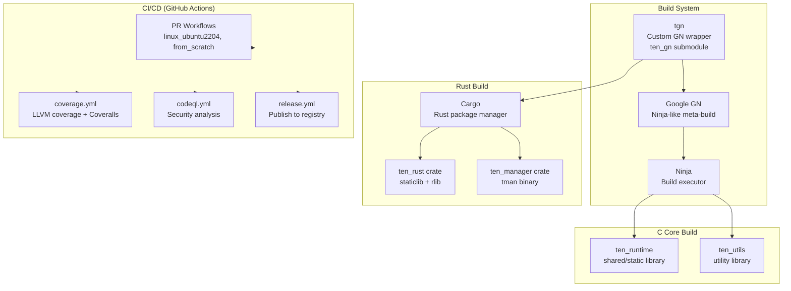

# TEN Build System — GN Build, Cargo Integration, and CI/CD Pipelines

TEN Framework uses a custom GN build system wrapper (`tgn`) for the C core runtime and Rust components, combined with Cargo for the Rust crates and GitHub Actions for CI/CD. The build system supports four target platforms (Linux, macOS, Windows) with multiple architectures (x86, x64, arm, arm64) and four language bindings (Python, Go, Node.js, C++).

Source: `ten-framework/build/`, `ten-framework/.github/workflows/`, `ten-framework/Taskfile.yml`

## Build System Architecture



## tgn — TEN Build Wrapper

Source: `tools/tgn/install_tgn.sh` — installs `ten_gn` submodule to `/usr/local/ten_gn`

The `tgn` command wraps Google's GN build system with TEN-specific defaults and paths:

```bash
tgn gen <os> <arch> <build_type> -- <extra_args>   # Generate build files
tgn build <os> <arch> <build_type>                  # Build
```

**Defaults:** OS=linux, ARCH=x64, BUILD_TYPE=debug

**Examples:**
```bash
tgn gen linux x64 debug
tgn build linux x64 debug
tgn build:"ten_manager_package tests/ten_manager"   # Build specific targets
```

Source: `Taskfile.yml:1-40` — Taskfile automation for common build commands

## Root BUILD.gn

Source: `ten-framework/BUILD.gn:1-44`

```gn
import("//build/options.gni")
import("//build/ten_runtime/options.gni")
import("//build/ten_runtime/ten.gni")
import("//build/ten_utils/options.gni")

group("ten_framework_all") {
    deps = []

    if (ten_enable_ten_rust) {
        deps += [ "//core/src/ten_rust" ]
    }
    if (ten_enable_ten_manager) {
        deps += [ "//core/src/ten_manager" ]
    }
    if (ten_enable_tests) {
        deps += [ "//tests" ]
    }
}
```

The root build conditionally includes components based on build options, enabling partial builds for faster iteration.

## Build Options

Source: `build/options.gni:1-46`

| Option | Default | Purpose |
|--------|---------|---------|
| `ten_enable_memory_check` | `true` | Custom memory tracking |
| `ten_enable_ten_rust` | `true` (disabled on x86 + sanitizer) | Rust crates |
| `ten_enable_cargo_clean` | `false` (true in CI) | Clean Cargo cache after build |
| `ten_enable_rust_incremental_build` | `true` (false in CI) | Incremental compilation |
| `ten_rust_force_release` | `false` (true in CI on Linux) | Force Rust release mode |

Source: `build/ten_runtime/options.gni:1-85`

| Option | Default | Purpose |
|--------|---------|---------|
| `ten_build_shared` | `true` | Build shared vs static libraries |
| `ten_build_go_binding` | `true` | Go language binding |
| `ten_build_python_binding` | `true` | Python language binding |
| `ten_build_node_binding` | `true` | Node.js language binding |
| `ten_build_cpp_binding` | `true` | C++ language binding |
| `ten_enable_tests` | `true` | Enable test targets |
| `ten_enable_go_app_leak_check` | Linux x64 debug + sanitizer only | Go memory leak detection |

Aha: The x86 architecture disables Rust builds because rustc lacks ASAN support on 32-bit x86. This is why `ten_enable_ten_rust` is conditionally disabled on x86 with sanitizer. The CI also excludes clang for x86 builds entirely — a platform-specific workaround that saves CI minutes on a configuration that would fail anyway.

## ten_runtime Library Build

Source: `core/src/ten_runtime/BUILD.gn:1-181`

```gn
# ten_runtime_library — shared or static
if (ten_build_shared) {
    shared_library("ten_runtime_library") {
        # Public deps: 22 modules
        public_deps = [
            "//src/addon",
            "//src/addon_loader",
            "//src/app",
            "//src/common",
            "//src/connection",
            "//src/engine",
            "//src/extension",
            # ... 15 more
        ]

        # macOS: symbol export list + Security framework
        if (is_mac) {
            ldflags = [ "-Wl,-exported_symbols_list,$target_gen_dir/ten_runtime.exports" ]
            libs = [ "Security.framework" ]
        }

        # Linux: version script for symbol visibility
        if (is_linux) {
            ldflags = [ "--version-script=$target_gen_dir/ten_runtime.version" ]
        }
    }
}
```

The ten_runtime library bundles 22+ C modules and exports a controlled symbol set via platform-specific linker scripts.

## Rust Build Integration

Source: `build/ten_common/rust/cargo_build.py` — Python script that invokes Cargo

The GN build invokes Cargo for Rust crates:

| Script | Purpose |
|--------|---------|
| `cargo_build.py` | Build Rust crates (lib + tests) |
| `cargo_build_tests.py` | Build Rust test binaries |
| `cargo_clean.py` | Clean Cargo target directory |
| `rust_cbindgen.py` | Generate C header files from Rust |
| `rust_gen_cargo_config.py` | Generate Cargo.toml with correct paths |
| `target_dir_tag.py` | Tag target directories for cleanup |

Source: `build/ten_common/rust/rust.gni` — GN template for Rust build targets

## Cargo Configuration

Source: `core/src/ten_rust/Cargo.toml:85-94`

```toml
[features]
default = ["service-hub"]
service-hub = []
deprecated = ["bindgen"]

[profile.release]
lto = true
opt-level = 3
codegen-units = 1
panic = "abort"
```

The release profile uses full LTO, maximum optimization, single codegen unit, and abort-on-panic — all chosen for production performance.

Source: `core/src/ten_manager/Cargo.toml` — ten_manager binary crate dependencies

## Third-Party Dependencies

Source: `third_party/BUILD.gn:1-41`

| Library | Purpose | Build System |
|---------|---------|-------------|
| googletest/googlemock | C++ testing framework | CMake |
| msgpack | Binary serialization | CMake |
| nlohmann_json | JSON parsing | Header-only |
| yyjson | Fast JSON parsing | CMake |
| libuv | Async I/O event loop | CMake/Autotools |
| libwebsockets | WebSocket client/server | CMake |
| mbedtls | TLS/crypto library | CMake |
| curl | HTTP client library | CMake/Autotools |
| zlib | Compression library | CMake |
| ffmpeg | Media processing | Makefile (optional, disabled by default) |
| clingo-sys | ASP solver (Rust binding) | CMake |
| node / node-api-headers | Node.js addon support | — |

## Linker Scripts

Source: `build/ten_runtime/ld_script/` — platform-specific linker scripts

| File | Platform | Purpose |
|------|----------|---------|
| `linux` | Linux x64 | Export only public symbols |
| `linux_for_python_binding` | Linux Python binding | Additional symbols for Python binding |
| `mac` | macOS | Export symbol list for dynamic library |
| `mac_for_python_binding` | macOS Python binding | Additional symbols for Python binding |

Aha: TEN uses linker scripts to control symbol visibility in the shared library. Only explicitly exported symbols are visible to external consumers — internal implementation details are hidden. This provides ABI stability: the library can change internal functions without breaking downstream extensions. The `*_for_python_binding` variants export additional symbols needed by the Python FFI layer.

## CI/CD Pipelines

Source: `.github/workflows/` — 25+ GitHub Action workflow files

### Primary CI Workflows

| Workflow | Trigger | Purpose |
|----------|---------|---------|
| `from_scratch.yml` | PR opened/sync/reopen | End-to-end: install deps, create app, build, test all languages |
| `linux_ubuntu2204.yml` | PR + release | Full matrix: gcc/clang × debug/release × x64/x86 |
| `coverage.yml` | PR (core/**, tests/**, build/**) | LLVM coverage + Coveralls upload |
| `codeql.yml` | push main + weekly cron | Security analysis (C/C++, Go, JS, Python) |
| `commitlint.yml` | PR | Lint commit messages |
| `pr_name.yml` | PR | Lint PR titles (conventional commits) |
| `cancel_on_merged.yml` | PR closed (merged) | Cancel in-flight jobs |

### Platform-Specific Workflows

| Workflow | Platform | Purpose |
|----------|----------|---------|
| `tman_full_linux_x64.yml` | Linux x64 | Full tman build + tests |
| `tman_full_linux_arm64.yml` | Linux ARM64 | Full tman build + tests |
| `tman_full_mac_arm64.yml` | macOS ARM64 | Full tman build + tests |
| `tman_full_mac_x64.yml` | macOS x64 | Full tman build + tests |
| `mac_x64.yml` | macOS x64 | Platform build |
| `mac_arm64.yml` | macOS ARM64 | Platform build |
| `mac_arm64_without_rust.yml` | macOS ARM64 | Build without Rust components |
| `linux_arm64.yml` | Linux ARM64 | Platform build |
| `win.yml` | Windows x64 | Platform build |

### Reusable Workflow Pattern

Source: `_check_pr_status.yml:1-70`

The `_check_pr_status` workflow is a reusable action that checks if a PR is still open before running expensive jobs:

```yaml
- uses: actions/github-script@v7
  with:
    script: |
      const pr = await github.rest.pulls.get({
        owner: context.repo.owner,
        repo: context.repo.repo,
        pull_number: context.issue.number,
      });
      return pr.data.state === 'open';
```

All expensive matrix jobs gate on this output, avoiding wasted CI minutes on PRs that have been closed or superseded.

### Concurrency Control

All workflows use:
```yaml
concurrency:
  group: <name>-${{ github.head_ref }}
  cancel-in-progress: true
```

This ensures only the latest push's CI runs, cancelling older in-progress jobs.

### Docker Build Environment

Source: `tools/docker_for_building/ubuntu/22.04/Dockerfile`

The CI uses a custom Docker image `ghcr.io/ten-framework/ten_building_ubuntu2204` containing:
- clang-18, gcc, build-essential
- Python 3.10 + pip + pytest + coverage tools
- Go 1.24.3
- Rust (stable)
- System libraries: libssl, libcurl, libmsgpack, libcrypto++, ffmpeg deps

### Coverage Pipeline

Source: `coverage.yml` — LLVM coverage with profraw/profdata collection

The coverage workflow:
1. Installs LLVM 21 (purges pre-installed clang 13/14/15 for consistent profraw format version 10)
2. Builds with `enable_sanitizer=false` (ASAN conflicts with LLVM coverage instrumentation)
3. Runs tests, collecting `.profraw` files
4. Merges into `.profdata` using `llvm-profdata`
5. Generates coverage report with `llvm-cov`
6. Uploads to Coveralls
7. Does periodic cargo cache cleanup every 5 minutes during build

Aha: The coverage and sanitizer pipelines are mutually exclusive — ASAN instrumentation conflicts with LLVM coverage counters. The coverage workflow explicitly sets `enable_sanitizer=false` to avoid this conflict. Additionally, the coverage workflow avoids Docker containers because they have ~70GB free disk vs ~12GB for containerized runners, and coverage artifacts (profraw files) are large.

## Release Workflows

| Workflow | Trigger | Purpose |
|----------|---------|---------|
| `update_homebrew.yml` | release | Update Homebrew tap |
| `update_winget.yml` | release | Update Winget package |
| `build_docker.yml` | push on tools/docker_for_building/** | Build Docker image for GHCR |
| `manual_publish_extension.yml` | manual | Manual extension publishing |

### Version Management

Source: `tools/version/update_version_in_ten_framework.py` — updates version strings

The version is managed in multiple places:
- `core/src/ten_manager/src/version.rs` — Rust version constant
- `Cargo.toml` files — crate versions
- `manifest.json` — package metadata

## Build Tools

Source: `tools/` directory

| Tool | Path | Purpose |
|------|------|---------|
| tgn | `tools/tgn/install_tgn.sh` | Install TEN build system |
| tman | `tools/tman/install_tman.sh` | Install TEN package manager |
| cargo_clippy.sh | `tools/rust/cargo_clippy.sh` | Run clippy (debug + release) |
| disk_usage.sh | `tools/disk/disk_usage.sh` | Disk monitoring |
| go-formatter.sh | `tools/go/go-formatter.sh` | Go code formatting |
| version/ | `tools/version/` | Version management scripts |
| pylint/ | `tools/pylint/` | Python linting configuration |
| profiler/ | `tools/profiler/` | Profiling tools |
| grafana-monitoring/ | `tools/grafana-monitoring/` | Monitoring (hybrid, pull, push modes) |

## Code Quality

| Config | File | Purpose |
|--------|------|---------|
| clang-format | `.clang-format` (5445 lines) | C++ formatting |
| clang-tidy | `.clang-tidy` (47 lines) | All checks except 40+ exclusions |
| clangd | `.clangd` (12 lines) | LSP with strict unused include detection |
| Biome | `biome.json` | TypeScript/JavaScript linting |
| Pyright | `pyrightconfig.json` | Python type checking (recommended mode) |
| CodeRabbit | `.coderabbit.yaml` | Auto-review (chill profile, ruff + gitleaks) |

## Build Matrix Summary

| Platform | Arch | Compiler | Build Types | Language Bindings |
|----------|------|----------|-------------|-------------------|
| Linux | x64 | gcc, clang | debug, release | Python, Go, Node.js, C++ |
| Linux | x86 | gcc | debug, release | C++ only (no Rust, Go, Python, Node.js) |
| Linux | arm64 | gcc, clang | debug, release | Python, Go, Node.js, C++ |
| macOS | arm64 | clang | debug, release | Python, Go, Node.js, C++ |
| macOS | x64 | clang | debug, release | Python, Go, Node.js, C++ |
| Windows | x64 | MSVC | debug, release | Python, Go, Node.js, C++ |

## Cross-References

- [01-architecture.md](01-architecture.md) — Overall architecture and crate structure
- [03-tman-cli.md](03-tman-cli.md) — TMAN binary built by Cargo
- [18-testing.md](18-testing.md) — Test infrastructure and CI test execution

## Next

Continue to [18-testing.md](18-testing.md) for the test infrastructure deep dive.
