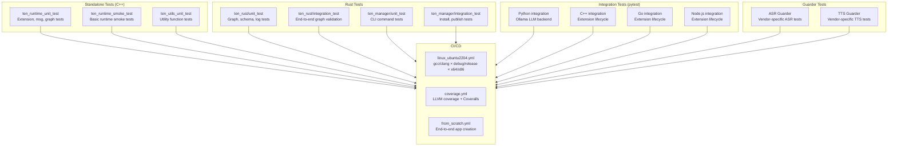

# TEN Testing Infrastructure — Test Frameworks, Integration Tests, and CI Execution

TEN Framework uses a multi-layered testing approach: standalone C++ unit/smoke tests, pytest-driven integration tests for all four language bindings, and Rust unit/integration tests. The CI runs these tests across a matrix of platforms, compilers, and build types.

Source: `ten-framework/tests/` — test directories and utilities

## Test Architecture



## Test Directory Structure

```
tests/
├── BUILD.gn                        # GN build configuration
├── common/                         # Shared test utilities
│   ├── client/                     # C test client (curl, msgpack, TCP)
│   │   ├── curl_connect.c/h        # HTTP client for test server
│   │   ├── http.c/h                # Generic HTTP utilities
│   │   ├── msgpack_tcp.c/h         # msgpack over TCP client
│   │   └── tcp.c/h                 # TCP socket utilities
│   ├── constant.h                  # Test constants
│   └── BUILD.gn
├── local_registry/                 # Local package registry for testing
│   ├── app/BUILD.gn                # Test app package
│   ├── extension/BUILD.gn          # Test extension package
│   └── system/BUILD.gn             # Test system package
├── ten_manager/                    # pytest tests for tman CLI
│   ├── dependency_resolve/         # SAT solver resolution tests
│   ├── error_context/              # Error message formatting tests
│   ├── fetch/                      # Package fetch tests
│   ├── install/                    # Package install tests
│   ├── install_all/                # Bulk install tests
│   └── publish/                    # Package publish tests
├── ten_runtime/
│   ├── integration/                # Language-specific integration tests
│   │   ├── cpp/                    # C++ extension integration
│   │   ├── go/                     # Go extension integration
│   │   ├── nodejs/                 # Node.js extension integration
│   │   └── python/                 # Python extension integration (uses Ollama)
│   ├── smoke/                      # Smoke tests
│   └── unit/                       # Unit tests
├── ten_utils/                      # Utility function tests
└── utils/                          # Python test utilities
    ├── build_config.py             # Build configuration helpers
    ├── build_pkg.py                # Package build utilities
    ├── cmd_exec.py                 # Command execution helpers
    ├── fs_utils.py                 # File system utilities
    ├── http.py                     # HTTP test client
    ├── install_all.py              # Bulk install helpers
    ├── install_pkg.py              # Single install helpers
    ├── log.py                      # Log parsing utilities
    └── msgpack.py                  # msgpack serialization helpers
```

## Test BUILD.gn

Source: `tests/BUILD.gn:1-39`

```gn
# Copy yyjson library for Windows test compatibility (no rpath on Windows)
copy("copy_yyjson_for_win_test") {
    ...
}

group("ten_runtime") {
    deps = [
        "//tests/ten_runtime/unit",
        "//tests/ten_runtime/smoke",
        "//tests/ten_utils/unit",
    ]
}

# Conditionally add local registry, ten_manager, and tman tests
if (ten_enable_tests) {
    deps += [
        "//tests/local_registry",
        "//tests/ten_manager",
        "//tests/ten_manager/tman_test",
    ]
}
```

## Standalone C++ Tests

### ten_runtime_unit_test

Tests the core runtime modules:

| Module | What It Tests |
|--------|---------------|
| Extension | Lifecycle hooks, property access, message sending |
| msg | Cmd, Data, AudioFrame, VideoFrame creation and manipulation |
| connection | Connection validation, message routing |
| engine | Graph engine execution, node scheduling |
| path | Property path resolution |

### ten_runtime_smoke_test

A minimal end-to-end test that:
1. Creates a simple graph with two extensions
2. Starts the graph engine
3. Sends a message between extensions
4. Verifies the message was received
5. Stops the graph

### ten_utils_unit_test

Tests utility functions:
- JSON parsing and manipulation
- String formatting
- Memory allocation tracking
- Hash functions

## Rust Tests

Source: `core/src/ten_rust/tests/integration_test.rs`, `core/src/ten_manager/tests/integration_test.rs`

| Test | File | Purpose |
|------|------|---------|
| `ten_rust/unit_test` | `tests/integration_test.rs` | Graph validation, schema, value_buffer, crypto |
| `ten_rust/integration_test` | `tests/integration_test.rs` | End-to-end graph loading and validation |
| `ten_manager/unit_test` | `tests/integration_test.rs` | CLI argument parsing, version checking |
| `ten_manager/integration_test` | `tests/integration_test.rs` | Install, publish, dependency resolution |

Rust tests use `--nocapture --test-threads=1` for deterministic execution order.

## Integration Tests (pytest-driven)

Source: `tests/ten_runtime/integration/` — pytest-based integration tests

### Python Integration Tests

Source: `tests/ten_runtime/integration/python/` — uses Ollama for LLM testing

The Python integration tests spin up a local Ollama instance and pull `smollm:135m` for LLM integration testing:

```bash
pytest -s tests/ten_runtime/integration/python/
```

Test cases cover:
- Extension lifecycle (configure → init → start → stop → deinit)
- Command message passing
- Data message passing
- Audio frame processing
- Video frame processing
- Property read/write
- Async extension behavior

### C++ Integration Tests

Source: `tests/ten_runtime/integration/cpp/`

```bash
pytest -s tests/ten_runtime/integration/cpp/
```

Tests the C++ extension lifecycle and message handling through the Python test harness.

### Go Integration Tests

Source: `tests/ten_runtime/integration/go/`

```bash
pytest -s tests/ten_runtime/integration/go/
```

Tests the Go extension lifecycle and message handling.

### Node.js Integration Tests

Source: `tests/ten_runtime/integration/nodejs/`

```bash
pytest -s tests/ten_runtime/integration/nodejs/
```

Tests the Node.js extension lifecycle and message handling.

## Guarder Tests

### ASR Guarder

Source: `agents/integration_tests/asr_guarder/` — ASR vendor-specific tests

| Test Case | Purpose |
|-----------|---------|
| `test_connection_timing` | Connection establishment timing |
| `test_asr_result` | Result field validation |
| `test_asr_finalize` | Finalize signal handling |
| `test_same_session_finalize_reconnect` | Multiple finalize in one session |
| `test_reconnection` | Reconnection with invalid credentials |
| `test_vendor_error` | Vendor error detection and propagation |
| `test_multi_language` | English and Chinese transcription |
| `test_dump` | Audio dump verification |
| `test_metrics` | TTFW (Time To First Word) / TTLW (Time To Last Word) metrics |
| `test_audio_timestamp` | Timestamp accuracy validation |
| `test_long_duration_stream` | Extended streaming (>5 minutes) |

Run via Taskfile:
```bash
task asr-guarder-test EXTENSION=azure_asr_python
task asr-guarder-test EXTENSION=oracle_asr_python
```

### TTS Guarder

Source: `agents/integration_tests/tts_guarder/` — TTS vendor-specific tests

Similar structure to ASR Guarder, testing TTS vendor integration.

Run via Taskfile:
```bash
task tts-guarder-test EXTENSION=bytedance_tts_duplex
```

## CI Test Execution

Source: `.github/workflows/linux_ubuntu2204.yml` — main CI workflow

### Test Matrix

| Compiler | Arch | Build Type | Tests |
|----------|------|------------|-------|
| gcc | x64 | debug | unit, smoke, integration |
| gcc | x64 | release | unit, smoke, integration |
| gcc | x86 | debug | unit, smoke (no Rust, Go, Python, Node.js) |
| clang | x64 | debug | unit, smoke, integration |
| clang | x64 | release | unit, smoke, integration |

### ASAN Configuration

All tests run with AddressSanitizer:
```bash
ASAN_OPTIONS="detect_leaks=1:detect_stack_use_after_return=1:color=always:unmap_shadow_on_exit=1:abort_on_error=1"
MALLOC_CHECK_=3
TEN_ENABLE_MEMORY_TRACKING=true
TEN_ENABLE_BACKTRACE_DUMP=true
```

Aha: TEN combines ASAN with its own memory tracking system (`TEN_ENABLE_MEMORY_TRACKING`, `TEN_ENABLE_BACKTRACE_DUMP`). This dual-layer approach catches both standard memory errors (ASAN) and TEN-specific memory leaks (custom tracking). The `MALLOC_CHECK_=3` environment variable adds glibc's malloc checking on top, providing three independent memory safety mechanisms during CI testing.

### Local Registry for Testing

Source: `tests/local_registry/` — simulated cloud store

The local registry contains minimal test packages:
- `app/` — test app package with minimal manifest.json
- `extension/` — test extension package
- `system/` — test system package

The CI updates `config.json` dynamically to point to the build output directory, simulating the cloud store locally. This allows testing the full install pipeline without network access.

### Test Artifacts

Source: `coverage.yml:294-304` — periodic cargo cache cleanup

The coverage workflow:
1. Builds with `enable_sanitizer=false` (ASAN conflicts with LLVM coverage)
2. Runs tests, collecting `.profraw` files
3. Merges into `.profdata` using `llvm-profdata`
4. Generates coverage report with `llvm-cov`
5. Uploads to Coveralls
6. Cleans cargo cache every 5 minutes during build (to prevent disk exhaustion)

### from_scratch Workflow

Source: `.github/workflows/from_scratch.yml` — end-to-end test

1. Install dependencies (CMake, Go, Python, Node.js, Rust)
2. Create a new TEN app via `tman create`
3. Build the app
4. Run the app
5. Test C++ extension
6. Test Go extension
7. Test Python extension
8. Test Node.js extension

This workflow validates that a user can start from zero and build a working multi-language TEN app.

## Test Utilities

Source: `tests/utils/` — Python helper modules for testing

| Module | Purpose |
|--------|---------|
| `build_config.py` | Build configuration helpers (GN args, target selection) |
| `build_pkg.py` | Package build utilities (compile, link, install) |
| `cmd_exec.py` | Command execution helpers (subprocess management, output capture) |
| `fs_utils.py` | File system utilities (copy, temp files, path resolution) |
| `http.py` | HTTP test client (requests, response parsing) |
| `install_all.py` | Bulk package install from manifest |
| `install_pkg.py` | Single package install with validation |
| `log.py` | Log parsing utilities (grep, extract, validate) |
| `msgpack.py` | msgpack serialization helpers for testing |

## Test Execution Commands

```bash
# Standalone tests
out/linux/x64/tests/standalone/ten_utils_unit_test
out/linux/x64/tests/standalone/ten_runtime_unit_test
out/linux/x64/tests/standalone/ten_runtime_smoke_test
out/linux/x64/tests/standalone/ten_rust/unit_test
out/linux/x64/tests/standalone/ten_rust/integration_test
out/linux/x64/tests/standalone/ten_manager/unit_test
out/linux/x64/tests/standalone/ten_manager/integration_test

# pytest integration tests
pytest -s tests/ten_runtime/integration/cpp/
pytest -s tests/ten_runtime/integration/go/
pytest -s tests/ten_runtime/integration/nodejs/
pytest -s tests/ten_runtime/integration/python/
pytest -s tests/ten_manager/

# Guarder tests
task asr-guarder-test EXTENSION=azure_asr_python
task tts-guarder-test EXTENSION=bytedance_tts_duplex
```

## Code Quality Pipeline

| Tool | Scope | Configuration |
|------|-------|---------------|
| clang-format | C/C++ | `.clang-format` (5445 lines) |
| clang-tidy | C/C++ | `.clang-tidy` (all checks, 40+ exclusions) |
| clippy | Rust | `tools/rust/cargo_clippy.sh` (debug + release) |
| Biome | TypeScript/JS | `biome.json` |
| Pyright | Python | `pyrightconfig.json` (recommended mode) |
| BLACK | Python | `scripts/pylint.sh` (line-length 80) |
| gofmt | Go | `tools/go/go-formatter.sh` |
| CodeRabbit | PR review | `.coderabbit.yaml` (chill profile, ruff + gitleaks) |
| commitlint | Commit messages | `.github/configs/commitlint.config.mjs` |
| PR name lint | PR titles | Conventional commit format |

Aha: The CI uses a `_check_pr_status` reusable workflow that queries the GitHub API to verify the PR is still open before running expensive matrix jobs. This avoids wasting CI minutes on PRs that have been closed, merged, or superseded. All expensive workflows gate on this output, and concurrency control (`cancel-in-progress: true`) ensures only the latest push's CI runs.

## Cross-References

- [17-build-system.md](17-build-system.md) — GN build system and CI/CD pipelines
- [03-tman-cli.md](03-tman-cli.md) — TMAN CLI tested by integration tests
- [02-ten-rust-runtime.md](02-ten-rust-runtime.md) — ten_rust unit and integration tests

## Next

Continue to [19-extension-examples.md](19-extension-examples.md) for the example extensions catalog.
