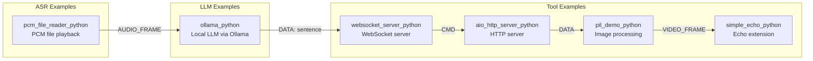

# TEN Extension Examples Catalog — Ollama, PCM Reader, WebSocket, PIL, and More

TEN Framework ships with a rich catalog of example extensions demonstrating real-world integrations across all supported languages. These examples serve as templates for building production extensions and validate the SDK APIs against actual third-party services.

Source: `ten-framework/packages/example_extensions/` — example extension packages

## Example Extensions Overview



| Extension | Language | Type | Purpose |
|-----------|----------|------|---------|
| `simple_echo_python` | Python | Generic | Minimal echo extension for testing |
| `ollama_python` | Python | LLM | Local LLM via Ollama API |
| `pcm_file_reader_python` | Python | ASR | Read PCM audio files as input |
| `websocket_server_python` | Python | Protocol | WebSocket server for text I/O |
| `aio_http_server_python` | Python | Protocol | Async HTTP server for command injection |
| `pil_demo_python` | Python | Tool | PIL image processing demo |

## Simple Echo Extension

Source: `packages/example_extensions/simple_echo_python/`

The simplest possible TEN extension — receives messages and echoes them back:

```python
class SimpleEchoExtension(Extension):
    def on_cmd(self, ten_env: TenEnv, cmd: Cmd) -> None:
        cmd_name = cmd.get_name()
        ten_env.log(LogLevel.DEBUG, "on_cmd name {}".format(cmd_name))

        # Echo the command back
        cmd_out = Cmd.create(cmd_name)
        # Copy properties from input to output
        ten_env.send_cmd(cmd_out)

        cmd_result = CmdResult.create(StatusCode.OK, cmd)
        ten_env.return_result(cmd_result)

    def on_data(self, ten_env: TenEnv, data: Data) -> None:
        data_name = data.get_name()
        ten_env.log(LogLevel.DEBUG, "on_data name {}".format(data_name))

        # Echo the data back
        data_out = Data.create(data_name)
        ten_env.send_data(data_out)
```

**Purpose:** Minimal extension for testing the TEN runtime. Validates that messages flow through an extension correctly. Useful for debugging graph connectivity issues.

## Ollama LLM Extension

Source: `packages/example_extensions/ollama_python/`

Integrates with local Ollama instances for LLM inference:

```python
class OllamaExtension(Extension):
    def on_start(self, ten_env: TenEnv) -> None:
        # Read configuration from property.json
        self.model = ten_env.get_property("model")
        self.base_url = ten_env.get_property("base_url")
        self.client = ollama.Client(host=self.base_url)
        ten_env.on_start_done()

    def on_cmd(self, ten_env: TenEnv, cmd: Cmd) -> None:
        if cmd.get_name() == "text":
            text = cmd.get_property_string("text")

            response = self.client.chat(
                model=self.model,
                messages=[{"role": "user", "content": text}]
            )

            # Send response as data
            data_out = Data.create("sentence")
            data_out.set_property_string("text", response["message"]["content"])
            ten_env.send_data(data_out)

        cmd_result = CmdResult.create(StatusCode.OK, cmd)
        ten_env.return_result(cmd_result)
```

**Configuration (property.json):**
```json
{
  "ten": {
    "property": {
      "model": {
        "type": "string",
        "default": "smollm:135m"
      },
      "base_url": {
        "type": "string",
        "default": "http://localhost:11434"
      }
    }
  }
}
```

**Key patterns:**
- Reads model and base_url from extension properties
- Uses the `ollama` Python package for local LLM access
- Converts incoming `Cmd("text")` to `Data("sentence")` — follows the LLM output convention
- Returns `CmdResult` with `StatusCode.OK` for every command

Aha: The Ollama extension demonstrates how TEN can integrate with local LLM backends without any cloud dependencies. Unlike production LLM extensions that use API keys and rate limiting, Ollama runs entirely locally, making it ideal for development, testing, and offline scenarios. The CI even uses Ollama with `smollm:135m` for integration testing — a tiny model that can run on CI runners.

## PCM File Reader Extension

Source: `packages/example_extensions/pcm_file_reader_python/`

Reads PCM audio files and outputs them as audio frames, simulating microphone input:

```python
class PcmFileReaderExtension(Extension):
    def on_start(self, ten_env: TenEnv) -> None:
        self.file_path = ten_env.get_property("file_path")
        self.sample_rate = ten_env.get_property_int("sample_rate")
        self.channel_layout = ten_env.get_property_string("channel_layout")
        ten_env.on_start_done()

    def on_cmd(self, ten_env: TenEnv, cmd: Cmd) -> None:
        if cmd.get_name() == "start":
            self._read_and_send_frames(ten_env)
        cmd_result = CmdResult.create(StatusCode.OK, cmd)
        ten_env.return_result(cmd_result)

    def _read_and_send_frames(self, ten_env: TenEnv) -> None:
        with open(self.file_path, "rb") as f:
            while True:
                buf = f.read(frame_size)
                if not buf:
                    break
                audio_frame = AudioFrame.create("pcm_frame")
                audio_frame.alloc_buf(len(buf))
                audio_frame.lock_buf().copy_from(buf)
                audio_frame.unlock_buf()
                ten_env.send_audio_frame(audio_frame)
```

**Purpose:** Simulates microphone input for testing STT extensions without requiring real audio hardware. Used by the CI's `from_scratch` workflow to validate the full ASR → LLM → TTS pipeline with recorded audio.

**Key patterns:**
- Reads raw PCM bytes from a file
- Creates `AudioFrame` objects with allocated buffers
- Copies PCM data into the frame buffer via `alloc_buf` / `lock_buf` / `unlock_buf`
- Sends frames at the configured sample rate

## WebSocket Server Extension

Source: `packages/example_extensions/websocket_server_python/`

Provides a WebSocket server for text-based interaction with TEN agents:

```python
class WebsocketServerExtension(Extension):
    def on_start(self, ten_env: TenEnv) -> None:
        self.port = ten_env.get_property_int("port")
        self.server = websockets.serve(self._handler, "0.0.0.0", self.port)
        asyncio.get_event_loop().run_until_complete(self.server)
        ten_env.on_start_done()

    async def _handler(self, websocket, path):
        async for message in websocket:
            # Send received text as a command to the graph
            cmd = Cmd.create("text")
            cmd.set_property_string("text", message)
            self.ten_env.send_cmd(cmd)

            # Wait for response and send back
            # ... handle response ...
```

**Purpose:** Enables text-based interaction with TEN agents over WebSocket, useful for:
- Chatbot integrations
- API gateways
- Testing without RTC
- Command-line clients

## Async HTTP Server Extension

Source: `packages/example_extensions/aio_http_server_python/`

An async HTTP server that accepts commands via HTTP POST:

```python
class AioHttpServerExtension(Extension):
    async def on_start(self, ten_env: AsyncTenEnv) -> None:
        self.port = ten_env.get_property("port")
        self.app = web.Application()
        self.app.router.add_post("/cmd", self._handle_cmd)
        runner = web.AppRunner(self.app)
        await runner.setup()
        site = web.TCPSite(runner, "0.0.0.0", self.port)
        await site.start()
        ten_env.on_start_done()

    async def _handle_cmd(self, request):
        body = await request.json()
        cmd = Cmd.create(body.get("name", "text"))
        for key, value in body.get("properties", {}).items():
            cmd.set_property(key, value)
        await self.ten_env.send_cmd(cmd)
        return web.Response(text="OK")
```

**Purpose:** Enables HTTP-based command injection into TEN graphs. Useful for:
- REST API integration
- Webhook handling
- Programmatic graph control
- Testing automation

Aha: The async HTTP server extension uses Python's `aiohttp` library with the `AsyncExtension` base class. All handlers are `async def`, and the event loop is shared across all async extensions (single-thread mode by default). This means multiple async extensions (HTTP server, WebSocket server, etc.) can coexist on the same event loop without thread contention — a powerful pattern for building API gateways around TEN agents.

## PIL Demo Extension

Source: `packages/example_extensions/pil_demo_python/`

Demonstrates image processing within a TEN extension:

```python
class PilDemoExtension(Extension):
    def on_data(self, ten_env: TenEnv, data: Data) -> None:
        if data.get_name() == "image_request":
            # Generate or process image using PIL
            from PIL import Image, ImageDraw

            img = Image.new("RGB", (800, 600), "white")
            draw = ImageDraw.Draw(img)
            draw.text((10, 10), "TEN Framework Demo")

            # Convert to bytes and send as data
            import io
            buffer = io.BytesIO()
            img.save(buffer, format="PNG")
            img_bytes = buffer.getvalue()

            data_out = Data.create("image")
            data_out.set_property_buf("data", img_bytes)
            ten_env.send_data(data_out)
```

**Purpose:** Demonstrates image generation and processing within TEN extensions. Shows how to:
- Use PIL for image creation
- Convert images to bytes for message passing
- Send binary data via `set_property_buf`

**Key patterns:**
- Uses `Data` messages for image transfer (not `Cmd`)
- Binary data is stored via `set_property_buf` / `get_property_buf`
- PIL library must be installed as a dependency

## Example Agent Graphs

Source: `ten-framework/ai_agents/agents/examples/` — 20+ agent examples

Each agent example is a complete `tenapp/` directory with `property.json` defining the agent graph:

| Example | Extensions | Purpose |
|---------|------------|---------|
| `voice-assistant` | Deepgram ASR + OpenAI LLM + ElevenLabs TTS | Base voice assistant |
| `voice-assistant-realtime` | OpenAI Realtime V2V | Voice-to-voice with OpenAI Realtime API |
| `voice-assistant-live2d` | ASR + LLM + TTS + Live2D | Lip-sync animated character |
| `voice-assistant-sip-twilio` | ASR + LLM + TTS + SIP | Phone calls via Twilio SIP |
| `voice-assistant-companion` | Multi-provider stack | Companion mode agent |
| `websocket-example` | WebSocket server + LLM + TTS | Text-based agent via WebSocket |
| `http-control` | HTTP server + LLM + TTS | HTTP-controlled agent |
| `transcription` | ASR + LLM (correction) | Pure transcription pipeline |
| `doodler` | LLM + DALL-E 3 | Kids drawing assistant |
| `speaker-diarization` | ASR + diarization | Real-time speaker identification |
| `demo` | 7 LLM stacks (Grok, Llama, Qwen, MiniMax, DeepSeek, Gemini) | Multi-provider demo |

Aha: The `demo` example contains 7 different LLM stacks in a single property.json, each with its own graph variant: Grok-4, Llama-4, Qwen3, MiniMax, DeepSeek V3.1, and Gemini V2V. This demonstrates TEN's provider-agnostic design — the same graph structure works with any LLM backend, and switching providers only requires changing the `addon` field in the node definition.

## Env Var Interpolation

Agent examples use environment variable interpolation in property.json:

```json
{
  "property": {
    "api_key": "${env:OPENAI_API_KEY}",
    "model": "${env:MODEL_NAME|gpt-4o}"
  }
}
```

- `${env:VAR}` — Required environment variable (fails if not set)
- `${env:VAR|default}` — Optional with default value

The Go server resolves these during the `processProperty` step (source: `ai_agents/server/internal/http_server.go:732-778`), validating that all required env vars are present before starting the agent.

## Cross-References

- [13-sdk-bindings.md](13-sdk-bindings.md) — SDK APIs used by these extensions
- [14-core-extensions.md](14-core-extensions.md) — Core extension templates these extend
- [11-data-flow.md](11-data-flow.md) — How messages flow through these extensions
- [05-extension-system.md](05-extension-system.md) — Package types and manifest format

## Next

All documents are complete. Return to [README.md](README.md) for the full document index.
