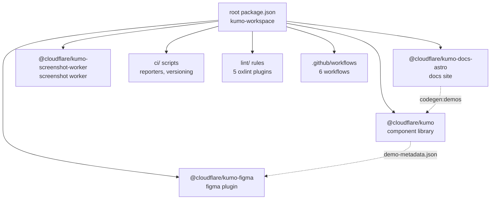

# Kumo Overview — Monorepo Architecture and Packages

Kumo is Cloudflare's production React component library — a pnpm monorepo with four packages (`kumo`, `kumo-docs-astro`, `kumo-figma`, `kumo-screenshot-worker`) providing accessible UI components built on Base UI and Tailwind CSS v4, with an Astro documentation site, Figma plugin for design-token sync, and a Cloudflare Worker for screenshot-based visual regression testing.

## Monorepo Architecture

Kumo is a pnpm workspace monorepo with a shared pnpm catalog for version consistency. The root `package.json` defines workspace-wide scripts, the `pnpm-workspace.yaml` declares `packages/*` as workspaces, and `pnpm-lock.yaml` is frozen for CI.

Source: `/home/darkvoid/Boxxed/@formulas/src.rust/src.AI/src.UIComponents/kumo/package.json` — root workspace definition  
Source: `/home/darkvoid/Boxxed/@formulas/src.rust/src.AI/src.UIComponents/kumo/pnpm-workspace.yaml` — workspace declaration + catalog



### Package Dependency Graph

```
packages/kumo-docs-astro → (demo metadata) → packages/kumo
packages/kumo-figma → (component-registry.json, demo metadata) → packages/kumo + packages/kumo-docs-astro
packages/kumo-screenshot-worker → (standalone Cloudflare Worker)
```

**Aha:** The cross-package dependency flows in one direction: docs generate demo metadata, which feeds the registry generator, which feeds the Figma plugin. This unidirectional data flow means there are no circular build dependencies — each package can build independently once its upstream data exists.

### Directory Structure

```
kumo/
├── packages/
│   ├── kumo/                          # Component library → @cloudflare/kumo
│   │   ├── src/
│   │   │   ├── components/            # 35+ components (Button, Dialog, Select, etc.)
│   │   │   ├── blocks/                # 3 composite blocks (PageHeader, ResourceList, DeleteResource)
│   │   │   ├── primitives/            # 40 Base UI re-exports (auto-generated)
│   │   │   ├── catalog/               # Runtime JSON-UI rendering module
│   │   │   ├── code/                  # Shiki-powered code highlighting
│   │   │   ├── command-line/          # CLI: ls, doc, add, init, migrate, ai
│   │   │   ├── registry/              # Component metadata types
│   │   │   ├── styles/                # CSS: kumo.css, theme-kumo.css, theme-fedramp.css
│   │   │   └── utils/                 # cn(), resolveVariant(), providers
│   │   ├── scripts/
│   │   │   ├── component-registry/    # AI metadata generator (12 files)
│   │   │   └── theme-generator/       # CSS token generator (5 files)
│   │   ├── lint/                      # 5 custom oxlint rules
│   │   ├── plop-templates/            # Component scaffolding templates
│   │   ├── ai/                        # Auto-generated registry JSON/MD/schemas
│   │   └── bin/kumo.js                # CLI entry point
│   ├── kumo-docs-astro/               # Astro documentation site
│   │   ├── src/
│   │   │   ├── pages/                 # MDX pages (50+ component docs)
│   │   │   ├── components/            # Docs UI components + demo files
│   │   │   ├── layouts/               # BaseLayout, DocLayout, MainLayout, MdxDocLayout
│   │   │   └── lib/                   # vite plugins, remark plugins, utilities
│   │   └── scripts/                   # extract-demo-examples.ts
│   ├── kumo-figma/                    # Figma plugin for token sync
│   │   ├── src/
│   │   │   ├── generators/            # 37 component generators (button.ts, badge.ts, etc.)
│   │   │   ├── parsers/               # 5 parsers (tailwind-to-figma, loader-parser, etc.)
│   │   │   └── *.ts                   # build-*.ts, code.ts, logger.ts
│   │   └── scripts/                   # figma-api.ts, color-utils.ts, sync-tokens-to-figma.ts
│   └── kumo-screenshot-worker/        # Cloudflare Worker for screenshots
│       └── src/index.ts               # Worker entry point
├── ci/
│   ├── reporters/                     # npm-release, kumo-docs-preview, visual-regression
│   ├── scripts/                       # create-release-pr, validate-changeset, etc.
│   ├── utils/                         # github-api.ts, git-operations.ts, pr-reporter.ts
│   ├── versioning/                    # deploy, publish, release shell scripts
│   └── visual-regression/             # page-config.ts, run-visual-regression.ts
├── lint/                              # 4 root-level oxlint rules
├── .github/workflows/                 # 6 GitHub Actions workflows
└── tools/deployments/                 # PR description validation
```

## Packages

### @cloudflare/kumo — Component Library (v2.6.0)

The core package: 35+ React components, 40 Base UI primitives, 3 composite blocks, CLI tooling, and AI metadata generation. Published to npm as `@cloudflare/kumo`.

**Key exports:**
- Components: `Button`, `Dialog`, `Select`, `Input`, `Toast`, `Sidebar`, `Table`, `Tabs`, `Popover`, etc.
- Blocks (CLI-installed): `PageHeader`, `ResourceList`, `DeleteResource`
- Primitives: Re-exports of all Base UI primitives (`@cloudflare/kumo/primitives/*`)
- Utils: `cn()`, `safeRandomId()`, `LinkProvider`, `KumoPortalProvider`
- Registry: Types for component metadata (`ComponentRegistry`, `ComponentSchema`, `PropSchema`)
- Code: Shiki-powered syntax highlighting (`Code`, `CodeBlock`)
- Catalog: Runtime JSON-UI rendering (`Catalog`)
- Styles: `@cloudflare/kumo/styles` (Tailwind v4 with `light-dark()` tokens)

Source: `/home/darkvoid/Boxxed/@formulas/src.rust/src.AI/src.UIComponents/kumo/packages/kumo/package.json`  
Source: `/home/darkvoid/Boxxed/@formulas/src.rust/src.AI/src.UIComponents/kumo/packages/kumo/src/index.ts`

### @cloudflare/kumo-docs-astro — Documentation Site

Astro-based documentation site hosted at [kumo-ui.com](https://kumo-ui.com). Provides interactive demos, MDX documentation pages, component registry API endpoints, and code generation for the Figma plugin.

**Key features:**
- 50+ MDX pages documenting each component
- Interactive demo components for every component
- `/api/component-registry` and `/api/version` endpoints
- `llms.txt` generation for AI consumption
- Changelog pagination system
- Search dialog with component search
- Theme toggle (light/dark)

Source: `/home/darkvoid/Boxxed/@formulas/src.rust/src.AI/src.UIComponents/kumo/packages/kumo-docs-astro/package.json`

### @cloudflare/kumo-figma — Figma Plugin

Figma plugin for bidirectional design-token sync between code and Figma Variables. Includes 37 component generators that programmatically create Figma frames matching React component output.

**Key capabilities:**
- Unidirectional token sync: code → Figma Variables
- Extension collections (fedramp) inheriting from base collection
- 37 component generators (button, badge, dialog, etc.)
- Tailwind-to-Figma parser with opacity extraction
- Phosphor icon generation
- Drift detection between Figma and code

Source: `/home/darkvoid/Boxxed/@formulas/src.rust/src.AI/src.UIComponents/kumo/packages/kumo-figma/package.json`

### @cloudflare/kumo-screenshot-worker — Screenshot Worker

Cloudflare Worker that captures browser screenshots for visual regression testing. Used by CI to verify component rendering across PRs.

Source: `/home/darkvoid/Boxxed/@formulas/src.rust/src.AI/src.UIComponents/kumo/packages/kumo-screenshot-worker/package.json`

## Toolchain

| Tool | Version | Purpose |
|------|---------|---------|
| Node.js | ^24.12.0 | Engine constraint |
| pnpm | >=10.21.0 | Workspace manager + catalog |
| TypeScript | 5.9.2 | Type checking |
| Vite | 7.1.7 | Library bundler + dev server |
| Tailwind CSS | 4.1.17 | Styling with `light-dark()` |
| oxlint | 1.42.0 | Primary linter |
| Vitest | 4.1.0 | Test runner (happy-dom, browser Playwright) |
| Changesets | 2.29.7 | Version management |
| Astro | latest | Docs framework |
| Wrangler | 4.87.0 | Cloudflare Workers deployment |
| Plop | 4.0.4 | Component scaffolding |

Source: `/home/darkvoid/Boxxed/@formulas/src.rust/src.AI/src.UIComponents/kumo/pnpm-workspace.yaml` — catalog

## Quick Start

```bash
# Clone and install
git clone https://github.com/cloudflare/kumo.git
cd kumo
pnpm install

# Start docs dev server (localhost:4321)
pnpm dev

# Build all packages
pnpm build:all

# Run tests
pnpm test

# Create a new component
pnpm --filter @cloudflare/kumo new:component

# Lint
pnpm lint

# Typecheck
pnpm typecheck
```

Source: `/home/darkvoid/Boxxed/@formulas/src.rust/src.AI/src.UIComponents/kumo/package.json` — scripts

## Design System Conventions

### Styling Rules (Enforced by Lint)

- **Semantic tokens only**: `bg-kumo-base`, `text-kumo-default`, `border-kumo-line` — never raw Tailwind colors like `bg-blue-500`
- **No `dark:` variant**: Dark mode is automatic via CSS `light-dark()` custom properties
- **Exceptions**: `bg-white`, `bg-black`, `text-white`, `text-black`, `transparent`
- **`cn()` utility**: Always compose classNames via `cn("base", conditional && "extra", className)`
- **Surface hierarchy**: `bg-kumo-base` → `bg-kumo-elevated` → `bg-kumo-recessed`

Source: `/home/darkvoid/Boxxed/@formulas/src.rust/src.AI/src.UIComponents/kumo/AGENTS.md` — conventions

### Component Patterns

- Components use `forwardRef` with `displayName`
- Variants exported as `KUMO_{COMPONENT}_VARIANTS` and `KUMO_{COMPONENT}_DEFAULT_VARIANTS`
- New components scaffolded via `pnpm --filter @cloudflare/kumo new:component` (plop-based)
- Blocks are NOT exported from package index; installed via CLI `kumo add`

Source: `/home/darkvoid/Boxxed/@formulas/src.rust/src.AI/src.UIComponents/kumo/AGENTS.md` — conventions

## CI/CD Pipeline

Kumo uses GitHub Actions with 6 workflows:

| Workflow | Trigger | Purpose |
|----------|---------|---------|
| `bonk.yml` | push to main | Full test + lint + build |
| `bonk-check.yml` | pull_request | PR validation (lint, typecheck, tests) |
| `pullrequest.yml` | pull_request | Tests on PR |
| `release.yml` | push to main | Changeset-based npm release |
| `preview.yml` | pull_request | Preview builds via pkg.pr.new |
| `preview-deploy.yml` | push to main | Docs preview deployment |

Source: `/home/darkvoid/Boxxed/@formulas/src.rust/src.AI/src.UIComponents/kumo/.github/workflows/`

## Changesets

Kumo uses the `@changesets/cli` package for version management. Changesets are required for the `kumo` package (pre-push hook enforced via lefthook), optional for `kumo-docs-astro`, and not needed for `kumo-figma`.

```bash
pnpm changeset          # Create a changeset
pnpm version            # Apply changesets (bump versions)
pnpm release            # Build + publish to npm
```

Source: `/home/darkvoid/Boxxed/@formulas/src.rust/src.AI/src.UIComponents/kumo/lefthook.yml` — pre-push hook

## Next Steps

- [01-theming](01-theming.html) — Deep dive into the theme system, color tokens, and variant architecture
- [02-ai-registry](02-ai-registry.html) — How the AI component registry works
