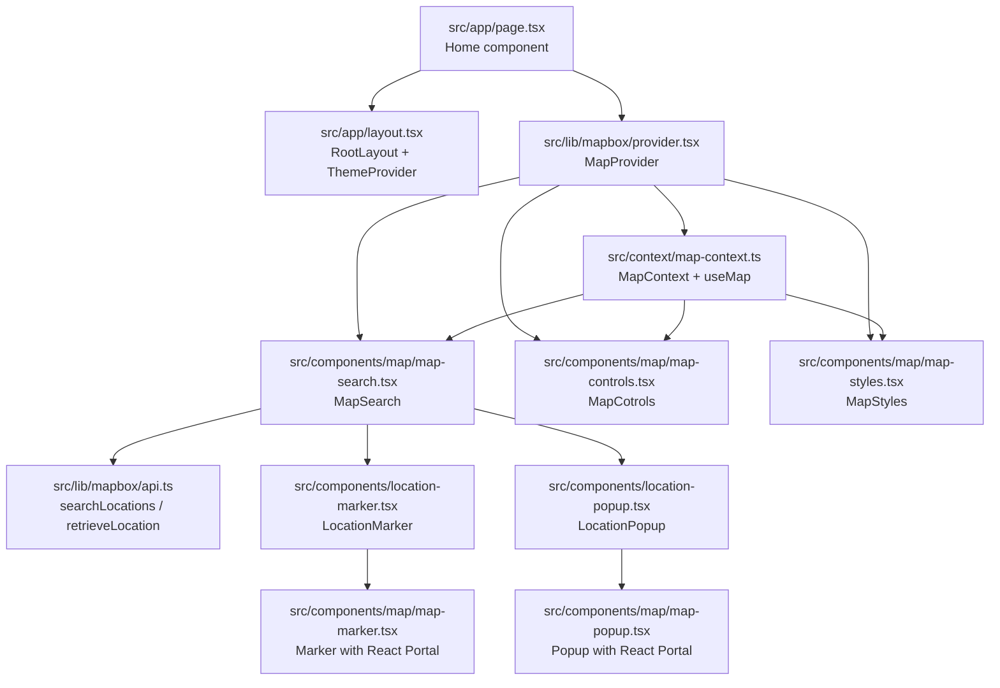
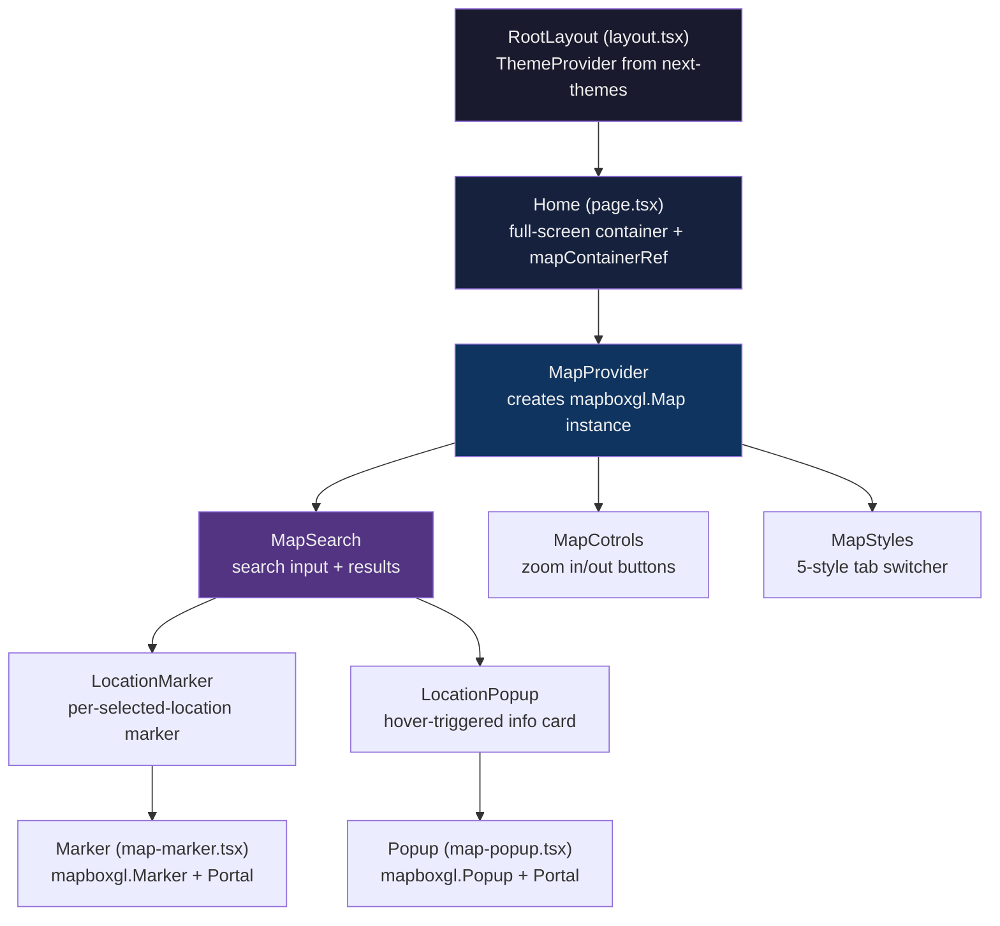

# next-maps Overview

next-maps is a full-screen interactive map application built on Next.js 15.2.3 with the App Router, integrating Mapbox GL JS for map rendering, the Mapbox Search Box API for location discovery, and shadcn/ui for its component primitives. It renders custom React-managed markers and popups on the map, supports five switchable map styles that automatically sync with the light/dark UI theme, and uses a React Context architecture to bridge React's declarative component model with Mapbox's imperative DOM-based API.

## Architecture at a Glance

The application is organized into three layers: the Next.js app shell, the Mapbox integration layer, and the React component layer. The Mapbox integration layer (in `src/lib/mapbox/`) owns all Mapbox SDK interaction -- map initialization, API calls, type definitions, and constants. The React component layer (in `src/components/`) provides the user-facing controls: search, markers, popups, style switcher, and zoom controls. A React Context (`src/context/map-context.ts`) connects these layers, exposing the `mapboxgl.Map` instance to any descendant component.



Source: `src/app/page.tsx` -- entry point composing MapProvider with children.

## Quick Start

### Prerequisites

- Node.js 18+
- A Mapbox access token (set as `NEXT_PUBLIC_MAPBOX_TOKEN` in `.env.local`)

### Install and Run

```bash
npm install
npm run dev          # next dev --turbopack
npm run build        # next build
npm start            # next start
```

Source: `package.json` -- scripts section.

The app opens on `http://localhost:3000` and renders a full-screen map centered on San Francisco (longitude -122.4194, latitude 37.7749, zoom 10).

## Mapbox Integration Architecture

The Mapbox integration follows a two-layer pattern: the **provider layer** manages the `mapboxgl.Map` instance lifecycle, and the **API layer** handles HTTP communication with Mapbox's Search Box endpoints.

### Provider Layer

`MapProvider` (`src/lib/mapbox/provider.tsx`) is a React component that:

1. Receives a `mapContainerRef` pointing to a DOM element and an `initialViewState` with longitude, latitude, and zoom.
2. Creates a `mapboxgl.Map` instance inside a `useEffect`, setting `style: "mapbox://styles/mapbox/standard"`, `attributionControl: false`, and `logoPosition: "bottom-right"`.
3. Listens for the `"load"` event and sets a `loaded` state flag to remove the loading spinner.
4. Cleans up the map instance on unmount by calling `mapInstance.remove()` and removing the event listener.
5. Wraps children in `MapContext.Provider`, passing `{ map: mapRef.current! }`.

```typescript
// src/lib/mapbox/provider.tsx:38
const mapInstance = new mapboxgl.Map({
  container: mapContainerRef.current,
  style: "mapbox://styles/mapbox/standard",
  center: [initialViewState.longitude, initialViewState.latitude],
  zoom: initialViewState.zoom,
  attributionControl: false,
  logoPosition: "bottom-right",
});
```

Source: `src/lib/mapbox/provider.tsx:10` -- `mapboxgl.accessToken` is set from `process.env.NEXT_PUBLIC_MAPBOX_TOKEN`.

### API Layer

The API layer (`src/lib/mapbox/api.ts`) implements the Mapbox Search Box API's two-phase flow:

1. **`searchLocations(options)`** calls `GET /search/searchbox/v1/suggest` with query, country (default "US"), limit (default 5), proximity, and session token. Returns `LocationSuggestion[]`.
2. **`retrieveLocation(mapboxId)`** calls `GET /search/searchbox/v1/retrieve/{mapboxId}` with the suggestion's `mapbox_id`. Returns `LocationFeature[]` with full geometry and properties.

Both functions use `AbortSignal` for request cancellation and validate `NEXT_PUBLIC_MAPBOX_TOKEN` before making requests.

```typescript
// src/lib/mapbox/api.ts:33-36
export async function searchLocations(
  options: SearchOptions
): Promise<LocationSuggestion[]> {
  const { query, country = "US", limit = 5, proximity, signal } = options;
```

Source: `src/lib/mapbox/api.ts` -- full API module.

### Session Token Management

`getSessionToken()` (`src/lib/mapbox/api.ts:5`) caches the session token in `sessionStorage` under the key `"mapbox_session_token"`. On first call, it reads from `process.env.NEXT_PUBLIC_MAPBOX_SESSION_TOKEN` and stores it. Subsequent calls return the cached value. This token groups search and retrieve calls into a single Mapbox billing session.

Source: `src/lib/mapbox/api.ts:5-15`.

### Constants

All configurable values live in `MAP_CONSTANTS` (`src/lib/mapbox/constants.ts`):

| Constant | Value | Used By |
|----------|-------|---------|
| `FLY_TO.ZOOM` | `14` | `MapSearch.handleSelect` -- target zoom after selecting a location |
| `FLY_TO.SPEED` | `4` | `MapSearch.handleSelect` -- fly animation speed |
| `FLY_TO.DURATION` | `1000` (ms) | `MapSearch.handleSelect` -- fly animation duration |
| `SEARCH.DEBOUNCE_MS` | `400` | `MapSearch` -- debounce delay for search input via `useDebounce` |
| `SEARCH.DEFAULT_LIMIT` | `5` | `searchLocations` -- max suggestions returned |
| `SEARCH.DEFAULT_COUNTRY` | `"US"` | `searchLocations` -- country filter |
| `SEARCH.DEFAULT_PROXIMITY` | `[-122.4194, 37.7749]` | `searchLocations` -- San Francisco coordinates for proximity bias |

Source: `src/lib/mapbox/constants.ts`.

## Type System

The application defines two core types in `src/lib/mapbox/utils.tsx`:

### LocationSuggestion

A lightweight search result from the suggest endpoint:

```typescript
// src/lib/mapbox/utils.tsx:35
export type LocationSuggestion = {
  mapbox_id: string;
  name: string;
  place_formatted: string;
  maki?: string;
};
```

### LocationFeature

A full GeoJSON Feature from the retrieve endpoint:

```typescript
// src/lib/mapbox/utils.tsx:42
export type LocationFeature = {
  type: "Feature";
  geometry: {
    type: "Point";
    coordinates: [number, number];  // [longitude, latitude]
  };
  properties: {
    name: string;
    name_preferred?: string;
    mapbox_id: string;
    feature_type: string;
    address?: string;
    full_address?: string;
    place_formatted?: string;
    context: { /* country, region, place, etc. */ };
    coordinates: { latitude: number; longitude: number; /* ... */ };
    maki?: string;
    poi_category?: string[];
    brand?: string[];
    operational_status?: string;
    // ... many more optional fields
  };
};
```

### iconMap

A lookup table mapping POI category names (maki icons) to Lucide React components:

```typescript
// src/lib/mapbox/utils.tsx:16
export const iconMap: { [key: string]: React.ReactNode } = {
  cafe: <Coffee className="h-5 w-5" />,
  restaurant: <Utensils className="h-5 w-5" />,
  hotel: <Hotel className="h-5 w-5" />,
  gym: <Dumbbell className="h-5 w-5" />,
  bank: <Banknote className="h-5 w-5" />,
  shopping: <ShoppingBag className="h-5 w-5" />,
  // ... 14 total icon mappings
};
```

Source: `src/lib/mapbox/utils.tsx` -- 14 icon mappings covering cafe, restaurant, hotel, gym, bank, shopping, store, government, school, hospital, clothing, and home.

## Component Tree



## Technology Stack

| Layer | Technology | Version |
|-------|-----------|---------|
| Framework | Next.js | 15.2.3 |
| UI Library | React | 19.0.0 |
| Map SDK | mapbox-gl | 3.10.0 |
| Theme | next-themes | 0.4.6 |
| UI Primitives | shadcn/ui (new-york style) | -- |
| Command Palette | cmdk | 1.1.1 |
| Icons | lucide-react | 0.483.0 |
| CSS | Tailwind CSS v4 | 4.x |
| Styling Utils | class-variance-authority, clsx, tailwind-merge | -- |
| Language | TypeScript | 5.x |
| Build | Turbopack | -- |

Source: `package.json`, `components.json`.

## Directory Structure

```
next-maps/
  package.json
  next.config.ts
  tsconfig.json
  components.json
  postcss.config.mjs
  src/
    app/
      layout.tsx            # Root layout with ThemeProvider + fonts
      page.tsx              # Home component with MapProvider
      globals.css           # Tailwind v4 imports, theme vars, Mapbox popup CSS
    components/
      location-marker.tsx   # LocationMarker wrapper around Marker
      location-popup.tsx    # LocationPopup wrapper around Popup
      theme-provider.tsx    # ThemeProvider passthrough to next-themes
      map/
        map-controls.tsx    # MapCotrols: zoom in/out buttons
        map-marker.tsx      # Marker: mapboxgl.Marker with React Portal
        map-popup.tsx       # Popup: mapboxgl.Popup with React Portal
        map-search.tsx      # MapSearch: search input + results + markers
        map-styles.tsx      # MapStyles: 5-style tab switcher
      ui/
        badge.tsx           # Badge component (shadcn)
        button.tsx          # Button component (shadcn)
        command.tsx         # Command palette components (cmdk-based)
        dialog.tsx          # Dialog components (shadcn/Radix)
        input.tsx           # Input component (shadcn)
        popover.tsx         # Popover components (shadcn/Radix)
        separator.tsx       # Separator component (shadcn/Radix)
        tabs.tsx            # Tabs components (shadcn/Radix)
    context/
      map-context.ts        # MapContext + useMap hook
    hooks/
      useDebounce.ts        # Generic useDebounce hook
    lib/
      utils.ts              # cn() utility (clsx + tailwind-merge)
      mapbox/
        api.ts              # searchLocations, retrieveLocation, getSessionToken
        constants.ts        # MAP_CONSTANTS
        provider.tsx        # MapProvider component
        utils.tsx           # iconMap, LocationSuggestion, LocationFeature
```

Source: Full directory listing of the project.

## Aha Moments

**Aha:** The application does not use a dedicated React wrapper library for Mapbox GL JS. Instead, `MapProvider` creates the raw `mapboxgl.Map` imperatively inside a `useEffect`, stores it in a `useRef`, and exposes it through `MapContext`. Child components like `Marker` and `Popup` then use their own `useEffect` hooks to call Mapbox's imperative API (`new mapboxgl.Marker()`, `new mapboxgl.Popup()`) while rendering their React children through `createPortal` into Mapbox-managed DOM elements. This approach avoids the overhead and potential version-lock of a third-party wrapper, gives full control over the Mapbox lifecycle, and still lets React manage the inner content of markers and popups declaratively.

**Aha:** The `MapStyles` component does not just switch map styles -- it also calls `setTheme("dark")` or `setTheme("light")` based on the selected style. Selecting "Dark" map style (`dark-v11`) automatically switches the entire UI to dark mode, and selecting any other style switches back to light mode. This means the map style and the UI theme are coupled, not independent.

## Cross-References

- [Map Context and Provider Deep Dive](01-map-context.md) -- MapProvider lifecycle, useMap hook, useDebounce, search flow
- [Component Architecture](02-components.md) -- Marker, Popup, Search, Controls, Styles components
- [App Structure and Styling](03-app-structure.md) -- Next.js layout, globals.css, shadcn/ui components
