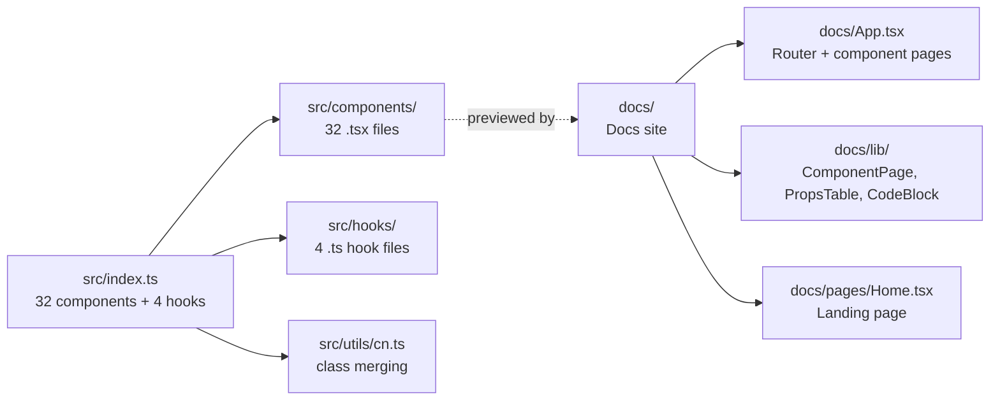

# performativeUI: Overview

A React component library of 32 performative/animated UI elements for landing pages — typewriter heroes, logo walls, node graph backgrounds, ASCII art, cursor effects, sparkle animations, and more. Ships as a library (`src/index.ts`) with a docs site (`docs/`) for live previews.

**Source:** `https://github.com/[...]/performativeUI`
**Location:** `/home/darkvoid/Boxxed/@formulas/src.rust/src.AI/src.UIComponents/performativeUI/`

## Quick Start

```bash
cd performativeUI
npm install
npm run dev        # vite docs site
npm run build      # library build (vite.lib.config.ts)
```

## Library Exports

Source: `src/index.ts` — 139 lines, exports 32 components + 4 hooks.

### Components (32)

| Component | Lines | Category | Description |
|-----------|-------|----------|-------------|
| `AsciiHero` | 101 | Hero | ASCII art hero with field animation |
| `Aurora` | 177 | Background | Aurora borealis gradient animation |
| `BeforeAfter` | 110 | Interactive | Before/after slider comparison |
| `BigBack` | 126 | Background | Large animated background element |
| `Button` | 93 | Interactive | Animated button variants |
| `ChatBubble` | 55 | UI | Animated chat bubble |
| `ChatFAB` | 127 | UI | Floating action button for chat |
| `CommunityBadge` | 39 | Badge | Community/member badge |
| `EyebrowPill` | 24 | Label | Eyebrow label component |
| `FloatingSparkles` | 78 | Effect | Floating sparkle particles |
| `GlassCard` | 86 | UI | Glassmorphism card |
| `Goldeneye` | 187 | Background | Golden ratio spiral animation |
| `GradientText` | 36 | Text | Animated gradient text |
| `LogoMarquee` | 74 | Logo | Scrolling logo marquee |
| `LogoRow` | 40 | Logo | Static logo row/grid |
| `MockIDE` | 170 | Hero | Mock code editor/IDE display |
| `NodeGraphBackground` | 270 | Background | Animated node graph/particles |
| `Popover` | 169 | UI | Animated popover |
| `PricingCard` | 109 | Card | Pricing card with animations |
| `Prompt` | 268 | Hero | AI prompt display component |
| `PromptHero` | 91 | Hero | Hero section for prompts |
| `QuestText` | 123 | Text | Quest/RPG-style text animation |
| `Rotator` | 76 | Text | 3D text rotator/carousel |
| `SlippyWords` | 149 | Text | Sliding word animation |
| `Sparkle` | 34 | Effect | Single sparkle particle |
| `StatCounter` | 44 | Data | Animated counter |
| `StatusDot` | 25 | Status | Animated status indicator |
| `StickyBanner` | 25 | Layout | Sticky banner component |
| `Temperature` | 451 | Data | Temperature/thermometer visualization |
| `TokenStream` | 59 | Text | Streaming token animation |
| `WaitlistForm` | 92 | Form | Waitlist signup form |
| `WibblingSpinner` | 155 | Effect | Spinning/wibbling animation |

### Hooks (4)

| Hook | Lines | Purpose |
|------|-------|---------|
| `useAsciiField` | 265 | ASCII art field animation |
| `useCounter` | 39 | Animated number counter |
| `useTokenStream` | 83 | Streaming token simulation |
| `useTypewriter` | 92 | Typewriter text animation |

### Utilities

| Export | Lines | Purpose |
|--------|-------|---------|
| `cn` | 25 | Class name merging (clsx + tailwind-merge) |

## Architecture



## Component Categories

| Category | Components | Description |
|----------|-----------|-------------|
| **Hero** | AsciiHero, MockIDE, Prompt, PromptHero | Attention-grabbing hero sections |
| **Background** | Aurora, BigBack, Goldeneye, NodeGraphBackground | Full-page animated backgrounds |
| **Text** | GradientText, QuestText, Rotator, SlippyWords, TokenStream | Animated typography |
| **Logo** | LogoMarquee, LogoRow | Company logo displays |
| **Interactive** | BeforeAfter, Button | Click/drag interactions |
| **UI** | ChatBubble, ChatFAB, GlassCard, Popover, PricingCard | Common UI patterns |
| **Data** | StatCounter, Temperature | Data visualization |
| **Effect** | FloatingSparkles, Sparkle, WibblingSpinner | Decorative animations |
| **Badge/Label** | CommunityBadge, EyebrowPill, StatusDot | Small status/label elements |
| **Layout** | StickyBanner | Layout utilities |
| **Form** | WaitlistForm | Signup forms |

## Technology Stack

| Layer | Technology |
|-------|-----------|
| Library Build | Vite (vite.lib.config.ts) |
| Docs Build | Vite (vite.docs.config.ts) |
| React | 19.0.0 |
| CSS | Tailwind CSS |
| Deployment | Vercel (vercel.json) |

## Research Methodology

Components are sourced from real companies and websites. The `research/` directory documents the source companies and implementation details:

| File | Content |
|------|---------|
| `00_source_companies.md` | List of companies using these patterns |
| `01_typewriter_hero.md` | Typewriter hero implementations |
| `02_logo_walls.md` | Logo wall patterns |
| `03_node_graph_backgrounds.md` | Node graph backgrounds |
| `04_ascii_hero_art.md` | ASCII art heroes |
| `05_aiified_ui_elements.md` | AI-themed UI elements |
| `06_cursor_effects.md` | Cursor effect patterns |

## Directory Structure

```
performativeUI/
├── src/
│   ├── index.ts              # Library exports (139 lines)
│   ├── styles.css            # Shared CSS
│   ├── components/           # 32 components
│   ├── hooks/                # 4 hooks
│   └── utils/
│       └── cn.ts             # Class name merging
├── docs/
│   ├── App.tsx               # Docs app router
│   ├── main.tsx              # Docs entry point
│   ├── pages/Home.tsx        # Docs landing page
│   ├── lib/
│   │   ├── meta.tsx          # Component metadata (2281 lines!)
│   │   ├── ComponentPage.tsx # Component preview page
│   │   ├── PropsTable.tsx    # Props documentation
│   │   ├── CodeBlock.tsx     # Code display
│   │   └── Attribution.tsx   # Source attribution
│   └── public/
│       └── og.png            # Social card
├── research/                 # Source company research
├── scripts/
│   └── gen-og.mjs            # OG image generation
├── vite.docs.config.ts       # Docs site Vite config
├── vite.lib.config.ts        # Library Vite config
├── package.json              # Dependencies
├── vercel.json               # Vercel deployment
└── tsconfig.json
```

## Related Documents

- [Hero Components](01-hero-components.md) — AsciiHero, MockIDE, Prompt, PromptHero
- [Background Effects](02-background-effects.md) — Aurora, BigBack, Goldeneye, NodeGraphBackground
- [Interactive Components](03-interactive-components.md) — BeforeAfter, Button, cursor effects
- [Logo Walls](04-logo-walls.md) — LogoMarquee, LogoRow
- [Build System](05-build-system.md) — Vite configs, OG generation, Vercel
- [Research Methodology](06-research-methodology.md) — How components are sourced

[Next → Hero Components](01-hero-components.md)
