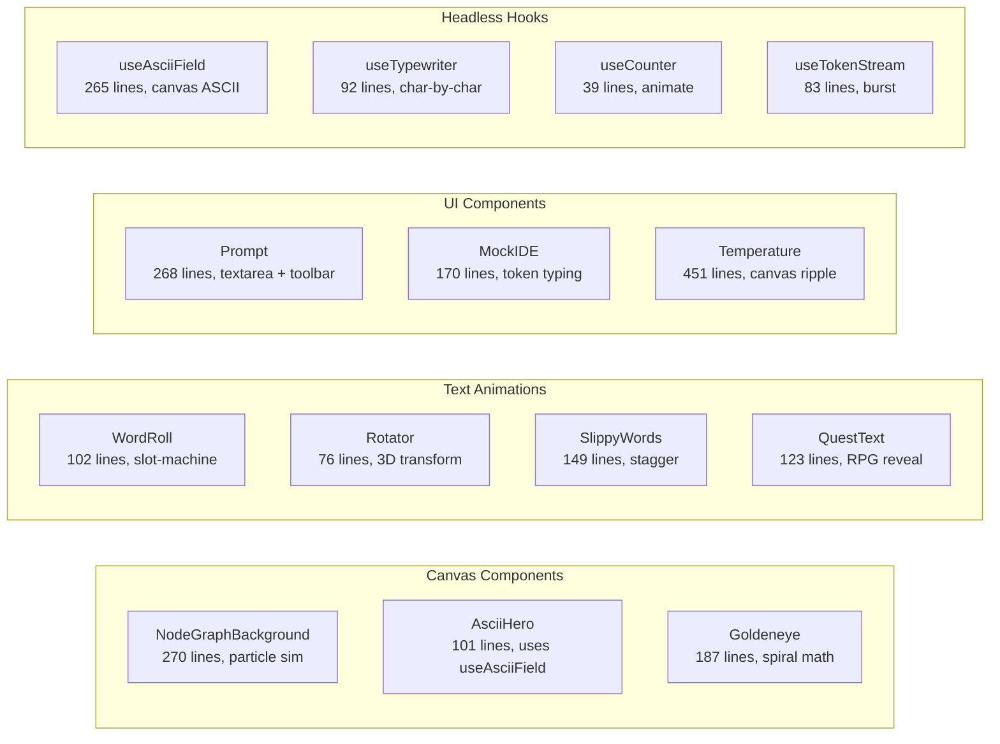

# performativeUI: Overview

A React component library of 32 components and 4 hooks for "performative" AI-startup landing page patterns. Components are canvas-rendered (NodeGraphBackground, AsciiHero, Goldeneye, Aurora), DOM-animated (WordRoll, Rotator, SlippyWords), or CSS-driven (GradientText, GlassCard, Sparkle). Ships as a library with a docs site.

**Source:** `https://github.com/[...]/performativeUI`
**Location:** `/home/darkvoid/Boxxed/@formulas/src.rust/src.AI/src.UIComponents/performativeUI/`

## Quick Start

```bash
npm install performative-ui
```

```tsx
import { NodeGraphBackground, Prompt, Temperature } from 'performative-ui'
```

Or from source:
```bash
cd performativeUI
npm install
npm run dev        # Vite docs site
npm run build      # Library build
```

## All 32 Components + 4 Hooks

### Canvas-Rendered (GPU-accelerated)

| Component | Lines | Rendering | Description |
|-----------|-------|-----------|-------------|
| `NodeGraphBackground` | 270 | `<canvas>` 2D | Drifting dots connected by proximity lines, with cursor gravity/brightening |
| `AsciiHero` | 101 | `<canvas>` 2D | Procedural ASCII art field with aurora color palette |
| `Goldeneye` | 187 | `<canvas>` 2D | Golden ratio spiral rotation animation |
| `Aurora` | 177 | CSS gradient | Flowing gradient bands (aurora borealis effect) |
| `FloatingSparkles` | 78 | CSS animation | Floating sparkle particles with random positions |
| `WibblingSpinner` | 155 | CSS animation | Spinning loader with "wibble" oscillation |
| `Sparkle` | 34 | CSS animation | Single sparkle particle |

### Text Animations

| Component | Lines | Technique | Description |
|-----------|-------|-----------|-------------|
| `WordRoll` | 102 | CSS transform | Words sliding up/down like a slot machine |
| `Rotator` | 76 | CSS 3D transform | 3D text rotation carousel |
| `SlippyWords` | 149 | CSS animation | Words sliding in/out with staggered timing |
| `GradientText` | 36 | CSS background-clip | Animated gradient text cycling |
| `QuestText` | 123 | CSS animation | RPG quest-style text reveal |
| `TokenStream` | 59 | React state | Streaming token display (AI response simulation) |

### UI Components

| Component | Lines | Purpose |
|-----------|-------|---------|
| `Prompt` | 268 | Multi-line AI prompt input with model dropdown, toolbar, send button |
| `PromptHero` | 91 | Hero section wrapping Prompt |
| `MockIDE` | 170 | Code editor mock with token-by-token typing animation |
| `Button` | 93 | Animated button with variants |
| `GlassCard` | 86 | Glassmorphism card with backdrop-blur |
| `Popover` | 169 | Animated popover with positioning |
| `ChatBubble` | 55 | Chat message bubble |
| `ChatFAB` | 127 | Floating action button for chat |
| `PricingCard` | 109 | Pricing card with animations |
| `WaitlistForm` | 92 | Waitlist signup form |
| `BeforeAfter` | 110 | Before/after slider comparison |
| `StickyBanner` | 25 | Sticky banner |

### Data Display

| Component | Lines | Purpose |
|-----------|-------|---------|
| `Temperature` | 451 | Reasoning effort selector with animated treatments (glow, rainbow, ludicrous) |
| `StatCounter` | 44 | Animated number counter |
| `StatusDot` | 25 | Pulsing status indicator |

### Brand/Social Proof

| Component | Lines | Purpose |
|-----------|-------|---------|
| `LogoMarquee` | 74 | Infinite-scrolling logo row |
| `LogoRow` | 40 | Static logo grid |
| `CommunityBadge` | 39 | Community/member badge |
| `EyebrowPill` | 24 | Eyebrow label |

### Layout

| Component | Lines | Purpose |
|-----------|-------|---------|
| `BigBack` | 126 | Large animated background with column layout |

## Hooks

| Hook | Lines | Purpose |
|------|-------|---------|
| `useAsciiField` | 265 | Drives canvas with procedural ASCII field, aurora colors, cursor ripple |
| `useTypewriter` | 92 | Character-by-character text reveal with configurable speed |
| `useCounter` | 39 | Animated number counter from 0 to target |
| `useTokenStream` | 83 | Simulates streaming AI tokens with burst patterns |

## Architecture



Aha: The library uses a consistent pattern: every component is `forwardRef`-ed with `ComponentPropsWithoutRef<"element">` extension, meaning it accepts all native element props plus its own. The `cn()` utility (clsx + tailwind-merge) is used everywhere for className merging. Canvas components (`NodeGraphBackground`, `AsciiHero`) use `requestAnimationFrame` loops with cleanup on unmount.

## Directory Structure

```
performativeUI/
├── src/
│   ├── index.ts              # All exports (139 lines)
│   ├── styles.css            # Shared CSS (animations, themes)
│   ├── components/           # 32 components
│   │   ├── NodeGraphBackground.tsx   # 270 lines
│   │   ├── Temperature.tsx           # 451 lines (largest)
│   │   ├── Prompt.tsx                # 268 lines
│   │   ├── useAsciiField.ts          # 265 lines (hook)
│   │   ├── MockIDE.tsx               # 170 lines
│   │   ├── WibblingSpinner.tsx       # 155 lines
│   │   └── ... (26 more)
│   ├── hooks/                # 4 hooks
│   │   ├── useAsciiField.ts  # 265 lines
│   │   ├── useTypewriter.ts  # 92 lines
│   │   ├── useTokenStream.ts # 83 lines
│   │   └── useCounter.ts     # 39 lines
│   └── utils/
│       └── cn.ts             # 25 lines, clsx + tailwind-merge
├── docs/                     # Docs site
│   ├── App.tsx               # 198 lines, router
│   ├── lib/meta.tsx          # 2281 lines, component catalog
│   └── ...
├── research/                 # Source company research (6 files)
├── scripts/
│   └── gen-og.mjs            # OG image generation
├── vite.docs.config.ts       # Docs Vite config
├── vite.lib.config.ts        # Library Vite config
├── package.json
├── vercel.json
└── tsconfig.json
```

## Related Documents

- [Hero Components](01-hero-components.md) — AsciiHero, MockIDE, Prompt, PromptHero
- [Background Effects](02-background-effects.md) — Aurora, BigBack, Goldeneye, NodeGraphBackground
- [Interactive Components](03-interactive-components.md) — BeforeAfter, Button, Popover
- [Logo Walls](04-logo-walls.md) — LogoMarquee, LogoRow
- [Build System](05-build-system.md) — Vite configs, OG image, Vercel
- [Research Methodology](06-research-methodology.md) — Sourcing from real companies

[Next → Hero Components](01-hero-components.md)
