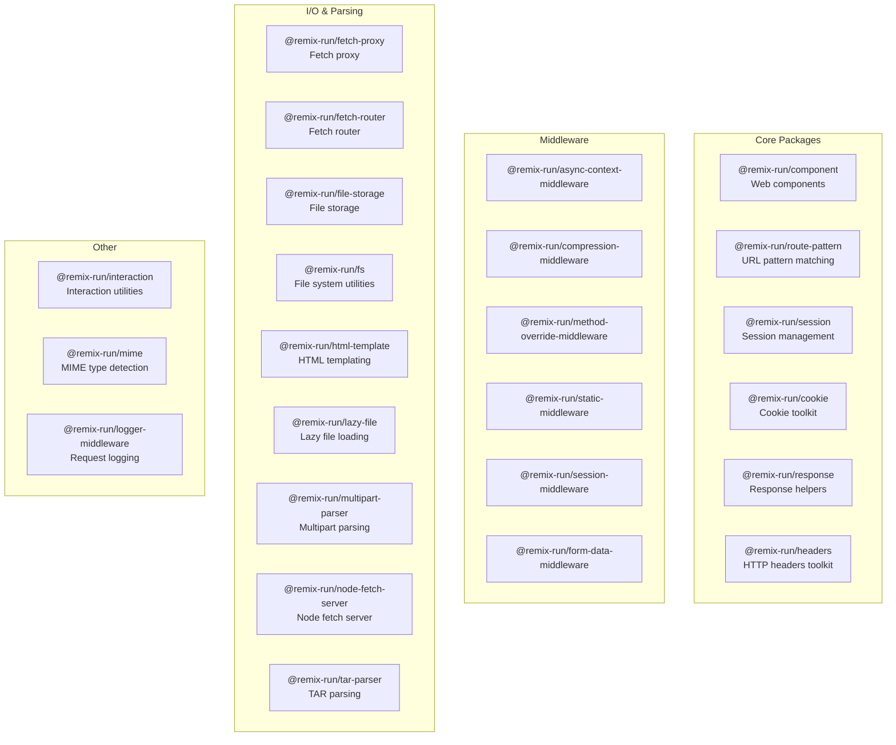

# Remix Architecture: Monorepo Package Map

Remix is a pnpm monorepo with 25 packages. Each package is independently versioned and published under `@remix-run/`.

**Source:** `https://github.com/remix-run/remix`
**Location:** `/home/darkvoid/Boxxed/@formulas/src.rust/src.AI/src.UIComponents/remix/`
**Package Manager:** pnpm workspaces

## Package Architecture



## All 25 Packages

| Package | Version | Category | Purpose |
|---------|---------|----------|---------|
| `@remix-run/component` | 0.1.0 | Core | Web components for Remix |
| `@remix-run/route-pattern` | 0.15.3 | Core | URL pattern matching with strong typing |
| `@remix-run/session` | 0.4.0 | Core | Session management for JavaScript |
| `@remix-run/cookie` | 0.5.0 | Core | Cookie toolkit |
| `@remix-run/response` | 0.2.0 | Core | Response helpers for Fetch API |
| `@remix-run/headers` | 0.18.0 | Core | HTTP headers toolkit |
| `@remix-run/async-context-middleware` | — | Middleware | Async context propagation |
| `@remix-run/compression-middleware` | — | Middleware | Response compression (gzip/brotli) |
| `@remix-run/method-override-middleware` | — | Middleware | HTTP method override support |
| `@remix-run/static-middleware` | — | Middleware | Static file serving |
| `@remix-run/session-middleware` | — | Middleware | Session middleware |
| `@remix-run/form-data-middleware` | — | Middleware | Form data processing |
| `@remix-run/fetch-proxy` | — | I/O | Fetch API proxy |
| `@remix-run/fetch-router` | — | I/O | Fetch-based request router |
| `@remix-run/file-storage` | — | I/O | File storage abstraction |
| `@remix-run/fs` | — | I/O | File system utilities |
| `@remix-run/html-template` | — | I/O | HTML templating engine |
| `@remix-run/lazy-file` | — | I/O | Lazy file loading |
| `@remix-run/multipart-parser` | — | Parsing | Multipart form data parser |
| `@remix-run/node-fetch-server` | — | I/O | Node.js fetch-compatible server |
| `@remix-run/tar-parser` | — | Parsing | TAR archive parser |
| `@remix-run/interaction` | — | Utility | Interaction utilities |
| `@remix-run/mime` | — | Utility | MIME type detection |
| `@remix-run/logger-middleware` | — | Middleware | Request/response logging |
| `@remix-run/form-data-parser` | — | Parsing | Form data parsing |

## Build System

```
remix/
├── package.json              # Root workspace config
├── pnpm-workspace.yaml       # pnpm workspace definition
├── pnpm-lock.yaml            # Lock file
├── eslint.config.js          # ESLint configuration
├── cspell.yml                # Spell check config
├── decisions/                # Architecture Decision Records
│   └── 001-route-pattern-vs-url-pattern.md
├── demos/                    # Package demos
├── scripts/                  # Release scripts
│   ├── create-github-release.js
│   ├── tag-release.js
│   └── view-changes.js
└── packages/                 # 25 packages
```

## Design Decisions

Source: `decisions/001-route-pattern-vs-url-pattern.md`

The first ADR documents the choice to use `route-pattern` instead of the native `URLPattern` API.

## Cross-References

- [Overview](00-overview.md) — What Remix is
- [Philosophy](01-philosophy.md) — Design philosophy
- [Packages](02-packages.md) — Package details
