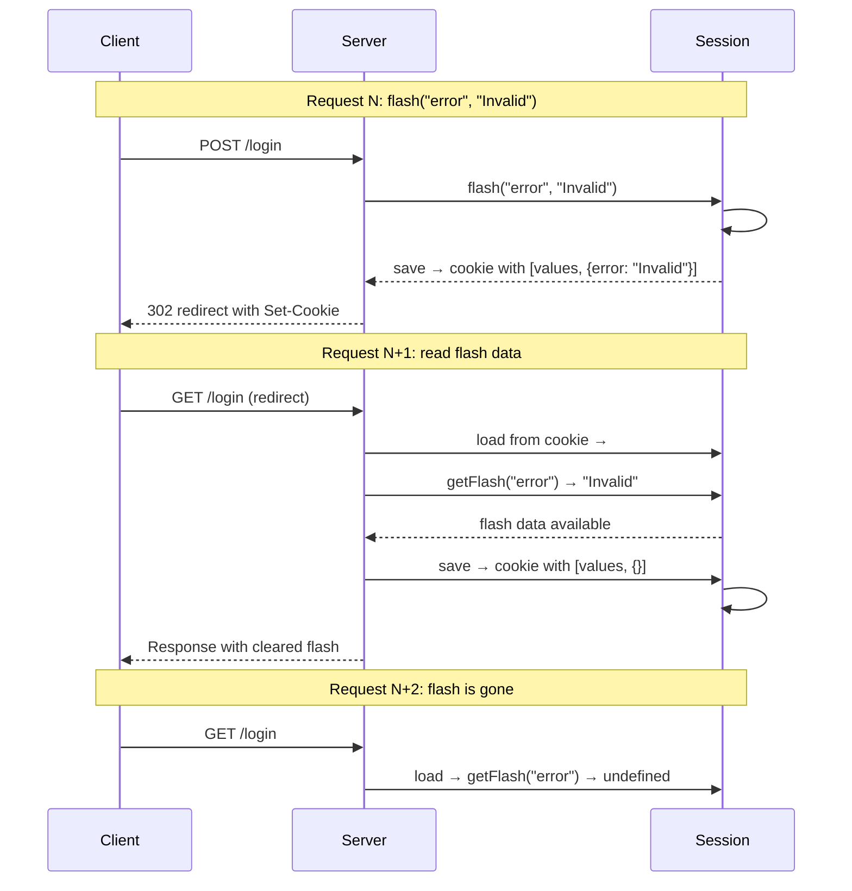

# Session Management: Event-Sourced Sessions with Flash Data

`@remix-run/session` (v0.4.0) provides typed session persistence with flash data lifecycle, three storage backends (memory, cookie, filesystem), and session ID rotation for security.

Source: `packages/session/src/` — 12 source files.

## Session Class — Full Implementation

Source: `lib/session.ts`

```typescript
type Data = Record<string, unknown>

export type SessionData<valueData extends Data = Data, flashData extends Data = Data> = [
  valueData,
  flashData,
]
```

### Data Model

Session data is stored as a **tuple** `[valueData, flashData]`, not an object. The first element is regular session data, the second is flash data (one-request lifetime).

### Internal State

```typescript
export class Session<valueData extends Data, flashData extends Data> {
  #currentId: string
  #deleteId: string | undefined = undefined
  #valueMap: Map<keyof valueData, valueData[keyof valueData]>
  #flashMap: Map<keyof flashData, flashData[keyof flashData]>
  #nextMap: Map<keyof flashData, flashData[keyof flashData]>
  #destroyed = false
  #dirty: boolean

  constructor(id = createSessionId(), initialData?: SessionData<valueData, flashData>) {
    this.#currentId = id
    this.#valueMap = toMap(initialData?.[0])
    this.#flashMap = toMap(initialData?.[1])
    this.#nextMap = new Map()
    this.#dirty = this.#flashMap.size > 0
  }
```

Four Maps:
| Map | Purpose |
|-----|---------|
| `#valueMap` | Regular session data (persists across requests) |
| `#flashMap` | Current flash data (read-only, from previous request) |
| `#nextMap` | Flash data for the NEXT request (written during current request) |
| `#deleteId` | Old session ID to delete on save (for ID rotation) |

Aha: Flash data has a **two-phase lifecycle**. `#flashMap` holds data written in the previous request (available for reading now). `#nextMap` holds data written during the current request (available for reading in the next request). On save, `#nextMap` becomes the next request's `#flashMap`, and `#nextMap` is cleared.

### Constructor Logic

```typescript
this.#valueMap = toMap(initialData?.[0])    // Regular data from storage
this.#flashMap = toMap(initialData?.[1])    // Flash data from previous request
this.#nextMap = new Map()                   // Empty for next request
this.#dirty = this.#flashMap.size > 0       // Mark dirty if flash data exists
```

Aha: The session is marked `dirty` if `#flashMap` has entries, even if nothing was written during this request. This ensures flash data is cleared on save — the flash data from the previous request must be consumed (and cleared) even if the current request doesn't write anything.

### toMap() Helper

```typescript
function toMap<T>(data?: Record<string, T>): Map<string, T> {
  return new Map(Object.entries(data ?? {}))
}
```

Converts plain objects to Maps.

### #checkDestroyed()

```typescript
#checkDestroyed() {
  if (this.#destroyed) throw new Error('Session has been destroyed')
}
```

Called before every mutation operation.

### data Getter — Serialization

```typescript
get data(): SessionData<valueData, flashData> {
  return (
    this.#destroyed
      ? [{}, {}]
      : [Object.fromEntries(this.#valueMap), Object.fromEntries(this.#nextMap)]
  ) as SessionData<valueData, flashData>
}
```

Returns the serializable form:
- **If destroyed**: `[{}, {}]` — empty data
- **Otherwise**: `[valueMap, nextMap]` — regular data + next flash data

Aha: The `data` getter returns `#nextMap` (not `#flashMap`) for the flash slot. This means when the session is saved, only the flash data written during this request persists — the flash data from the previous request (`#flashMap`) is implicitly discarded.

### deleteId Getter

```typescript
get deleteId(): string | undefined {
  return this.#deleteId
}
```

Returns the old session ID when `regenerateId({ deleteOldSession: true })` was called. Storage backends use this to delete the old session data.

### get() — Read Session Data

```typescript
get<K extends keyof valueData>(key: K): valueData[K] | undefined {
  this.#checkDestroyed()
  return this.#valueMap.get(key)
}
```

### getFlash() — Read Flash Data

```typescript
getFlash<K extends keyof flashData>(key: K): flashData[K] | undefined {
  this.#checkDestroyed()
  return this.#flashMap.get(key)
}
```

Reads from `#flashMap` — data written in the previous request.

### set() — Write Session Data

```typescript
set<K extends keyof valueData>(key: K, value: valueData[K]): void {
  this.#checkDestroyed()
  this.#valueMap.set(key, value)
  this.#dirty = true
}
```

Marks the session as dirty.

### flash() — Write Flash Data

```typescript
flash<K extends keyof flashData>(key: K, value: flashData[K]): void {
  this.#checkDestroyed()
  this.#nextMap.set(key, value)
  this.#dirty = true
}
```

Writes to `#nextMap` — available in the NEXT request, not the current one.

### unset() — Remove Session Data

```typescript
unset<K extends keyof valueData>(key: K): void {
  this.#checkDestroyed()
  this.#valueMap.delete(key)
  this.#dirty = true
}
```

### regenerateId() — Session ID Rotation

```typescript
regenerateId(options?: { deleteOldSession?: boolean }): string {
  const oldId = this.#currentId
  this.#currentId = createSessionId()
  this.#dirty = true
  if (options?.deleteOldSession) {
    this.#deleteId = oldId
  }
  return this.#currentId
}
```

Aha: When `deleteOldSession: true`, the old session ID is stored in `#deleteId`. The storage backend's `commitSession` method checks `session.deleteId` and deletes the old session data from storage. This prevents **session fixation attacks** — where an attacker sets a known session ID before the user authenticates.

### destroy() — Session Destruction

```typescript
destroy(): void {
  this.#checkDestroyed()
  this.#destroyed = true
  this.#dirty = true
}
```

Marks the session as destroyed. Subsequent operations throw.

## Session ID Generation

```typescript
function createSessionId(): string {
  return randomBytes(32).toString('hex')  // 64-character hex string
}
```

256 bits of randomness from `crypto.randomBytes`.

## SessionStorage Interface

Source: `lib/session-storage.ts`

```typescript
export interface SessionStorage<valueData = Data, flashData = Data> {
  getSession(cookieHeader?: string | null): Promise<Session<valueData, flashData>>
  commitSession(session: Session<valueData, flashData>, options?: CookieSerializeOptions): Promise<string>
  destroySession(session: Session<valueData, flashData>, options?: CookieSerializeOptions): Promise<string>
}
```

Three implementations:

## MemoryStorage

Source: `lib/session-storage/memory.ts`

```typescript
export function createMemorySessionStorage(): SessionStorage {
  const sessions = new Map<string, SessionData>()

  return {
    async getSession(cookieHeader) {
      if (!cookieHeader) return new Session()
      const data = sessions.get(cookieHeader)
      return data ? new Session(cookieHeader, data) : new Session()
    },

    async commitSession(session) {
      const data = session.data
      sessions.set(session.id, data)
      return session.id
    },

    async destroySession(session) {
      sessions.delete(session.id)
      return ''
    },
  }
}
```

In-memory storage. Lost on process restart. Used for testing.

## CookieStorage

Source: `lib/session-storage/cookie.ts`

```typescript
export function createCookieSessionStorage({ cookie }: { cookie: Cookie }): SessionStorage {
  return {
    async getSession(cookieHeader) {
      const data = await cookie.parse(cookieHeader ?? '')
      if (!data) return new Session()
      return new Session(data.id, data)
    },

    async commitSession(session, options) {
      const data = session.data
      return cookie.serialize({ id: session.id, ...data }, options)
    },

    async destroySession(session, options) {
      return cookie.serialize({ id: session.id, data: [{}, {}] }, { ...options, maxAge: 0 })
    },
  }
}
```

Sessions stored in signed/encrypted cookies. Size-limited (~4KB per cookie).

## FsStorage

Source: `lib/session-storage/fs.ts`

```typescript
export function createFsSessionStorage({ directory, cookie }: { directory: string; cookie: Cookie }): SessionStorage {
  return {
    async getSession(cookieHeader) {
      const data = await cookie.parse(cookieHeader ?? '')
      if (!data) return new Session()
      const filePath = path.join(directory, `${data.id}.json`)
      try {
        const fileData = JSON.parse(await fs.readFile(filePath, 'utf-8'))
        return new Session(data.id, fileData)
      } catch {
        return new Session()
      }
    },

    async commitSession(session) {
      const data = session.data
      const filePath = path.join(directory, `${session.id}.json`)
      await fs.writeFile(filePath, JSON.stringify(data))

      // Delete old session if ID was rotated
      if (session.deleteId) {
        await fs.unlink(path.join(directory, `${session.deleteId}.json`))
      }

      return cookie.serialize({ id: session.id })
    },

    async destroySession(session) {
      const filePath = path.join(directory, `${session.id}.json`)
      await fs.unlink(filePath)
      return cookie.serialize({ id: session.id }, { maxAge: 0 })
    },
  }
}
```

Each session is a JSON file. Includes cleanup of old sessions on ID rotation.

## Flash Data Lifecycle — Sequence



## Cross-References

- [Overview](00-overview.md) — What Remix is
- [Fetch Router](09-fetch-router.md) — Router that uses sessions
- [Cookie](05-cookie.md) — Cookie toolkit (used by CookieStorage)

[Next → Cookie](05-cookie.md)
