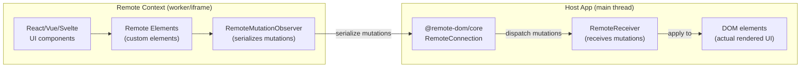

# remote-dom: Overview

Render React (or Vue, Svelte, Preact, Vanilla) UI from a remote context — a Web Worker, iframe, or separate process — into a host application's DOM. The host owns the DOM; the remote sends serialized mutations. Originally from Shopify.

**Source:** `https://github.com/Shopify/remote-dom`
**Location:** `/home/darkvoid/Boxxed/@formulas/src.rust/src.AI/src.UIComponents/remote-dom/`
**Monorepo:** pnpm workspaces with 6 packages + kitchen-sink example

## Quick Start

```bash
cd remote-dom
pnpm install
pnpm build
pnpm test          # vitest
```

The kitchen-sink example demonstrates all 6 framework integrations.

## Architecture: Host/Remote Model



The key insight: the remote context never touches the host's DOM. Instead, it creates "remote elements" — custom elements whose mutations are serialized and sent to the host. The host receives mutations and applies them to real DOM elements.

## The 6 Packages

| Package | Version | Purpose |
|---------|---------|---------|
| `@remote-dom/core` | 1.11.1 | Core protocol: RemoteConnection, receivers, elements, serialization |
| `@remote-dom/react` | 1.2.2 | React bridge: `createRemoteComponent`, slot props, event props |
| `@remote-dom/polyfill` | 1.5.1 | DOM API polyfill: Attr, CharacterData, ChildNode, Comment, CustomElementRegistry, Element, Event, MutationObserver, Node, etc. |
| `@remote-dom/signals` | 2.1.1 | Preact signals-based receiver for reactive rendering |
| `@remote-dom/compat` | 1.0.2 | Legacy adapter: `adaptToLegacyRemoteChannel` |
| `@remote-dom/elements` | — | Custom element definitions: RemoteElement, RemoteFragmentElement, RemoteRootElement |

## Core Protocol

Source: `packages/core/source/constants.ts`

```ts
// Node types (matching DOM node types)
export const NODE_TYPE_ELEMENT = 1;
export const NODE_TYPE_TEXT = 3;
export const NODE_TYPE_COMMENT = 8;
export const NODE_TYPE_ROOT = 9;

// Mutation types
export const MUTATION_TYPE_INSERT_CHILD = 0;
export const MUTATION_TYPE_REMOVE_CHILD = 1;
export const MUTATION_TYPE_UPDATE_TEXT = 2;
export const MUTATION_TYPE_UPDATE_PROPERTY = 3;

// Property update sub-types
export const UPDATE_PROPERTY_TYPE_PROPERTY = 1;
export const UPDATE_PROPERTY_TYPE_ATTRIBUTE = 2;
export const UPDATE_PROPERTY_TYPE_EVENT_LISTENER = 3;

export const ROOT_ID = '~';
```

Aha: The protocol uses a tuple-based serialization format. Each mutation is a typed tuple like `[MUTATION_TYPE_INSERT_CHILD, parentId, child, index]`. This is intentionally low-level — no objects, no JSON schema, just positional arrays. The `createRemoteConnection` helper wraps this into a friendlier API with named methods.

## RemoteConnection

Source: `packages/core/source/connection.ts`

```ts
export interface RemoteConnectionHandler {
  call: RemoteConnection['call'];
  insertChild(id, child, index): void;
  removeChild(id, index): void;
  updateText(id, text): void;
  updateProperty(id, property, value, type?): void;
}

export function createRemoteConnection(handlers): RemoteConnection {
  const handlers = {
    [MUTATION_TYPE_INSERT_CHILD]: insertChild,
    [MUTATION_TYPE_REMOVE_CHILD]: removeChild,
    [MUTATION_TYPE_UPDATE_TEXT]: updateText,
    [MUTATION_TYPE_UPDATE_PROPERTY]: updateProperty,
  };
  return { call, mutate(records) { /* dispatch by type */ } };
}
```

## RemoteReceiver

The host-side receiver maintains a virtual DOM tree from serialized mutations:

```ts
export { RemoteReceiver, DOMRemoteReceiver } from './receivers';
export type { RemoteReceiverOptions } from './receivers/shared';
```

- **`RemoteReceiver`** — Pure JS tree representation
- **`DOMRemoteReceiver`** — Creates actual DOM elements

## Kitchen-Sink Example

Source: `examples/kitchen-sink/`

Demonstrates 6 framework integrations:
| Example | Framework | Transport |
|---------|-----------|-----------|
| `react.tsx` | React | Direct |
| `react-remote-ui.tsx` | React | Remote UI pattern |
| `preact.tsx` | Preact | Direct |
| `vue.ts` | Vue | Direct |
| `svelte.ts` | Svelte | Direct |
| `vanilla.ts` | Vanilla JS | Direct |
| `htm.ts` | HTM (hyperscript) | Direct |

Plus two transport sandboxes:
| Sandbox | Transport |
|---------|-----------|
| `iframe/sandbox.ts` | iframe postMessage |
| `worker/sandbox.ts` | Web Worker postMessage |

Aha: The kitchen-sink shows that the same remote element definitions work with ANY UI framework. React, Vue, Svelte, Preact, and vanilla JS all produce the same serialized mutations — the host doesn't care what framework generated them.

## Cross-References

- [Core Package](01-core-package.md) — RemoteConnection, receivers, types
- [React Package](02-react-package.md) — createRemoteComponent, slot props
- [Polyfill Package](03-polyfill-package.md) — DOM API emulation
- [Signals Package](04-signals-package.md) — Preact signals receiver
- [Compat Package](05-compat-package.md) — Legacy adapter
- [Examples](06-examples.md) — Kitchen-sink with 6 frameworks
- [Architecture](07-architecture.md) — Full host/remote flow
