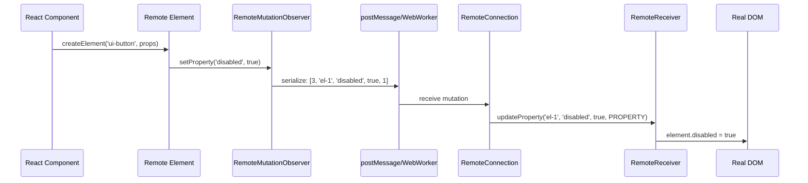

# Architecture: Full Host/Remote Communication Flow

This document traces the complete flow from a React component in a remote context to a rendered DOM element in the host app.

## High-Level Architecture



## Node Type Mapping

| Remote Type | DOM Equivalent | Constant |
|-------------|---------------|----------|
| `NODE_TYPE_ELEMENT` | `Node.ELEMENT_NODE` | 1 |
| `NODE_TYPE_TEXT` | `Node.TEXT_NODE` | 3 |
| `NODE_TYPE_COMMENT` | `Node.COMMENT_NODE` | 8 |
| `NODE_TYPE_ROOT` | `Node.DOCUMENT_NODE` | 9 |

## Mutation Types

| Mutation | When | Tuple |
|----------|------|-------|
| `INSERT_CHILD` | New child added | `[0, parentId, child, index]` |
| `REMOVE_CHILD` | Child removed | `[1, parentId, index]` |
| `UPDATE_TEXT` | Text content changed | `[2, textNodeId, text]` |
| `UPDATE_PROPERTY` | Property/attribute/event changed | `[3, elementId, property, value, type]` |

### Property Sub-Types

| Sub-Type | Value | Purpose |
|----------|-------|---------|
| `UPDATE_PROPERTY_TYPE_PROPERTY` | 1 | DOM property (e.g., `disabled`, `value`) |
| `UPDATE_PROPERTY_TYPE_ATTRIBUTE` | 2 | HTML attribute (e.g., `href`, `class`) |
| `UPDATE_PROPERTY_TYPE_EVENT_LISTENER` | 3 | Event listener (e.g., `onclick`) |

## The Element Protocol

Every remote element:
1. Extends `RemoteElement` (a custom element base class)
2. Defines its properties, methods, slots via decorators
3. Gets a unique ID via `remoteId()`
4. Connects to a `RemoteConnection` via `connectRemoteNode()`
5. Sends mutations via `RemoteMutationObserver`

### Decorator-Based Element Definition

```ts
@customElement('ui-button')
class ButtonElement extends RemoteElement {
  @remoteProperty() disabled = false;
  @remoteProperty() variant = 'primary';
  @remoteSlots() slots = { icon: 'remote-fragment' };

  click() { this.dispatchEvent(new RemoteEvent('click')); }
}
```

### React Bridge

```tsx
const Button = createRemoteComponent('ui-button', ButtonElement, {
  eventProps: { onClick: { event: 'click' } },
});
```

The React component:
1. Renders as `<ui-button>` custom element
2. Maps React props to element properties
3. Converts React element props to `remote-fragment` slots
4. Maps React event handlers to custom element events

## Cross-References

- [Overview](00-overview.md) — Package summary
- [Core Package](01-core-package.md) — RemoteConnection protocol
- [React Package](02-react-package.md) — React bridge
- [Examples](06-examples.md) — Kitchen-sink demonstrating all frameworks
