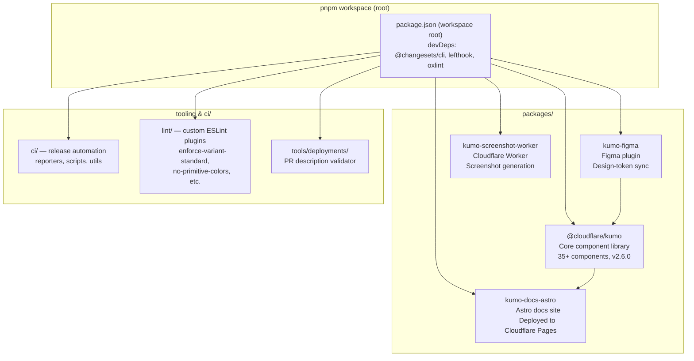
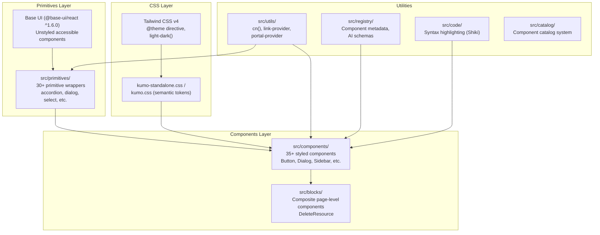
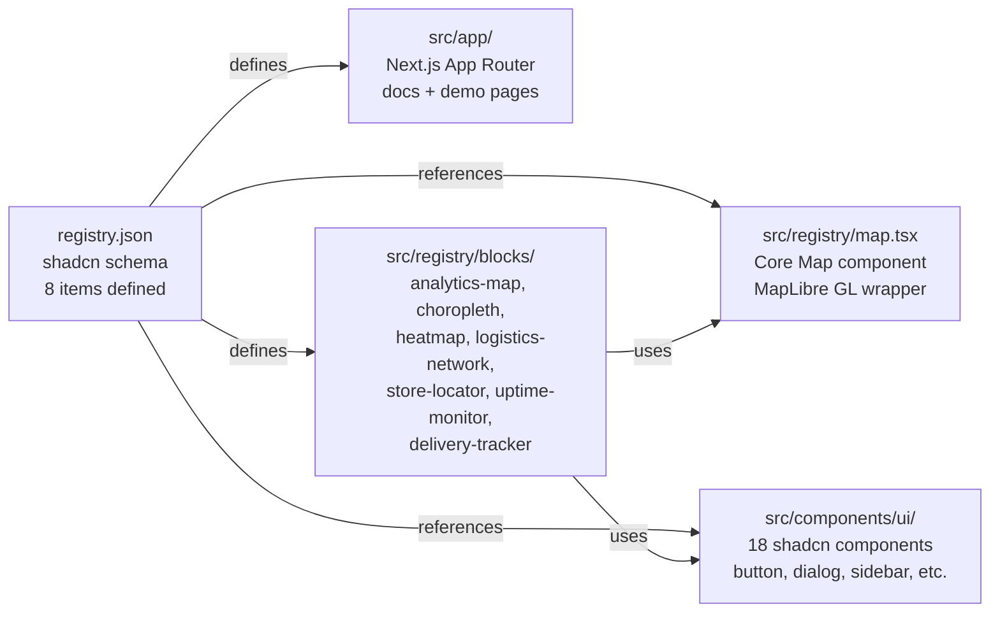
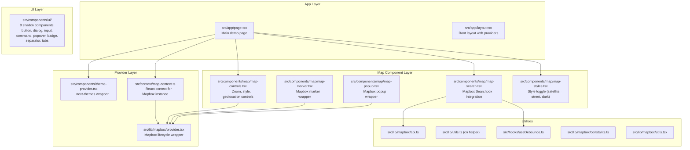
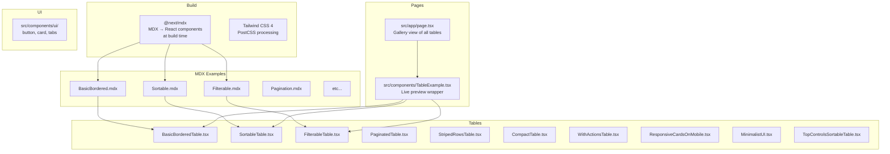

# Architecture

This document maps the architecture of each of the four src.UIComponents projects, including dependency graphs, layer diagrams, and module relationships.

## kumo Architecture

### Monorepo Structure



**Source:** `pnpm-workspace.yaml` at root defines workspace packages: `packages/*`.

### kumo Component Layer Architecture



**Aha:** The primitives layer is *generated*, not hand-written. Running `pnpm run codegen:primitives` executes `scripts/generate-primitives.ts` which creates primitive wrappers from a template. This means adding a new Base UI primitive to Kumo is a codegen step, not a manual implementation — the primitives stay in lockstep with Base UI's API.

### kumo Import Resolution

kumo uses granular `exports` in `package.json` (lines 26-411) to enable tree-shakable imports:

```
@cloudflare/kumo                     → dist/index.js (all exports)
@cloudflare/kumo/components/button   → dist/components/button.js (single component)
@cloudflare/kumo/primitives/dialog   → dist/primitives/dialog.js (primitive only)
@cloudflare/kumo/utils               → dist/utils.js (cn, link-provider)
@cloudflare/kumo/registry            → dist/registry.js (metadata)
@cloudflare/kumo/code                → dist/code.js (syntax highlighting)
@cloudflare/kumo/code/server       → dist/code/server.js (server-side rendering)
@cloudflare/kumo/styles              → dist/styles/kumo.css
@cloudflare/kumo/ai/schemas          → dist/ai/schemas.js (Zod schemas for AI)
```

This means importing `@cloudflare/kumo/components/button` only bundles the Button component, not the entire library.

### kumo Versioning

kumo uses [changesets](https://github.com/changesets/changesets) for version management. The `.changeset/` directory contains pending change descriptions:

| Changeset | Description |
|-----------|-------------|
| `blue-red-button-rings` | Button ring style update |
| `bright-toasts-close` | Toast component close behavior fix |
| `fix-button-firefox-turnstile` | Firefox Turnstile compatibility fix |
| `fix-dialog-size-width` | Dialog size width correction |
| `flow-vertical-orientation` | Flow component vertical orientation |
| `fresh-otters-draw` | (pending change) |
| `spicy-maps-glow` | (pending change) |

**Source:** `.changeset/` directory at kumo root.

## mapcn Architecture

### Registry Pattern



**Source:** `registry.json` (345 lines, 8 items).

### mapcn Component Surface

The core `Map` component (`src/registry/map.tsx`) wraps MapLibre GL and exposes:

| Feature | Implementation |
|---------|---------------|
| Markers | `Marker` with custom elements, labels, tooltips, popups |
| Popups | Standalone and marker-attached popup composition |
| Routes | Line routes with optional markers and interaction handlers |
| Arcs | Curved connection arcs between coordinates |
| GeoJSON | Sources and layers for custom map data |
| Clusters | Clustered point layers for dense datasets |

**Source:** `registry.json` meta.components (lines 34-75).

### mapcn Dependencies

```
mapcn (Next.js 15 app)
├── maplibre-gl          (map rendering)
├── lucide-react         (icons)
├── cmdk                 (command palette / search)
├── radix-ui             (accessible primitives)
├── class-variance-authority (component variants)
├── clsx + tailwind-merge (class merging)
├── next-themes          (theme provider)
└── @vercel/analytics    (usage tracking)
```

**Source:** `mapcn/package.json`.

## next-maps Architecture

### Layer Diagram



### Map Context API

The map context (`src/context/map-context.ts`) exposes the Mapbox `map` instance to all child components:

```tsx
// src/context/map-context.ts
// Provides: map instance, loading state, center/zoom access
```

The provider (`src/lib/mapbox/provider.tsx`) manages the Mapbox map lifecycle:
- Creates `new mapboxgl.Map()` with config
- Cleans up `map.remove()` on unmount
- Delegates events to child components

**Source:** `next-maps/src/context/map-context.ts`, `next-maps/src/lib/mapbox/provider.tsx`.

### Dependencies

```
next-maps
├── mapbox-gl            (map rendering — requires API key)
├── @radix-ui/react-*    (dialog, popover, separator, slot, tabs)
├── lucide-react         (icons)
├── cmdk                 (command palette)
├── class-variance-authority
├── clsx + tailwind-merge
└── @types/mapbox__mapbox-gl-geocoder
```

**Source:** `next-maps/package.json`.

## table-forge Architecture

### MDX-Driven Documentation



### Table Components

All table components live in `src/components/tables/` and are documented via corresponding MDX files in `src/examples/tables/`:

| Table Component | MDX File | Feature |
|----------------|----------|---------|
| `BasicBorderedTable.tsx` | `BasicBordered.mdx` | Simple bordered table |
| `SortableTable.tsx` | `Sortable.mdx` | Column sorting |
| `FilterableTable.tsx` | `Filterable.mdx` | Row filtering |
| `PaginatedTable.tsx` | `Pagination.mdx` | Pagination controls |
| `StripedRowsTable.tsx` | `StripedRows.mdx` | Alternating row colors |
| `CompactTable.tsx` | `Compact.mdx` | Dense layout |
| `WithActionsTable.tsx` | `WithActions.mdx` | Action buttons per row |
| `ResponsiveCardsOnMobile.tsx` | `ResponsiveCardsOnMobile.mdx` | Mobile card layout |
| `MinimalistUI.tsx` | `Minimalist.mdx` | Minimal design |
| `TopControlsSortableTable.tsx` | `TopControlsSortable.mdx` | Sort + search controls |

**Source:** `table-forge/src/components/tables/`, `table-forge/src/examples/tables/`.

### Dependencies

```
table-forge
├── next (15, App Router)
├── react (19)
├── tailwindcss (4)
├── @mdx-js/loader + @mdx-js/react + @next/mdx
├── lucide-react (icons)
├── class-variance-authority
├── clsx + tailwind-merge
├── @radix-ui/react-slot, react-tabs
└── @vercel/analytics + next-themes
```

**Source:** `table-forge/package.json`.

## Next

Continue to [02-kumo](02-kumo.md) for a deep dive into Kumo's component architecture, theming system, and AI registry.
