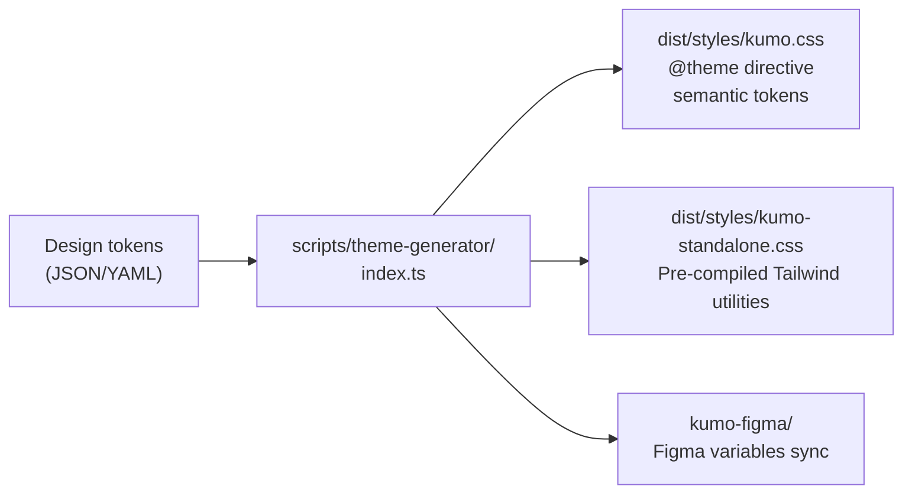

# Kumo: Cloudflare's Component Library

Kumo (`@cloudflare/kumo` v2.6.0) is Cloudflare's production-grade React component library. It provides 35+ accessible UI components built on [Base UI](https://base-ui.com/) and Tailwind CSS v4, with granular tree-shakable exports, an AI-powered component registry, and a Figma design-token sync plugin.

**Source:** `/home/darkvoid/Boxxed/@formulas/src.rust/src.AI/src.UIComponents/kumo/packages/kumo/`

## Component Architecture

Kumo has three distinct component layers:

### 1. Primitives — Base UI Wrappers

Primitives are unstyled, accessibility-focused wrappers around Base UI components. They provide keyboard navigation, ARIA attributes, and focus management without imposing visual opinions.

**Source:** `packages/kumo/src/primitives/` (generated by `scripts/generate-primitives.ts`)

| Primitive | Base UI Component |
|-----------|------------------|
| `primitives/accordion` | `Accordion` |
| `primitives/alert-dialog` | `AlertDialog` |
| `primitives/autocomplete` | `Autocomplete` |
| `primitives/avatar` | `Avatar` |
| `primitives/button` | `Button` |
| `primitives/checkbox` | `Checkbox` |
| `primitives/collapsible` | `Collapsible` |
| `primitives/combobox` | `Combobox` |
| `primitives/context-menu` | `ContextMenu` |
| `primitives/dialog` | `Dialog` |
| `primitives/drawer` | `Drawer` |
| `primitives/field` | `Field` |
| `primitives/form` | `Form` |
| `primitives/menu` | `Menu` |
| `primitives/navigation-menu` | `NavigationMenu` |
| `primitives/popover` | `Popover` |
| `primitives/progress` | `Progress` |
| `primitives/radio-group` | `RadioGroup` |
| `primitives/scroll-area` | `ScrollArea` |
| `primitives/select` | `Select` |
| `primitives/slider` | `Slider` |
| `primitives/switch` | `Switch` |
| `primitives/tabs` | `Tabs` |
| `primitives/toast` | `Toast` |
| `primitives/toolbar` | `Toolbar` |
| `primitives/tooltip` | `Tooltip` |

**Aha:** Primitives are **generated**, not hand-written. The `scripts/generate-primitives.ts` script reads Base UI's API and generates wrapper files from templates (`plop-templates/`). This means primitives stay in lockstep with Base UI — when Base UI adds a new component or changes an API, running `pnpm run codegen:primitives` regenerates all wrappers automatically. The `build:primitives` script runs before every build.

### 2. Components — Styled Implementations

Components are Kumo's opinionated, design-system-compliant implementations. They compose primitives with Tailwind CSS styling using semantic design tokens.

**Source:** `packages/kumo/src/components/` (35+ components)

```tsx
// packages/kumo/src/index.ts — full export list
// Components (partial):
export { Badge, type BadgeVariant } from "./components/badge";
export { Button, RefreshButton, LinkButton, buttonVariants } from "./components/button";
export { Dialog, DialogRoot, DialogTrigger, DialogTitle, DialogDescription } from "./components/dialog";
export { Sidebar, SidebarProvider, SidebarRoot, SidebarHeader, SidebarContent } from "./components/sidebar";
export { Chart, SankeyChart, TimeseriesChart, BubbleMap } from "./components/chart";
export { Autocomplete, autocompleteVariants } from "./components/autocomplete";
export { TableOfContents } from "./components/table-of-contents";
export { CloudflareLogo, PoweredByCloudflare } from "./components/cloudflare-logo";
// ... and 30+ more
```

Components are organized by category:

| Category | Components |
|----------|-----------|
| Action | Button, ClipboardText, Link, RefreshButton |
| Display | Badge, Breadcrumbs, Code, Empty, LayerCard, Meter, Text |
| Feedback | Banner, Loader, Toast (Toasty) |
| Input | Checkbox, Combobox, DatePicker, Field, Input, Radio, Select, SensitiveInput, Switch |
| Layout | Grid, Surface (deprecated → use LayerCard) |
| Navigation | CommandPalette, MenuBar, Pagination, Tabs, TableOfContents |
| Overlay | Dialog, DropdownMenu, Popover, Tooltip |
| Data | Table, Chart (SankeyChart, TimeseriesChart, BubbleMap) |
| Complex | Sidebar (full resizable panel system), Autocomplete, Flow |

### 3. Blocks — Composite Page Patterns

Blocks are higher-level components that compose multiple base components into common page patterns.

**Source:** `packages/kumo/src/blocks/`

```tsx
// Example: DeleteResource block
export {
  DeleteResource,
  KUMO_DELETE_RESOURCE_VARIANTS,
  KUMO_DELETE_RESOURCE_DEFAULT_VARIANTS,
  type DeleteResourceProps,
} from "./blocks/delete-resource";
```

Blocks are NOT exported in the main barrel import. They are installed via the CLI:

```bash
npx @cloudflare/kumo add <block-name>
```

This follows the shadcn pattern — blocks are copied into your project, not imported from the package.

## Theming System

### CSS `light-dark()` Over `dark:` Variant

**Aha:** Kumo forbids Tailwind's `dark:` variant entirely. Instead, it uses the CSS `light-dark()` function for automatic theme handling. This is enforced by a custom ESLint plugin (`lint/no-tailwind-dark-variant.js`).

The design token system uses semantic names (`bg-kumo-base`, `text-kumo-default`) rather than raw colors. These tokens resolve to different values in light and dark mode via CSS `light-dark()`:

```css
/* Generated by theme codegen */
--kumo-base: light-dark(#ffffff, #1a1a1a);
--kumo-text: light-dark(#1a1a1a, #ffffff);
```

**Source:** `packages/kumo/scripts/css-build.ts` generates the CSS output from design tokens.

### Theme Generation Pipeline



### Two CSS Import Modes

**Tailwind mode** (for projects using Tailwind CSS v4):
```css
@source "../node_modules/@cloudflare/kumo/dist/**/*.{js,jsx,ts,tsx}";
@import "@cloudflare/kumo/styles/tailwind";
@import "tailwindcss";
```

**Standalone mode** (for projects not using Tailwind):
```js
import "@cloudflare/kumo/styles/standalone";
```

**Source:** `packages/kumo/README.md` lines 47-70.

## AI Registry

Kumo includes a machine-readable component registry for AI-assisted development:

```json
// @cloudflare/kumo/ai/component-registry.json
// Generated from TypeScript types + demo examples
```

The registry provides:
- Component names and descriptions
- Prop schemas with types
- Variant values and examples
- Usage examples

**Aha:** The AI registry is generated automatically from TypeScript types. This means the registry always stays in sync with the actual component API — no manual documentation drift. AI tools can query `@cloudflare/kumo/ai/schemas` for Zod schemas and `@cloudflare/kumo/ai/component-registry.json` for full component metadata.

The CLI reads from this registry:

```bash
npx @cloudflare/kumo ls          # List all components
npx @cloudflare/kumo doc Button  # Get component documentation
npx @cloudflare/kumo docs        # Get all component docs
```

**Source:** `packages/kumo/bin/kumo.js` (CLI entry point), `scripts/component-registry/index.ts` (registry generator).

## Component Categories Export Map

The full export surface (from `packages/kumo/src/index.ts`):

```
@cloudflare/kumo                           → All components + utilities
@cloudflare/kumo/components/{name}         → Single component (tree-shakable)
@cloudflare/kumo/primitives/{name}         → Single primitive (tree-shakable)
@cloudflare/kumo/primitives                → All primitives (barrel)
@cloudflare/kumo/blocks/{name}             → Block (install via CLI)
@cloudflare/kumo/utils                     → cn(), safeRandomId(), LinkProvider
@cloudflare/kumo/registry                  → Component metadata types
@cloudflare/kumo/catalog                   → Component catalog system
@cloudflare/kumo/code                      → Syntax highlighting (Shiki)
@cloudflare/kumo/code/server               → Server-side code rendering
@cloudflare/kumo/ai/schemas                → Zod schemas for AI
@cloudflare/kumo/ai/component-registry.json → Full component metadata
@cloudflare/kumo/styles                    → Tailwind CSS mode
@cloudflare/kumo/styles/standalone         → Standalone CSS mode
@cloudflare/kumo/scripts/theme-generator/config → Theme config types
@cloudflare/kumo/scripts/theme-generator/types  → Theme type definitions
```

**Source:** `packages/kumo/package.json` exports field (lines 26-411).

## Scaffolding

Kumo uses Plop for component scaffolding:

```bash
pnpm new:component    # Create new component
pnpm new-block        # Create new block
```

**Templates:** `packages/kumo/plop-templates/`

| Template | Output |
|----------|--------|
| `component.tsx.hbs` | `src/components/{name}/{name}.tsx` |
| `index.ts.hbs` | `src/components/{name}/index.ts` |
| `component.test.tsx.hbs` | `src/components/{name}/{name}.test.tsx` |
| `component.stories.tsx.hbs` | `src/components/{name}/{name}.stories.tsx` |

The scaffolding tool automatically updates `src/index.ts`, `vite.config.ts`, and `package.json` exports.

**Source:** `packages/kumo/plopfile.js`, `packages/kumo/plop-templates/`.

## Testing

Kumo uses Vitest for testing with two test projects:

```bash
pnpm test:unit      # Unit tests (happy-dom)
pnpm test:browser   # Browser tests (Playwright)
pnpm test:coverage  # Coverage report
pnpm test:exports   # Export path validation
```

**Source:** `packages/kumo/vite.config.ts`, `packages/kumo/vitest.config.ts`, `packages/kumo/vitest.browser.config.ts`.

### Strict Type Tests

Kumo includes TypeScript strict mode tests for component props:

```
packages/kumo/tests/select-strict-types.test-d.tsx
packages/kumo/tests/stratus-scenario.test-d.tsx
packages/kumo/tests/stratus-scenario-verify.test-d.tsx
```

These are `.test-d.tsx` files (vitest type tests) that verify TypeScript type constraints at compile time, not runtime.

**Source:** `packages/kumo/tests/` directory, `packages/kumo/tests/tsconfig.strict.json`.

## Next

Continue to [03-kumo-packages](03-kumo-packages.md) for Kumo's monorepo packages: docs site, Figma plugin, and screenshot worker.
