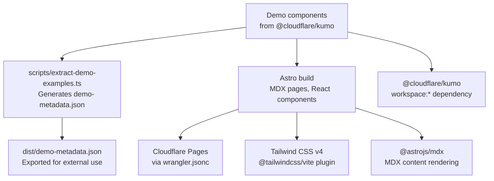
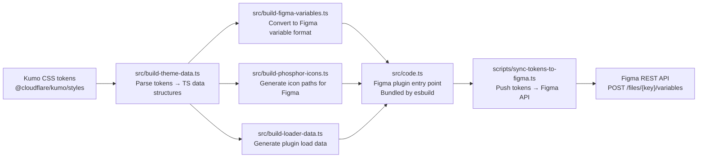
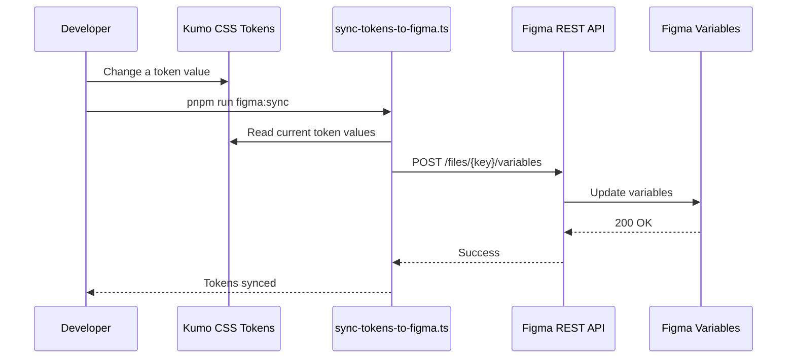
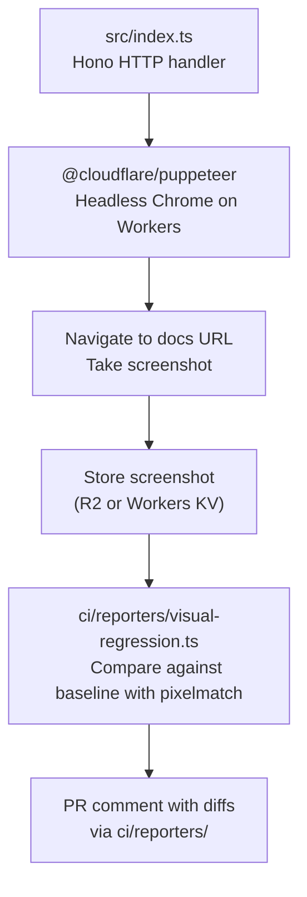
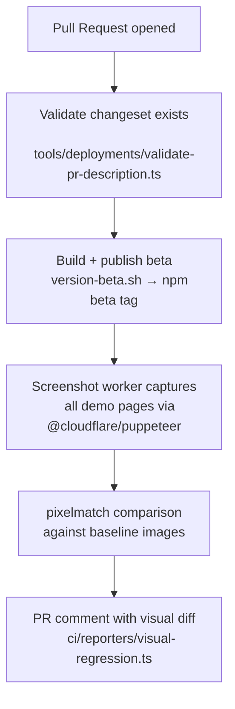

# Kumo Packages: Monorepo Deep Dive

Kumo is a pnpm monorepo with four packages. Beyond the core `@cloudflare/kumo` library (documented in [02-kumo](02-kumo.md)), three supporting packages power the documentation, design sync, and visual regression testing.

## Package Overview

| Package | Version | Purpose | Deploy Target |
|---------|---------|---------|---------------|
| `@cloudflare/kumo` | 2.6.0 | Core component library | npm (public) |
| `@cloudflare/kumo-docs-astro` | 1.5.10 | Documentation site | Cloudflare Pages |
| `@cloudflare/kumo-figma` | 0.3.40 | Figma plugin for design sync | Figma (plugin) |
| `@cloudflare/kumo-screenshot-worker` | 0.1.0 | Screenshot generation | Cloudflare Workers |

**Source:** `packages/*/package.json` at kumo root.

## kumo-docs-astro (v1.5.10)

### Purpose

The Astro-based documentation site for Kumo components. It renders live component demos, provides searchable documentation, and generates the AI component registry JSON.

**Source:** `/home/darkvoid/Boxxed/@formulas/src.rust/src.AI/src.UIComponents/kumo/packages/kumo-docs-astro/`

### Architecture



### Key Scripts

```bash
pnpm run codegen:demos    # Extract demo examples → dist/demo-metadata.json
pnpm dev                  # Astro dev server
pnpm build                # codegen:demos + astro build
pnpm lint:astro           # Custom color lint (lint-astro-colors.js)
```

### Dependencies

- **Core:** `@cloudflare/kumo` (workspace), `astro ^5.18.1`, `@astrojs/mdx ^4.3.14`
- **UI:** `echarts ^6.0.0`, `@phosphor-icons/react` (catalog)
- **Processing:** `match-sorter ^8.2.0` (fuzzy search), `react-markdown 10.1.0`, `turndown 7.2.2`
- **Build:** `@tailwindcss/vite`, `@astrojs/react ^4.2.1`

**Aha:** The docs site exports `demo-metadata.json` as a package export (`./demo-metadata.json`). This means external consumers can import component demo metadata without running the docs site — enabling AI tools and other consumers to access component examples programmatically.

### Demo Extraction

The `scripts/extract-demo-examples.ts` script scans the docs site for demo components and generates structured metadata:

```typescript
// scripts/extract-demo-examples.ts
// Scans for demo components → dist/demo-metadata.json
```

This feeds the AI registry and enables the `npx @cloudflare/kumo doc` CLI command to show component examples.

### Lint Rules

The docs site has a custom color lint (`lint-astro-colors.js`) that enforces the same semantic-token-only rule as the core library — no raw Tailwind colors in Astro components.

**Source:** `packages/kumo-docs-astro/package.json` line 17, root `lint/lint-astro-colors.js`.

## kumo-figma (v0.3.40)

### Purpose

A Figma plugin that provides bidirectional design-token synchronization between Kumo's CSS tokens and Figma variables. This ensures the design system in Figma matches the implementation in code.

**Source:** `/home/darkvoid/Boxxed/@formulas/src.rust/src.AI/src.UIComponents/kumo/packages/kumo-figma/`

### Architecture



### Build Pipeline

```bash
pnpm run build:data      # Run all build steps:
                         #   src/build-theme-data.ts
                         #   src/build-loader-data.ts
                         #   src/build-phosphor-icons.ts
                         #   src/build-figma-variables.ts
pnpm run build:plugin    # esbuild src/code.ts → src/code.js (IIFE)
pnpm run figma:sync      # Push tokens to Figma via REST API
```

**Source:** `packages/kumo-figma/package.json` lines 10-17.

### Plugin Structure

| File | Purpose |
|------|---------|
| `src/code.ts` | Figma plugin entry point (bundled to `src/code.js`) |
| `src/build-figma-variables.ts` | Convert CSS tokens to Figma variable format |
| `src/build-theme-data.ts` | Parse Kumo theme tokens into structured data |
| `src/build-loader-data.ts` | Generate data the plugin loads at runtime |
| `src/build-phosphor-icons.ts` | Convert Phosphor icon SVGs to Figma icon paths |
| `src/manifest.json` | Figma plugin manifest (name, permissions, entry points) |
| `src/ui.html` | Plugin UI HTML |
| `src/figma-types.d.ts` | TypeScript type definitions for Figma API |

**Source:** `packages/kumo-figma/src/` directory listing.

### Drift Detection

The Figma package includes a drift-detection test (`src/generators/drift-detection.test.ts`) that validates the Figma variables match the CSS tokens. Running `pnpm run validate` checks:

1. Registry generation from core library
2. Theme data build
3. Drift detection test

This ensures Figma and code never drift apart — if a token changes in CSS but not in Figma (or vice versa), the test fails.

**Source:** `packages/kumo-figma/package.json` line 17.

### Design Token Sync Flow



**Aha:** The sync is **bidirectional** in intent — `scripts/maybe-sync.ts` can pull changes from Figma back into CSS tokens. This means designers can adjust values in Figma, and developers can pull them into code, or developers can change code and push to Figma. The Figma plugin (`src/code.ts`) provides the runtime UI for this within Figma itself.

### Dependencies

- `@cloudflare/kumo` (workspace) — reads tokens from the core library
- `culori ^4.0.0` — color conversion (RGB, HSL, OKLCH)
- `@phosphor-icons/core 2.1.1` — icon source SVGs
- `esbuild 0.27.2` — plugin bundling (IIFE format for Figma)

## kumo-screenshot-worker (v0.1.0)

### Purpose

A Cloudflare Worker that captures screenshots of Kumo documentation pages. These screenshots feed the visual regression testing pipeline — comparing current screenshots against baseline images to detect unintended visual changes.

**Source:** `/home/darkvoid/Boxxed/@formulas/src.rust/src.AI/src.UIComponents/kumo/packages/kumo-screenshot-worker/`

### Architecture



### Stack

- **Framework:** Hono `^4.12.16` (lightweight web framework for Workers)
- **Browser:** `@cloudflare/puppeteer ^1.0.0` (Puppeteer on Cloudflare Workers)
- **Deploy:** Wrangler (`wrangler.jsonc`, `wrangler deploy`)

### Integration with CI

The screenshot worker is invoked from the CI reporter pipeline:

```
ci/reporters/visual-regression.ts → calls screenshot worker → compares with pixelmatch → reports in PR
```

**Source:** `ci/reporters/visual-regression.ts`, `packages/kumo-screenshot-worker/src/index.ts`.

## CI Infrastructure (Cross-Package)

### Directory Structure

```
kumo/
├── ci/                          # Release automation and CI tooling
│   ├── AGENTS.md               # CI agent instructions
│   ├── reporters/              # PR comment reporters
│   │   ├── index.ts            # Reporter router
│   │   ├── kumo-docs-preview.ts # Docs deploy preview reporter
│   │   ├── npm-release.ts      # npm release reporter
│   │   ├── types.ts            # Reporter type definitions
│   │   └── visual-regression.ts # Visual regression reporter
│   ├── scripts/                # CI automation scripts
│   │   ├── create-release-pr.ts
│   │   ├── ensure-changeset-config.ts
│   │   ├── post-pr-report.ts
│   │   ├── validate-kumo-changeset.ts
│   │   ├── write-kumo-docs-report.ts
│   │   └── write-npm-report.ts
│   ├── utils/                  # Shared utilities
│   │   ├── github-api.ts       # GitHub API wrapper
│   │   ├── git-operations.ts   # Git operations
│   │   └── pr-reporter.ts      # PR comment formatting
│   ├── versioning/             # Release versioning scripts
│   │   ├── deploy-kumo-docs-preview.sh
│   │   ├── deploy-kumo-docs-staging.sh
│   │   ├── publish-beta.sh
│   │   ├── release-production.sh
│   │   └── version-beta.sh
│   └── visual-regression/
│       ├── page-config.ts      # Page configuration for screenshots
│       └── run-visual-regression.ts # Visual regression runner
```

### GitHub Workflows

| Workflow | File | Purpose |
|----------|------|---------|
| bonk | `.github/workflows/bonk.yml` | Main CI pipeline |
| bonk-check | `.github/workflows/bonk-check.yml` | CI status checker |
| bigbonk | `.github/workflows/bigbonk.yml` | Extended CI |
| preview | `.github/workflows/preview.yml` | Beta publication on PRs |
| preview-deploy | `.github/workflows/preview-deploy.yml` | Docs preview deploy |
| pullrequest | `.github/workflows/pullrequest.yml` | PR validation |
| release | `.github/workflows/release.yml` | Production release |
| reviewer | `.github/workflows/reviewer.yml` | Review automation |
| semgrep | `.github/workflows/semgrep.yml` | Security scanning |
| validate-pr-description | `.github/workflows/validate-pr-description.yml` | PR description validation |

### Visual Regression Flow



**Source:** `.github/workflows/` at kumo root, `ci/` directory.

## Next

Continue to [04-kumo-ci](04-kumo-ci.md) for detailed CI/CD pipeline documentation, including the changeset workflow and release automation.
