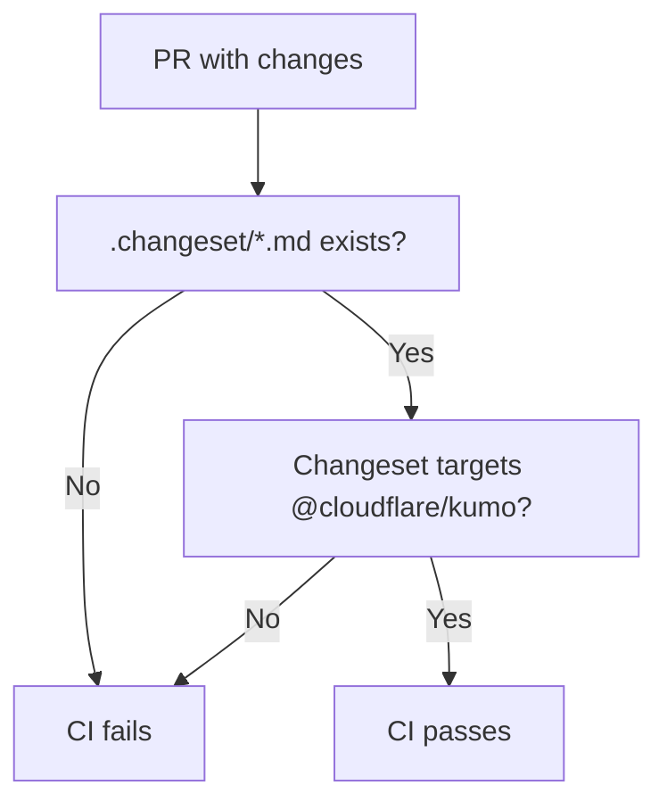
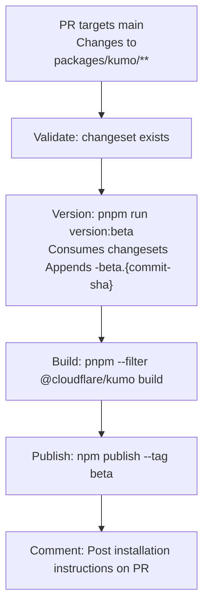
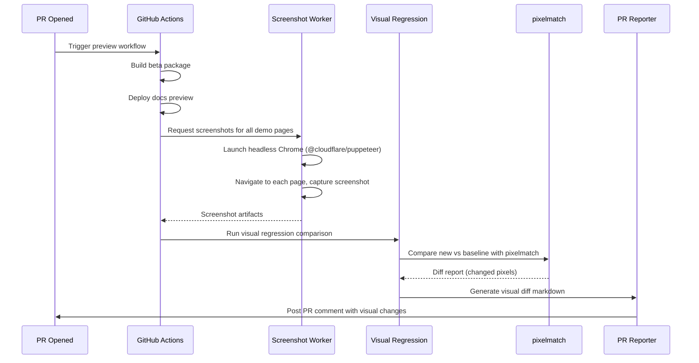
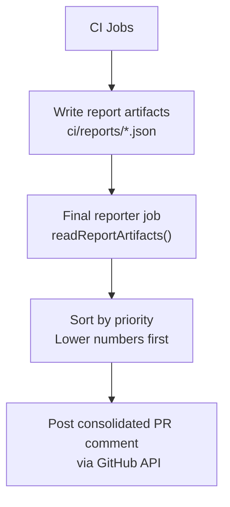
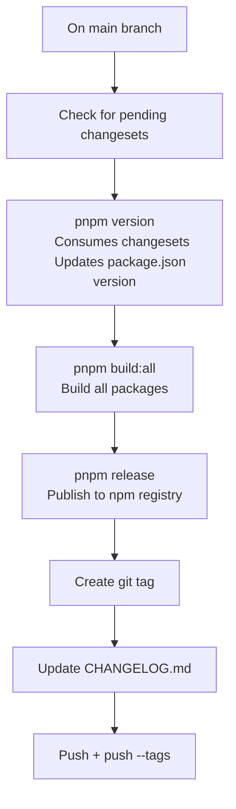

# Kumo CI/CD Pipeline

Kumo's CI/CD pipeline handles changeset validation, beta publication, visual regression testing, and production release automation. This document covers the full pipeline from PR creation to production release.

**Source:** `/home/darkvoid/Boxxed/@formulas/src.rust/src.AI/src.UIComponents/kumo/ci/` and `.github/workflows/`

## Pipeline Overview

```mermaid
flowchart LR
    PR["PR Created"] --> VALID["Validate PR Description
    validate-pr-description.yml"]
    VALID --> CHANGES["Validate Changeset
    validate-kumo-changeset.ts"]
    CHANGES --> BETA["Build Beta Release
    version-beta.sh → npm beta tag"]
    BETA --> SCREENSHOT["Screenshot Capture
    kumo-screenshot-worker"]
    SCREENSHOT --> VDIFF["Visual Regression
    pixelmatch comparison"]
    VDIFF --> REPORT["PR Report
    Consolidated comment"]
    REPORT --> MERGE["Merge to main"]
    MERGE --> RELEASE["Production Release
    release-production.sh"]
```



## Changeset Workflow

Kumo uses [changesets](https://github.com/changesets/changesets) for version management. Every PR with changes to `packages/kumo/` must include a changeset.

### Creating a Changeset

```bash
pnpm changeset
# Select @cloudflare/kumo
# Choose: patch | minor | major
# Write description
```

This creates a file in `.changeset/` like `bright-toasts-close.md`:

```markdown
---
"@cloudflare/kumo": patch
---

Fix toast close behavior.
```

### Validation

The changeset is validated by `ci/scripts/validate-kumo-changeset.ts`:



**Source:** `ci/scripts/validate-kumo-changeset.ts`, `.github/workflows/validate-pr-description.yml`.

### Pending Changesets

| Changeset | Type | Description |
|-----------|------|-------------|
| `blue-red-button-rings` | (pending) | Button ring style update |
| `bright-toasts-close` | patch | Toast close behavior fix |
| `fix-button-firefox-turnstile` | (pending) | Firefox Turnstile compatibility |
| `fix-dialog-size-width` | (pending) | Dialog size width correction |
| `flow-vertical-orientation` | (pending) | Flow vertical orientation |
| `fresh-otters-draw` | (pending) | Pending change |
| `spicy-maps-glow` | (pending) | Pending change |

**Source:** `.changeset/*.md` files at kumo root.

## Beta Publication

PRs with changes to `packages/kumo/**` or `.changeset/**` trigger automatic beta releases via `.github/workflows/preview.yml`:



**Beta version format:** `{base-version}-beta.{commit-sha}`

Example: `2.6.0-beta.a1b2c3d`

### Beta Scripts

| Script | Purpose |
|--------|---------|
| `ci/versioning/version-beta.sh` | Create beta version from changesets |
| `ci/versioning/publish-beta.sh` | Publish beta to npm |
| `ci/versioning/deploy-kumo-docs-preview.sh` | Deploy docs preview to Cloudflare Pages |
| `ci/versioning/deploy-kumo-docs-staging.sh` | Deploy docs to staging environment |

**Source:** `ci/versioning/` directory.

## Visual Regression Testing

### Pipeline



### Components

**Screenshot Worker** (`packages/kumo-screenshot-worker/`):
- Built on Hono + `@cloudflare/puppeteer`
- Runs on Cloudflare Workers
- Accepts HTTP requests with page URLs
- Returns screenshot images

**Visual Regression Runner** (`ci/visual-regression/run-visual-regression.ts`):
- Reads page configuration from `page-config.ts`
- Calls screenshot worker for each page
- Compares against baseline using `pixelmatch`
- Generates report markdown

**Reporter** (`ci/reporters/visual-regression.ts`):
- Implements the `Reporter` interface
- Collects `visualRegressionReport` from CI context
- Returns `ReportItem` with priority 25 (previews group)

**Source:** `ci/visual-regression/`, `ci/reporters/visual-regression.ts`, `packages/kumo-screenshot-worker/`.

## PR Reporter System

Kumo uses a consolidated PR reporter system that aggregates reports from multiple CI jobs into a single PR comment.

### Reporter Interface

**Source:** `ci/reporters/types.ts`

```typescript
// ci/reporters/types.ts — Reporter interface
interface Reporter {
  id: string;       // Unique identifier (e.g., "visual-regression")
  name: string;     // Human-readable name
  collect(context: CIContext): Promise<ReportItem | null>;
}

interface ReportItem {
  id: string;       // Matches Reporter.id
  title: string;    // Section title in PR comment
  priority: number; // Sort order (10-19: release, 20-29: previews)
  content: string;  // Markdown content
  success: boolean; // Whether this report is successful
}
```

### Reporters

| Reporter | ID | Priority | Source |
|----------|----|----------|--------|
| npm-release | `npm-release` | 10-19 | `ci/reporters/npm-release.ts` |
| kumo-docs-preview | `kumo-docs-preview` | 20-29 | `ci/reporters/kumo-docs-preview.ts` |
| visual-regression | `visual-regression` | 25 | `ci/reporters/visual-regression.ts` |

### Report Flow



Report artifacts are written to `ci/reports/` as JSON files and collected by the final reporter job:

```typescript
// Each CI job writes its report:
writeReportArtifact({
  id: "npm-release",
  title: "NPM Release",
  priority: 10,
  content: "Published @cloudflare/kumo@2.6.0",
  success: true,
});

// Final job collects and consolidates:
const { items } = readReportArtifacts();
items.sort((a, b) => a.priority - b.priority);
// Post as PR comment
```

**Source:** `ci/reporters/types.ts` lines 102-143.

### CI Utilities

| Utility | Purpose | Source |
|---------|---------|--------|
| `github-api.ts` | GitHub API wrapper for PR comments | `ci/utils/github-api.ts` |
| `git-operations.ts` | Git operations (branch, commit, push) | `ci/utils/git-operations.ts` |
| `pr-reporter.ts` | PR comment formatting and posting | `ci/utils/pr-reporter.ts` |

## Production Release

### Release Pipeline



### Production Scripts

| Script | Purpose |
|--------|---------|
| `ci/versioning/release-production.sh` | Run full production release |
| `ci/scripts/create-release-pr.ts` | Create release PR automatically |
| `ci/scripts/ensure-changeset-config.ts` | Validate changeset configuration |
| `ci/scripts/post-pr-report.ts` | Post consolidated PR report |
| `ci/scripts/write-npm-report.ts` | Generate npm release report |
| `ci/scripts/write-kumo-docs-report.ts` | Generate docs deploy report |

### Semantic Versioning

| Version Type | When to Use | Example |
|-------------|-------------|---------|
| Patch | Bug fixes, style tweaks, small updates | `2.6.0` → `2.6.1` |
| Minor | New components, new features | `2.6.0` → `2.7.0` |
| Major | Breaking changes, removed components | `2.6.0` → `3.0.0` |

**Source:** `kumo/packages/kumo/README.md` lines 478-484.

## GitHub Workflows

### Workflow Matrix

| Workflow | Trigger | Purpose |
|----------|---------|---------|
| `preview.yml` | PR with kumo changes | Build + publish beta |
| `preview-deploy.yml` | PR with docs changes | Deploy docs preview |
| `bonk.yml` | Push to main | Main CI pipeline |
| `bonk-check.yml` | PR | CI status check |
| `bigbonk.yml` | Scheduled/trigger | Extended CI |
| `pullrequest.yml` | PR opened/updated | PR validation |
| `release.yml` | Release tag | Production release |
| `reviewer.yml` | PR review | Review automation |
| `semgrep.yml` | Push/PR | Security scanning |
| `validate-pr-description.yml` | PR opened | PR description validation |

### PR Description Validation

The `validate-pr-description.test.ts` and `validate-pr-description.ts` in `tools/deployments/` validate that PR descriptions meet Kumo's requirements:

- Must describe what changed
- Must include screenshots for visual changes
- Must reference the changeset

**Source:** `tools/deployments/validate-pr-description.ts`.

## Next

Continue to [05-mapcn](05-mapcn.md) for mapcn's MapLibre registry and pre-built block documentation.
