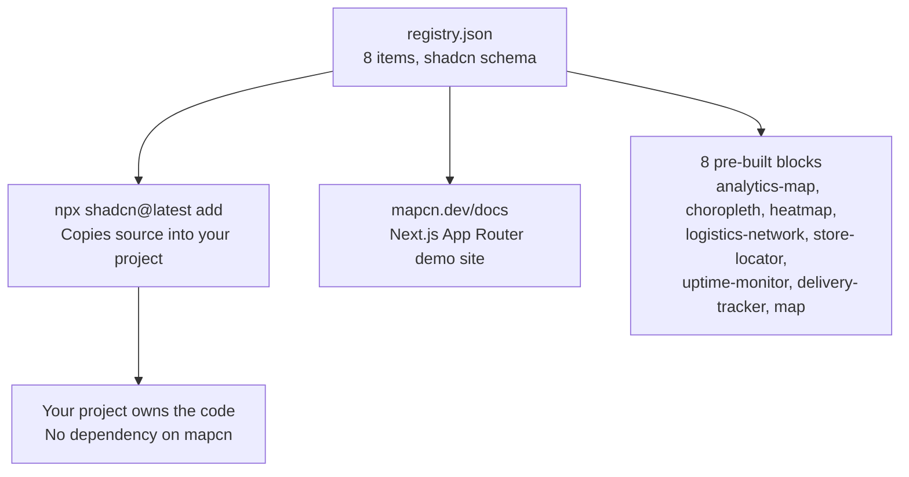
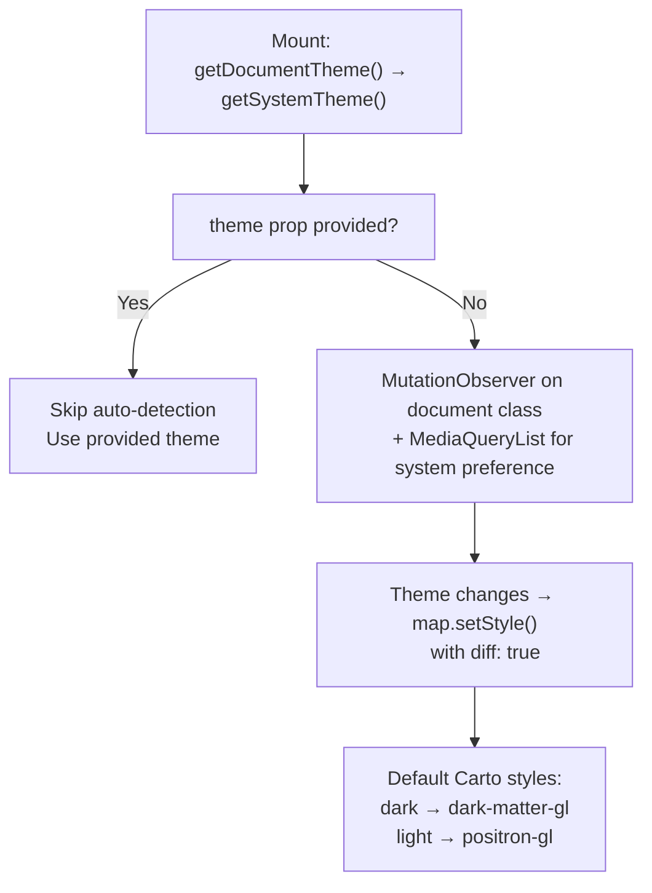
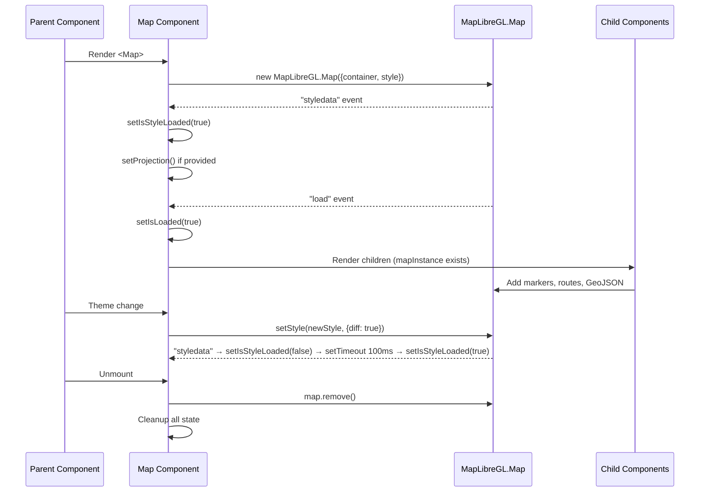

# mapcn: MapLibre Registry and Blocks

mapcn is a shadcn/ui-style component registry for maps powered by MapLibre GL. Instead of publishing an npm package, it uses the `shadcn` CLI to copy component source directly into your project.

**Source:** `/home/darkvoid/Boxxed/@formulas/src.rust/src.AI/src.UIComponents/mapcn/`

## Registry Architecture



**Aha:** The shadcn registry pattern means you **own** the code after installation. Unlike an npm package where updates come from the registry, shadcn-copied components are yours to modify. The trade-off is you don't get updates automatically — you must re-run `npx shadcn add` to get new versions. This is ideal for map components where you'll likely customize the styles and behavior heavily.

## The Map Component

The core `Map` component (`src/registry/map.tsx`, 2192 lines) is a comprehensive MapLibre GL wrapper providing markers, popups, routes, arcs, GeoJSON layers, clusters, controls, and automatic theme handling — all in a single file.

**Source:** `src/registry/map.tsx`

### Exports

| Export | Type | Purpose |
|--------|------|---------|
| `Map` | Component | Main map wrapper with MapLibreGL.Map lifecycle |
| `useMap` | Hook | Access map instance from context |
| `MapMarker` | Component | Marker with custom content |
| `MarkerContent` | Component | Marker body (custom JSX) |
| `MarkerPopup` | Component | Popup attached to marker |
| `MarkerTooltip` | Component | Tooltip attached to marker |
| `MarkerLabel` | Component | Text label on marker |
| `MapPopup` | Component | Standalone popup (not attached to marker) |
| `MapControls` | Component | Zoom, geolocate, fullscreen, compass controls |
| `MapRoute` | Component | Line route between coordinates |
| `MapArc` | Component | Curved arc between two coordinates |
| `MapGeoJSON` | Component | GeoJSON source + layer rendering |
| `MapClusterLayer` | Component | Clustered point layer with expansion |

### Map Props

```typescript
// src/registry/map.tsx — Map component interface
type MapProps = {
  children?: ReactNode;
  className?: string;
  theme?: "light" | "dark";
  styles?: { light?: MapStyleOption; dark?: MapStyleOption };
  blank?: boolean;               // Transparent basemap for data viz
  projection?: ProjectionSpecification;
  viewport?: Partial<MapViewport>;
  onViewportChange?: (viewport: MapViewport) => void;
  loading?: boolean;
} & Omit<MapLibreGL.MapOptions, "container" | "style">;

type MapViewport = {
  center: [number, number];      // [longitude, latitude]
  zoom: number;
  bearing: number;               // Rotation in degrees
  pitch: number;                 // Tilt in degrees
};
```

### Theme Detection

The Map component automatically detects and reacts to theme changes:



**Source:** `src/registry/map.tsx` lines 70-123 (`useResolvedTheme` hook).

**Aha:** The theme detection uses **two** observation mechanisms: a `MutationObserver` on `document.documentElement` for CSS class changes (from `next-themes` or manual toggling) and a `MediaQueryList` listener for system preference changes. The `theme` prop overrides auto-detection entirely — if you pass `theme="dark"`, the observer is disconnected.

### Blank Mode

The `blank` prop opts into a transparent, tile-less basemap:

```typescript
// src/registry/map.tsx:34-44 — Blank map style
const blankMapStyle: MapLibreGL.StyleSpecification = {
  version: 8,
  sources: {},
  layers: [{
    id: "background",
    type: "background",
    paint: { "background-color": "rgba(0, 0, 0, 0)" },
  }],
};
```

This is ideal for choropleths, arcs, and dot maps where you draw your own layers and don't need street basemap context. The transparent background lets your themed container show through.

### Controlled Viewport

The Map supports controlled viewport mode:

```tsx
<Map viewport={viewport} onViewportChange={setViewport}>
  {/* Map is now controlled by your state */}
</Map>
```

When both `viewport` and `onViewportChange` are provided, the map becomes controlled — the viewport is driven entirely by your state. The component uses an `internalUpdateRef` to prevent feedback loops where the map's own `move` event triggers the callback which triggers another update.

**Source:** `src/registry/map.tsx` lines 242, 330-355.

### Map Lifecycle



**Source:** `src/registry/map.tsx` lines 272-327 (init), 358-371 (style change), 316-325 (cleanup).

**Aha:** The `setStyle` call uses `{ diff: true }` to perform a diff-based style update rather than a full reload. This preserves existing layers and markers during theme switches. However, there's a 100ms delay (`styleTimeoutRef`) after `styledata` fires before setting `isStyleLoaded(true)` — this is a workaround for race conditions where layer operations would fail before the style is fully processed.

## Pre-built Blocks

mapcn ships 7 pre-built block examples (plus the base `map` component). Each block is a complete page with data, components, and layout.

### Block Catalog

| Block | Type | Description | Files | iframe Height |
|-------|------|-------------|-------|--------------|
| `map` | `registry:ui` | Base MapLibre component with all features | `src/registry/map.tsx` | — |
| `analytics-map` | `registry:block` | World map + overview cards + device stats | 4 files | 940px |
| `choropleth` | `registry:block` | Country shading by metric with hover tooltip | 3 files | 720px |
| `uptime-monitor` | `registry:block` | Edge network health map with status sidebar | 4 files | 720px |
| `logistics-network` | `registry:block` | Domestic logistics map with filter sidebar | 4 files | 800px |
| `store-locator` | `registry:block` | Searchable store list synced to map markers | 4 files | 800px |
| `heatmap` | `registry:block` | Globe-projected earthquake density heatmap | 1 file | 800px |
| `delivery-tracker` | `registry:block` | Live order tracking with route progress | 2 files | 720px |

**Source:** `registry.json` (345 lines, 8 items).

### Installation

```bash
# Install the base map component
npx shadcn@latest add "https://mapcn.dev/r/map.json"

# Install a specific block
npx shadcn@latest add "https://mapcn.dev/r/choropleth.json"
npx shadcn@latest add "https://mapcn.dev/r/store-locator.json"
```

### Block Details

#### Choropleth

Renders a world choropleth (thematic map) with countries shaded by a metric value. Includes a hover tooltip showing the country name and value.

**Files:** `page.tsx`, `data.ts`, `use-world-data.ts`

Uses the `blank` prop on the Map component for a transparent basemap, then draws GeoJSON country polygons with fill colors based on data values.

#### Analytics Map

Dashboard-style analytics page showing a world map alongside overview cards and device breakdown charts.

**Files:** `page.tsx`, `data.ts`, `overview-card.tsx`, `breakdown-card.tsx`

Uses Recharts for the charts and mapcn's Map for the world visualization.

#### Uptime Monitor

Status-page style map showing edge network locations with health status, latency, and uptime indicators.

**Files:** `page.tsx`, `data.ts`, `edge-node-marker.tsx`, `status-sidebar.tsx`

Custom markers show node health with color-coded indicators.

#### Logistics Network

Domestic logistics map with a sidebar of statistics and filters.

**Files:** `page.tsx`, `data.ts`, `filter-sidebar.tsx`, `network-map.tsx`

Uses MapRoute for shipping routes and MapMarker for warehouse/depot locations.

#### Store Locator

Searchable store list with results synced to map markers.

**Files:** `page.tsx`, `data.ts`, `store-list.tsx`, `locator-map.tsx`

The store list and map markers are linked — selecting a store in the list highlights its marker on the map and vice versa.

#### Heatmap

Globe-projected heatmap visualizing earthquake density with zoom-dependent styling.

**Files:** `page.tsx` (single file — all logic inline)

Uses `{ type: "globe" }` projection for a 3D globe view and MapLibre's heatmap layer for density visualization.

#### Delivery Tracker

Live order tracking showing a route with progress indicator and courier position.

**Files:** `page.tsx`, `data.ts`

Uses MapRoute to show the delivery path with a moving marker for the courier.

## Registry JSON Schema

The `registry.json` follows the shadcn schema (`$schema: "https://ui.shadcn.com/schema/registry.json"`):

```json
{
  "name": "mapcn",
  "homepage": "https://mapcn.dev",
  "items": [
    {
      "name": "map",
      "type": "registry:ui",
      "title": "Map",
      "description": "A MapLibre-powered map component...",
      "dependencies": ["maplibre-gl", "lucide-react"],
      "registryDependencies": [],
      "files": [...],
      "css": { ... },
      "meta": { "components": [...] }
    }
  ]
}
```

Each item has:
- **`name`** — Unique identifier for `npx shadcn add {name}`
- **`type`** — `registry:ui`, `registry:block`, `registry:lib`, `registry:page`, `registry:component`
- **`dependencies`** — npm packages to install
- **`registryDependencies`** — Other registry items this depends on
- **`files`** — Files to copy into the target project
- **`css`** — CSS to inject (MapLibre popup styles, etc.)
- **`meta`** — Additional metadata (component list, iframe height)

**Source:** `registry.json` structure, `mapcn/package.json`.

## UI Components

mapcn includes 18 shadcn/ui components for the documentation site:

```
src/components/ui/
  badge.tsx, breadcrumb.tsx, button-group.tsx, button.tsx, card.tsx,
  chart.tsx, collapsible.tsx, command.tsx, dialog.tsx, dropdown-menu.tsx,
  input.tsx, kbd.tsx, separator.tsx, sheet.tsx, sidebar.tsx, skeleton.tsx,
  table.tsx, tabs.tsx, tooltip.tsx
```

These are standard shadcn/ui components and are NOT part of the registry — they exist only for the docs site itself.

**Source:** `mapcn/src/components/ui/` directory listing.

## Site Components and Navigation

The mapcn docs site includes:

- **Header** — Logo, navigation, GitHub button, theme toggle
- **Command Search** — `cmdk`-powered search for components and blocks
- **Mobile Navigation** — Responsive sidebar drawer
- **Footer** — Links and attribution
- **LLM.txt Route** — `/llms.txt` endpoint for AI tools (`src/app/llms.txt/route.ts`)

**Source:** `mapcn/src/components/`, `mapcn/src/app/llms.txt/route.ts`.

## Library Utilities

| Utility | Purpose | Source |
|---------|---------|--------|
| `use-world-data.ts` | Hook for fetching world GeoJSON data | `src/lib/use-world-data.ts` |
| `blocks.ts` | Block registry enumeration | `src/lib/blocks.ts` |
| `events.ts` | Event type definitions | `src/lib/events.ts` |
| `get-block-file-source.ts` | File source retrieval for code display | `src/lib/get-block-file-source.ts` |
| `highlight.ts` | Syntax highlighting for code blocks | `src/lib/highlight.ts` |
| `llm-content.ts` | LLM.txt content generation | `src/lib/llm-content.ts` |
| `llm-prompts.ts` | LLM prompt templates | `src/lib/llm-prompts.ts` |
| `site-navigation.ts` | Navigation configuration | `src/lib/site-navigation.ts` |
| `utils.ts` | `cn()` helper (clsx + tailwind-merge) | `src/lib/utils.ts` |

## Next

Continue to [06-next-maps](06-next-maps.md) for the Mapbox-based next-maps project documentation.
