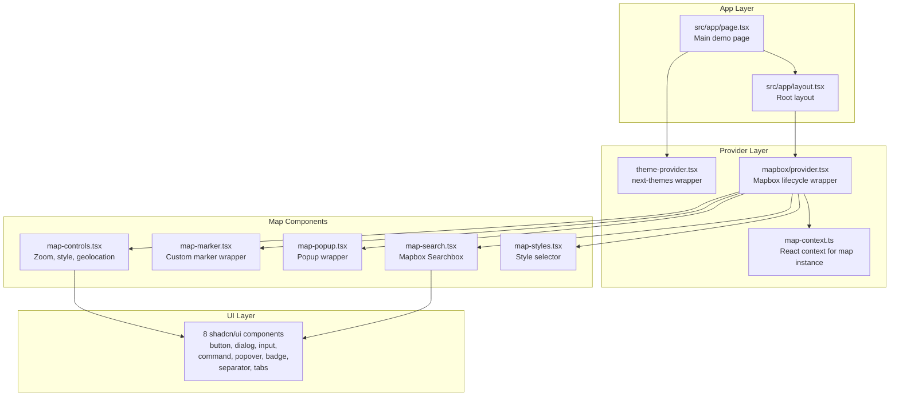
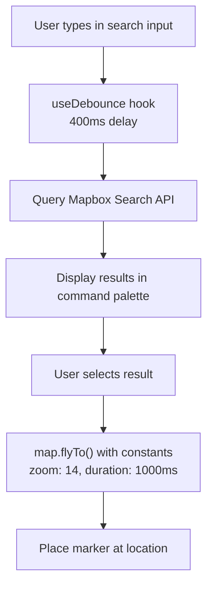

# next-maps: Mapbox Integration

next-maps is a Next.js showcase project demonstrating Mapbox GL JS integration with shadcn/ui components. Unlike mapcn (which is a reusable registry), next-maps is a standalone application you can fork and customize.

**Source:** `/home/darkvoid/Boxxed/@formulas/src.rust/src.AI/src.UIComponents/next-maps/`

## Architecture



## Map Context

The MapContext provides the Mapbox `map` instance to all child components:

```typescript
// src/context/map-context.ts
interface MapContextType {
  map: mapboxgl.Map;
}

const MapContext = createContext<MapContextType | null>(null);

function useMap() {
  const context = useContext(MapContext);
  if (!context) {
    throw new Error("useMap must be used within a MapProvider");
  }
  return context;
}
```

**Source:** `src/context/map-context.ts`.

## Mapbox Provider

The MapProvider manages the Mapbox map lifecycle:

```typescript
// src/lib/mapbox/provider.tsx — key sections
mapboxgl.accessToken = process.env.NEXT_PUBLIC_MAPBOX_TOKEN!;

// Initialize
const mapInstance = new mapboxgl.Map({
  container: mapContainerRef.current,
  style: "mapbox://styles/mapbox/standard",  // Mapbox Standard style
  center: [initialViewState.longitude, initialViewState.latitude],
  zoom: initialViewState.zoom,
  attributionControl: false,
  logoPosition: "bottom-right",
});

// Cleanup
return () => {
  mapInstance.off("load", onLoad);
  mapInstance.remove();
  mapRef.current = null;
};
```

**Source:** `src/lib/mapbox/provider.tsx`.

**Aha:** The provider uses `"mapbox://styles/mapbox/standard"` — this is Mapbox's newer Standard style (v2), which provides a 3D-rendered map with lighting effects. The older `mapbox://styles/mapbox/streets-v12` would give a flat 2D map. The `attributionControl: false` disables Mapbox's built-in attribution (likely provided elsewhere in the UI).

## Map Constants

Configuration constants for map behavior:

```typescript
// src/lib/mapbox/constants.ts
export const MAP_CONSTANTS = {
  FLY_TO: {
    ZOOM: 14,          // Zoom level for fly-to animation
    SPEED: 4,          // Animation speed
    DURATION: 1000,    // Animation duration (ms)
  },
  SEARCH: {
    DEBOUNCE_MS: 400,           // Search debounce (ms)
    DEFAULT_LIMIT: 5,           // Max search results
    DEFAULT_COUNTRY: "US",      // Default country for search
    DEFAULT_PROXIMITY: [-122.4194, 37.7749], // San Francisco
  },
} as const;
```

**Source:** `src/lib/mapbox/constants.ts`.

## Search Integration

The map search component integrates Mapbox's search functionality:



**Source:** `src/components/map/map-search.tsx`, `src/hooks/useDebounce.ts`.

### useDebounce Hook

```typescript
// src/hooks/useDebounce.ts
// Debounces a value by the specified delay
// Used for search input to avoid API spam
```

The hook takes a value and delay, returning the debounced value. When the user types rapidly, the search only fires 400ms after they stop — matching `MAP_CONSTANTS.SEARCH.DEBOUNCE_MS`.

## Map Components

### MapMarker

```tsx
// src/components/map/map-marker.tsx
// Wraps Mapbox Marker with custom element support
// Uses Lucide icons for marker appearance
```

### MapPopup

```tsx
// src/components/map/map-popup.tsx
// Wraps Mapbox Popup with shadcn/ui styling
// Supports arbitrary content
```

### MapControls

```tsx
// src/components/map/map-controls.tsx
// Floating control panel with:
// - Zoom in/out buttons
// - Geolocate (find user's position)
// - Map style toggle
```

### MapStyles

```tsx
// src/components/map/map-styles.tsx
// Style selector component
// Allows switching between Mapbox styles
```

## Map Utilities

| File | Purpose |
|------|---------|
| `src/lib/mapbox/api.ts` | Mapbox API wrapper functions |
| `src/lib/mapbox/constants.ts` | Configuration constants (zoom, search defaults) |
| `src/lib/mapbox/provider.tsx` | Mapbox lifecycle provider |
| `src/lib/mapbox/utils.tsx` | Utility functions for Mapbox operations |

**Source:** `src/lib/mapbox/` directory.

## Location Components

### LocationMarker

```tsx
// src/components/location-marker.tsx
// Custom marker component for displaying locations on the map
```

### LocationPopup

```tsx
// src/components/location-popup.tsx
// Popup content shown when clicking a location marker
```

## Stack

| Technology | Version | Purpose |
|-----------|---------|---------|
| Next.js | 15 (App Router) | React framework |
| Mapbox GL JS | latest | Map rendering |
| Tailwind CSS | latest | Styling |
| shadcn/ui | — | UI components |
| Lucide React | — | Icons |
| cmdk | — | Command palette (search) |
| @radix-ui/react-* | — | Accessible primitives |

**Source:** `next-maps/package.json`.

### Dependencies

```
next-maps
├── mapbox-gl                   (map rendering)
├── @radix-ui/react-dialog      (dialog/modal)
├── @radix-ui/react-popover     (popover)
├── @radix-ui/react-separator   (separator)
├── @radix-ui/react-slot        (polymorphic component)
├── @radix-ui/react-tabs        (tab navigation)
├── lucide-react                (icons)
├── cmdk                        (command palette / search)
├── class-variance-authority    (component variants)
├── clsx + tailwind-merge       (class merging)
└── @types/mapbox__mapbox-gl-geocoder
```

## Environment Variables

| Variable | Purpose | Required |
|----------|---------|----------|
| `NEXT_PUBLIC_MAPBOX_TOKEN` | Mapbox access token | Yes |

**Source:** `src/lib/mapbox/provider.tsx` line 10.

## Mapbox vs MapLibre Comparison

next-maps uses Mapbox GL JS while mapcn uses MapLibre GL. The key differences:

| Aspect | next-maps (Mapbox) | mapcn (MapLibre) |
|--------|-------------------|------------------|
| License | Proprietary (requires API key) | Open source (BSD) |
| Styles | `mapbox://styles/*` (hosted) | URL-based style JSON |
| Search | Mapbox Searchbox API (built-in) | Custom or third-party |
| 3D | Standard style (3D rendering) | Via projection config |
| Cost | Usage-based pricing | Free |
| Default Styles | streets-v12, satellite-v9, etc. | Carto basemaps (dark-matter, positron) |

**Aha:** next-maps is a **standalone application**, not a component registry. You fork it to customize — there's no `npx shadcn add` equivalent. This makes it better as a starting point for a custom map application, while mapcn is better for adding map functionality to an existing project.

## Next

Continue to [07-table-forge](07-table-forge.md) for the table-forge MDX-driven table showcase.
