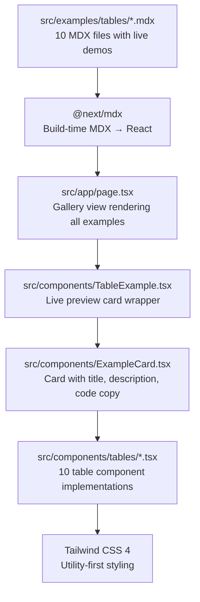

# table-forge: MDX-Driven Table Showcase

table-forge is a documentation site showcasing 10+ table component variations built with Tailwind CSS. Each table is documented via an MDX file that renders a live preview with one-click code copy.

**Source:** `/home/darkvoid/Boxxed/@formulas/src.rust/src.AI/src.UIComponents/table-forge/`

## Architecture



## MDX Pattern

Each table example follows the same MDX pattern:

```tsx
// src/examples/tables/BasicBordered.mdx
import ExampleCard from "@/components/ExampleCard";
import BasicBorderedTable from "@/components/tables/BasicBorderedTable";

export const meta = {
  id: "basic-bordered",
  title: "Basic Bordered",
  description: "Simple table with borders and striped header.",
  group: "Basic",
  codePath: "src/components/tables/BasicBorderedTable.tsx",
};

export default function Example() {
  return (
    <ExampleCard
      title={meta.title}
      description={meta.description}
      codePath={meta.codePath}
    >
      <BasicBorderedTable />
    </ExampleCard>
  );
}
```

**Source:** `src/examples/tables/BasicBordered.mdx`.

**Aha:** The `meta` export is a convention — each MDX file exports a `meta` object with `id`, `title`, `description`, `group`, and `codePath`. The `src/examples/index.ts` file imports all MDX files, validates their `meta` exports at runtime (`validateMeta`), and creates a unified `examples` array. This means adding a new table example is just creating the MDX file — the index auto-discovers it through the explicit imports, and `validateMeta` ensures no fields are missing.

## Example Groups

The 10 table examples are organized into 5 groups:

| Group | Examples | Count |
|-------|----------|-------|
| Basic | Basic Bordered, Striped Rows, Compact, Minimalist | 4 |
| Sorting | Sortable, Top Controls Sortable | 2 |
| Filtering | Filterable | 1 |
| Pagination | Pagination | 1 |
| Advanced | Responsive Cards on Mobile, With Actions | 2 |

**Source:** `src/examples/index.ts` lines 20-25 (`ExampleGroup` type), lines 49-100 (`examples` array).

## Example Meta Validation

```typescript
// src/examples/index.ts:39-46
const validateMeta = (meta: any, componentName: string): ExampleMeta => {
  const required = ["id", "title", "description", "group"];
  for (const field of required) {
    if (!meta[field]) {
      throw new Error(`Missing required field '${field}' in ${componentName}`);
    }
  }
  return meta as ExampleMeta;
};
```

This validates at import time that every MDX file has the required metadata. If a field is missing, the build fails with a clear error message.

## Table Components

All table implementations live in `src/components/tables/`:

| Component | File | Feature | Lines |
|-----------|------|---------|-------|
| `BasicBorderedTable` | `BasicBorderedTable.tsx` | Simple bordered table with striped header | — |
| `SortableTable` | `SortableTable.tsx` | Column sorting with ascending/descending toggle | 60+ |
| `FilterableTable` | `FilterableTable.tsx` | Row filtering via text input | — |
| `PaginatedTable` | `PaginatedTable.tsx` | Pagination with page controls | — |
| `StripedRowsTable` | `StripedRowsTable.tsx` | Alternating row colors | — |
| `CompactTable` | `CompactTable.tsx` | Dense layout for data-heavy tables | — |
| `WithActionsTable` | `WithActionsTable.tsx` | Action buttons per row (edit, delete) | — |
| `ResponsiveCardsOnMobile` | `ResponsiveCardsOnMobile.tsx` | Mobile card layout, desktop table | — |
| `MinimalistUI` | `MinimalistUI.tsx` | Minimal design with subtle styling | — |
| `TopControlsSortableTable` | `TopControlsSortableTable.tsx` | Sort + search controls above table | — |

### SortableTable Implementation

```typescript
// src/components/tables/SortableTable.tsx
// Key logic:
type Person = { name: string; title: string; email: string; role: string };
type SortKey = keyof Person;
type SortDirection = "asc" | "desc";

// Click column header → toggle sort key/direction
function onHeaderClick(key: SortKey) {
  if (key === sortKey) {
    setSortDirection((d) => (d === "asc" ? "desc" : "asc"));
  } else {
    setSortKey(key);
    setSortDirection("asc");
  }
}

// Memoized sorted data
const sorted = useMemo(() => {
  const data = [...initialData];
  data.sort((a, b) => {
    const aVal = String(a[sortKey]).toLowerCase();
    const bVal = String(b[sortKey]).toLowerCase();
    return sortDirection === "asc"
      ? aVal.localeCompare(bVal)
      : bVal.localeCompare(aVal);
  });
  return data;
}, [sortKey, sortDirection]);
```

**Source:** `src/components/tables/SortableTable.tsx`.

**Aha:** The sorting uses `String(a[sortKey]).toLowerCase()` for case-insensitive comparison and `localeCompare` for proper alphabetical ordering. The data array is spread (`[...initialData]`) before sorting to avoid mutating the original — a common React mistake that causes re-render loops. The `useMemo` ensures the sort only runs when `sortKey` or `sortDirection` changes.

## ExampleCard Component

The `ExampleCard` wraps each table with a consistent presentation:

```tsx
// src/components/ExampleCard.tsx
// Renders:
// - Title from meta.title
// - Description from meta.description
// - Live table preview (children)
// - Copy code button (reads from codePath)
```

The code copy button reads the source file from the `codePath` and copies it to the clipboard, enabling the one-click "grab the code" experience.

## MDX Configuration

table-forge uses `@next/mdx` for MDX processing:

```typescript
// next.config.ts
import nextMDX from "@next/mdx";

const withMDX = nextMDX({
  extension: /\.mdx$/,
});

export default withMDX({
  pageExtensions: ["ts", "tsx", "mdx"],
});
```

This enables `.mdx` files to be treated as pages and imported as React components. The `pageExtensions` array includes `"mdx"` so MDX files in `src/app/` become routes automatically.

**Source:** `table-forge/next.config.ts`.

## Stack

| Technology | Purpose |
|-----------|---------|
| Next.js 15 (App Router) | React framework |
| React 19 | UI library |
| Tailwind CSS 4 | Styling |
| @next/mdX | MDX processing |
| @mdx-js/loader + @mdx-js/react | MDX runtime |
| shadcn/ui (Button, Card, Tabs) | UI primitives |
| Lucide React | Icons |
| class-variance-authority | Component variants |
| clsx + tailwind-merge | Class merging |
| @vercel/analytics | Usage tracking |
| next-themes | Theme provider |

**Source:** `table-forge/package.json`.

### Zero Extra Dependencies

**Aha:** The table components themselves have **zero dependencies** beyond React and Tailwind CSS. No table library, no data grid package, no sorting/filtering utility. Every table is hand-coded with React state (`useState`, `useMemo`) and Tailwind classes. This means:
- Full control over behavior and styling
- No library overhead
- Easy to copy into any project
- Self-contained — each component file has everything it needs

## SEO Configuration

table-forge includes SEO metadata:

```
src/app/robots.ts    — Robots.txt generation
src/app/sitemap.ts   — Sitemap generation
src/lib/seo.ts       — SEO metadata configuration
```

**Source:** `src/app/robots.ts`, `src/app/sitemap.ts`, `src/lib/seo.ts`.

## Theme Support

```
src/components/theme/ThemeProvider.tsx  — Theme provider wrapper
src/components/theme/ThemeToggle.tsx    — Theme toggle button
```

Uses `next-themes` for light/dark mode with `localStorage` persistence.

**Source:** `src/components/theme/` directory.

## Layout

```
src/components/layout/Navbar.tsx    — Top navigation bar
src/components/layout/Footer.tsx    — Footer with links
```

## TablesGallery

The main page renders a gallery of all table examples:

```
src/app/page.tsx            — Main page
src/components/TablesGallery.tsx  — Gallery grid rendering all examples
```

The gallery groups examples by their `group` field (Basic, Sorting, Filtering, Pagination, Advanced) and renders each with its `ExampleCard` wrapper.

## Next

Continue to [08-cross-cutting](08-cross-cutting.md) for shared patterns across all four projects.
