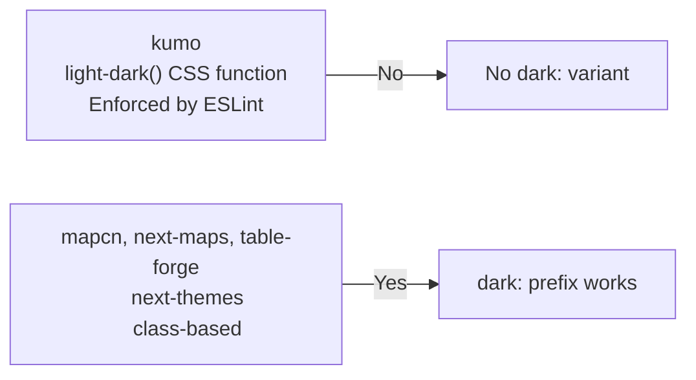
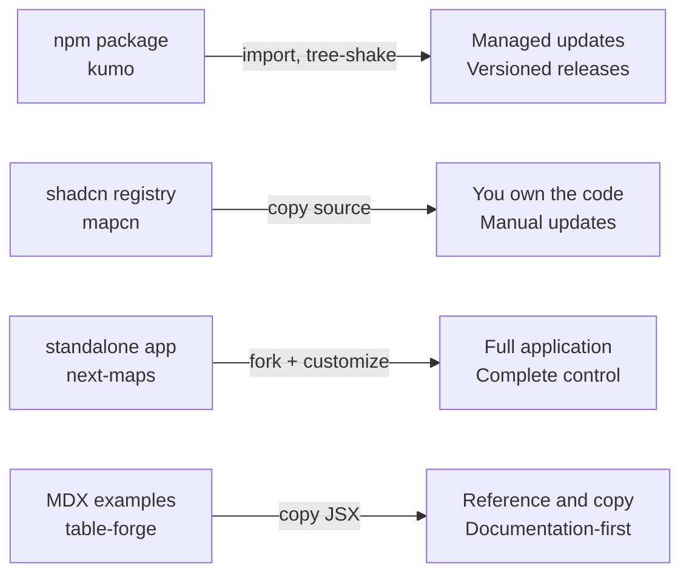

# Cross-Cutting Patterns

This document covers patterns shared across all four src.UIComponents projects — the common technologies, architectural decisions, and design philosophies that unite them.

## Shared Technology Stack

### Next.js 15 App Router

Three of four projects use Next.js 15 with the App Router:

| Project | Next.js Usage |
|---------|--------------|
| kumo-docs-astro | Astro (not Next.js) — kumo's docs site uses Astro |
| mapcn | Next.js 15, App Router, all UI components |
| next-maps | Next.js 15, App Router, map showcase |
| table-forge | Next.js 15, App Router, MDX processing |

**Aha:** mapcn, next-maps, and table-forge all use identical project structure — `src/app/layout.tsx` for root layout, `src/app/page.tsx` for the main page, `src/components/` for React components. This consistent pattern means anyone who understands one project's structure can navigate the others immediately.

### Tailwind CSS v4

All four projects use Tailwind CSS v4 with the new `@import "tailwindcss"` syntax:

```css
/* kumo */
@source "../node_modules/@cloudflare/kumo/dist/**/*.{js,jsx,ts,tsx}";
@import "@cloudflare/kumo/styles/tailwind";
@import "tailwindcss";

/* mapcn, next-maps, table-forge */
@import "tailwindcss";
```

Tailwind CSS v4 changes:
- No more `tailwind.config.js` required — uses CSS `@theme` directive
- `@source` directive for scanning `node_modules`
- Native CSS cascade layers support
- `light-dark()` function for automatic theme handling

**Source:** All projects' CSS entry files, kumo's `@source` directive at `packages/kumo/README.md` line 52.

### shadcn/ui Pattern

Three projects adopt the shadcn/ui approach:

| Project | shadcn Usage |
|---------|-------------|
| kumo | Not shadcn — uses Base UI primitives instead |
| mapcn | Full shadcn registry pattern for distribution |
| next-maps | shadcn components for UI wrapper |
| table-forge | shadcn components (Button, Card, Tabs) for site UI |

The shadcn pattern:
1. Define components with Tailwind CSS
2. Publish via `registry.json` following shadcn schema
3. Users install via `npx shadcn add` — source is **copied**, not imported
4. Users own the code — no dependency, no updates unless re-added

**Aha:** mapcn extends the shadcn pattern from UI components to entire **map blocks**. A shadcn registry item is typically a single component (Button, Card), but mapcn's items are full pages with data files, components, and layout. This is the "registry:block" type in the shadcn schema.

### clsx + tailwind-merge

All projects use the same class-merging pattern:

```typescript
// src/lib/utils.ts (mapcn, next-maps, table-forge)
import { clsx, type ClassValue } from "clsx";
import { twMerge } from "tailwind-merge";

export function cn(...inputs: ClassValue[]) {
  return twMerge(clsx(inputs));
}
```

This `cn()` utility merges Tailwind classes, resolving conflicts (e.g., `bg-red-500` and `bg-blue-500` merge to the last one, not both).

**Source:** `mapcn/src/lib/utils.ts`, `next-maps/src/lib/utils.ts`, `table-forge/src/lib/utils.ts`.

### Lucide React Icons

All Next.js-based projects use Lucide React for icons:

```tsx
import { X, Plus, Minus, Loader2 } from "lucide-react";
```

Lucide provides consistent, lightweight SVG icons with the same API across all projects.

## Theme Handling

All projects support light/dark themes, but use different approaches:

| Project | Theme Approach |
|---------|---------------|
| kumo | CSS `light-dark()` function, no `dark:` variant allowed |
| mapcn | `next-themes` + MutationObserver on document class |
| next-maps | `next-themes` |
| table-forge | `next-themes` |

**Aha:** kumo is the only project that forbids Tailwind's `dark:` variant entirely, enforcing semantic tokens only through a custom ESLint plugin. The other three projects use the standard `next-themes` approach which toggles a `dark` class on `document.documentElement`. kumo's approach is more robust because it doesn't depend on a CSS class — it uses the CSS `light-dark()` function which the browser resolves natively.

### Theme Comparison



## Component Distribution Spectrum

The four projects represent the full spectrum of React component distribution:



| Aspect | npm (kumo) | Registry (mapcn) | App (next-maps) | Examples (table-forge) |
|--------|-----------|-----------------|----------------|----------------------|
| Distribution | `pnpm add` | `npx shadcn add` | Fork repo | Copy from docs |
| Updates | `pnpm update` | Re-run `add` | Pull upstream | Manual |
| Customization | Override styles | Edit copied code | Full access | Copy and modify |
| Bundle Size | Tree-shakable | Only what you add | Full app | Copy what you need |
| Dependencies | Peer deps | Direct deps | All deps | Zero (tables) |

## Build and Testing Patterns

| Pattern | kumo | mapcn | next-maps | table-forge |
|---------|------|-------|-----------|-------------|
| TypeScript | Yes (strict) | Yes | Yes | Yes |
| Testing | Vitest (unit + browser) | None visible | None visible | None visible |
| Linting | oxlint + custom ESLint | ESLint + Prettier | ESLint + Prettier | ESLint + Prettier |
| CI/CD | Full GitHub Actions | None visible | None visible | Vercel deploy |
| Changesets | Yes | No | No | No |
| Visual Regression | Yes (screenshot worker) | No | No | No |

**Aha:** kumo has by far the most mature CI/CD infrastructure — changesets, visual regression testing, beta releases, automated PR reporting. The other three projects are lighter-weight with minimal CI. This reflects their different purposes: kumo is Cloudflare's production library (needs rigorous QA), while the others are showcase/documentation sites.

## Code Quality Patterns

### Consistent File Organization

All projects follow a similar structure:

```
src/
├── app/              # Next.js App Router (layout, page, routes)
├── components/       # React components
│   ├── ui/           # shadcn primitives
│   └── ...           # Domain-specific components
├── lib/              # Utilities and helpers
├── hooks/            # Custom React hooks
└── types/            # TypeScript type definitions
```

### Naming Conventions

| Convention | Example |
|-----------|---------|
| Components | PascalCase: `SortableTable`, `MapMarker` |
| Hooks | camelCase with `use` prefix: `useMap`, `useDebounce` |
| Files | kebab-case: `map-marker.tsx`, `sortable-table.tsx` |
| Constants | UPPER_SNAKE_CASE: `MAP_CONSTANTS`, `defaultStyles` |
| Types | PascalCase: `MapProps`, `MapViewport`, `ExampleMeta` |

## Aha Moments Across Projects

1. **kumo's generated primitives** — Base UI wrappers are codegen'd, not hand-written, keeping them in lockstep with Base UI updates.

2. **mapcn's registry:blocks** — Extending the shadcn registry from single components to full page blocks (choropleth, analytics dashboard, etc.).

3. **next-maps' controlled viewport** — Using `internalUpdateRef` to prevent feedback loops between the map's own events and controlled state updates.

4. **table-forge's zero-dependency tables** — All 10 table variations use only React + Tailwind, no table library, making them trivially portable to any project.

5. **kumo's AI registry** — Machine-readable component metadata generated from TypeScript types, enabling AI tools to understand component APIs without reading source code.

6. **mapcn's blank mode** — A transparent, tile-less basemap for data visualization, showing how to opt out of street maps entirely while keeping all MapLibre features.

## Next

You've completed the src.UIComponents documentation. Return to the [README](README.md) for the full index.
