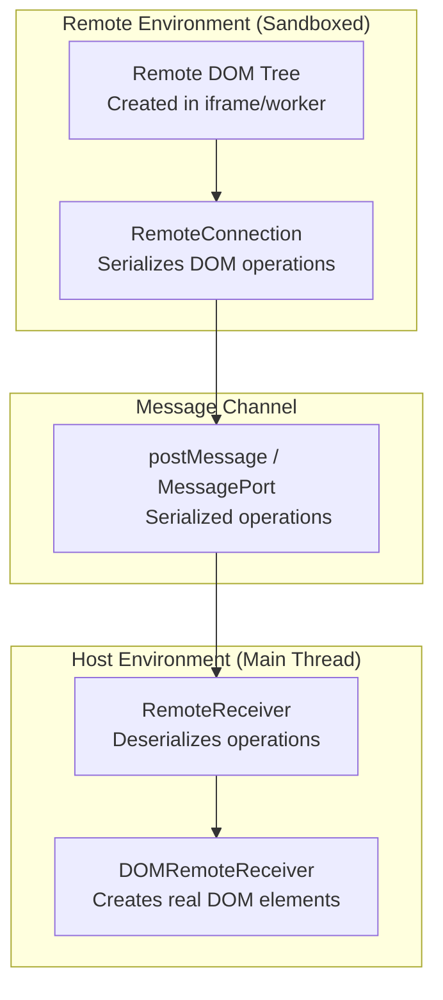

# Remote DOM: DOM Rendering from Sandboxed Environments

Remote DOM lets you take a tree of DOM elements created in a sandboxed JavaScript environment (iframe, web worker) and render them to the DOM in a different environment. This isolates potentially-untrusted code off the main thread while still allowing UI rendering.

**Source:** `/home/darkvoid/Boxxed/@formulas/src.rust/src.AI/src.UIComponents/remote-dom/`

## Architecture



**Aha:** The key insight is that Remote DOM doesn't serialize the entire DOM tree on each update. Instead, it serializes individual DOM *operations* (createElement, appendChild, setAttribute, etc.) and replays them on the host side. This makes updates incremental and efficient — only the changed operations are transmitted.

## Package Structure

| Package | Purpose | Files |
|---------|---------|-------|
| `@remote-dom/core` | Core connection and receiver types | 7 source files |
| `@remote-dom/react` | React bindings for remote rendering | 6 source files |
| `@remote-dom/preact` | Preact bindings (lightweight alternative) | 5 source files |
| `@remote-dom/signals` | Signal-based reactive receiver | 2 source files |
| `@remote-dom/compat` | Compatibility layer for older APIs | 1 source file |
| `@remote-dom/polyfill` | Minimal DOM API polyfill for workers | 30+ source files |

## @remote-dom/core

**Source:** `packages/core/source/`

### Types

```typescript
// packages/core/source/types.ts
// Core type definitions for Remote DOM
```

Defines:
- `RemoteNode` — serialized representation of a DOM node
- `RemoteElement` — serialized element with properties, children, event listeners
- `RemoteText` — serialized text node
- `RemoteReceiver` — interface for receiving remote operations

### Connection

```typescript
// packages/core/source/connection.ts
// RemoteConnection — serializes DOM operations and sends them to host
```

The `RemoteConnection` class:
- Accepts a `postMessage` function and a `MessagePort` or `postMessage` receiver
- Serializes DOM operations into a wire format
- Handles element references (mapping remote element IDs to host elements)
- Manages the connection lifecycle (connect, disconnect)

### Receivers

```typescript
// packages/core/source/receivers.ts
// RemoteReceiver implementations
```

#### RemoteReceiver (Base)

The base receiver that stores the remote tree in memory. Consumers can subscribe to changes and render the tree however they want.

#### DOMRemoteReceiver

Extends `RemoteReceiver` to create real DOM elements on the host side. When the remote environment creates an element, `DOMRemoteReceiver` creates a matching element on the host page.

### Elements

```typescript
// packages/core/source/elements.ts
// Element type definitions
```

### HTML

```typescript
// packages/core/source/html.ts
// HTML serialization utilities
```

### Constants

```typescript
// packages/core/source/constants.ts
// Wire format constants
```

Defines the message types used in the wire protocol:
- `REMOTE_ELEMENT_CREATE` — create a new element
- `REMOTE_ELEMENT_INSERT_CHILD` — append a child
- `REMOTE_ELEMENT_REMOVE_CHILD` — remove a child
- `REMOTE_ELEMENT_SET_PROPERTY` — set a property
- `REMOTE_ELEMENT_ADD_EVENT_LISTENER` — add event listener
- `REMOTE_ELEMENT_REMOVE_EVENT_LISTENER` — remove event listener
- `REMOTE_ELEMENT_REMOVE` — remove an element

## @remote-dom/react

**Source:** `packages/react/source/`

### RemoteComponent

```tsx
// packages/react/source/component.tsx
// RemoteComponent — renders children in a remote environment
```

Wraps children in a remote context, allowing them to render DOM elements that are synchronized to the host.

### Host

```typescript
// packages/react/source/host.ts
// Host component — receives and renders remote elements
```

The `Host` component creates a `DOMRemoteReceiver` and renders the remote tree as real DOM elements.

### HTML

```typescript
// packages/react/source/html.ts
// HTML rendering utilities for React
```

### Polyfill

```typescript
// packages/react/source/polyfill.ts
// Polyfill utilities for React in workers
```

## @remote-dom/preact

**Source:** `packages/preact/source/`

Same API as the React bindings but using Preact for a smaller bundle size. Ideal for web worker environments where bundle size matters.

## @remote-dom/signals

**Source:** `packages/signals/source/`

### SignalRemoteReceiver

A receiver that uses signals for reactive updates. When the remote tree changes, the signal updates, and any consumers re-render automatically.

## @remote-dom/polyfill

**Source:** `packages/polyfill/source/`

A minimal DOM API polyfill for web workers. This lets you run libraries that expect DOM APIs (like Preact or Svelte) inside a worker.

### Polyfilled APIs

| API | File | Purpose |
|-----|------|---------|
| `Attr` | `Attr.ts` | Attribute nodes |
| `CharacterData` | `CharacterData.ts` | Base for text nodes |
| `ChildNode` | `ChildNode.ts` | Mixin for child node operations |
| `Comment` | `Comment.ts` | Comment nodes |
| `CustomElementRegistry` | `CustomElementRegistry.ts` | Custom element registration |
| `CustomEvent` | `CustomEvent.ts` | Custom event creation |
| `Document` | `Document.ts` | Document object |
| `DocumentFragment` | `DocumentFragment.ts` | Document fragments |
| `Element` | `Element.ts` | Element base class |
| `Event` | `Event.ts` | Event object |
| `EventTarget` | `EventTarget.ts` | Event target base |
| `HTMLElement` | `HTMLElement.ts` | HTML element base |
| `Node` | `Node.ts` | Node base class |
| `Text` | `Text.ts` | Text nodes |
| `Window` | `Window.ts` | Window object |
| `MutationObserver` | `MutationObserver.ts` | DOM mutation tracking |

**Aha:** The polyfill doesn't implement the full DOM API — it implements just enough to let Preact and Svelte run inside a worker. The polyfilled DOM elements don't actually render anything; they build a virtual tree that gets serialized to the host via Remote DOM's connection layer.

## Examples

| Example | Purpose |
|---------|---------|
| `getting-started` | Basic usage: sync text between iframe and main page |
| `custom-element` | Extend to allow custom button elements |
| `kitchen-sink` | Full-featured implementation with custom elements, properties, events, methods |

The kitchen sink example is implemented in vanilla JS, htm, Preact, React, Svelte, and Vue — demonstrating that Remote DOM works with any framework.

## Use Cases

1. **Plugin UI isolation** — Run plugin UI in an iframe, render to main page
2. **Web worker UI** — Run UI libraries in a worker, render to main thread
3. **Sandboxed content** — Render untrusted content safely
4. **Micro-frontend** — Independent UI modules with isolated rendering

## Next

Continue to [10-kumo-deep](10-kumo-deep.md) for comprehensive source-level documentation of every kumo component and primitive.
