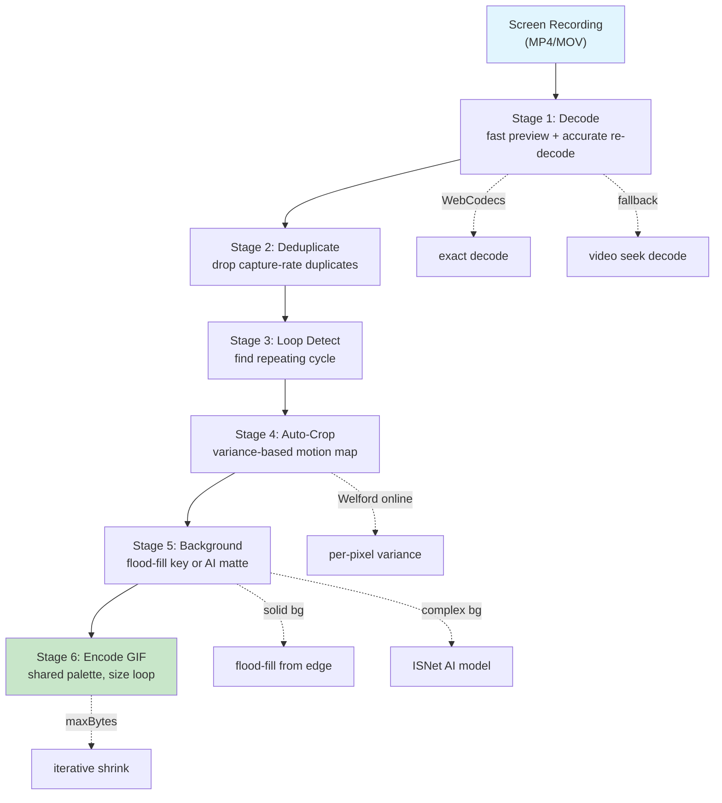
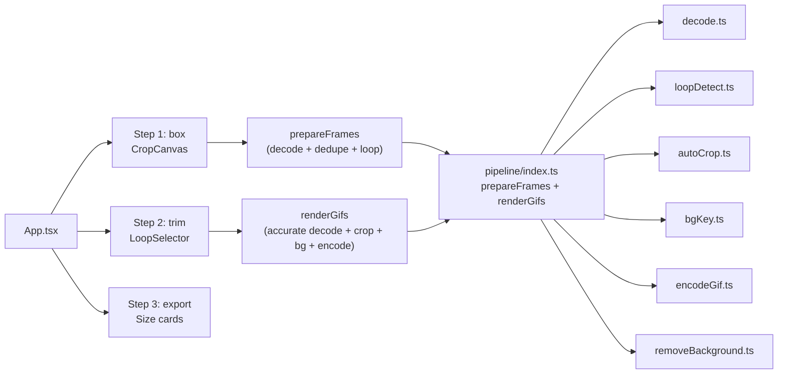

# steal-a-gif: Overview

Recover a clean, downloadable GIF from a screen recording of a hard-to-download animation. A complete 6-stage pipeline — decode, deduplicate, loop-detect, auto-crop, background key, encode — runs entirely in the browser. No server, no FFmpeg, no upload.

**Source:** `https://github.com/[...]/steal-a-gif` (private, single-page app)
**Location:** `/home/darkvoid/Boxxed/@formulas/src.rust/src.AI/src.UIComponents/steal-a-gif/`
**Version:** 0.0.0 (private, deployed on GitHub Pages)

## What Problem It Solves

You see an animation on TikTok, Xiaohongshu (XHS), YouTube, or a sticker picker — but there's no "download as GIF" button. So you screen-record it. But screen recordings have problems:

1. They include phone chrome (status bar, home indicator, rounded corners)
2. They're at 60fps while the animation is ~10fps (duplicated frames)
3. The loop start/end are buried in extra seconds of recording
4. They have a solid app background that makes the GIF look bad
5. They're MP4/MOV files, not GIFs

steal-a-gif fixes all five in the browser. You upload a screen recording, draw a crop box, pick the loop range, and get downloadable GIFs back.

Aha: The entire pipeline runs client-side. Decoding uses WebCodecs or `<video>` seek, deduplication uses 32×32 grayscale fingerprints, background removal uses either flood-fill (for solid-color sticker backgrounds) or ISNet AI matting, and GIF encoding uses a shared-palette approach to prevent frame shimmer. Nothing leaves the browser.

## The 6-Stage Pipeline



### Stage Details

| Stage | Source | Input | Output | Key Algorithm |
|-------|--------|-------|--------|---------------|
| Decode | `pipeline/decode.ts` | `File` (MP4/MOV) | `Frame[]` | WebCodecs decode + `<video>` seek fallback |
| Deduplicate | `pipeline/loopDetect.ts` | `Frame[]` | `Frame[]` (reduced) | 32×32 grayscale fingerprint, L1 distance |
| Loop Detect | `pipeline/loopDetect.ts` | `Frame[]` (deduped) | `{start, end, fps}` | Periodic autocorrelation over all candidate periods |
| Auto-Crop | `pipeline/autoCrop.ts` | `Frame[]`, rough crop | `Rect` (tight) | Welford online variance → bounding box of motion |
| BG Key | `pipeline/bgKey.ts` | `ImageData`, bg color | `ImageData` (alpha) | Flood-fill from frame border with feather ramp |
| Encode GIF | `pipeline/encodeGif.ts` | `ImageData[]`, opts | `Blob` (GIF) | Single shared palette, iterative shrink to maxBytes |

## Quick Start

```bash
cd steal-a-gif
npm install
npm run dev        # → http://localhost:5173
```

The app opens with a landing page showing sample clips (TikTok, XHS, YouTube). Click "Ghost" to load a sample, or upload your own screen recording.

## Architecture at a Glance



The app has a three-step wizard:
1. **box** — Draw a crop rectangle around the animation on the first frame
2. **trim** — Scrub through deduped frames and pick start/end of the loop
3. **export** — Choose output sizes, background removal, and generate GIFs

## Pipeline Architecture: Two-Pass Decode

The pipeline decodes twice:
1. **Preview pass** (`decodeForPreview`) — Fast, lossy decode via `<video>` playback at 0.5× speed with `requestVideoFrameCallback`. Grabs up to 900 frames. This drives the UI scrubber.
2. **Accurate pass** (`extractAccurateRange`) — For the final render, re-decode the exact time window with WebCodecs (every frame, precise timing). Falls back to `<video>` seek per frame when WebCodecs isn't available.

Aha: The preview decode is lossy (frames may be dropped under load), but that's fine — it only drives the UI. The accurate decode is what matters for the final GIF, and it's triggered only after the user picks their loop range. This two-pass design means the UI feels instant while the final output is pixel-perfect.

## Key Constants

Source: `pipeline/types.ts`

```ts
export const SLACK_EMOJI_BYTES = 128 * 1024;  // 131,072 bytes
export const SLACK_EMOJI_EDGE = 128;           // 128px longest edge
```

Slack's animated emoji limit: 128KB max file size, 128px max edge.

## Package Structure

```
steal-a-gif/
├── src/
│   ├── App.tsx              # Main app: 3-step wizard (box → trim → export)
│   ├── main.tsx             # React 19 entry point
│   ├── styles.css           # Brand styles, dark theme
│   ├── vite-env.d.ts        # Vite type declarations
│   └── pipeline/
│       ├── index.ts         # prepareFrames + renderGifs (orchestrator)
│       ├── types.ts         # Frame, Rect, LoopRange, ExportOptions
│       ├── decode.ts        # Two-pass: preview + accurate decode
│       ├── loopDetect.ts    # fingerprint, dedupe, detectLoop
│       ├── autoCrop.ts      # Variance-based motion bounding box
│       ├── bgKey.ts         # Flood-fill background removal
│       ├── removeBackground.ts  # ISNet AI background removal
│       └── encodeGif.ts     # gifenc with shared palette, size loop
├── src/ui/
│   ├── CropCanvas.tsx       # Interactive crop box on first frame
│   └── LoopSelector.tsx     # Frame scrubber with loop range selection
├── scripts/
│   ├── lib.cjs              # Puppeteer launch helper
│   ├── e2e.cjs              # End-to-end smoke test
│   ├── scroll-test.cjs      # Scroll behavior test
│   ├── extract-thumbnails.cjs  # Regenerate sample thumbnails
│   └── og-card.cjs          # Generate OG/Twitter card images
├── public/
│   └── samples/             # Sample MP4 clips + thumbnails
├── package.json             # private, React 19, gifenc, mp4box
├── vite.config.ts           # COOP/COEP headers for WebCodecs
└── tsconfig.json            # TypeScript 5.7
```

## Dependencies

| Package | Purpose |
|---------|---------|
| `gifenc` | GIF encoding with quantize + applyPalette |
| `mp4box` | MP4 demuxing for accurate frame extraction |
| `@imgly/background-removal` | ISNet AI matting model (WebGPU) |
| `react` / `react-dom` | React 19 UI |
| `@resvg/resvg-js` | (dev) OG card SVG→PNG rendering |
| `puppeteer-core` | (dev) E2E testing |

## Related Documents

- [Pipeline Deep Dive](01-pipeline.md) — All 6 stages in detail
- [UI Components](02-ui.md) — CropCanvas, LoopSelector, App wizard
- [Types & Data Flow](03-types.md) — Frame, Rect, LoopRange, data flow between stages
- [Scripts & Tooling](04-scripts.md) — E2E tests, thumbnail extraction, OG card generation

[Next → Pipeline Deep Dive](01-pipeline.md)
