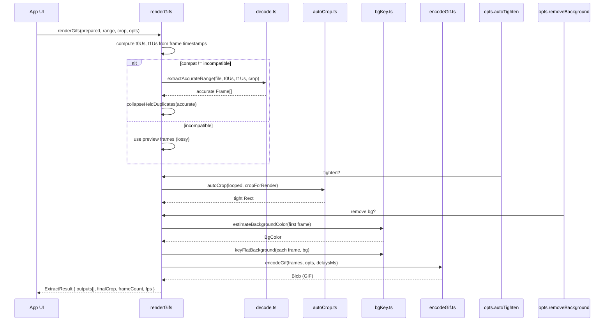

# Pipeline Deep Dive

The core pipeline is a 6-stage pipeline: decode → deduplicate → loop-detect → auto-crop → background key → encode. The orchestrator (`pipeline/index.ts`) exposes two functions: `prepareFrames()` (stages 1-3 for the UI) and `renderGifs()` (stages 1, 4, 5, 6 for the final output).

Source: `pipeline/index.ts` — orchestrator, ~200 lines.

## prepareFrames: Fast Setup for the UI

```ts
// pipeline/index.ts:40-70
export async function prepareFrames(file: File): Promise<Prepared> {
  const compat = await probeDecodability(file);
  const raw = await decodeForPreview(file);
  if (raw.length === 0) throw new Error("No frames decoded from this file");

  const width = raw[0].bitmap.width;
  const height = raw[0].bitmap.height;
  const full: Rect = { x: 0, y: 0, width, height };

  const prints = await fingerprintFrames(raw, full);
  const { frames, prints: dprints } = dedupeFrames(raw, prints);
  const loop = detectLoop(frames, dprints);

  return { frames, fps: loop.fps, width, height,
    suggested: { start: loop.startIndex, end: loop.endIndex },
    file, compat };
}
```

This runs once when the user uploads a file. It:
1. Probes how the browser can decode the file (WebCodecs, fallback, or incompatible)
2. Decodes up to 900 preview frames (fast, lossy)
3. Fingerprints each frame to a 32×32 grayscale grid
4. Deduplicates consecutive identical frames
5. Detects the loop cycle
6. Returns a `Prepared` object

## renderGifs: Final Output Generation

```ts
// pipeline/index.ts:72-160
export async function renderGifs(
  prepared: Prepared,
  range: { start: number; end: number },
  crop: Rect,
  opts: { removeBackground: boolean; autoTighten: boolean; sizes: SizeSpec[] },
  onStage?: (stage: Stage, detail?: string) => void,
): Promise<ExtractResult> {
```

This runs when the user clicks "Make GIF". It:
1. Computes the time window from the chosen frame range
2. Re-decodes accurately (WebCodecs or video seek)
3. Collapses held duplicates in the accurate frames
4. Auto-tightens the crop (optional)
5. Removes/keys the background (optional)
6. Encodes to one or more GIF sizes



## Stage 1: Decode

Source: `pipeline/decode.ts` — ~350 lines.

### Two Decode Modes

**Preview decode** (`decodeForPreview`):
```ts
// pipeline/decode.ts:83-95
export async function decodeForPreview(
  file: File, opts: { maxFrames?: number } = {},
): Promise<Frame[]> {
  const maxFrames = opts.maxFrames ?? 900;
  const url = URL.createObjectURL(file);
  try {
    return await captureByPlayback(url, maxFrames);
  } finally {
    URL.revokeObjectURL(url);
  }
}
```

Plays the video at 0.5× speed, capturing frames via `requestVideoFrameCallback`. Fast but may drop frames under load. Only drives the UI.

**Accurate decode** (`extractAccurateRange`):
```ts
// pipeline/decode.ts:140-220
export async function extractAccurateRange(
  file: File, t0Us: number, t1Us: number,
  crop: Rect,
  onProgress?: (done: number, total: number) => void,
): Promise<Frame[]> {
```

For the final render. Two sub-modes:
- **WebCodecs**: demux with mp4box, feed to VideoDecoder. Every frame, exact timing.
- **Fallback**: demux timestamps with mp4box, then `<video>.currentTime = timestamp` for each frame. Slower but works for HEVC and other non-WebCodecs codecs.

### Memory-Bounded Crop at Decode Time

Aha: The `cropSpec` function bounds total memory across all decoded frames. It reads `navigator.deviceMemory` (Chrome/Android only) and caps the budget at 120MB-300MB. Each frame's longest edge is scaled down so that `nFrames × width × height × 4 bytes` stays within budget. Safari doesn't report `deviceMemory`, so it assumes a conservative 150MB budget.

```ts
// pipeline/decode.ts:24-45
const dm = (navigator as Navigator & { deviceMemory?: number }).deviceMemory;
const MEM_BUDGET = dm ? Math.max(120e6, Math.min(300e6, dm * 36e6)) : 150e6;
const cap = Math.max(256, Math.min(1280,
  Math.floor(Math.sqrt(MEM_BUDGET / (4 * Math.max(1, nFrames))))));
```

### Safari Workaround

Aha: Safari ignores the source rectangle when creating `ImageBitmap` from a `VideoFrame` — it returns the whole frame squished, causing the "still-OOM bug." The workaround: draw the full frame onto a canvas (which Safari honors), then crop FROM that canvas. One full canvas is the only full-resolution buffer ever held.

```ts
// pipeline/decode.ts:61-77
function cropFromFull(full, source, srcW, srcH, cs) {
  full.ctx.drawImage(source, 0, 0, srcW, srcH);
  const small = makeCanvas(cs.resizeW, cs.resizeH);
  const sctx = small.getContext("2d");
  sctx.drawImage(full.canvas, cs.x, cs.y, cs.w, cs.h, 0, 0, cs.resizeW, cs.resizeH);
  return createImageBitmap(small);
}
```

### Decodability Probe

```ts
// pipeline/decode.ts (probeDecodability)
export async function probeDecodability(file: File): Promise<"webcodecs" | "fallback" | "incompatible"> {
```

Tests whether WebCodecs can decode the file. If not, tests if `<video>` can. Returns:
- `"webcodecs"` — exact decode possible
- `"fallback"` — video seek decode works
- `"incompatible"` — nothing works (e.g., HEVC in Firefox)

The probe runs BEFORE the user crops/trims, so the app can warn early.

## Stage 2: Deduplication

Source: `pipeline/loopDetect.ts` — ~196 lines.

Screen recordings capture at 60fps but the animation runs at ~10fps. Each animation frame is captured 6× in a row. These duplicates must be removed.

```ts
// pipeline/loopDetect.ts:28-60
export function dedupeFrames(frames, prints, opts: { epsilon?: number } = {}) {
  const eps = opts.epsilon ?? 0.004; // mean per-pixel delta
  const keptIdx = [0];
  for (let i = 1; i < frames.length; i++) {
    if (l1(prints[i], prints[keptIdx[keptIdx.length - 1]]) > eps) {
      keptIdx.push(i);
    }
  }
  // ...assign durations from next kept frame's timestamp
}
```

The `epsilon` threshold (0.004) is the mean per-pixel grayscale difference. Below this, frames are considered identical. The kept frame's `durationUs` spans from its timestamp to the next kept frame's timestamp — so merged duplicates preserve the real on-screen time.

## Stage 3: Loop Detection

```ts
// pipeline/loopDetect.ts:70-140
export function detectLoop(frames: Frame[], prints: Float32Array[]): LoopRange {
```

For each candidate period `p`, measures how well `frame[i]` matches `frame[i+p]` across the clip. The best period is where the error is minimized.

```mermaid
flowchart TD
    A[deduped frames] --> B[try all periods p=1..N/2]
    B --> C[E_p = mean L1 distance frame[i] vs frame[i+p]]
    C --> D[find p with lowest E_p]
    D --> E[scan for best start offset within period]
    E --> F[return startIndex, endIndex, fps, seamError]
```

Aha: Loop detection only seeds a suggested range — the user owns the final start/end. Auto-detection can't tell the animation from accidental content (like swiping Control Center open at the end of the clip). The loop detector finds the mathematically best period; the user refines it visually.

## Stage 4: Auto-Crop

Source: `pipeline/autoCrop.ts` — ~103 lines.

```ts
// pipeline/autoCrop.ts:14-40
export async function autoCrop(frames: Frame[], roughCrop: Rect, opts?) {
```

Builds a per-pixel motion map using Welford's online variance algorithm across sampled frames. The bounding box of everything that moves becomes the tight crop.

```ts
// Welford online variance
for (let f = 0; f < frames.length; f += stride) {
  // ...draw frame, get grayscale per pixel
  for (let i = 0; i < w * h; i++) {
    const delta = gray - mean[i];
    mean[i] += delta / count;
    m2[i] += delta * (gray - mean[i]);
  }
}
// variance = m2 / (count - 1)
```

Aha: The insight is that inside the user's rough crop rectangle, the app's static chrome (rounded corners, padding, caption bar) doesn't change between frames, while the animation does. By computing variance per pixel across the loop, we get a motion map. The bounding box of moving pixels is the animation's true extent. This removes dead app background AND finds the real GIF size.

The algorithm is conservative: if the moving region collapses below 15% of the user's box area, it keeps the user's box rather than cropping to a misleading fragment (e.g., just a bobbing character's head).

## Stage 5: Background Key

Source: `pipeline/bgKey.ts` — ~125 lines.

For sticker-picker captures (WeChat, XHS) that have a SOLID background color.

```ts
// pipeline/bgKey.ts:25-50
export function estimateBackgroundColor(img: ImageData): BgColor {
  // Sample border pixels, take median
}

export function keyFlatBackground(img: ImageData, bg: BgColor, opts?) {
  // Flood-fill from border, feather ramp
}
```

Aha: Two properties make flood-fill robust over AI matting for solid backgrounds:
1. It only removes pixels CONNECTED to the edge — an interior shape whose outline is close in color to the background is never eaten, because the subject blocks the fill.
2. The seed color is constant across frames, so there's no per-frame flicker the way independent AI mattes produce.

### Flood Fill Algorithm

```ts
// pipeline/bgKey.ts:60-120
// Scanline flood fill from every border pixel matching background
// Two thresholds: tol (hard cut) and tolNear (feather ramp)
// Soft alpha ramp avoids jaggies on edges
```

Defaults: `tolerance = 42` (Euclidean distance²), `feather = 18`. Pixels within `tol - feather` to `tol` get a soft alpha ramp.

### AI Background Removal

Source: `pipeline/removeBackground.ts` — ~54 lines.

For non-solid backgrounds, uses `@imgly/background-removal` (ISNet model with WebGPU):

```ts
// pipeline/removeBackground.ts:12-18
export async function removeFrameBackground(source) {
  const blob = await canvasToBlob(source);
  return removeBackground(blob, {
    device: "gpu", model: "isnet_fp16",
    output: { format: "image/png" },
  });
}
```

Aha: Background removal must run per-frame (a first-frame matte isn't valid for later frames). @imgly holds a single global onnxruntime session, so calls MUST be serialized — running two concurrently throws "Session already started." The batch function processes strictly one at a time.

## Stage 6: GIF Encoding

Source: `pipeline/encodeGif.ts` — ~129 lines.

```ts
// pipeline/encodeGif.ts:12-60
export async function encodeGif(frames, opts, delaysMs?) {
  // Iterative shrink loop to fit maxBytes
  for (let attempt = 0; attempt < 12; attempt++) {
    const bytes = encodeOnce(working, delays, paletteColors, transparent);
    if (!opts.maxBytes || bytes.length <= opts.maxBytes) return blob;
    // Shrink resolution first, then drop colors
  }
}
```

### Shared Palette

Aha: One palette for the whole animation. Quantizing each frame independently gives slightly different palettes per frame, causing shimmer/flashing. A single shared palette keeps colors stable across the loop. Built from an evenly-spaced sample of frames.

### Size Iteration

When `maxBytes` is set (e.g., Slack's 128KB):
1. Encode with full resolution and 256 colors
2. If over budget, shrink resolution by 0.85×
3. At size floor (72px), drop colors to 128, then 64, then 32
4. Max 12 attempts
5. Return smallest attempt even if still over budget

### Per-Frame Delays

```ts
// pipeline/encodeGif.ts:27-30
const delays = frames.map((_, i) =>
  Math.max(20, Math.round(delaysMs?.[i] ?? 1000 / opts.fps)));
```

GIF delays are centiseconds. Anything under ~2cs (20ms) gets clamped to a slow default by renderers, so the code floors at 20ms.

### Transparency Guard

```ts
// pipeline/encodeGif.ts:22
const transparent = opts.removeBackground;
```

Only key transparency when background was actually removed. Otherwise, reserving a transparent palette index makes opaque pixels that quantize onto it disappear.

## Cross-References

- [Overview](00-overview.md) — Package summary, quick start
- [UI Components](02-ui.md) — CropCanvas, LoopSelector, App wizard
- [Types & Data Flow](03-types.md) — Frame, Rect, Prepared, ExtractResult
- [Scripts](04-scripts.md) — E2E tests, thumbnails, OG card
