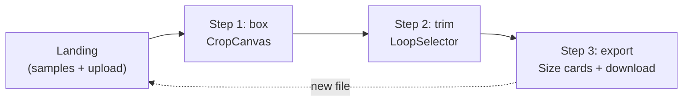

# UI Components

The app has a 3-step wizard: box → trim → export. Each step has dedicated UI components that exercise the pipeline.

Source: `src/App.tsx` (~300 lines), `src/ui/CropCanvas.tsx` (~200 lines), `src/ui/LoopSelector.tsx` (~150 lines).

## App.tsx: Three-Step Wizard

```tsx
// src/App.tsx:23
type Step = "box" | "trim" | "export";
```

The app cycles through three steps:



### State Machine

```tsx
// App state (simplified)
const [step, setStep] = useState<Step>("box");
const [prepared, setPrepared] = useState<Prepared | null>(null);
const [crop, setCrop] = useState<Rect | null>(null);
const [range, setRange] = useState<LoopRange | null>(null);
const [removeBg, setRemoveBg] = useState(false);
const [outputs, setOutputs] = useState<Output[]>([]);
const [stage, setStage] = useState<Stage | null>(null);
```

### Loading Flow

When a file is uploaded (or a sample is selected):
1. Set `loading = true` with rotating status messages
2. Call `prepareFrames(file)` (stages 1-3: decode, dedupe, loop)
3. Set `prepared` with the result
4. Set `loading = false`, advance to Step 1 (box)

### Export Flow

When the user clicks "Make GIF":
1. Call `renderGifs(prepared, range, crop, opts, onStage)`
2. Report stages: "extract" → "background" → "encode" → "done"
3. Create blob URLs for each output
4. Show download cards with file sizes

### Responsive Layout

```tsx
const isDesktop = useIsDesktop();
// window.matchMedia("(min-width: 760px)")
```

On desktop: side-by-side layout. On mobile: single column, full-width.

## CropCanvas: Interactive Crop Selection

Source: `src/ui/CropCanvas.tsx` — ~200 lines.

The user draws a rectangle on the first frame to define the crop area.

```tsx
export function CropCanvas({ frame, value, onChange }: {
  frame: Frame;
  value: Rect | null;
  onChange: (rect: Rect) => void;
}) {
```

### Interaction

1. First frame is rendered at full size, scaled to fit the container
2. User clicks and drags to draw a rectangle
3. The rectangle is constrained to the canvas bounds
4. On release, `onChange` is called with the final `Rect`

### Mouse/Touch Handling

- **Desktop**: mousedown → mousemove → mouseup
- **Mobile**: touchstart → touchmove → touchend

The component synthesizes pointer events from both input types into a unified rectangle drag interaction.

Aha: The "Next · Trim" button is disabled until the user draws a crop box. This validation prevents the user from proceeding with a full-frame crop that includes phone chrome. The pipeline's `autoTighten` option can further tighten the crop, but the user must first define the rough area.

## LoopSelector: Frame Scrubber with Loop Range

Source: `src/ui/LoopSelector.tsx` — ~150 lines.

```tsx
export interface LoopRange {
  start: number;
  end: number;
}

export function LoopSelector({ frames, suggested, value, onChange }: {
  frames: Frame[];
  suggested: { start: number; end: number };
  value: LoopRange;
  onChange: (range: LoopRange) => void;
}) {
```

### Components

The scrubber has:
1. **Frame thumbnails** — A horizontal strip of frame previews
2. **Start handle** — Draggable left edge of the loop range
3. **End handle** — Draggable right edge
4. **Preview** — The current loop plays in real-time within the selected range

### Suggested Range

The `suggested` prop comes from `detectLoop()` in the pipeline. It auto-selects the best start/end based on periodic autocorrelation. The user can drag the handles to refine it.

### Live Preview

As the user adjusts the handles, the loop preview updates in real-time. The selected frames play in a small preview window, so the user can verify the loop is clean.

Aha: The loop range is stored as `{start, end}` indices into the `frames` array, NOT as timestamps. This keeps the UI simple (frame numbers) while the pipeline converts to timestamps internally when re-decoding.

## Step Transitions

```mermaid
sequenceDiagram
    participant User
    participant App
    participant Crop as CropCanvas
    participant Loop as LoopSelector
    participant Pipe as Pipeline

    User->>App: Upload file
    App->>Pipe: prepareFrames(file)
    Pipe-->>App: Prepared {frames, suggested, compat}
    App->>Crop: show first frame, await crop
    User->>Crop: draw rectangle
    Crop->>App: onChange(Rect)
    App->>App: enable "Next · Trim"
    User->>App: click Next
    App->>Loop: show frames + suggested range
    User->>Loop: adjust start/end handles
    Loop->>App: onChange(LoopRange)
    App->>App: enable "Next · Export"
    User->>App: click Next
    App->>App: show export options (sizes, bg removal)
    User->>App: click "Make GIF"
    App->>Pipe: renderGifs(prepared, range, crop, opts)
    Pipe-->>App: ExtractResult {outputs, finalCrop, frameCount}
    App->>User: show download cards
```

## Sample Clips

The app ships with 3 sample clips:

| Source | File | Thumbnail |
|--------|------|-----------|
| TikTok | `samples/tiktok-catfight.MP4` | `tiktok-catfight.thumb.png` |
| XHS | `samples/xhs-smelly.MP4` | `xhs-smelly.thumb.png` |
| YouTube | `samples/yt-snoop.MP4` | `yt-snoop.thumb.png` |

The sample URLs are computed from `import.meta.env.BASE_URL`, which is `/` in dev and `/steal-a-gif/` on GitHub Pages.

## GitHub Buttons Integration

```tsx
// App.tsx:50-60
const GH_BUTTONS_SRC = "https://buttons.github.io/buttons.js";
```

The app dynamically loads the GitHub buttons script and renders them with a fallback SVG if the script fails to load (CSP, network error, etc.).

## Cross-References

- [Pipeline Deep Dive](01-pipeline.md) — What the UI components trigger
- [Types & Data Flow](03-types.md) — Prepared, Rect, LoopRange, ExtractResult
- [Scripts](04-scripts.md) — E2E test drives this UI flow
